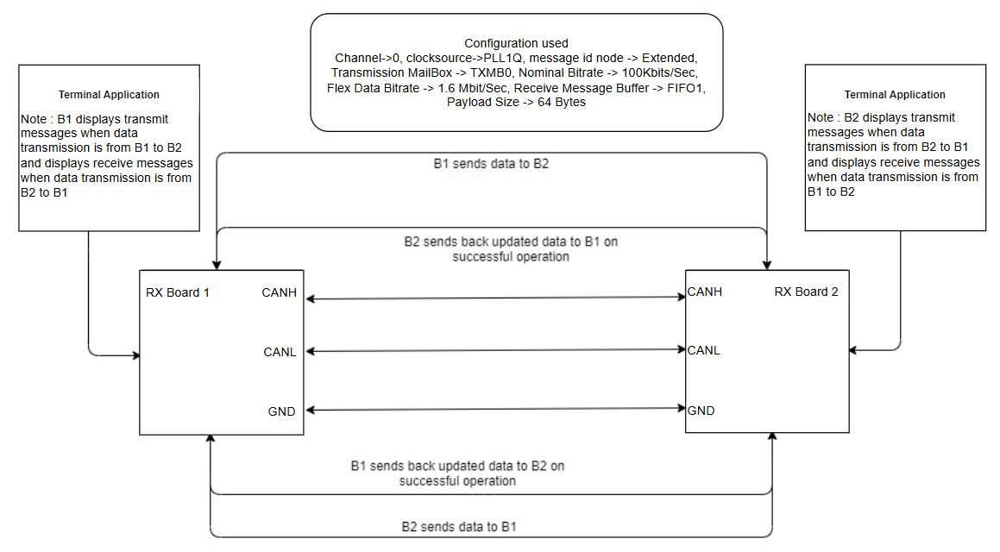
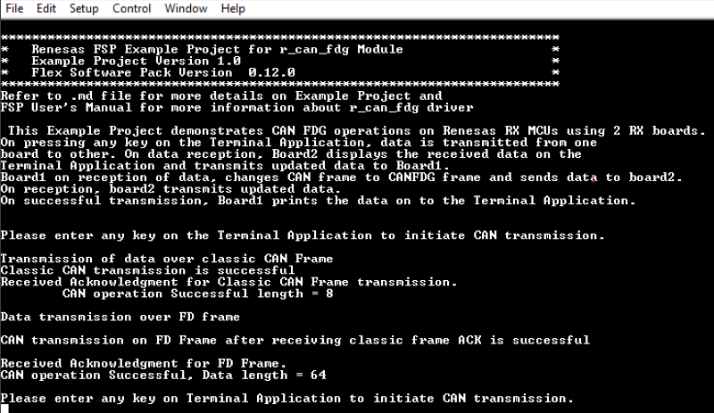
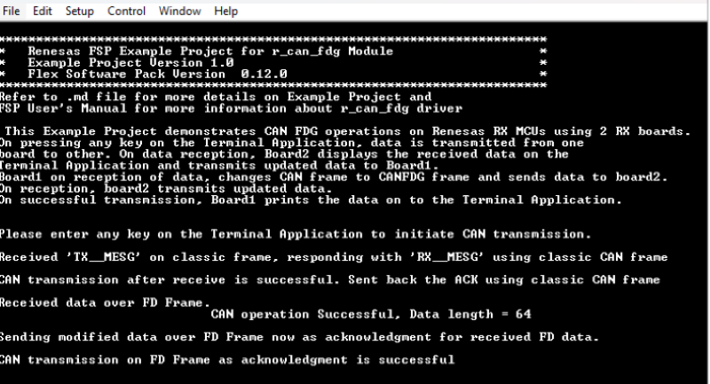

# Introduction #

This Example Project demonstrates CAN FDG operations on Renesas RX MCUs using 2 RX boards. On pressing any key on the Terminal Application (connected to any one of the 2 boards), data is transmitted from Board 1 to Board 2. On data reception, Board 2 displays the received data on the Terminal Application and Board 2 transmits updated data back to Board 1 as an acknowledgment. Board 1 on reception of data, changes mode from CAN frame to CAN-FD frame and transmits data to Board 2. On reception, Board 2 transmits updated data back to Board 1 as an acknowledgment. On successful transmission and reception, Boards prints the transmitted & received data on to the Terminal Application.

**Note**: 
- To display information, the user can select between Debug Virtual Console and the Serial Terminal (UART) with USB Serial COM. It is important to note that the user should only operate a single terminal application at a time to avoid conflicts or data inconsistencies. For instructions on how to switch between these options, please refer to the section [`Special Topics`](#special-topics)/[`Changing Terminal Application`](#changing-terminal-application).

- By default, EP information is printed to the host PC using the Serial Terminal (UART) for boards that support USB Serial COM. LED3 is turned ON to indicate the UART initialized unsuccessfully.

- RX boards that support USB Serial COM: EK-RX74M, EK-RX74N.

In this example project, the same code runs on both boards. The board from which the user initiates the transmission becomes Board 1, and the board which receives the data becomes Board 2.
## Required Resources ##
To build and run the CAN FDG example project, the following resources are needed.

### Software ###

* Renesas Flexible Software Package (FSP): Version 1.0.0.
* e2 studio: Version 2026-07.
* Renesas GCC Compiler for RX: Version 14.2.0.202607.
* Renesas CC-RX Compiler: Version v3.08.00.
* Terminal Console Application: Tera Term or a similar application.

### Hardware ###
Supported RX boards: EK-RX74M, EK-RX74N.

* 2 x Renesas RX boards.
* 4 x Type-C USB cables for programming and debugging.
* For using onboard CAN Transceivers: 3 x Jumper wires with both ends female.

### Hardware Connections  ###

* Connect the RX board USB debug port (J8) to the PC via a Type-C USB cable for EP debugging (If E2 Lite on-board is used).
* Connect the RX board USB Serial port (J27) to the PC using a Type-C USB cable to verify logs through the Terminal Application.

The boards used for testing the same type (e.g., EK-RX74M and EK-RX74M, EK-RX74N and EK-RX74N) they can be used for testing by connecting CANH, CANL, and GND lines directly.
* For EK-RX74M/EK-RX74N boards:
    * Use onboard CAN Transceiver:
	   * J36:1 of Board 1 to J36:1 of Board 2 (CANH).
      * J36:2 of Board 1 to J36:2 of Board 2 (GND).
      * J36:3 of Board 1 to J36:3 of Board 2 (CANL).

## Related Collateral References ##
The following documents can be referred to for enhancing your understanding of the operation of this example project:
- [FSP User Manual on GitHub (Reference link)](https://renesas.github.io/fsp/)
- [FSP Known Issues (Reference link)](https://github.com/renesas/fsp/issues)

# Project Notes #

## System Level Block Diagram ##

## FSP Modules Used ##
List all the various modules that are used in this example project. Refer to the FSP User Manual for further details on each module listed below.

| Module Name | Usage  | Searchable Keyword|
|-------------|-----------------------------------------------|-----------------------------------------------|
| CANFDG | CANFDG module is used to support CAN with both flexible data rate and classic frame, to support multiple channel operation and gateway function. | CAN |

## Module Configuration Notes ##
This section describes FSP Configurator properties which are important or different than those selected by default. 

**Common Configuration Properties**

|   Module Property Path and Identifier   |   Default Value   |   Used Value   |   Reason   |
| :-------------------------------------: | :---------------: | :------------: | :--------: |
|   configuration.xml > BSP > Properties > Settings > Property > RX Common > Main stack size (bytes)  |  0x400   | 0x500 |  Main stack size is required for standard library functions to be used. |
|   configuration.xml > BSP > Properties > Settings > Property > RX Common > Heap size (bytes)  |  0   | 0x400  |  Heap size is required for standard library functions to be used. |

**Note**: Following is the formula for data and nominal bitrate calculation.

**baud rate = canfd_clock_hz / ((time_segment_1 + time_segment_2 + 1) * prescaler)**

These values are chosen by taking reference of EK-RX74M/EK-RX74N hardware user manual from the **Section 46.4.1**

|   Module Property Path and Identifier   |   Default Value   |   Used Value   |   Reason   |
| :-------------------------------------: | :---------------: | :------------: | :--------: |
|   configuration.xml > Stacks > g_canfdg0 CAN FDG (r_canfdg) > Properties > Settings > Property > Common > Global Error Interrupt > Sources > DLC Check |   Not checked   |   Checked   |  Error conditions for which interrupt has to be triggered are enabled, so that the application handles them by setting error status flags in callback.  |
|   configuration.xml > Stacks > g_canfdg0 CAN FDG (r_canfdg) > Properties > Settings > Property > Common > Global Error Interrupt > Sources > Message Lost |   Not checked   |   Checked   |  Error conditions for which interrupt has to be triggered are enabled, so that the application handles them by setting error status flags in callback.  |
|   configuration.xml > Stacks > g_canfdg0 CAN FDG (r_canfdg) > Properties > Settings > Property > Common > Global Error Interrupt > Sources > FD Payload Overflow |   Not checked   |   Checked   |  Error conditions for which interrupt has to be triggered are enabled, so that the application handles them by setting error status flags in callback.  |
|   configuration.xml > Stacks > g_canfdg0 CAN FDG (r_canfdg) > Properties > Settings > Property > Common > Reception > Message Buffers > Number of buffers |   0   |   1 | Number of RX Message Buffer to be used for reception is specified here. '0' value disables the RX message buffers.  |
|   configuration.xml > Stacks > g_canfdg0 CAN FDG (r_canfdg) > Properties > Settings > Property > Common > Reception > Message Buffers > Payload Size |   8 bytes  |   64 bytes | Maximum data payload size of 64 is specified here for the RX message buffer to accommodate data length in FD frame.  |
|   configuration.xml > Stacks > g_canfdg0 CAN FDG (r_canfdg) > Properties > Settings > Property > Module g_canfdg0 CANFD Driver on r_canfdg > Bitrate > Manual > Nominal > Prescaler |   1   |   4 | Prescaler value is updated for the chosen nominal bitrate 100KBits/Sec (Refer note for formula).  |
|   configuration.xml > Stacks > g_canfdg0 CAN FDG (r_canfdg) > Properties > Settings > Property > Module g_canfdg0 CANFD Driver on r_canfdg > Bitrate > Manual > Nominal > Time Segment 1 |   29   |   74 | Time Segment value is calculated for the chosen nominal bitrate 100KBits/Sec (Refer note for formula).  |
|   configuration.xml > Stacks > g_canfdg0 CAN FDG (r_canfdg) > Properties > Settings > Property > Module g_canfdg0 CANFD Driver on r_canfdg > Bitrate > Manual > Nominal > Time segment 2 |   10  |   25 | Time Segment value is calculated for the chosen nominal bitrate 100KBits/Sec (Refer note for formula).  |
|   configuration.xml > Stacks > g_canfdg0 CAN FDG (r_canfdg) > Properties > Settings > Property > Module g_canfdg0 CANFD Driver on r_canfdg > Bitrate > Manual > Nominal > Sync Jump width |   4   |   10 | Sync Jump width value is calculated for the chosen nominal bitrate 100KBits/Sec (Refer note for formula).  |
|   configuration.xml > Stacks > g_canfdg0 CAN FDG (r_canfdg) > Properties > Settings > Property > Module g_canfdg0 CANFD Driver on r_canfdg > Bitrate > Manual > Data > Prescaler |   1   |   2 | Prescaler value is updated for the chosen nominal bitrate 1.6MBits/Sec (Refer note for formula).  |
|   configuration.xml > Stacks > g_canfdg0 CAN FDG (r_canfdg) > Properties > Settings > Property > Module g_canfdg0 CANFD Driver on r_canfdg > Bitrate > Manual > Data > Time Segment 1 |   2   |   9 | Time Segment value is calculated for the chosen nominal bitrate 1.6MBits/Sec (Refer note for formula).  |
|   configuration.xml > Stacks > g_canfdg0 CAN FDG (r_canfdg) > Properties > Settings > Property > Module g_canfdg0 CANFD Driver on r_canfdg > Bitrate > Manual > Data > Time segment 2 |   2  |   2 | Time Segment value is calculated for the chosen nominal bitrate 1.6MBits/Sec (Refer note for formula).  |
|   configuration.xml > Stacks > g_canfdg0 CAN FDG (r_canfdg) > Properties > Settings > Property > Module g_canfdg0 CANFD Driver on r_canfdg > Bitrate > Manual > Data > Sync Jump width |   1   |   2 | Sync Jump width value is calculated for the chosen nominal bitrate 1.6MBits/Sec (Refer note for formula).  |
|   configuration.xml > Stacks > g_canfdg0 CAN FDG (r_canfdg) > Properties > Settings > Property > Module g_canfdg0 CANFD Driver on r_canfdg > Bitrate > Manual > Use Manual Settings |   No   |   Yes | Use manual bitrate values so that automatic bitrate values are overwritten and user configured bitrate values are used.  |
|   configuration.xml > Stacks > g_canfdg0 CAN FDG (r_canfdg) > Properties > Settings > Property > Module g_canfdg0 CANFD Driver on r_canfdg > Transmit Interrupts |   TXMB0 disabled   |   TXMB0 Enabled | Relevant Tx buffer is enabled to trigger interrupt after transmission is complete.  |
|   configuration.xml > Stacks > g_canfdg0 CAN FDG (r_canfdg) > Properties > Settings > Property > Module g_canfdg0 CANFD Driver on r_canfdg > Channel Error Interrupts |   Not checked   |   Checked | Required channel error interrupt sources are enabled for which interrupt has to be triggered are enabled, so that the application handles them by setting error status flags in callback.  |

**Configuration Properties for using the Serial Terminal (UART)**   
|   Configure Clock Path                  |   Default Value   |   Used Value   |   Reason   |
|-----------------------------------------|-------------------|----------------|------------|
| configuration.xml > Clocks > Clocks Configuration > SCICLK Disable | SCICLK Disable | SCICLK Src: HOCO | Enable operating clock for SCI module by HOCO clock source. |

|   Configure Interrupt Event Path        |   Default Value   |   Used Value   |   Reason   |
|-----------------------------------------|-------------------|----------------|------------|
| configuration.xml > Interrupts > Interrupts Configuration > New User Event > RSCI > RSCI12 > RSCI12 RXI (Receive data full) | empty | sci_b_uart_rxi_isr | Assign the UART receive ISR (Receive data full) to the interrupt vector table. |
| configuration.xml > Interrupts > Interrupts Configuration > New User Event > RSCI > RSCI12 > RSCI12 TXI (Transmit data empty) | empty | sci_b_uart_txi_isr | Assign the UART transfer ISR (Transfer data empty) to the interrupt vector table. |
| configuration.xml > Interrupts > Interrupts Configuration > New User Event > RSCI > RSCI12 > 105-6 GROUPAL1 RSCI12 TEI (Transmit end) | empty | sci_b_uart_tei_isr | Assign the UART transfer ISR (Transfer end) to the interrupt vector table. |
| configuration.xml > Interrupts > Interrupts Configuration > New User Event > RSCI > RSCI12 > 105-7 GROUPAL1 RSCI12 ERI (Receive error) | empty | sci_b_uart_eri_isr | Assign the UART receive ISR (Receive error) to the interrupt vector table. |

## API Usage ##

The table below lists the CAN FDG API used at the application layer by this example project.

| API Name    | Usage                                                                          |
|-------------|--------------------------------------------------------------------------------|
|R_CANFD_Open| This API is used to initialize CANFD module. |
|R_CANFD_Write| This API is used to Write data to the CANFD channel. |
|R_CANFD_InfoGet| This API is used to get the status information for CAN transmission. |
|R_CANFD_Read| This API is used to  read data from a CANFD Message Buffer or FIFO. |
|R_CANFD_Close| This API is used to close the CANFD channel. |
|R_IOPORT_PinWrite| This API is used to set pin's status. |

**For using the Serial Terminal (UART)**
| API Name    | Usage                                                                          |
|-------------|--------------------------------------------------------------------------------|
| R_SCI_B_UART_Open | This API is used to configures the UART driver based on the input configurations. |
| R_SCI_B_UART_Write | This API is used to transmit user specified number of bytes from the source buffer pointer. |
| R_SCI_B_UART_Close | This API is used to abort any in progress transfers, disables interrupts, receiver, and transmitter, close lower level transfer drivers if used and remove power. |

## Verifying operation ##
1. Import the example project.

2. Generate, and build the example project.

3. Before running the example project, make sure hardware connections are completed.

4. Connect the RX MCU to the host PC via debugger. By default, EP will use E2lite debugger.
5. Open a terminal application (e.g., Tera Term or Debug Virtual Console) on the host PC and connect to the RX board’s USB Serial port.  
   * Note: For using the Serial Terminal application:
        * To echo back typed content in Tera Term, go to [Setup] -> [Terminal...] and check [Local echo].
        * The configuration parameters of the serial port are:
            - COM port: Provided by the USB Serial COM.
            - Baud rate: 115200 bps
            - Data length: 8 bits
            - Parity: None
            - Stop bit: 1 bit
            - Flow control: None 

Note: Since the same project applies to both boards, repeat these steps on Board 2 as well. 
* On EK-RX74M, EK-RX74N: After flashing Board 1, set SW6.1 on that board to ON to enable on-board debugging, press the Reset button, and then continue flashing Board 2. 

### Below images showcases the output log on the Terminal Application (Tera Term):

Data Transmission from B1 to B2.

Board 1 Terminal Application log:

Board 2 Terminal Application log:

## Special Topics ##
1. Ensure the configured baud rate of 2 Boards are same.
2. The user is expected to enter data not exceeding 15 bytes in size.

### LED Behavior ###
   * LED1 will be turned ON when CAN transmission operation is in progress.
   * LED2 will be turned ON when CAN transmission operation is successful.
   * LED3 will be turned ON when an error occurs.

### Debugger Setting ###

* To use E2 Lite on-board or E2 Emulator Lite, please follow the instructions below:

1. **Common step**: Click [**Run**] → [**Debug Configurations…**] to open the “**Debug Configurations**” window.  
  

2. **Select file application**  
  a. **Used for projects built with GCC**: --> Select file **.elf**.  
    
  b. **Used for projects built with CCRX**: --> Select file **.x**.  
  

3. **Setting debugger configurations**  
  a. **Used for E2 Lite on-board**.    
    
  b. **Used for external E2 Emulator Lite**.  
    

  **Note:** Connect the RX board debugger port (J9) to the host PC via E2 Emulator Lite (with USB cable and 20-20 pin cable).

### Adding lowsrc Folder

Before changing terminal application settings, you need to add the `lowsrc` folder from another Example Project:

1. **Locate the lowsrc folder:**
   
   - Navigate to Example Project `sci_uart` or `usb_pcdc_with_freertos`  (`example_projects/<board>/sci_uart/e2studio/gccrx_sci_uart_<board>_ep/src`)
   - Find the `lowsrc` folder containing low-level source files.

2. **Copy `lowsrc` folder to this Example Project:**
   
   - Copy the entire `lowsrc` folder.
   - Paste it into this your target Example Project directory: `example_projects/ek_rx74m/<EP>/e2studio/`.

3. **Add lowsrc to e2studio project:**
   
   - In e2studio, right-click on the project in Project Explorer.
   - Select **Refresh** (or press F5) to detect the new folder.

4. **Verify the folder is included:**
   
   - Expand the project tree in Project Explorer.
   - Confirm that `lowsrc` folder and its contents are visible.
   - The folder should be included in the build path with source files ready to compile.

5. **Changing the terminal Application to use the Debug Virtual Console:**
   
   - For instructions on how to switch between these options, please refer to the section [`Special Topics`](#special-topics)/[`Changing Terminal Application`](#changing-terminal-application).

6. **Re-build the project:**
   
   - In e2studio, right-click on the project and select **Build Project**.

**Note:** To use Debug Virtual Console, the `lowsrc` folder must be added to the project, as it contains the source files required for Debug Virtual Console operation.

### Changing Terminal Application ###
By default, the EP supports Serial Terminal for RX boards that support USB Serial COM   
**For use CCRX Compiler:**
* Define USE_VIRTUAL_COM=1 macro in Project Properties -> C/C++ Build -> Settings -> Tool Settings -> Compiler -> Source -> Macro definition (-define)

To use Debug Virtual Console, please follow the instructions below:
* Define USE_VIRTUAL_COM=0 macro in Project Properties -> C/C++ Build -> Settings -> Tool Settings -> Compiler -> Source -> Macro definition (-define)
* Define BSP_CFG_IO_LIB_ENABLE=1 macro in Project Properties -> C/C++ Build -> Settings -> Tool Settings -> Compiler -> Source -> Macro definition (-define)

**For use GCCRX Compiler:**  
* Define USE_VIRTUAL_COM=1 macro in Project Properties -> C/C++ Build -> Settings -> Tool Settings -> Compiler -> Includes -> Macro Defines (-D)
  
To use Debug Virtual Console, please follow the instructions below:
* Define USE_VIRTUAL_COM=0 macro in Project Properties -> C/C++ Build -> Settings -> Tool Settings -> Compiler -> Includes -> Macro Defines (-D)
  

  