# Introduction
This example demonstrates the typical usage of the CMTW HAL module APIs.  
Users can input values via the terminal console menu to select different CMTW-supported modes (One-Shot, Periodic) and input types (Period (ms) or Frequency (Hz)).  

The example project operates in:  
**Demo 1**: One-Shot mode - Compare Match: 
   * LED1 turns on for a user-defined period or frequency, then turns off automatically.  

**Demo 2**: Periodic mode - Compare Match: 
   * LED2 blinks continuously based on the user-defined period or frequency.  

**Demo 3**: Periodic mode - Input Capture:  
   * GPT1 generates a waveform on the GTIOC1B pin with user-defined period or frequency.  
   * CMTW0 captures the waveform on TIC1 pin, measures the actual pulse width, and toggles LED3 on each capture event.  

**Demo 4**: Periodic mode - Output Compare:  
   * CMTW0 generates a waveform on TOC1 pin with user-defined period/frequency.  
   * GPT1 captures the waveform on GTIOC1A pin, measures the actual pulse width, and toggles LED3 on each capture event.  

**Note**:
- In Periodic mode with waveform generation (Demo 3, Demo 4): **the duty cycle is 50%.**  
**Example**: If the period is set to 100 ms, the ***pulse width*** becomes 50 ms (high for 50 ms, low for 50 ms).

- To display information, the user can select between Debug Virtual Console and the Serial Terminal (UART) with USB Serial COM. It is important to note that the user should only operate a single terminal application at a time to avoid conflicts or data inconsistencies. For instructions on how to switch between these options, please refer to the section [`Special Topics`](#special-topics)/[`Changing Terminal Application`](#changing-terminal-application).

- By default, EP information is printed to the host PC using the Serial Terminal (UART) for boards that support USB Serial COM. LED3 is turned ON to indicate the UART initialized unsuccessfully.

- RX boards that support USB Serial COM: EK-RX74M, EK-RX74N. 

## Required Resources
To build and run the CMTW example project, the following resources are required.

### Software
* Renesas Flexible Software Package (FSP): Version 1.0.0.
* e2 studio: Version 2026-07.
* Renesas GCC Compiler for RX: Version 14.2.0.202607.
* Renesas CC-RX Compiler: Version v3.08.00.
* Terminal Console Application: Tera Term or a similar application.

### Hardware
* 1 x Renesas RX board.
* 2 x Type-C USB cables for programming and debugging.
* 2 x Jumper wires.

## Hardware Connections
* Connect the RX board USB debug port (J8) to the PC via a Type-C USB cable for EP debugging.
* Pin Connections:
   * For Board EK-RX74M:
      * Demo 3: Pin GPT1 output - GTIOC1B P205 (J1:20) <---> Pin CMTW0 input - TIC1 P208 (J1:23) 
      * Demo 4: Pin GPT1 input - GTIOC1A P204 (J1:19) <---> Pin CMTW0 output - TOC1 P209 (J1:24)

## Related Collateral References 
The following documents can be referred to for enhancing your understanding of the operation of this example project:
- [FSP User Manual on GitHub (Reference link)](https://renesas.github.io/fsp/)
- [FSP Known Issues (Reference link)](https://github.com/renesas/fsp/issues)

# Project Notes 

## System Level Block Diagram 
High-level block diagram of the system is as shown below:
  
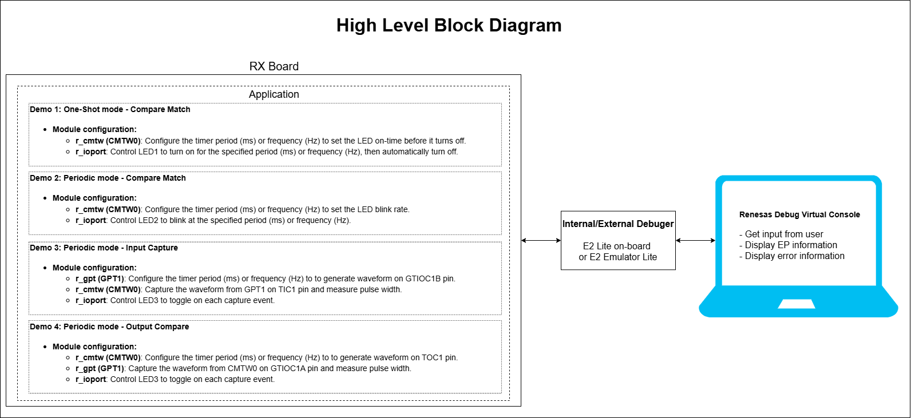

## FSP Modules Used 
List all the various modules that are used in this example project. Refer to the FSP User Manual for further details on each module listed below.

| Module Name | Usage | Searchable Keyword  |
|-------------|-----------------------------------------------|-----------------------------------------------|
|CMTW | The Compare Match Timer W (CMTW) module can be used to count events, measure external input signals, generate a periodic interrupt, and output a periodic signal to a TOC pin. This module supports two units (unit 0 and unit 1) with one channel of 32-bit. | r_cmtw|
|GPT | The GPT module can be used to count events, measure external input signals, generate a periodic interrupt, or output a periodic or PWM signal to a GTIOC pin. | r_gpt|

## Module Configuration Notes 
This section describes FSP Configurator properties which are important or different than those selected by default. 

**Common Configuration Properties**

|   Module Property Path and Identifier   |   Default Value   |   Used Value   |   Reason   |
| :-------------------------------------: | :---------------: | :------------: | :--------: |
|   configuration.xml > BSP > Properties > Settings > Property > RX Common > Heap size (bytes)  |  0   | 0x2000  |  Heap size is required for standard library functions to be used. |

### Configuration for Demo 1

**Configuration Properties for using CMTW (g_timer_cmtw_one_shot)**

|   Module Property Path and Identifier   |   Default Value   |   Used Value   |   Reason   |
|-----------------------------------------|-------------------|----------------|------------|
| configuration.xml > Stack > g_timer_cmtw_one_shot Timer Driver on r_cmtw > Properties > Settings > Property > Module g_timer_cmtw_one_shot Timer Driver on r_cmtw > General > Name | g_timer0 | g_timer_cmtw_one_shot | Module name. |
| configuration.xml > Stack > g_timer_cmtw_one_shot Timer Driver on r_cmtw > Properties > Settings > Property > Module g_timer_cmtw_one_shot Timer Driver on r_cmtw > General > Channel | 0 | 0 | Specify the hardware channel. |
| configuration.xml > Stack > g_timer_cmtw_one_shot Timer Driver on r_cmtw > Properties > Settings > Property > Module g_timer_cmtw_one_shot Timer Driver on r_cmtw > General > Mode | Periodic | One-Shot | Mode selection. Note: One-shot mode is implemented in software. ISR's must be enabled for one shot even if callback is unused. |
| configuration.xml > Stack > g_timer_cmtw_one_shot Timer Driver on r_cmtw > Properties > Settings > Property > Module g_timer_cmtw_one_shot Timer Driver on r_cmtw > General > Period | 0x10000 | 1 | Specify the timer period based on the selected unit. |
| configuration.xml > Stack > g_timer_cmtw_one_shot Timer Driver on r_cmtw > Properties > Settings > Property > Module g_timer_cmtw_one_shot Timer Driver on r_cmtw > General > Period Unit | Raw Counts | Milliseconds | Unit of the period specified above. |
| configuration.xml > Stack > g_timer_cmtw_one_shot Timer Driver on r_cmtw > Properties > Settings > Property > Module g_timer_cmtw_one_shot Timer Driver on r_cmtw > General > Counter Size | 32-bit | 32-bit | Size of the timer counter. |
| configuration.xml > Stack > g_timer_cmtw_one_shot Timer Driver on r_cmtw > Properties > Settings > Property > Module g_timer_cmtw_one_shot Timer Driver on r_cmtw > General > Counter Clear Source | Compare Match | Compare Match | Select the Counter Clear Source. |
| configuration.xml > Stack > g_timer_cmtw_one_shot Timer Driver on r_cmtw > Properties > Settings > Property > Module g_timer_cmtw_one_shot Timer Driver on r_cmtw > Interrupts > Callback | NULL | one_shot_timer_callback | A user callback function. If this callback function is provided, it is called from the interrupt service routine (ISR) each time the timer period elapses. |
| configuration.xml > Stack > g_timer_cmtw_one_shot Timer Driver on r_cmtw > Properties > Settings > Property > Module g_timer_cmtw_one_shot Timer Driver on r_cmtw > Interrupts > Compare Match Interrupt Priority | Disabled | Priority 10 | Select the compare match interrupt priority. |

### Configuration for Demo 2

**Configuration Properties for using CMTW (g_timer_cmtw_periodic)**

|   Module Property Path and Identifier   |   Default Value   |   Used Value   |   Reason   |
|-----------------------------------------|-------------------|----------------|------------|
| configuration.xml > Stack > g_timer_cmtw_periodic Timer Driver on r_cmtw > Properties > Settings > Property > Module g_timer_cmtw_periodic Timer Driver on r_cmtw > General > Name | g_timer0 | g_timer_cmtw_periodic | Module name. |
| configuration.xml > Stack > g_timer_cmtw_periodic Timer Driver on r_cmtw > Properties > Settings > Property > Module g_timer_cmtw_periodic Timer Driver on r_cmtw > General > Channel | 0 | 1 | Specify the hardware channel. |
| configuration.xml > Stack > g_timer_cmtw_periodic Timer Driver on r_cmtw > Properties > Settings > Property > Module g_timer_cmtw_periodic Timer Driver on r_cmtw > General > Mode | Periodic | Periodic | Mode selection. Note: One-shot mode is implemented in software. ISR's must be enabled for one shot even if callback is unused. |
| configuration.xml > Stack > g_timer_cmtw_periodic Timer Driver on r_cmtw > Properties > Settings > Property > Module g_timer_cmtw_periodic Timer Driver on r_cmtw > General > Period | 0x10000 | 1 | Specify the timer period based on the selected unit. |
| configuration.xml > Stack > g_timer_cmtw_periodic Timer Driver on r_cmtw > Properties > Settings > Property > Module g_timer_cmtw_periodic Timer Driver on r_cmtw > General > Period Unit | Raw Counts | Milliseconds | Unit of the period specified above. |
| configuration.xml > Stack > g_timer_cmtw_periodic Timer Driver on r_cmtw > Properties > Settings > Property > Module g_timer_cmtw_periodic Timer Driver on r_cmtw > General > Counter Size | 32-bit | 32-bit | Size of the timer counter. |
| configuration.xml > Stack > g_timer_cmtw_periodic Timer Driver on r_cmtw > Properties > Settings > Property > Module g_timer_cmtw_periodic Timer Driver on r_cmtw > General > Counter Clear Source | Compare Match | Compare Match | Select the Counter Clear Source. |
| configuration.xml > Stack > g_timer_cmtw_periodic Timer Driver on r_cmtw > Properties > Settings > Property > Module g_timer_cmtw_periodic Timer Driver on r_cmtw > Interrupts > Callback | NULL | periodic_timer_callback | A user callback function. If this callback function is provided, it is called from the interrupt service routine (ISR) each time the timer period elapses. |
| configuration.xml > Stack > g_timer_cmtw_periodic Timer Driver on r_cmtw > Properties > Settings > Property > Module g_timer_cmtw_periodic Timer Driver on r_cmtw > Interrupts > Compare Match Interrupt Priority | Disabled | Priority 10 | Select the compare match interrupt priority. |

### Configuration for Demo 3

**Configuration Properties for using CMTW (g_timer_cmtw_periodic_input_capture)** - ***Capture device***

|   Module Property Path and Identifier   |   Default Value   |   Used Value   |   Reason   |
|-----------------------------------------|-------------------|----------------|------------|
| configuration.xml > Stack > g_timer_cmtw_periodic_input_capture Timer Driver on r_cmtw > Properties > Settings > Property > Module g_timer_cmtw_periodic_input_capture Timer Driver on r_cmtw > General > Name | g_timer0 | g_timer_cmtw_periodic_input_capture | Module name. |
| configuration.xml > Stack > g_timer_cmtw_periodic_input_capture Timer Driver on r_cmtw > Properties > Settings > Property > Module g_timer_cmtw_periodic_input_capture Timer Driver on r_cmtw > General > Channel | 0 | 0 | Specify the hardware channel. |
| configuration.xml > Stack > g_timer_cmtw_periodic_input_capture Timer Driver on r_cmtw > Properties > Settings > Property > Module g_timer_cmtw_periodic_input_capture Timer Driver on r_cmtw > General > Mode | Periodic | Periodic | Mode selection. Note: One-shot mode is implemented in software. ISR's must be enabled for one shot even if callback is unused. |
| configuration.xml > Stack > g_timer_cmtw_periodic_input_capture Timer Driver on r_cmtw > Properties > Settings > Property > Module g_timer_cmtw_periodic_input_capture Timer Driver on r_cmtw > General > Period | 0x10000 | 1 | Specify the timer period based on the selected unit. |
| configuration.xml > Stack > g_timer_cmtw_periodic_input_capture Timer Driver on r_cmtw > Properties > Settings > Property > Module g_timer_cmtw_periodic_input_capture Timer Driver on r_cmtw > General > Period Unit | Raw Counts | Milliseconds | Unit of the period specified above. |
| configuration.xml > Stack > g_timer_cmtw_periodic_input_capture Timer Driver on r_cmtw > Properties > Settings > Property > Module g_timer_cmtw_periodic_input_capture Timer Driver on r_cmtw > General > Counter Size | 32-bit | 32-bit | Size of the timer counter. |
| configuration.xml > Stack > g_timer_cmtw_periodic_input_capture Timer Driver on r_cmtw > Properties > Settings > Property > Module g_timer_cmtw_periodic_input_capture Timer Driver on r_cmtw > General > Counter Clear Source | Compare Match | Input Capture1 | Select the Counter Clear Source. |
| configuration.xml > Stack > g_timer_cmtw_periodic_input_capture Timer Driver on r_cmtw > Properties > Settings > Property > Module g_timer_cmtw_periodic_input_capture Timer Driver on r_cmtw > Output > TOC0 Output | Disabled | Disabled | Configure TOC0 output. |
| configuration.xml > Stack > g_timer_cmtw_periodic_input_capture Timer Driver on r_cmtw > Properties > Settings > Property > Module g_timer_cmtw_periodic_input_capture Timer Driver on r_cmtw > Output > TOC1 Output | Disabled | Disabled | Configure TOC1 output. |
| configuration.xml > Stack > g_timer_cmtw_periodic_input_capture Timer Driver on r_cmtw > Properties > Settings > Property > Module g_timer_cmtw_periodic_input_capture Timer Driver on r_cmtw > Output > TOC0 Output Enable | Output Disable | Output Disable | Configure TOC0 output enable. |
| configuration.xml > Stack > g_timer_cmtw_periodic_input_capture Timer Driver on r_cmtw > Properties > Settings > Property > Module g_timer_cmtw_periodic_input_capture Timer Driver on r_cmtw > Output > TOC1 Output Enable | Output Disable | Output Disable | Configure TOC1 output enable. |
| configuration.xml > Stack > g_timer_cmtw_periodic_input_capture Timer Driver on r_cmtw > Properties > Settings > Property > Module g_timer_cmtw_periodic_input_capture Timer Driver on r_cmtw > Input > TIC0 Capture Trigger | Rising Edge | Rising Edge | Select the trigger edge. |
| configuration.xml > Stack > g_timer_cmtw_periodic_input_capture Timer Driver on r_cmtw > Properties > Settings > Property > Module g_timer_cmtw_periodic_input_capture Timer Driver on r_cmtw > Input > TIC1 Capture Trigger | Rising Edge | Both Edge | Select the trigger edge. |
| configuration.xml > Stack > g_timer_cmtw_periodic_input_capture Timer Driver on r_cmtw > Properties > Settings > Property > Module g_timer_cmtw_periodic_input_capture Timer Driver on r_cmtw > Input > TIC0 Input Enable | Input Disable | Input Disable | Configure TIC0 output enable. |
| configuration.xml > Stack > g_timer_cmtw_periodic_input_capture Timer Driver on r_cmtw > Properties > Settings > Property > Module g_timer_cmtw_periodic_input_capture Timer Driver on r_cmtw > Input > TIC1 Input Enable | Input Disable | Input Enable | Configure TIC1 output enable. |
| configuration.xml > Stack > g_timer_cmtw_periodic_input_capture Timer Driver on r_cmtw > Properties > Settings > Property > Module g_timer_cmtw_periodic_input_capture Timer Driver on r_cmtw > Interrupts > Callback | NULL | periodic_timer_callback | A user callback function. If this callback function is provided, it is called from the interrupt service routine (ISR) each time the timer period elapses. |
| configuration.xml > Stack > g_timer_cmtw_periodic_input_capture Timer Driver on r_cmtw > Properties > Settings > Property > Module g_timer_cmtw_periodic_input_capture Timer Driver on r_cmtw > Interrupts > Compare Match Interrupt Priority | Disabled | Disabled | Select the compare match interrupt priority. |
| configuration.xml > Stack > g_timer_cmtw_periodic_input_capture Timer Driver on r_cmtw > Properties > Settings > Property > Module g_timer_cmtw_periodic_input_capture Timer Driver on r_cmtw > Interrupts > Input Capture 0 Interrupt Priority | Disabled | Disabled | Select the input capture 0 interrupt priority. |
| configuration.xml > Stack > g_timer_cmtw_periodic_input_capture Timer Driver on r_cmtw > Properties > Settings > Property > Module g_timer_cmtw_periodic_input_capture Timer Driver on r_cmtw > Interrupts > Input Capture 1 Interrupt Priority | Disabled | Priority 10 | Select the input capture 1 interrupt priority. |
| configuration.xml > Stack > g_timer_cmtw_periodic_input_capture Timer Driver on r_cmtw > Properties > Settings > Property > Module g_timer_cmtw_periodic_input_capture Timer Driver on r_cmtw > Interrupts > Output Compare 0 Interrupt Priority | Disabled | Disabled | Select the output compare 0 interrupt priority. |
| configuration.xml > Stack > g_timer_cmtw_periodic_input_capture Timer Driver on r_cmtw > Properties > Settings > Property > Module g_timer_cmtw_periodic_input_capture Timer Driver on r_cmtw > Interrupts > Output Compare 1 Interrupt Priority | Disabled | Disabled | Select the output compare 1 interrupt priority. |
| configuration.xml > Stack > g_timer_cmtw_periodic_input_capture Timer Driver on r_cmtw > Properties > Settings > Property > Module g_timer_cmtw_periodic_input_capture Timer Driver on r_cmtw > Pins > CMTW0_TIC0 | None | None | Select pin input. |
| configuration.xml > Stack > g_timer_cmtw_periodic_input_capture Timer Driver on r_cmtw > Properties > Settings > Property > Module g_timer_cmtw_periodic_input_capture Timer Driver on r_cmtw > Pins > CMTW0_TIC1 | None | P208 | Select pin input. |
| configuration.xml > Stack > g_timer_cmtw_periodic_input_capture Timer Driver on r_cmtw > Properties > Settings > Property > Module g_timer_cmtw_periodic_input_capture Timer Driver on r_cmtw > Pins > CMTW0_TOC0 | None | None | Select pin output. |
| configuration.xml > Stack > g_timer_cmtw_periodic_input_capture Timer Driver on r_cmtw > Properties > Settings > Property > Module g_timer_cmtw_periodic_input_capture Timer Driver on r_cmtw > Pins > CMTW0_TOC1 | None | None | Select pin output. |

**Configuration Properties for using GPT (g_timer_gpt_output_generate)** - ***Output device***

|   Module Property Path and Identifier   |   Default Value   |   Used Value   |   Reason   |
|-----------------------------------------|-------------------|----------------|------------|
| configuration.xml > Stack > g_timer_gpt_output_generate Timer Driver on r_gpt > Properties > Settings > Property > Common > Pin Output Support | Disabled | Enabled | Enables or disables support for outputting PWM waveforms on GTIOCx pins. |
| configuration.xml > Stack > g_timer_gpt_output_generate Timer Driver on r_gpt > Properties > Settings > Property > Module g_timer_gpt_output_generate Timer Driver on r_gpt > General > Name | g_timer0 | g_timer_gpt_output_generate | Module name. |
| configuration.xml > Stack > g_timer_gpt_output_generate Timer Driver on r_gpt > Properties > Settings > Property > Module g_timer_gpt_output_generate Timer Driver on r_gpt > General > Channel | 0 | 1 | Specify the hardware channel. |
| configuration.xml > Stack > g_timer_gpt_output_generate Timer Driver on r_gpt > Properties > Settings > Property > Module g_timer_gpt_output_generate Timer Driver on r_gpt > General > Mode | Periodic | Periodic | Mode selection. |
| configuration.xml > Stack > g_timer_gpt_output_generate Timer Driver on r_gpt > Properties > Settings > Property > Module g_timer_gpt_output_generate Timer Driver on r_gpt > General > Period | 0x10000 | 500 | Specify the timer period. |
| configuration.xml > Stack > g_timer_gpt_output_generate Timer Driver on r_gpt > Properties > Settings > Property > Module g_timer_gpt_output_generate Timer Driver on r_gpt > General > Period Unit | Raw Counts | Milliseconds | Unit of the period specified above. |
| configuration.xml > Stack > g_timer_gpt_output_generate Timer Driver on r_gpt > Properties > Settings > Property > Module g_timer_gpt_output_generate Timer Driver on r_gpt > Output > GTIOCA Output Enabled | False | False | Enable the output of GTIOCA on a pin. |
| configuration.xml > Stack > g_timer_gpt_output_generate Timer Driver on r_gpt > Properties > Settings > Property > Module g_timer_gpt_output_generate Timer Driver on r_gpt > Output > GTIOCA Stop Level | Pin Level Low | Pin Level Low | Select the behavior of the output pin when the timer is stopped. |
| configuration.xml > Stack > g_timer_gpt_output_generate Timer Driver on r_gpt > Properties > Settings > Property > Module g_timer_gpt_output_generate Timer Driver on r_gpt > Output > GTIOCB Output Enabled | False | True | Enable the output of GTIOCB on a pin. |
| configuration.xml > Stack > g_timer_gpt_output_generate Timer Driver on r_gpt > Properties > Settings > Property > Module g_timer_gpt_output_generate Timer Driver on r_gpt > Output > GTIOCB Stop Level | Pin Level Low | Pin Level Low | Select the behavior of the output pin when the timer is stopped. |
| configuration.xml > Stack > g_timer_gpt_output_generate Timer Driver on r_gpt > Properties > Settings > Property > Module g_timer_gpt_output_generate Timer Driver on r_gpt > Pins > GTIOC1A | None | None | Select pin output. |
| configuration.xml > Stack > g_timer_gpt_output_generate Timer Driver on r_gpt > Properties > Settings > Property > Module g_timer_gpt_output_generate Timer Driver on r_gpt > Pins > GTIOC1B | None | P205 | Select pin output. |

### Configuration for Demo 4 

**Configuration Properties for using CMTW (g_timer_cmtw_output_generate)** - ***Output device***

|   Module Property Path and Identifier   |   Default Value   |   Used Value   |   Reason   |
|-----------------------------------------|-------------------|----------------|------------|
| configuration.xml > Stack > g_timer_cmtw_output_generate Timer Driver on r_cmtw > Properties > Settings > Property > Module g_timer_cmtw_output_generate Timer Driver on r_cmtw > General > Name | g_timer0 | g_timer_cmtw_output_generate | Module name. |
| configuration.xml > Stack > g_timer_cmtw_output_generate Timer Driver on r_cmtw > Properties > Settings > Property > Module g_timer_cmtw_output_generate Timer Driver on r_cmtw > General > Channel | 0 | 0 | Specify the hardware channel. |
| configuration.xml > Stack > g_timer_cmtw_output_generate Timer Driver on r_cmtw > Properties > Settings > Property > Module g_timer_cmtw_output_generate Timer Driver on r_cmtw > General > Mode | Periodic | Periodic | Mode selection. Note: One-shot mode is implemented in software. ISR's must be enabled for one shot even if callback is unused. |
| configuration.xml > Stack > g_timer_cmtw_output_generate Timer Driver on r_cmtw > Properties > Settings > Property > Module g_timer_cmtw_output_generate Timer Driver on r_cmtw > General > Period | 0x10000 | 500 | Specify the timer period based on the selected unit. |
| configuration.xml > Stack > g_timer_cmtw_output_generate Timer Driver on r_cmtw > Properties > Settings > Property > Module g_timer_cmtw_output_generate Timer Driver on r_cmtw > General > Period Unit | Raw Counts | Milliseconds | Unit of the period specified above. |
| configuration.xml > Stack > g_timer_cmtw_output_generate Timer Driver on r_cmtw > Properties > Settings > Property > Module g_timer_cmtw_output_generate Timer Driver on r_cmtw > General > Counter Size | 32-bit | 32-bit | Size of the timer counter. |
| configuration.xml > Stack > g_timer_cmtw_output_generate Timer Driver on r_cmtw > Properties > Settings > Property > Module g_timer_cmtw_output_generate Timer Driver on r_cmtw > General > Counter Clear Source | Compare Match | Output Compare1 | Select the Counter Clear Source. |
| configuration.xml > Stack > g_timer_cmtw_output_generate Timer Driver on r_cmtw > Properties > Settings > Property > Module g_timer_cmtw_output_generate Timer Driver on r_cmtw > Output > TOC0 Output | Disabled | Disabled | Configure TOC0 output. |
| configuration.xml > Stack > g_timer_cmtw_output_generate Timer Driver on r_cmtw > Properties > Settings > Property > Module g_timer_cmtw_output_generate Timer Driver on r_cmtw > Output > TOC1 Output | Disabled | Start Level Low and Toggle Output | Configure TOC1 output. |
| configuration.xml > Stack > g_timer_cmtw_output_generate Timer Driver on r_cmtw > Properties > Settings > Property > Module g_timer_cmtw_output_generate Timer Driver on r_cmtw > Output > TOC0 Output Enable | Output Disable | Output Disable | Configure TOC0 output enable. |
| configuration.xml > Stack > g_timer_cmtw_output_generate Timer Driver on r_cmtw > Properties > Settings > Property > Module g_timer_cmtw_output_generate Timer Driver on r_cmtw > Output > TOC1 Output Enable | Output Disable | Output Enable | Configure TOC1 output enable. |
| configuration.xml > Stack > g_timer_cmtw_output_generate Timer Driver on r_cmtw > Properties > Settings > Property > Module g_timer_cmtw_output_generate Timer Driver on r_cmtw > Input > TIC0 Capture Trigger | Rising Edge | Rising Edge | Select the trigger edge. |
| configuration.xml > Stack > g_timer_cmtw_output_generate Timer Driver on r_cmtw > Properties > Settings > Property > Module g_timer_cmtw_output_generate Timer Driver on r_cmtw > Input > TIC1 Capture Trigger | Rising Edge | Rising Edge | Select the trigger edge. |
| configuration.xml > Stack > g_timer_cmtw_output_generate Timer Driver on r_cmtw > Properties > Settings > Property > Module g_timer_cmtw_output_generate Timer Driver on r_cmtw > Input > TIC0 Input Enable | Input Disable | Input Disable | Configure TIC0 output enable. |
| configuration.xml > Stack > g_timer_cmtw_output_generate Timer Driver on r_cmtw > Properties > Settings > Property > Module g_timer_cmtw_output_generate Timer Driver on r_cmtw > Input > TIC1 Input Enable | Input Disable | Input Disable | Configure TIC1 output enable. |
| configuration.xml > Stack > g_timer_cmtw_output_generate Timer Driver on r_cmtw > Properties > Settings > Property > Module g_timer_cmtw_output_generate Timer Driver on r_cmtw > Interrupts > Callback | NULL | NULL | A user callback function. If this callback function is provided, it is called from the interrupt service routine (ISR) each time the timer period elapses. |
| configuration.xml > Stack > g_timer_cmtw_output_generate Timer Driver on r_cmtw > Properties > Settings > Property > Module g_timer_cmtw_output_generate Timer Driver on r_cmtw > Interrupts > Compare Match Interrupt Priority | Disabled | Disabled | Select the compare match interrupt priority. |
| configuration.xml > Stack > g_timer_cmtw_output_generate Timer Driver on r_cmtw > Properties > Settings > Property > Module g_timer_cmtw_output_generate Timer Driver on r_cmtw > Interrupts > Input Capture 0 Interrupt Priority | Disabled | Disabled | Select the input capture 0 interrupt priority. |
| configuration.xml > Stack > g_timer_cmtw_output_generate Timer Driver on r_cmtw > Properties > Settings > Property > Module g_timer_cmtw_output_generate Timer Driver on r_cmtw > Interrupts > Input Capture 1 Interrupt Priority | Disabled | Disabled | Select the input capture 1 interrupt priority. |
| configuration.xml > Stack > g_timer_cmtw_output_generate Timer Driver on r_cmtw > Properties > Settings > Property > Module g_timer_cmtw_output_generate Timer Driver on r_cmtw > Interrupts > Output Compare 0 Interrupt Priority | Disabled | Disabled | Select the output compare 0 interrupt priority. |
| configuration.xml > Stack > g_timer_cmtw_output_generate Timer Driver on r_cmtw > Properties > Settings > Property > Module g_timer_cmtw_output_generate Timer Driver on r_cmtw > Interrupts > Output Compare 1 Interrupt Priority | Disabled | Disabled | Select the output compare 1 interrupt priority. |
| configuration.xml > Stack > g_timer_cmtw_output_generate Timer Driver on r_cmtw > Properties > Settings > Property > Module g_timer_cmtw_output_generate Timer Driver on r_cmtw > Pins > CMTW0_TIC0 | None | None | Select pin input. |
| configuration.xml > Stack > g_timer_cmtw_output_generate Timer Driver on r_cmtw > Properties > Settings > Property > Module g_timer_cmtw_output_generate Timer Driver on r_cmtw > Pins > CMTW0_TIC1 | None | None | Select pin input. |
| configuration.xml > Stack > g_timer_cmtw_output_generate Timer Driver on r_cmtw > Properties > Settings > Property > Module g_timer_cmtw_output_generate Timer Driver on r_cmtw > Pins > CMTW0_TOC0 | None | None | Select pin output. |
| configuration.xml > Stack > g_timer_cmtw_output_generate Timer Driver on r_cmtw > Properties > Settings > Property > Module g_timer_cmtw_output_generate Timer Driver on r_cmtw > Pins > CMTW0_TOC1 | None | P209 | Select pin output. |

**Configuration Properties for using GPT (g_timer_gpt_periodic_input_capture)** - ***Capture device***

|   Module Property Path and Identifier   |   Default Value   |   Used Value   |   Reason   |
|-----------------------------------------|-------------------|----------------|------------|
| configuration.xml > Stack > g_timer_gpt_periodic_input_capture Timer Driver on r_gpt > Properties > Settings > Property > Common > Pin Output Support | Disabled | Enabled | Enables or disables support for outputting PWM waveforms on GTIOCx pins. |
| configuration.xml > Stack > g_timer_gpt_periodic_input_capture Timer Driver on r_gpt > Properties > Settings > Property > Module g_timer_gpt_periodic_input_capture Timer Driver on r_gpt > General > Name | g_timer0 | g_timer_gpt_periodic_input_capture | Module name. |
| configuration.xml > Stack > g_timer_gpt_periodic_input_capture Timer Driver on r_gpt > Properties > Settings > Property > Module g_timer_gpt_periodic_input_capture Timer Driver on r_gpt > General > Channel | 0 | 1 | Specify the hardware channel. |
| configuration.xml > Stack > g_timer_gpt_periodic_input_capture Timer Driver on r_gpt > Properties > Settings > Property > Module g_timer_gpt_periodic_input_capture Timer Driver on r_gpt > General > Mode | Periodic | Periodic | Mode selection. |
| configuration.xml > Stack > g_timer_gpt_periodic_input_capture Timer Driver on r_gpt > Properties > Settings > Property > Module g_timer_gpt_periodic_input_capture Timer Driver on r_gpt > General > Period | 0x10000 | 0x100000000 | Specify the timer period. |
| configuration.xml > Stack > g_timer_gpt_periodic_input_capture Timer Driver on r_gpt > Properties > Settings > Property > Module g_timer_gpt_periodic_input_capture Timer Driver on r_gpt > General > Period Unit | Raw Counts | Raw Counts | Unit of the period specified above. |
| configuration.xml > Stack > g_timer_gpt_output_generate Timer Driver on r_gpt > Properties > Settings > Property > Module g_timer_gpt_output_generate Timer Driver on r_gpt > Input > Start Source > GTIOCA Rising Edge While GTIOCB Low | ☐ | ☑ | Configure external source to start the timer. |
| configuration.xml > Stack > g_timer_gpt_output_generate Timer Driver on r_gpt > Properties > Settings > Property > Module g_timer_gpt_output_generate Timer Driver on r_gpt > Input > Stop Source > GTIOCA Falling Edge While GTIOCB Low | ☐ | ☑ | Configure external source to stop the timer. |
| configuration.xml > Stack > g_timer_gpt_output_generate Timer Driver on r_gpt > Properties > Settings > Property > Module g_timer_gpt_output_generate Timer Driver on r_gpt > Input > Clear Source > GTIOCA Rising Edge While GTIOCB Low | ☐ | ☑ | Configure external source to clear the timer. |
| configuration.xml > Stack > g_timer_gpt_output_generate Timer Driver on r_gpt > Properties > Settings > Property > Module g_timer_gpt_output_generate Timer Driver on r_gpt > Input > Capture A Source > GTIOCA Falling Edge While GTIOCB Low | ☐ | ☑ | Select external source that will trigger a capture A event. |
| configuration.xml > Stack > g_timer_gpt_output_generate Timer Driver on r_gpt > Properties > Settings > Property > Module g_timer_gpt_output_generate Timer Driver on r_gpt > Interrupts > Callback | NULL | periodic_timer_callback | A user callback function can be specified here. If this callback function is provided, it will be called from the interrupt service routine (ISR) each time the timer period elapses. |
| configuration.xml > Stack > g_timer_gpt_output_generate Timer Driver on r_gpt > Properties > Settings > Property > Module g_timer_gpt_output_generate Timer Driver on r_gpt > Interrupts > Overflow/Crest Interrupt Priority | Disabled | Priority 10 | Select the overflow interrupt priority. This is the crest interrupt for triangle-wave PWM. |
| configuration.xml > Stack > g_timer_gpt_output_generate Timer Driver on r_gpt > Properties > Settings > Property > Module g_timer_gpt_output_generate Timer Driver on r_gpt > Interrupts > Capture/Compare match A Interrupt Priority | Disabled | Priority 10 | Select the interrupt priority for Capture/Compare match A. |
| configuration.xml > Stack > g_timer_gpt_output_generate Timer Driver on r_gpt > Properties > Settings > Property > Module g_timer_gpt_output_generate Timer Driver on r_gpt > Interrupts > Capture/Compare match B Interrupt Priority | Disabled | Disabled | Select the interrupt priority for Capture/Compare match B. |
| configuration.xml > Stack > g_timer_gpt_output_generate Timer Driver on r_gpt > Properties > Settings > Property > Module g_timer_gpt_output_generate Timer Driver on r_gpt > Interrupts > Underflow/Trough Interrupt Priority | Disabled | Disabled | Select the interrupt priority for the trough interrupt (triangle-wave PWM only). |
| configuration.xml > Stack > g_timer_gpt_periodic_input_capture Timer Driver on r_gpt > Properties > Settings > Property > Module g_timer_gpt_periodic_input_capture Timer Driver on r_gpt > Pins > GTIOC1A | None | P204 | Select pin input. |
| configuration.xml > Stack > g_timer_gpt_periodic_input_capture Timer Driver on r_gpt > Properties > Settings > Property > Module g_timer_gpt_periodic_input_capture Timer Driver on r_gpt > Pins > GTIOC1B | None | None | Select pin input. |

**Configuration Properties for using the Serial Terminal (UART)**   
|   Configure Clock Path                  |   Default Value   |   Used Value   |   Reason   |
|-----------------------------------------|-------------------|----------------|------------|
| configuration.xml > Clocks > Clocks Configuration > SCICLK Disable | SCICLK Disable | SCICLK Src: HOCO | Enable operating clock for SCI module by HOCO clock source. |

|   Configure Interrupt Event Path        |   Default Value   |   Used Value   |   Reason   |
|-----------------------------------------|-------------------|----------------|------------|
| configuration.xml > Interrupts > Interrupts Configuration > New User Event > RSCI > RSCI12 > RSCI12 RXI (Receive data full) | empty | sci_b_uart_rxi_isr | Assign the UART receive ISR (Receive data full) to the interrupt vector table. |
| configuration.xml > Interrupts > Interrupts Configuration > New User Event > RSCI > RSCI12 > RSCI12 TXI (Transmit data empty) | empty | sci_b_uart_txi_isr | Assign the UART transfer ISR (Transfer data empty) to the interrupt vector table. |
| configuration.xml > Interrupts > Interrupts Configuration > New User Event > RSCI > RSCI12 > 105-6 GROUPAL1 RSCI12 TEI (Transmit end) | empty | sci_b_uart_tei_isr | Assign the UART transfer ISR (Transfer end) to the interrupt vector table. |
| configuration.xml > Interrupts > Interrupts Configuration > New User Event > RSCI > RSCI12 > 105-7 GROUPAL1 RSCI12 ERI (Receive error) | empty | sci_b_uart_eri_isr | Assign the UART receive ISR (Receive error) to the interrupt vector table. |

## API Usage
The table below lists the FSP provided API used at the application layer by this example project.

| API Name              | Usage                                                                                                      |
|-----------------------|------------------------------------------------------------------------------------------------------------|
| R_CMTW_Open           | This function is used to initialize the CMTW module.                                                       |
| R_CMTW_Start          | This function is used to start the CMTW module.                                                            |
| R_CMTW_Close          | This function is used to de-initialize the CMTW module.                                                    |
| R_CMTW_Reset          | This function is used to reset the counter value to 0.                                                     |
| R_CMTW_StatusGet      | This function is used to get the current timer status and store it in the provided pointer p_status.       |
| R_CMTW_InfoGet        | This function is used to get timer information and store it in the provided pointer p_info.                |
| R_CMTW_PeriodSet      | This function is used to set the period value provided.                                                    |
| R_CMTW_Enable         | This function is used to enable external event triggers that start, stop, clear, or capture the counter.   |
| R_CMTW_OutputEnable   | This function is used to enable output pin for waveform generation (Demo 4).                               |
| R_GPT_Open            | This function is used to initialize the GPT module.                                                        |
| R_GPT_Start           | This function is used to start the GPT module.                                                             |
| R_GPT_Close           | This function is used to de-initialize the GPT module.                                                     |
| R_GPT_InfoGet         | This function is used to get GPT timer information and store it in the provided pointer p_info.            |
| R_GPT_PeriodSet       | This function is used to set the period value for GPT timer.                                               |
| R_GPT_Enable          | This function is used to enable external event triggers for GPT timer.                                     |
| R_IOPORT_PinWrite     | This function is used to set a pin's output either high or low for LED control.                            |

**For using the Serial Terminal (UART)**
| API Name    | Usage                                                                          |
|-------------|--------------------------------------------------------------------------------|
| R_SCI_B_UART_Open | This API is used to configure the UART driver based on the input configurations. |
| R_SCI_B_UART_Write | This API is used to transmit user specified number of bytes from the source buffer pointer. |
| R_SCI_B_UART_Close | This API is used to abort any in progress transfers, disables interrupts, receiver, and transmitter, close lower level transfer drivers if used and remove power. |

## Verifying operation
1. Import the example project.
2. Generate, and build the example project.
3. Before running the example project, make sure hardware connections are completed.
4. Connect the RX MCU to the host PC via E2 Lite on-board.
   * By default, EP will use the on-board E2 Lite. If the user uses the E2 Emulator Lite, please refer to the section [`Special Topics`](#special-topics).
5. Open a terminal application (e.g., Tera Term or Debug Virtual Console) on the host PC and connect to the RX board’s USB Serial port.  
   * Note: For using the Serial Terminal application:
        * To echo back typed content in Tera Term, go to [Setup] -> [Terminal...] and check [Local echo].
        * The configuration parameters of the serial port are:
            - COM port: Provided by the USB Serial COM.
            - Baud rate: 115200 bps
            - Data length: 8 bits
            - Parity: None
            - Stop bit: 1 bit
            - Flow control: None 
6. User can perform Menu option operations and check corresponding results on the Terminal Application.

   Please refer section [`Limitation`](#limitation).  

### Below images showcases the output log on the Terminal Application (Tera Term):
   **Display information of the EP**  
   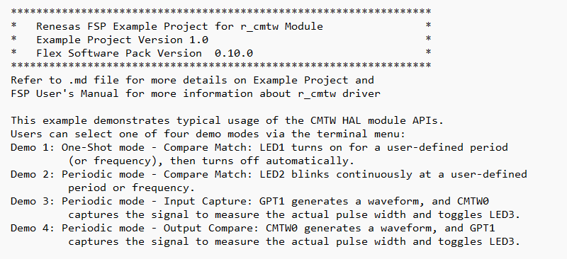  

   **Demo 1**  
   > **Run the EP with One-Shot - Compare Match, input type is ***millisecond*****  

   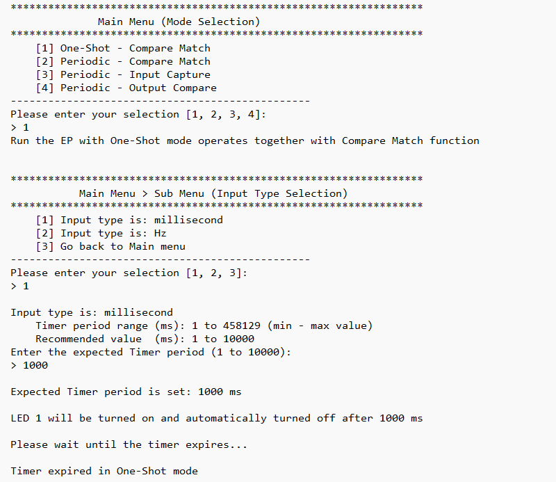  

   > **Run the EP with One-Shot - Compare Match, input type is ***Hz*****  

   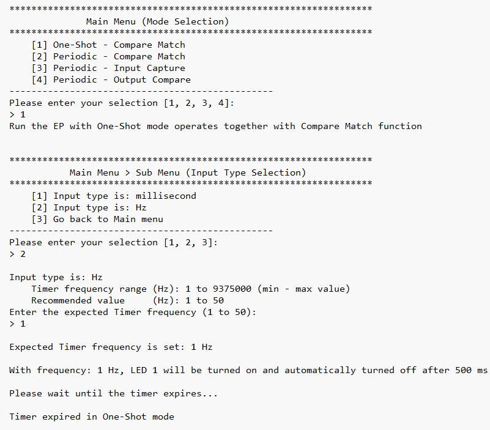  

   **Demo 2**  
   > **Run the EP with Periodic - Compare Match, input type is ***millisecond*****  

   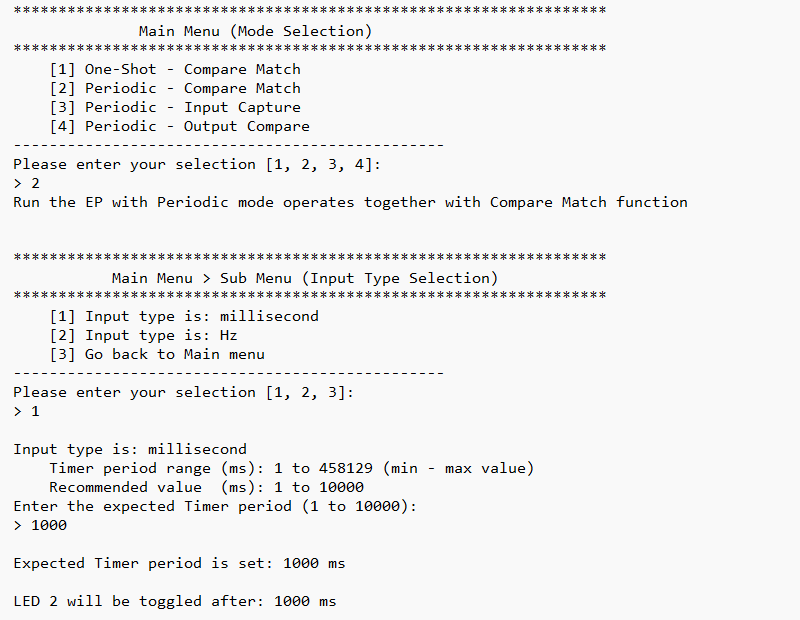  

   > **Run the EP with Periodic - Compare Match, input type is ***Hz*****  

   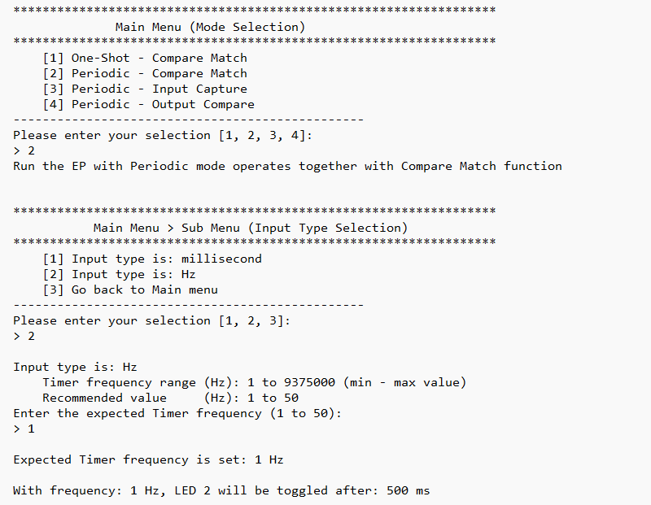  

   **Demo 3**
   > **Run the EP with Periodic - Input Capture (GPT outputs, CMTW captures), input type is ***millisecond*****

   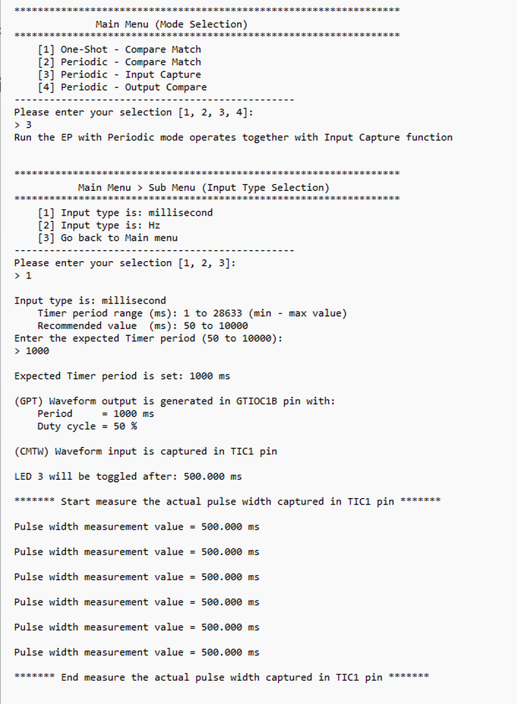

   > **Run the EP with Periodic - Input Capture (GPT outputs, CMTW captures), input type is ***Hz*****  

   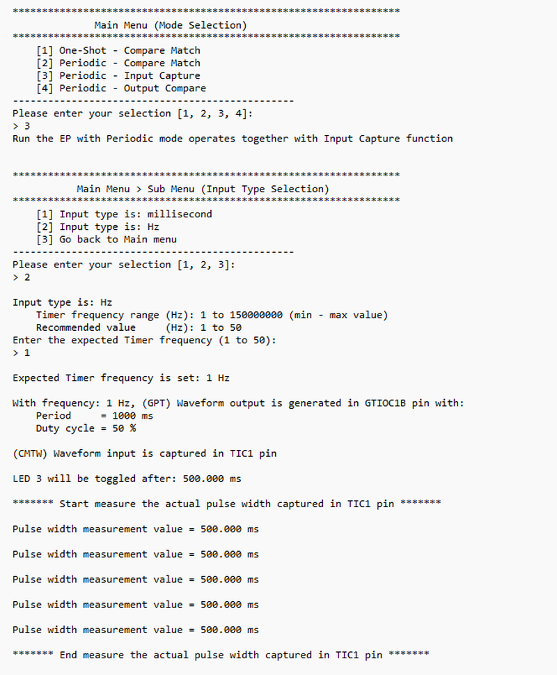

   **Demo 4**
   > **Run the EP with Periodic - Output Compare (CMTW outputs, GPT captures), input type is ***millisecond*****

   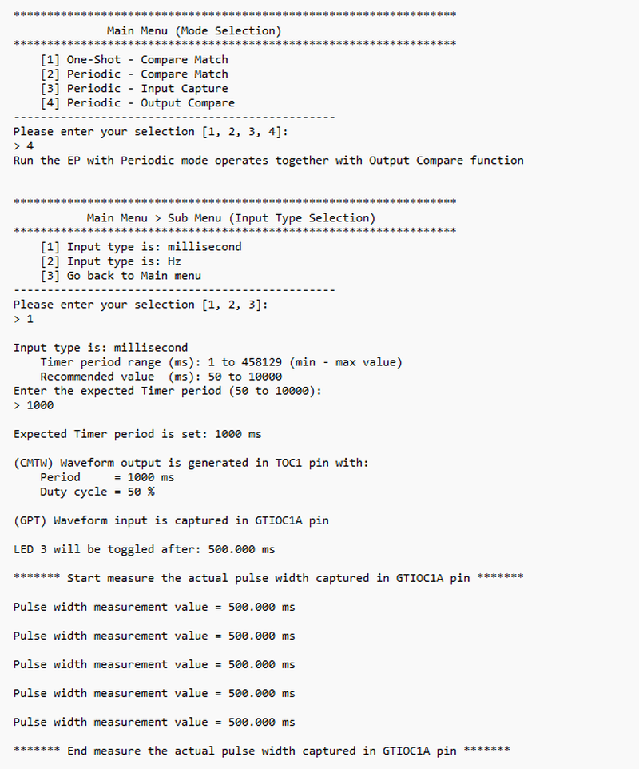

   > **Run the EP with Periodic - Output Compare (CMTW outputs, GPT captures), input type is ***Hz*****  

   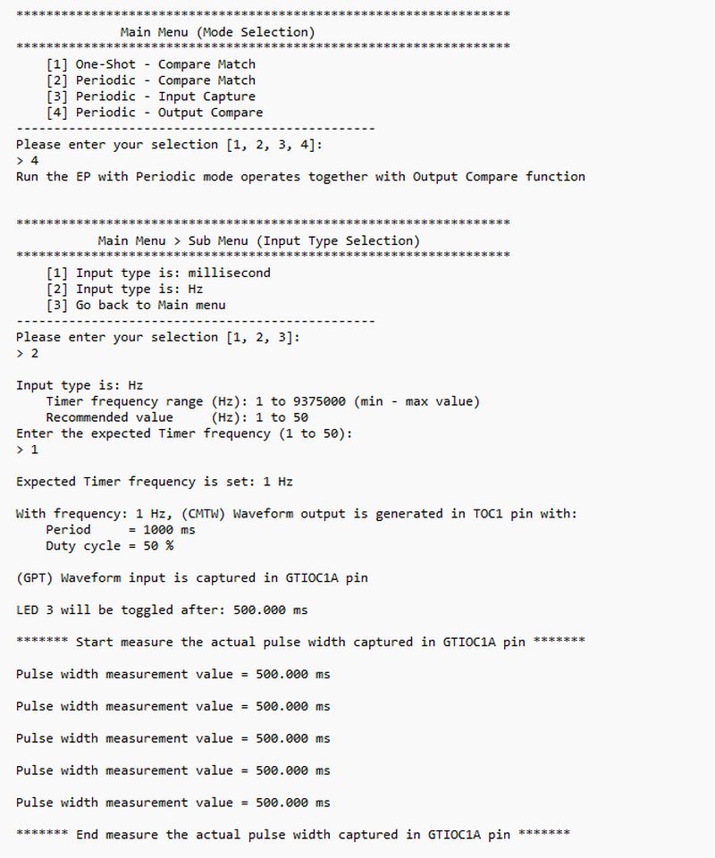 

## Special Topics ##

### Debugger Setting

* To use E2 Lite on-board or E2 Emulator Lite, please follow the instructions below:  

   1. **Common step**: Click [**Run**] → [**Debug Configurations…**] -> to open the “**Debug Configurations**” window.  
   

   2. **Select file application**  
      a. **Used for projects built with GCC**: --> Select file *.elf  
     

      b. **Used for projects built with CCRX**: --> Select file *.x  
   

   3. **Setting debugger configurations**  
      a. **Used for E2 Lite on-board**.  
     

      b. **Used for external E2 Lite emulator**.  
     

**Note:** Connect the RX board debugger port (J9) to the host PC via E2 Emulator Lite (With USB cable and 20-20 pin cable). 

### Adding lowsrc Folder

Before changing terminal application settings, you need to add the `lowsrc` folder from another Example Project:

1. **Locate the lowsrc folder:**
   
   - Navigate to Example Project `sci_uart` or `usb_pcdc_with_freertos`  (`example_projects/<board>/sci_uart/e2studio/gccrx_sci_uart_<board>_ep/src`)
   - Find the `lowsrc` folder containing low-level source files.

2. **Copy `lowsrc` folder to this Example Project:**
   
   - Copy the entire `lowsrc` folder.
   - Paste it into this your target Example Project directory: `example_projects/ek_rx74m/<EP>/e2studio/`.

3. **Add lowsrc to e2studio project:**
   
   - In e2studio, right-click on the project in Project Explorer.
   - Select **Refresh** (or press F5) to detect the new folder.

4. **Verify the folder is included:**
   
   - Expand the project tree in Project Explorer.
   - Confirm that `lowsrc` folder and its contents are visible.
   - The folder should be included in the build path with source files ready to compile.

5. **Changing the terminal Application to use the Debug Virtual Console:**
   
   - For instructions on how to switch between these options, please refer to the section [`Special Topics`](#special-topics)/[`Changing Terminal Application`](#changing-terminal-application).

6. **Re-build the project:**
   
   - In e2studio, right-click on the project and select **Build Project**.

**Note:** To use Debug Virtual Console, the `lowsrc` folder must be added to the project, as it contains the source files required for Debug Virtual Console operation.

### Changing Terminal Application ###
By default, the EP supports Serial Terminal for RX boards that support USB Serial COM   
**For use CCRX Compiler:**
* Define USE_VIRTUAL_COM=1 macro in Project Properties -> C/C++ Build -> Settings -> Tool Settings -> Compiler -> Source -> Macro definition (-define)

To use Debug Virtual Console, please follow the instructions below:
* Define USE_VIRTUAL_COM=0 macro in Project Properties -> C/C++ Build -> Settings -> Tool Settings -> Compiler -> Source -> Macro definition (-define)
* Define BSP_CFG_IO_LIB_ENABLE=1 macro in Project Properties -> C/C++ Build -> Settings -> Tool Settings -> Compiler -> Source -> Macro definition (-define)

**For use GCCRX Compiler:**  
* Define USE_VIRTUAL_COM=1 macro in Project Properties -> C/C++ Build -> Settings -> Tool Settings -> Compiler -> Includes -> Macro Defines (-D)
  
To use Debug Virtual Console, please follow the instructions below:
* Define USE_VIRTUAL_COM=0 macro in Project Properties -> C/C++ Build -> Settings -> Tool Settings -> Compiler -> Includes -> Macro Defines (-D)

## Limitation

* **Input Format:**
  * Must be an integer within 15 bytes.
  * Non-integer inputs (float, char, special characters) are not supported.

* **Recommended Value Ranges:**
  The EP will accept values within hardware limits but warns if outside recommended ranges for optimal LED observation:
  | Demo | Input Type | Recommended Range | Purpose |
  |------|------------|-------------------|---------|
  | **Demo 1 and 2** (Compare Match) | Period (ms) | 1 - 10000 ms | LED visibility. |
  | **Demo 1 and 2** (Compare Match) | Frequency (Hz) | 1 - 50 Hz | LED visibility. |
  | **Demo 3 and 4** (Capture) | Period (ms) | 50 - 10000 ms | LED visibility and pulse width measurement accuracy. |
  | **Demo 3 and 4** (Capture) | Frequency (Hz) | 1 - 50 Hz | LED visibility and pulse width measurement accuracy. |

  **Note:**
  * If user inputs a value **outside the recommended range**, the EP will display a **warning message** and prompt to re-enter the value.
  * Values outside these ranges may result in:
    * LED blinking too fast/slow to observe.
    * Inaccurate pulse width measurements displayed on terminal (for Demo 3 and 4).
    
  **Warning Example:**  
  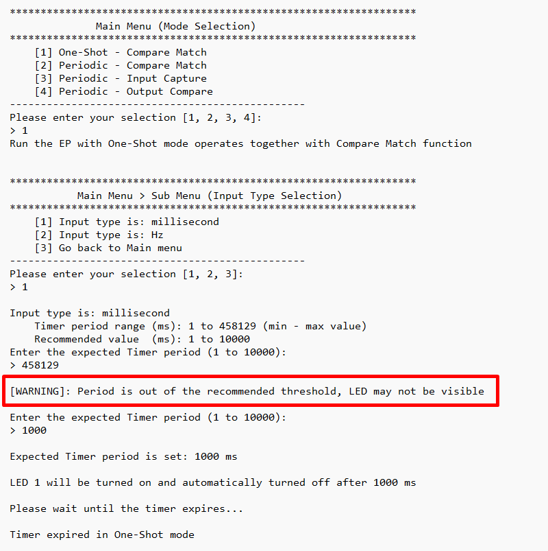