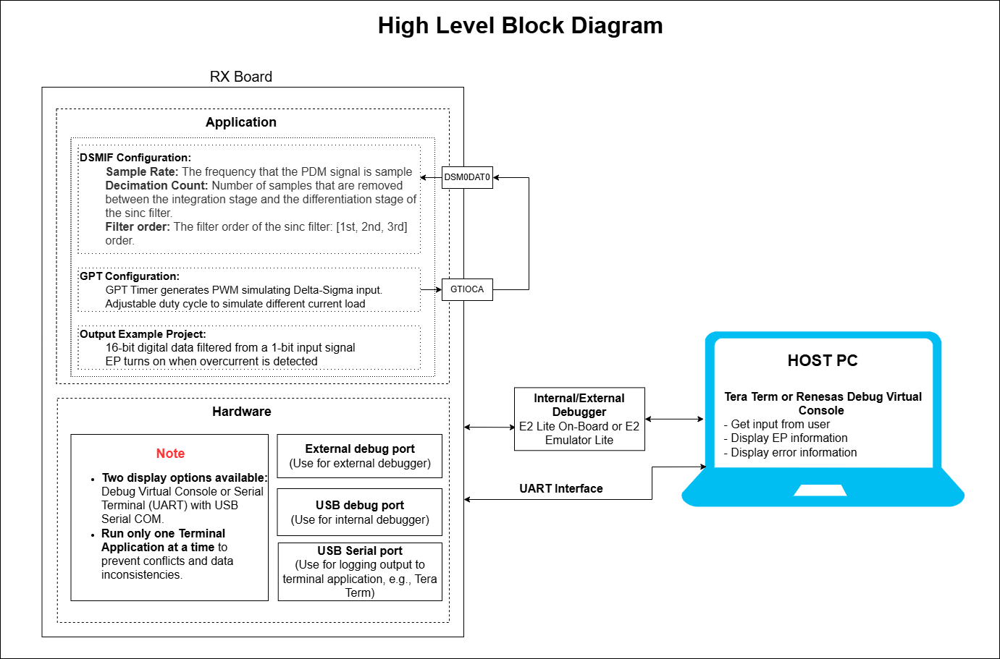
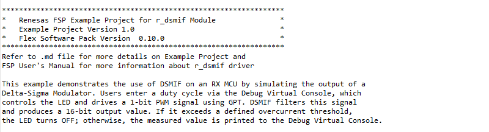
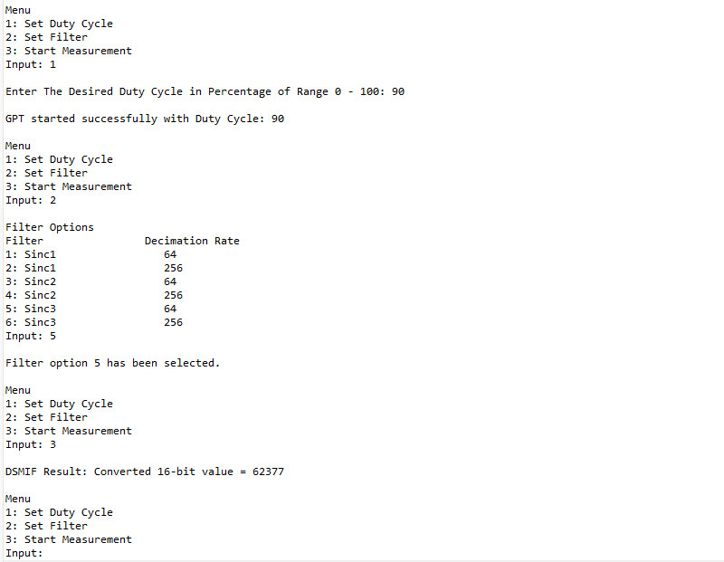
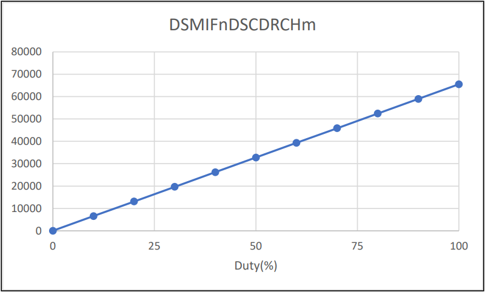

# Introduction

This example demonstrates the use of DSMIF on an RX MCU by simulating the output of a Delta-Sigma Modulator. Users enter a duty cycle via the Terminal Application, which controls the LED and drives a 1-bit PWM signal using GPT. DSMIF filters this signal and produces a 16-bit output value. If the value exceeds a defined overcurrent threshold, the LED turns OFF; otherwise, the measured value is printed to the Terminal Application.

Note: 
  - Information can be displayed using either the Debug Virtual Console or a serial terminal (UART) via the USB Serial port, depending on the board’s capabilities. If USB Serial COM is not supported, the project defaults to the Debug Virtual Console. If supported, the project defaults to the serial terminal (UART).
  - RX boards that support USB Serial COM: EK-RX74M.

## Required Resources
To build and run the DSMIF example project, the following resources are required.

### Software
* Renesas Flexible Software Package (FSP): Version 1.0.0.
* e2 studio: Version 2026-07.
* Renesas GCC Compiler for RX: Version 14.2.0.202607.
* Renesas CC-RX Compiler: Version v3.08.00.
* Terminal Console Application: Tera Term or a similar application.

### Hardware
* 1 x Renesas RX board
* 2 x Type-C USB cables for programming and debugging.
* 1 x Jumper wire

### Hardware Connections
- Connect the RX board USB debug port (J8) to the PC via a Type-C USB cable for EP debugging (If E2 Lite on-board is used).
- Connect the RX board USB SERIAL port (J27) to the PC using a Type-C USB cable to verify logs through the terminal console.
- Connect Pin PF05 (J2:36) to Pin P001 (J2:18).

## Related Collateral References
The following documents can be referred to for further understanding of the operation of this example project:
- [FSP User Manual on GitHub](https://renesas.github.io/fsp/)
- [FSP Known Issues](https://github.com/renesas/fsp/issues)
- [Output Value DSMIF](https://www.renesas.com/en/document/apn/rh850u2bx-1-bit-digital-data-stream-conversion-using-dsmif-module?srsltid=AfmBOor6syDdxbvqGnJxY9ICuGdMtmhY_irmpIBEr4Mltb6cO8GGWQc3)

# Project Notes

## System Level Block Diagram

## FSP Modules Used
Below is a list of important modules used in this example project. Refer to the FSP User Manual for further details on each module.

| Module Name | Usage | Searchable Keyword |
|-------------|---------------------------------------------------------------|-------------------|
| DSMIF       | Used to receive and filter 1-bit delta-sigma modulated signals and convert them to 16-bit digital values. | r_dsmif |
| GPT       | The GPT module can be used to generate a PWM signal that simulates the Delta-Sigma modulator input. | r_gpt |

## Module Configuration Notes
This section describes FSP Configurator properties that are important or differ from the default selections.

**DSMIF Configuration Properties**

|   Module Property Path and Identifier   |   Default Value   |   Used Value   |   Reason   |
| :-------------------------------------: | :---------------: | :------------: | :--------: |
| configuration.xml -> Stacks -> HAL/Common -> Properties > Settings > Property > g_dsmif DSMIF (r_dsmif) > Common > Error Detection Support | Disabled | Enabled | Enable error detection support to improve reliability of the DSMIF module. |
| configuration.xml -> Stacks -> HAL/Common -> Properties > Settings > Property > g_dsmif DSMIF (r_dsmif) > Module g_dsmif0 DSMIF (r_dsmif) > General > Clock Selection  | PCLKA | GPTCLK | Select GPTCLK to provide a stable clock source for DSMIF sampling operations. |
| configuration.xml -> Stacks -> HAL/Common -> Properties > Settings > Property > g_dsmif DSMIF (r_dsmif) > Module g_dsmif0 DSMIF (r_dsmif) > General > Callback  | NULL | dsmif_callback | Handle DSMIF interrupts via user-defined callback function. |
| configuration.xml -> Stacks -> HAL/Common -> Properties > Settings > Property > g_dsmif DSMIF (r_dsmif) > Module g_dsmif0 DSMIF (r_dsmif) > Interrupt > Error Interrupt Priority  | Disable | Priority 13 | Setting level priority. |
| configuration.xml -> Stacks -> HAL/Common -> Properties > Settings > Property > g_dsmif_channel0 DSMIF Channel Configuration (r_dsmif) > Module g_dsmif_channel0 DSMIF Channel Configuration (r_dsmif) > Clock > Clock Direction  | Slave Mode | Master Mode | DSMIF generates the clock (DSMCLK) internally and outputs it to the Delta-Sigma modulator. |
| configuration.xml -> Stacks -> HAL/Common -> Properties > Settings > Property > g_dsmif_channel0 DSMIF Channel Configuration (r_dsmif) > Module g_dsmif_channel0 DSMIF Channel Configuration (r_dsmif) > Clock > CKDIV Setting (Master Mode Only)  | 2 | 4 | Clock division factor; reduces input clock frequency to appropriate sampling rate. |
| configuration.xml -> Stacks -> HAL/Common -> Properties > Settings > Property > g_dsmif_channel0 DSMIF Channel Configuration (r_dsmif) > Module g_dsmif_channel0 DSMIF Channel Configuration (r_dsmif) > Error Detection > Overcurrent Detection 0 > Upper Limit > Detection | Disabled | Enabled | Enable overcurrent 0 upper limit. |
| configuration.xml -> Stacks -> HAL/Common -> Properties > Settings > Property > g_dsmif_channel0 DSMIF Channel Configuration (r_dsmif) > Module g_dsmif_channel0 DSMIF Channel Configuration (r_dsmif) > Error Detection > Overcurrent Detection 0 > Upper Limit > Threshold | 0xFFFF | 0xFF00 | Setting in the range [0,65535]. |

**Configuration Properties for using the Serial Terminal (UART)**   
|   Configure Clock Path                  |   Default Value   |   Used Value   |   Reason   |
|-----------------------------------------|-------------------|----------------|------------|
| configuration.xml > Clocks > Clocks Configuration > SCICLK Disable | SCICLK Disable | SCICLK Src: HOCO | Enable operating clock for SCI module by HOCO clock source. |

|   Configure Interrupt Event Path        |   Default Value   |   Used Value   |   Reason   |
|-----------------------------------------|-------------------|----------------|------------|
| configuration.xml > Interrupts > Interrupts Configuration > New User Event > RSCI > RSCI12 > RSCI12 RXI (Receive data full) | empty | sci_b_uart_rxi_isr | Assign the UART receive ISR (Receive data full) to the interrupt vector table. |
| configuration.xml > Interrupts > Interrupts Configuration > New User Event > RSCI > RSCI12 > RSCI12 TXI (Transmit data empty) | empty | sci_b_uart_txi_isr | Assign the UART transfer ISR (Transfer data empty) to the interrupt vector table. |
| configuration.xml > Interrupts > Interrupts Configuration > New User Event > RSCI > RSCI12 > 105-6 GROUPAL1 RSCI12 TEI (Transmit end) | empty | sci_b_uart_tei_isr | Assign the UART transfer ISR (Transfer end) to the interrupt vector table. |
| configuration.xml > Interrupts > Interrupts Configuration > New User Event > RSCI > RSCI12 > 105-7 GROUPAL1 RSCI12 ERI (Receive error) | empty |

## API Usage ##

The table below lists the FSP-provided APIs used at the application layer in this example project.

| API Name    | Usage                                                                          |
|-------------|--------------------------------------------------------------------------------|
| R_DSMIF_Open | This API is used to open the DSMIF instance. |
| R_DSMIF_ScanStart | This API is used to start the DSMIF Scan.  |
| R_DSMIF_Read | This API is used to read the DSMIF converted value from the specific DSMIF channel.  |
| R_DSMIF_Close | This API is used to close the DSMIF module. |
| R_DSMIF_ErrorDetectionEnable | This API is used to enable error detection after waiting for the filter to stabilize. |
| R_DSMIF_ErrorStatusGet | This API is used to read the error status in order to clear the error flags. |
| R_GPT_Open | This API is used to initialize the GPT module.|
| R_GPT_Start  |This API is used to start GPT module.|
| R_GPT_DutyCycleSet |This API is used to set GPT timer's DutyCycle as per user input.|
| R_GPT_Close |This API is used to de-initialize the GPT module.|
| R_GPT_InfoGet |This API is used to get timer information and store it in provided pointer p_info.|
| R_GPT_PeriodSet |This API is used to sets period value provided. |
| R_BSP_SoftwareDelay | This API is used to delay a specified period of time. |

## Verifying Operation
1. Import the example project.

2. Generate, and build the example project.

3. Before running the example project, make sure hardware connections are completed.

4. Connect the RX MCU to the host PC via debugger. By default, EP will use E2lite debugger.

5. Open a terminal application (e.g., Tera Term or Debug Virtual Console) on the host PC and connect to the RX board’s USB Serial port.  
   * Note: For using the Serial Terminal application:
        * To echo back typed content in Tera Term, go to [Setup] -> [Terminal...] and check [Local echo].
        * The configuration parameters of the serial port are:
            - COM port: Provided by the USB Serial COM.
            - Baud rate: 115200 bps
            - Data length: 8 bits
            - Parity: None
            - Stop bit: 1 bit
            - Flow control: None 

6. User can perform Menu option operations and check corresponding results on the Terminal Application.

7. Set Duty Cycle:
    - Enter a user-defined duty cycle (e.g., 100%) via the Terminal Application.
    - This value is used to generate a 1-bit PWM signal using the GPT peripheral. The same duty cycle also controls the LED state.
8. Change Filter Configuration:

    | Option | Filter Type | Decimation Rate |
    |--------|-------------|-----------------|
    | 1      | Sinc1       | 64              |
    | 2      | Sinc1       | 256             |
    | 3      | Sinc2       | 64              |
    | 4      | Sinc2       | 256             |
    | 5      | Sinc3       | 64              |
    | 6      | Sinc3       | 256             |

    Users may select any of the above options based on the required filtering strength and data throughput.

9. Start Measurement:
    - Upon selecting Start Measurement, DSMIF begins sampling the 1-bit PWM signal generated by GPT.
    - The PWM frequency and duty cycle were previously configured via Option 1.
    - The filter type and decimation rate were set via Option 2.
    - DSMIF then filters this PWM stream according to the selected filter configuration and produces a 16-bit digital output.
    - The overcurrent upper-limit threshold is defined as a DSMIF output value greater than 0xFF00.
    - Refer to the [`DSMIF Configuration Properties`](#module-configuration-notes) section for the configuration path and details on updating the upper-limit threshold.

10. LED Behavior (Implicitly Verified):
    - The LED brightness is directly controlled by the PWM duty cycle configured in Option 1.
    - Additionally, during measurement:
        - If the DSMIF 16-bit result exceeds the overcurrent threshold, the LED will automatically turn OFF to indicate a fault condition.
        - For verification of the measured DSMIF output, refer to the [`Output Value`](#output-value) section provided below.

The image below shows the DSMIF output on the Terminal Application:
  
  
  
  
## Special Topics ##

## Output Value
-  Output of SINC filter of DSMIF can be monitored with DSMIFnDSCDRCHm register. DSMIFnDSCDRCHm register is taken value from 0 to 65520 (0xFFF0) value in setting decimation ratio of SINC3=16. 

- Since it does not go through the FIR filter, the delay is small, but the values have high-frequency components. The relation between input
duty to data in DSMIFnDSCDRCHm register is shown below.

**General Formula** 
|  |
|-------|
| **DSMIF_Output ≈ p × (M^N)** |

**Where:**
- **p** = input PWM duty (0-100%) 
- **M** = decimation ratio  
- **N** = SINC order (1, 2, or 3)  

However, the DSMIF output register is limited to 16 bits. When the 
calculated value exceeds the 16-bit maximum, the hardware automatically clips 
the result.

Hardware limitation (per RX DSMIF specification):

> When the filter result exceeds the valid range, the value is rounded and saturated to 0xFFFF (65535), ensuring that all SINC1/SINC2/SINC3 outputs remain within the 16-bit DSMIF result register.

### Debugger Setting ###

* To use E2 Lite on-board or E2 Emulator Lite, please follow the instructions below:

1. **Common step**: Click [**Run**] → [**Debug Configurations…**] to open the “**Debug Configurations**” window.  
  

2. **Select file application**  
  a. **Used for projects built with GCC**: --> Select file **.elf**.  
    
  b. **Used for projects built with CCRX**: --> Select file **.x**.  
  

3. **Setting debugger configurations**  
  a. **Used for E2 Lite on-board**.    
    
  b. **Used for external E2 Emulator Lite**.  
    

  **Note:** Connect the RX board debugger port (J9) to the host PC via E2 Emulator Lite (With USB cable and 20-20 pin cable).

### Adding lowsrc Folder

Before changing terminal application settings, you need to add the `lowsrc` folder from another Example Project:

1. **Locate the lowsrc folder:**
   
   - Navigate to Example Project `sci_uart` or `usb_pcdc_with_freertos`  (`example_projects/<board>/sci_uart/e2studio/gccrx_sci_uart_<board>_ep/src`)
   - Find the `lowsrc` folder containing low-level source files.

2. **Copy `lowsrc` folder to this Example Project:**
   
   - Copy the entire `lowsrc` folder.
   - Paste it into this your target Example Project directory: `example_projects/ek_rx74m/<EP>/e2studio/`.

3. **Add lowsrc to e2studio project:**
   
   - In e2studio, right-click on the project in Project Explorer.
   - Select **Refresh** (or press F5) to detect the new folder.

4. **Verify the folder is included:**
   
   - Expand the project tree in Project Explorer.
   - Confirm that `lowsrc` folder and its contents are visible.
   - The folder should be included in the build path with source files ready to compile.

5. **Changing the terminal Application to use the Debug Virtual Console:**
   
   - For instructions on how to switch between these options, please refer to the section [`Special Topics`](#special-topics)/[`Changing Terminal Application`](#changing-terminal-application).

6. **Re-build the project:**
   
   - In e2studio, right-click on the project and select **Build Project**.

**Note:** To use Debug Virtual Console, the `lowsrc` folder must be added to the project, as it contains the source files required for Debug Virtual Console operation.

### Changing Terminal Application ###
By default, the EP supports Serial Terminal for RX boards that support USB Serial COM   
**For use CCRX Compiler:**
* Define USE_VIRTUAL_COM=1 macro in Project Properties -> C/C++ Build -> Settings -> Tool Settings -> Compiler -> Source -> Macro definition (-define)

To use Debug Virtual Console, please follow the instructions below:
* Define USE_VIRTUAL_COM=0 macro in Project Properties -> C/C++ Build -> Settings -> Tool Settings -> Compiler -> Source -> Macro definition (-define)
* Define BSP_CFG_IO_LIB_ENABLE=1 macro in Project Properties -> C/C++ Build -> Settings -> Tool Settings -> Compiler -> Source -> Macro definition (-define)

