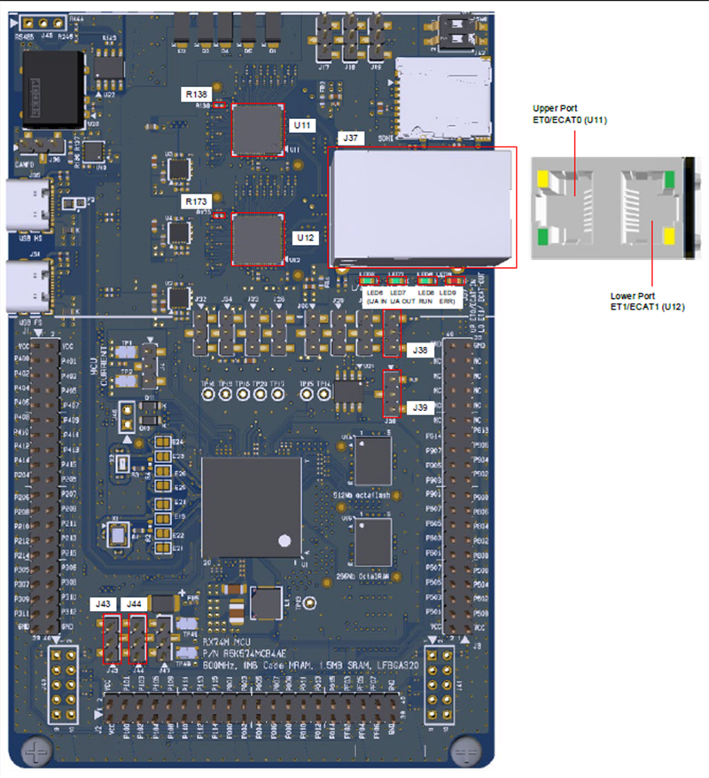
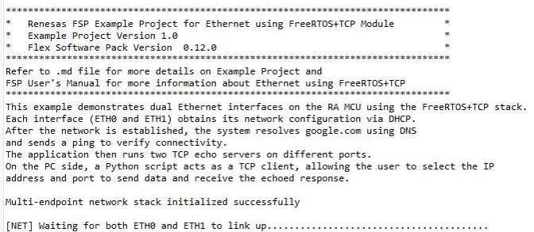
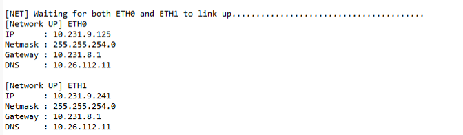
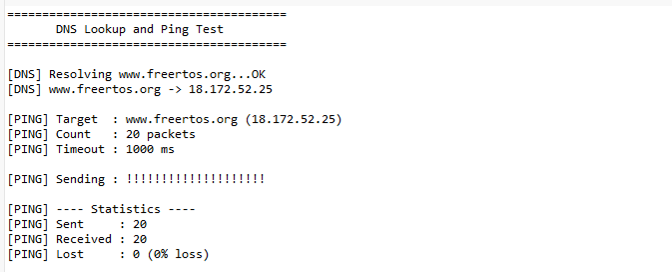
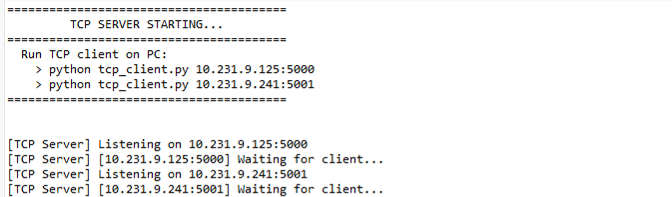
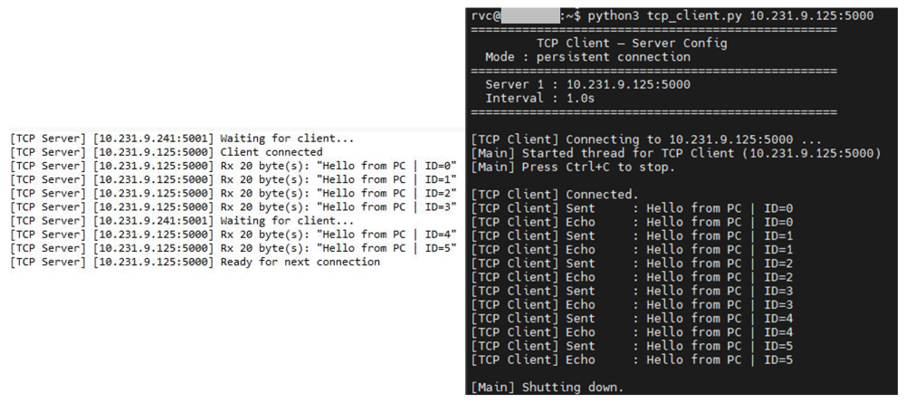
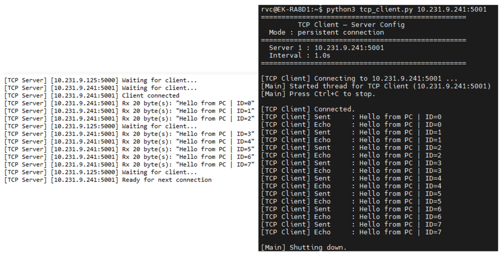

# Introduction #

This example demonstrates dual Ethernet interfaces on the RX MCU using the FreeRTOS+TCP stack. Each interface (ETH0 and ETH1) obtains its network configuration via DHCP. After the network is established, the system resolves google.com using DNS and sends a ping to verify connectivity. The application then runs two TCP echo servers on different ports. On the PC side, a Python script acts as a TCP client, allowing the user to select the IP address and port to send data and receive the echoed response.

**Note**: 
- To display information, the user can select between Debug Virtual Console and the Serial Terminal (UART) with USB Serial COM. It is important to note that the user should only operate a single terminal application at a time to avoid conflicts or data inconsistencies. For instructions on how to switch between these options, please refer to the section [`Special Topics`](#special-topics)/[`Changing Terminal Application`](#changing-terminal-application).

- By default, EP information is printed to the host PC using the Serial Terminal (UART) for boards that support USB Serial COM. LED3 is turned ON to indicate the UART initialized unsuccessfully.

- RX boards that support USB Serial COM: EK-RX74M. 

## Required Resources ##

To build and run the Ethernet example project, the following resources are needed.

### Software ###

* Renesas Flexible Software Package (FSP): Version 1.0.0.
* e2 studio: Version 2026-07.
* Renesas GCC Compiler for RX: Version 14.2.0.202607.
* Renesas CC-RX Compiler: Version v3.08.00.
* Terminal Console Application: Tera Term or a similar application.

### Hardware ###

* 1 x Renesas RX board.
* 2 x Type-C USB cable for programming and debugging.
* 3 × Ethernet cables for connecting the dual Ethernet ports on the RX board and the host PC to the network router.
* 1 x Ethernet router with an internet connection.

### Hardware Connections ###

- Connect the RX board USB debug port (J8) to the PC via a Type-C USB cable for EP debugging (If E2 Lite on-board is used).
- Connect LAN cable on RX board at ethernet upper port (U11) and other end connect to ethernet switch/router.
- Connect the RX board USB Serial port (J27) to the PC using a Type-C USB cable to verify logs through the Terminal Application.

- **Ethernet channel 0 configuration and jumper & resistor settings for MII/GMII mode:**
    - J38  : Jumper on pins 1-2.
    - J39  : Jumper on pins 1-2.
    - J43  : Jumper on pins 1-2.
    - J44  : Jumper on pins 1-2.
    - E64  : Open.
    - E65  : Closed.
    - E66  : Closed.
    - R138 : Fit.
    - R140 : Fit
    - R141 : Not fit.
    - R142 : Fit.
    - R143 : Not fit.

## Related Collateral References ##
The following documents can be referred to for enhancing your understanding of the operation of this example project:
- [FSP User Manual on GitHub (Reference link)](https://renesas.github.io/fsp/)
- [FSP Known Issues (Reference link)](https://github.com/renesas/fsp/issues)

# Project Notes #

## System Level Block Diagram ##

## FSP Modules Used ##
List all the various modules that are used in this example project. Refer to the FSP User Manual for further details on each module listed below.

| Module Name | Usage | Searchable Keyword  |
|-------------|-------|---------------------|
| FreeRTOS+TCP | This stack implements a lightweight TCP/IP stack for enabling network communication. | FreeRTOS+TCP |
| FreeRTOS+TCP Wrapper to r_ether | This module provides the network interface required to use FreeRTOS Plus TCP with the Ethernet (r_rmac) driver. | rm_freertos_plus_tcp |
| Ethernet  | This module performs Ethernet frame transmission and reception using an Ethernet controller. | r_rmac |
| CMT | This module is used for system tick in FreeRTOS. | r_cmt |

 

## Module Configuration Notes ##
This section describes FSP Configurator properties which are important or different than those selected by default.

**Configuration Properties for BSP** `configuration.xml > BSP > Properties > Settings > Property`

|   Module Property Path and Identifier   |   Default Value   |   Used Value   |   Reason   |
| --------------------------------------- | ----------------- | -------------- | ---------- |
|   RX Common > Main Stack size (bytes)  |  0x2000   | 0x1000  |  Main Stack size is required for standard library functions to be used. |
|   RX Common > Heap size (bytes)  |  0   | 0x8000  |  Heap size is required for standard library functions to be used. |

 

**Configuration Properties for Clocks** `configuration.xml > Clocks`

| Clock      | Default Value| Source Clock |      Divider     | Description                         |
|------------|--------------|--------------|------------------|-------------------------------------|
| ESWCLK     | Disabled     | PLL2P        | ESWCLK Div/2     | Select Ethernet Switch clock        |
| ESWPHYCLK  | Disabled     | PLL2P        | ESWPHYCLK Div/1  | Select Ethernet Switch PHY clock    |
| ETHPHYCLK  | Disabled     | PLL1Q        | ETHPHYCLK Div/16 | Select Ethernet PHY clock           |

 

**Configuration Properties for using CMT** `configuration.xml > Stack > HAL/Common > Timer, Compare Match Timer (r_cmt) > Properties > Settings > Property`

|   Module Property Path and Identifier   |   Default Value   |   Used Value   |   Reason   |
|-----------------------------------------|-------------------|----------------|------------|
|  Module > General > Period | 0x10000 | 1 | Specify the timer period based on the selected unit. |
|  Module > General > Period Unit| Raw Counts | Miliseconds | Specify the uint of the period. |
|  Module > Interrupts > Compare Match Interrupt Priority | Disable | Priority 2 | Select the compare match interrupt priority. |

 

**Configuration Properties for Net thread** `configuration.xml > Stack > Net Thread > Properties > Settings > Property`

|   Module Property Path and Identifier   |   Default Value   |   Used Value   |   Reason   |
|-----------------------------------------|-------------------|----------------|------------|
|  Common > Memory Allocation > Support Dynamic Allocation |  Disable |  Enable | Enable support for dynamic allocation. |
|  Common > Memory Allocation > Total Heap Size | 0 | 0x8000 |  Total amount RAM available in FreeRTOS heap. |
|  Common > Timers > Timer Task Priority | 6 | 3 | Sets the priority of the  software timer service. |
|  Common > Timers > Timer Queue Length | 5 | 10 | Sets the length of the software timer command queue. |
|  Common > Timers > Timer Task Stack Depth | configMINIMAL_STACK _SIZE * 6 | 128 | Sets the stack depth allocated to the software timer service. |
|  Thread > Stack size (bytes) | 1024 | 8192 | Stack size is required for handling function and local variables usage. |

 

**Configuration Properties for FreeRTOS+TCP** `configuration.xml > Stacks > FreeRTOS+TCP`

|   Module Property Path and Identifier   |   Default Value   |   Used Value   |   Reason   |
|-----------------------------------------|-------------------|----------------|------------|
|  Properties > Settings > Property > Common > Receive Block Time | 10000 | 2000 | Amount of time FreeRTOS_recv() will block for. |
|  Properties > Settings > Property > Common > Send Block Time | 10000 | 2000 | Amount of time FreeRTOS_send() will block for. |
|  Properties > Settings > Property > Common > DNS Request Attempts | 2 | 5 | Increased DNS Request Attempts. |
|  Properties > Settings > Property > Common > IP stack task priority | configMAX_PRIORITIES - 2 | configMAX_PRIORITIES - 1 | Set the priority of the task that executes the IP stack. |
|  Properties > Settings > Property > Common > Stack size in words (not bytes) | configMINIMAL_STACK_SIZE * 5 | configMINIMAL_STACK_SIZE * 10 | The size of the stack allocated to the FreeRTOS+TCP stack. |
|  Properties > Settings > Property > Common > Network Events call vApplicationIPNetworkEventHook | Enable | Disable | Not call vApplicationIPNetworkEventHook when the network connects or disconnects. |
|  Properties > Settings > Property > Common > DHCP Send Discover After Auto IP | Disable | Enable | Enable DHCP Send Discover After Auto IP. |
|  Properties > Settings > Property > Common > DHCP callback function | Disable | Enable | Provide an implementation of the DHCP callback function. |
|  Properties > Settings > Property > Common > Total number of available network buffers | 10 | 16 | Define the total number of network buffer that are available to the IP stack. |
|  Properties > Settings > Property > Common > FreeRTOS+SendPingRequest() is available | Disable | Enable | FreeRTOS+SendPingRequest() API function is available. |
|  g_ether0 Ethernet MAC (r_rmac) > Properties > Settings > Property > General > Channel | 0 | 0 | Select the Ether channer number. |
|  g_ether0 Ethernet MAC (r_rmac) > Properties > Settings > Property > General > MAC address | 00:11:22:33:44:55 | 00:11:22:33:44:57 | Specify MAC address for this channel. |
|  g_ether1 Ethernet MAC (r_rmac) > Properties > Settings > Property > General > Channel | 0 | 1 | Select the Ether channer number. |
|  g_ether1 Ethernet MAC (r_rmac) > Properties > Settings > Property > General > MAC address | 00:11:22:33:44:55 | 00:11:22:33:44:56 | Specify MAC address for this channel. |
|  g_layer3_switch0 Switch (r_layer3_switch) > Properties > Settings > Property > Module g_layer3_switch0 Switch (r_layer3_switch) > Interrupt > Interrupt priority | Priority 2 | Priority 4 | Select the layer3_switch interrupt priority. |
|  g_rmac_phy0 Ethernet (r_rmac_phy) > Properties > Settings > Property > Common > VSC8541 Target | Disabled | Enabled | Select to use VSC8541 PHY-LSI. |
|  g_rmac_phy0 Ethernet (r_rmac_phy) > Properties > Settings > Property > Module g_rmac_phy0 Ethernet (r_rmac_phy) > Channel | 0 | 0 | Select Ethernet controller channel number. |
|  g_rmac_phy0 Ethernet (r_rmac_phy) > Properties > Settings > Property > Module g_rmac_phy0 Ethernet (r_rmac_phy) > Default PHY-LSI port | 0 | 0 | Select the default port for HY-LSI configuration. |
|  g_rmac_phy1 Ethernet (r_rmac_phy) > Properties > Settings > Property > Module g_rmac_phy1 Ethernet (r_rmac_phy) > Select MII Type | GMII | GMII | Select to use GMII mode. |
|  g_rmac_phy1 Ethernet (r_rmac_phy) > Properties > Settings > Property > Common > VSC8541 Target | Disabled | Enabled | Select to use VSC8541 PHY-LSI. |
|  g_rmac_phy1 Ethernet (r_rmac_phy) > Properties > Settings > Property > Module g_rmac_phy1 Ethernet (r_rmac_phy) > Channel | 0 | 0 | Select Ethernet controller channel number. |
|  g_rmac_phy1 Ethernet (r_rmac_phy) > Properties > Settings > Property > Module g_rmac_phy1 Ethernet (r_rmac_phy) > Default PHY-LSI port | 0 | 1 | Select the default port for HY-LSI configuration. |
|  g_rmac_phy1 Ethernet (r_rmac_phy) > Properties > Settings > Property > Module g_rmac_phy1 Ethernet (r_rmac_phy) > Select MII Type | GMII | GMII | Select to use GMII mode. |
|  g_rmac_phy_lsi0 Ethernet PHY-LSI > Properties > Settings > Property > Common > VSC8541 Target | Disabled | Enabled | Select to use VSC8541 PHY-LSI. |
|  g_rmac_phy_lsi1 Ethernet PHY-LSI > Properties > Settings > Property > Module g_rmac_phy_lsi0 Ethernet PHY-LSI >  PHY-LSI Address | 0 | 0 | Select the PHY-LSI address. |
|  g_rmac_phy_lsi0 Ethernet PHY-LSI > Properties > Settings > Property > Module g_rmac_phy_lsi0 Ethernet PHY-LSI >  PHY-LSI type | Kit Component | VSC8541 | Select the PHY-LSI target. |
|  g_rmac_phy_lsi1 Ethernet PHY-LSI > Properties > Settings > Property > Common > VSC8541 Target | Disabled | Enabled | Select to use VSC8541 PHY-LSI. |
|  g_rmac_phy_lsi1 Ethernet PHY-LSI > Properties > Settings > Property > Module g_rmac_phy_lsi1 Ethernet PHY-LSI >  PHY-LSI Address | 0 | 1 | Select the PHY-LSI address. |
|  g_rmac_phy_lsi1 Ethernet PHY-LSI > Properties > Settings > Property > Module g_rmac_phy_lsi1 Ethernet PHY-LSI >  PHY-LSI type | Kit Component | VSC8541 | Select the PHY-LSI target. |

 

## API Usage ##

The table below lists the APIs used at the application layer by this example project.

| API Name    | Usage                                                                          |
|-------------|--------------------------------------------------------------------------------|
| pxFSP_Eth_FillInterfaceDescriptor | This API fills interface descriptor |
| FreeRTOS_FillEndPoint | This API configures and installs IPv4 endpoint |
| FreeRTOS_IPInit_Multi | This API initializes multiple FreeRTOS+TCP network stacks and IP-task. |
| FreeRTOS_gethostbyname | This API resolves a domain name into an IP address. |
| FreeRTOS_IsNetworkUp | This API checks the current status of the network connection. |
| FreeRTOS_inet_addr | This API converts the IP address from "w.x.y.z" (dotted decimal) format to the 32-bit format. |
| FreeRTOS_SendPingRequest | This API sends an ICMP ping request to a remote host. |
| FreeRTOS_inet_ntoa | This API converts the IP address to a string. |
| FreeRTOS_socket |  This API inintializes a socket. |
| FreeRTOS_bind | This API binds a socket to a local port number. |
| FreeRTOS_setcokopt | This API sets the socket options for the given socket. |
| FreeRTOS_listen | This API requests to put a socket in listen mode |
| FreeRTOS_accept | This API accepts a connection on an listening socket |
| FreeRTOS_recv | This API reads incoming data from a TCP socket |
| FreeRTOS_send | This API sends data using a TCP socket |
| FreeRTOS_closesocket | This API closes a socket and free the allocated space |

 

## Verifying Operation ##
1. Import the example project.
2. Generate, and build the example project.
3. Before running the example project, make sure hardware connections are completed.
4. Connect the RX MCU to the host PC via E2 Lite on-board.
By default, EP will use the on-board E2 Lite.
5. Open a terminal application (e.g., Tera Term or Debug Virtual Console) on the host PC and connect to the RX board’s USB Serial port.  
   * Note: For using the Serial Terminal application:
        * To echo back typed content in Tera Term, go to [Setup] -> [Terminal...] and check [Local echo].
        * The configuration parameters of the serial port are:
            - COM port: Provided by the USB Serial COM.
            - Baud rate: 115200 bps
            - Data length: 8 bits
            - Parity: None
            - Stop bit: 1 bit
            - Flow control: None 

### The below images showcase the output on the Terminal Application (Tera Term) ### 
  * The terminal displays the EP information:

    

  * The terminal displays the DHCP operation:
  
    

  * The terminal displays the DNS and ping operation:

    

  * The terminal displays the TCP server enter listening mode:

    

  * The terminal displays the TCP server operation on port 0 (left side), while on the right side shows a PC executing the `tcp_client.py` script:

    

  * The terminal displays the TCP server operation on port 1 (lest side), while on the right side shows a PC executing the `tcp_client.py` script:
  
    

## Special Topics ##

### MII/GMII Mode ###

User can change mode between MII and GMII, please follow the instructions below :

|   Module Property Path and Identifier   |   Default Value   |   Used Value   |   Reason   |
|-----------------------------------------|-------------------|----------------|------------|
| configuration.xml > Stack > FreeRTOS+TCP > g_rmac_phy0 Ethernet (r_rmac_phy) > Properties > Settings > Property > Module g_rmac_phy0 Ethernet (r_rmac_phy) > Select MII Type | GMII | MII | Select to use MII. |

 

|   Functionality   |   MII   |   GMII   |
|-------------------|---------|----------|
|   Data Rate       |   10/100 Mbps   |   1000 Mbps (1 Gbps)  |

 
**Note:**
- If user use GMII mode, you must connect with switch support 1 Gbps.

### Debugger Setting ###

* To use E2 Lite on-board or E2 Emulator Lite, please follow the instructions below:

1. **Common step**: Click [**Run**] → [**Debug Configurations…**] to open the “**Debug Configurations**” window.  
  

2. **Select file application**  
  a. **Used for projects built with GCC**: --> Select file **.elf**.  
    
  b. **Used for projects built with CCRX**: --> Select file **.x**.  
  

3. **Setting debugger configurations**  
  a. **Used for E2 Lite on-board**.    
    
  b. **Used for external E2 Emulator Lite**.  
    

  **Note:** Connect the RX board debugger port (J9) to the host PC via E2 Emulator Lite (With USB cable and 20-20 pin cable).

### Adding lowsrc Folder

Before changing terminal application settings, you need to add the `lowsrc` folder from another Example Project:

1. **Locate the lowsrc folder:**
   
   - Navigate to Example Project `sci_uart` or `usb_pcdc_with_freertos`  (`example_projects/<board>/sci_uart/e2studio/gccrx_sci_uart_<board>_ep/src`)
   - Find the `lowsrc` folder containing low-level source files.

2. **Copy `lowsrc` folder to this Example Project:**
   
   - Copy the entire `lowsrc` folder.
   - Paste it into this your target Example Project directory: `example_projects/ek_rx74m/<EP>/e2studio/`.

3. **Add lowsrc to e2studio project:**
   
   - In e2studio, right-click on the project in Project Explorer.
   - Select **Refresh** (or press F5) to detect the new folder.

4. **Verify the folder is included:**
   
   - Expand the project tree in Project Explorer.
   - Confirm that `lowsrc` folder and its contents are visible.
   - The folder should be included in the build path with source files ready to compile.

5. **Changing the terminal Application to use the Debug Virtual Console:**
   
   - For instructions on how to switch between these options, please refer to the section [`Special Topics`](#special-topics)/[`Changing Terminal Application`](#changing-terminal-application).

6. **Re-build the project:**
   
   - In e2studio, right-click on the project and select **Build Project**.

**Note:** To use Debug Virtual Console, the `lowsrc` folder must be added to the project, as it contains the source files required for Debug Virtual Console operation.

### Changing Terminal Application ###
By default, the EP supports Serial Terminal for RX boards that support USB Serial COM   
**For use CCRX Compiler:**
* Define USE_VIRTUAL_COM=1 macro in Project Properties -> C/C++ Build -> Settings -> Tool Settings -> Compiler -> Source -> Macro definition (-define)

To use Debug Virtual Console, please follow the instructions below:
* Define USE_VIRTUAL_COM=0 macro in Project Properties -> C/C++ Build -> Settings -> Tool Settings -> Compiler -> Source -> Macro definition (-define)
* Define BSP_CFG_IO_LIB_ENABLE=1 macro in Project Properties -> C/C++ Build -> Settings -> Tool Settings -> Compiler -> Source -> Macro definition (-define)

**For use GCCRX Compiler:**  
* Define USE_VIRTUAL_COM=1 macro in Project Properties -> C/C++ Build -> Settings -> Tool Settings -> Compiler -> Includes -> Macro Defines (-D)
  
To use Debug Virtual Console, please follow the instructions below:
* Define USE_VIRTUAL_COM=0 macro in Project Properties -> C/C++ Build -> Settings -> Tool Settings -> Compiler -> Includes -> Macro Defines (-D)
