# Introduction #
This project demonstrates the basic functionalities of the Port Output Enable for GPT (POEG) driver on Renesas RX MCUs based on Renesas FSP. The user can disable the GPT output pins using one of the following options:
1. Disable GPT output pins based on the GTETRG input pin level.
2. Disable GPT output pins by software API.
3. Disable GPT output pins when GTIOC pins are at the same logic level.
4. Reset the POEG status.

Information, guidelines, and error messages are displayed on the Terminal Application. LED1 is turned ON when the GPT output pin is disabled successfully. LED1 is turned OFF when POEG resets successfully. Additionally, the user can verify the EP operation using a logic analyzer. 

**Note**: 
- To display information, the user can select between Debug Virtual Console and the Serial Terminal (UART) with USB Serial COM. It is important to note that the user should only operate a single terminal application at a time to avoid conflicts or data inconsistencies. For instructions on how to switch between these options, please refer to the section [`Special Topics`](#special-topics)/[`Changing Terminal Application`](#changing-terminal-application).

- By default, EP information is printed to the host PC using the Serial Terminal (UART) for boards that support USB Serial COM. LED3 is turned ON to indicate the UART initialized unsuccessfully.

- RX boards that support USB Serial COM: EK-RX74M. 

- EK-RX74M board does not support disabling GPT output pins based on comparator (ACMPHS) crossing events.

The user can refer to the "Verifying Operation" section to run the example project properly.

## Required Resources ##
To build and run the POEG example project, the following resources are needed.

### Software ###
* Renesas Flexible Software Package (FSP): Version 1.0.0.
* e2 studio: Version 2026-07.
* Renesas GCC Compiler for RX: Version 14.2.0.202607.
* Renesas CC-RX Compiler: Version v3.08.00.
* Terminal Console Application: Tera Term or a similar application.

### Hardware ###
* 1 x Renesas RX board.
* 2 x Type-C USB cables for programming and debugging.
* 1 x Logic Analyzer (e.g., Saleae logic) (Optional).
* 1 x Jumper wire.

## Hardware Connections ##
- Connect the RX board USB debug port (J8) to the PC via a Type-C USB cable for EP debugging (If E2 Lite on-board is used).
- Connect the RX board USB Serial port (J27) to the PC using a Type-C USB cable to verify logs through the Terminal Application.   
* After selecting Option 1, the user needs to give active LOW for GTETRG pin by:
  * For EK-RX74M:
	  * Connect GTETRG P310 (J1:36) to GND.

* Connect GPT output pins to Logic Analyzer to verify operations:
	* For EK-RX74M:
		* Connect GTIOC1A P802 (J3:13) to Logic Analyzer Channel 0.
		*	Connect GTIOC1B P803 (J3:14) to Logic Analyzer Channel 1.
		*	Connect GTIOC2B P501 (J3:4) to Logic Analyzer Channel 2.
		*	Connect GND (J3:40) to Logic Analyzer GND.

## Related Collateral References ##
The following documents can be referred to for enhancing your understanding of the operation of this example project:
- [FSP User Manual on GitHub (Reference link)](https://renesas.github.io/fsp/)
- [FSP Known Issues (Reference link)](https://github.com/renesas/fsp/issues)

# Project Notes #

## System Level Block Diagram ##

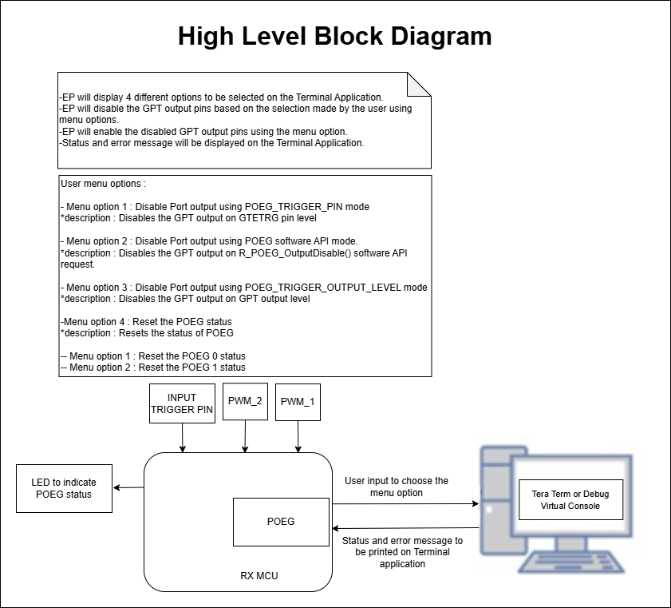

## FSP Modules Used ##
List all the various modules that are used in this example project. Refer to the FSP User Manual for further details on each module listed below.

| Module Name | Usage  | Searchable Keyword (using New Stack > Search) |
|-------------|-----------------------------------------------|-----------------------------------------------|
| Port output enable for GPT  | Port output enable for GPT channel 0.   | r_poeg |
| Port output enable for GPT  | Port output enable for GPT channel 1.   | r_poeg |
| General PWM   | General PWM channel 1. | r_gpt |
| General PWM   | General PWM channel 2. | r_gpt |

## Module Configuration Notes ##
This section describes FSP Configurator properties that are important or different from those selected by default. 

**Common Configuration Properties**

|   Module Property Path and Identifier   |   Default Value   |   Used Value   |   Reason   |
| :-------------------------------------: | :---------------: | :------------: | :--------: |
|   configuration.xml > BSP > Properties > Settings > Property > RX Common > Heap size (bytes) |  0  | 0x400 | Change heap size to accommodate functions usage in the EP and avoid any runtime errors. |

**Configuration Properties for POEG channel 0**

|   Module Property Path and Identifier   |   Default Value   |   Used Value   |   Reason   |
| :-------------------------------------: | :---------------: | :------------: | :--------: |
| configuration.xml > Stacks > g_poeg0 Port Output Enable for GPT (r_poeg) > Properties > Settings > Property > Module g_poeg0 Port Output Enable for GPT (r_poeg) > General > Channel | 0 | 0 | POEG Channel. |
| configuration.xml > Stacks > g_poeg0 Port Output Enable for GPT (r_poeg) > Properties > Settings > Property > Module g_poeg0 Port Output Enable for GPT (r_poeg) > General > Trigger > GPT Output Level |☐ | ☑ | POEG Trigger. |
| configuration.xml > Stacks > g_poeg0 Port Output Enable for GPT (r_poeg) > Properties > Settings > Property > Module g_poeg0 Port Output Enable for GPT (r_poeg) > Input > GTETRG Polarity | Active High | Active Low| Select the polarity of the GTETRG pin. |
| configuration.xml > Stacks > g_poeg0 Port Output Enable for GPT (r_poeg) > Properties > Settings > Property > Module g_poeg0 Port Output Enable for GPT (r_poeg) > Input > GTETRG Noise Filter | Disabled | PCLKA/32 | Configure the noise filter for the GTETRG pin. |
| configuration.xml > Stacks > g_poeg0 Port Output Enable for GPT (r_poeg) > Properties > Settings > Property > Module g_poeg0 Port Output Enable for GPT (r_poeg) > Interrupts > Callback | NULL | channel0_user_callback | This property is used to specify  user callback function. |
| configuration.xml > Stacks > g_poeg0 Port Output Enable for GPT (r_poeg) > Properties > Settings > Property > Module g_poeg0 Port Output Enable for GPT (r_poeg) > Interrupts > Interrupt Priority | Priority 0 | Priority 1  | This property is used to select the POEG interrupt priority. |

**Configuration Properties for POEG channel 1**

|   Module Property Path and Identifier   |   Default Value   |   Used Value   |   Reason   |
| :-------------------------------------: | :---------------: | :------------: | :--------: |
| configuration.xml > Stacks >  g_poeg1 Port Output Enable for GPT (r_poeg) > Properties > Settings > Property > Module g_poeg1 Port Output Enable for GPT (r_poeg) > General > Channel | 0 | 1 | POEG Channel. |
| configuration.xml > Stacks > g_poeg1 Port Output Enable for GPT (r_poeg) > Properties > Settings > Property > Module g_poeg1 Port Output Enable for GPT (r_poeg) > General > Trigger > GTETRG Pin | ☐ | ☑ | POEG Trigger. |
| configuration.xml > Stacks > g_poeg1 Port Output Enable for GPT (r_poeg) > Properties > Settings > Property > Module g_poeg1 Port Output Enable for GPT (r_poeg) > Input > GTETRG Polarity | Active High | Active Low | Select the polarity of the GTETRG pin. |
| configuration.xml > Stacks > g_poeg1 Port Output Enable for GPT (r_poeg) > Properties > Settings > Property > Module g_poeg1 Port Output Enable for GPT (r_poeg) > Input > GTETRG Noise Filter | Disabled | PCLKA/32 | Configure the noise filter for the GTETRG pin. |
| configuration.xml > Stacks > g_poeg1 Port Output Enable for GPT (r_poeg) > Properties > Settings > Property > Module g_poeg1 Port Output Enable for GPT (r_poeg) > Interrupts > Callback | NULL | channel1_user_callback | This property is used to specify  user callback function. |
| configuration.xml > Stacks > g_poeg1 Port Output Enable for GPT (r_poeg) > Properties > Settings > Property > Module g_poeg1 Port Output Enable for GPT (r_poeg) > Interrupts > Interrupt Priority | Priority 0 | Priority 1  | This property is used to select the POEG interrupt priority. |

**Configuration Properties for Timer, General PWM 1**

|   Module Property Path and Identifier   |   Default Value   |   Used Value   |   Reason   |
| :-------------------------------------: | :---------------: | :------------: | :--------: |
| configuration.xml > Stacks > g_timer_pwm1 General PWM (r_gpt) > Properties > Settings > Property > Common > Pin Output Support | Disabled | Enabled with Extra features | Enables or disables support for outputting PWM waveforms on GTIOCx pins. |
| configuration.xml > Stacks > g_timer_pwm1 General PWM (r_gpt) > Properties > Settings > Property > Module g_timer_pwm1 Timer, General PWM (r_gpt) > General > Channel | 0 | 1| This property is used to select the channel of GPT. |
| configuration.xml > Stacks > g_timer_pwm1 General PWM (r_gpt) > Properties > Settings > Property > Module g_timer_pwm1 Timer, General PWM (r_gpt) > General > Mode | Periodic | Saw-wave PWM | This property is used to select the mode. |
| configuration.xml > Stacks > g_timer_pwm1 General PWM (r_gpt) > Properties > Settings > Property > Module g_timer_pwm1 Timer, General PWM (r_gpt) > General > Period | 0x10000 | 1000  | This property is used to select the timer period. |
| configuration.xml > Stacks > g_timer_pwm1 General PWM (r_gpt) > Properties > Settings > Property > Module g_timer_pwm1 Timer, General PWM (r_gpt) > Output > Duty Cycle Percent (only applicable in PWM mode) | 50 | 50 | This property is used to specify the timer duty cycle percent. Only used in PWM mode. |
| configuration.xml > Stacks > g_timer_pwm1 General PWM (r_gpt) > Properties > Settings > Property > Module g_timer_pwm1 Timer, General PWM (r_gpt) > Output > GTIOCA Output Enabled | False | False | This property is used to enable the output of GTIOCA on a pin. |
| configuration.xml > Stacks > g_timer_pwm1 General PWM (r_gpt) > Properties > Settings > Property > Module g_timer_pwm1 Timer, General PWM (r_gpt) > Output > GTIOCB Output Enabled | False | True | This property is used to enable the output of GTIOCB on a pin. |
| configuration.xml > Stacks > g_timer_pwm1 General PWM (r_gpt) > Properties > Settings > Property > Module g_timer_pwm1 Timer, General PWM (r_gpt) > Output > Custom Waveform > Custom Waveform Enabled | Disabled | Enabled | This property is used to enable custom waveform generation using compare match events. |
| configuration.xml > Stacks > g_timer_pwm1 General PWM (r_gpt) > Properties > Settings > Property > Module g_timer_pwm1 Timer, General PWM (r_gpt) > Output > Custom Waveform > GTIOA > Compare Match Output Level | Pin Level Retain | Pin Level Toggle | This property is used to toggle the GTIOA output level each time a compare match occurs. |
| configuration.xml > Stacks > g_timer_pwm1 General PWM (r_gpt) > Properties > Settings > Property > Module g_timer_pwm1 Timer, General PWM (r_gpt) > Output > Custom Waveform > GTIOB > Compare Match Output Level | Pin Level Retain | Pin Level Toggle | This property is used to toggle the GTIOB output level each time a compare match occurs. |
| configuration.xml > Stacks > g_timer_pwm1 General PWM (r_gpt) > Properties > Settings > Property > Module g_timer_pwm1 Timer, General PWM (r_gpt) > Extra Features > Output Disable > Output Disable POEG Trigger > GTIOCA and GTIOCB High Level | ☐ | ☑ | Select which POEG to link this GPT channel to. |
| configuration.xml > Stacks > g_timer_pwm1 General PWM (r_gpt) > Properties > Settings > Property > Module g_timer_pwm1 Timer, General PWM (r_gpt) > Extra Features > Output Disable > POEG Link | POEG Channel 0| POEG Channel 0 | Select which POEG to link this GPT channel to. |
| configuration.xml > Stacks > g_timer_pwm1 General PWM (r_gpt) > Properties > Settings > Property > Module g_timer_pwm1 Timer, General PWM (r_gpt) > Extra Features > Output Disable > GTIOCA Disable Setting | Disable Prohibited | Disable Prohibited | Select the disable setting for GTIOCA. |
| configuration.xml > Stacks > g_timer_pwm1 General PWM (r_gpt) > Properties > Settings > Property > Module g_timer_pwm1 Timer, General PWM (r_gpt) > Extra Features > Output Disable > GTIOCB Disable Setting | Disable Prohibited | Level Low | Select the disable setting for GTIOCB. |
| configuration.xml > Stacks > g_timer_pwm1 General PWM (r_gpt) > Properties > Settings > Property > Module g_timer_pwm1 Timer, General PWM (r_gpt) > Extra Features > Extra Features | Disabled | Enabled | Select whether to enable extra features on this channel. |

**Configuration Properties for Timer, General PWM 2**

|   Module Property Path and Identifier   |   Default Value   |   Used Value   |   Reason   |
| :-------------------------------------: | :---------------: | :------------: | :--------: |
| configuration.xml > Stacks > g_timer_pwm2 General PWM (r_gpt) > Properties > Settings > Property > Common > Pin Output Support | Disabled | Enabled with Extra features | Enables or disables support for outputting PWM waveforms on GTIOCx pins. |
| configuration.xml > Stacks > g_timer_pwm2 General PWM (r_gpt) > Properties > Settings > Property > Module g_timer_pwm2 Timer, General PWM (r_gpt) > General > Channel | 0 | 2| This property is used to select the channel of GPT. |
| configuration.xml > Stacks > g_timer_pwm2 General PWM (r_gpt) > Properties > Settings > Property > Module g_timer_pwm2 Timer, General PWM (r_gpt) > General > Mode | Periodic | Saw-wave PWM | This property is used to select the mode. |
| configuration.xml > Stacks > g_timer_pwm2 General PWM (r_gpt) > Properties > Settings > Property > Module g_timer_pwm2 Timer, General PWM (r_gpt) > General > Period | 0x10000 | 1000  | This property is used to select the timer period. |
| configuration.xml > Stacks > g_timer_pwm2 General PWM (r_gpt) > Properties > Settings > Property > Module g_timer_pwm2 Timer, General PWM (r_gpt) > Output > Duty Cycle Percent (only applicable in PWM mode) | 50 | 50 | This property is used to specify the timer duty cycle percent. Only used in PWM mode. |
| configuration.xml > Stacks > g_timer_pwm2 General PWM (r_gpt) > Properties > Settings > Property > Module g_timer_pwm2 Timer, General PWM (r_gpt) > Output > GTIOCA Output Enabled | False | False | This property is used to enable the output of GTIOCA on a pin. |
| configuration.xml > Stacks > g_timer_pwm2 General PWM (r_gpt) > Properties > Settings > Property > Module g_timer_pwm2 Timer, General PWM (r_gpt) > Output > GTIOCB Output Enabled | False | True | This property is used to enable the output of GTIOCB on a pin. |
| configuration.xml > Stacks > g_timer_pwm2 General PWM (r_gpt) > Properties > Settings > Property > Module g_timer_pwm2 Timer, General PWM (r_gpt) > Extra Features > Output Disable > POEG Link | POEG Channel 0 | POEG Channel 1 | Select which POEG to link this GPT channel to. |
| configuration.xml > Stacks > g_timer_pwm2 General PWM (r_gpt) > Properties > Settings > Property > Module g_timer_pwm2 Timer, General PWM (r_gpt) > Extra Features > Output Disable > GTIOCA Disable Setting | Disable Prohibited | Disable Prohibited | Select the disable setting for GTIOCA. |
| configuration.xml > Stacks > g_timer_pwm2 General PWM (r_gpt) > Properties > Settings > Property > Module g_timer_pwm2 Timer, General PWM (r_gpt) > Extra Features > Output Disable > GTIOCB Disable Setting | Disable Prohibited | Level Low | Select the disable setting for GTIOCB. |
| configuration.xml > Stacks > g_timer_pwm2 General PWM (r_gpt) > Properties > Settings > Property > Module g_timer_pwm2 Timer, General PWM (r_gpt) > Extra Features > Extra Features | Disabled | Enabled | Select whether to enable extra features on this channel. |

**Configuration Properties for using the Serial Terminal (UART)**   
|   Configure Interrupt Event Path        |   Default Value   |   Used Value   |   Reason   |
|-----------------------------------------|-------------------|----------------|------------|
| configuration.xml > Interrupts > Interrupts Configuration > New User Event > RSCI > RSCI12 > RSCI12 RXI (Receive data full) | empty | sci_b_uart_rxi_isr | Assign the UART receive ISR (Receive data full) to the interrupt vector table. |
| configuration.xml > Interrupts > Interrupts Configuration > New User Event > RSCI > RSCI12 > RSCI12 TXI (Transmit data empty) | empty | sci_b_uart_txi_isr | Assign the UART transfer ISR (Transfer data empty) to the interrupt vector table. |
| configuration.xml > Interrupts > Interrupts Configuration > New User Event > RSCI > RSCI12 > 105-6 GROUPAL1 RSCI12 TEI (Transmit end) | empty | sci_b_uart_tei_isr | Assign the UART transfer ISR (Transfer end) to the interrupt vector table. |
| configuration.xml > Interrupts > Interrupts Configuration > New User Event > RSCI > RSCI12 > 105-7 GROUPAL1 RSCI12 ERI (Receive error) | empty | sci_b_uart_eri_isr | Assign the UART receive ISR (Receive error) to the interrupt vector table. |

## API Usage ##

The table below lists the POEG basic APIs used at the application layer by this example project.

| API Name    | Usage                                                                          |
|-------------|--------------------------------------------------------------------------------|
| R_POEG_Open | This API is used to open the POEG instance. |
| R_POEG_Reset | This API is used to reset POEG status. |
| R_POEG_OutputDisable | This API is used to disable GPT output pins. |
| R_GPT_Open | This API is used to open the GPT instance. |
| R_GPT_Start | This API is used to start the GPT. |
| R_GPT_OutputEnable | This API is used to enable waveform output on the specified GPT GTIOC pin. |
| R_GPT_OutputDisable | This API is used to disable waveform output on the specified GPT GTIOC pin. |

**For using the Serial Terminal (UART)**
| API Name    | Usage                                                                          |
|-------------|--------------------------------------------------------------------------------|
| R_SCI_B_UART_Open | This API is used to configures the UART driver based on the input configurations. |
| R_SCI_B_UART_Write | This API is used to transmit user specified number of bytes from the source buffer pointer. |
| R_SCI_B_UART_Close | This API is used to abort any in progress transfers, disables interrupts, receiver, and transmitter, close lower level transfer drivers if used and remove power. |

## Verifying Operation ##
1. Import the example project.

2. Generate, and build the example project.

3. Before running the example project, make sure hardware connections are completed.

4. Connect the RX MCU to the host PC via debugger. By default, EP will use E2lite debugger.
5. Open a terminal application (e.g., Tera Term or Debug Virtual Console) on the host PC and connect to the RX board’s USB Serial port.  
   * Note: For using the Serial Terminal application:
        * To echo back typed content in Tera Term, go to [Setup] -> [Terminal...] and check [Local echo].
        * The configuration parameters of the serial port are:
            - COM port: Provided by the USB Serial COM.
            - Baud rate: 115200 bps
            - Data length: 8 bits
            - Parity: None
            - Stop bit: 1 bit
            - Flow control: None 

**The EP information**  
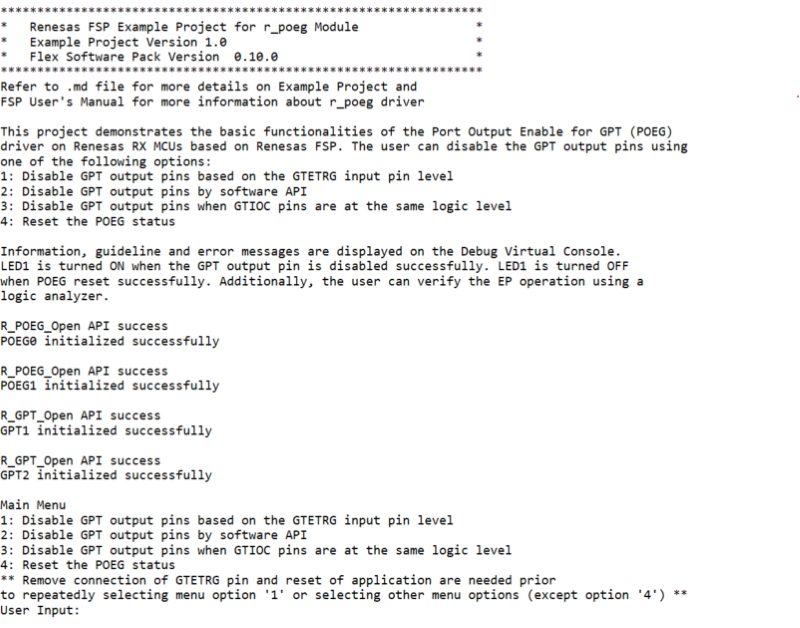

6. To disable GPT output pins based on the GTETRG input pin level, enter "1": The POEG1 channel number corresponds to the GTETRG input pin which is used with this channel. GTETRG pin level (active LOW or active HIGH based on configuration) disables GPT output pins at the input level.
    * After selecting Option "1", refer to the guidelines on the Terminal Application or the "Hardware Connections" section to connect hardware properly. Then reset the respective POEG status by entering Menu option "4".
    * Removing the connection of the GTETRG pin and resetting the application are needed prior to repeatedly selecting menu option "1", or selecting other options from the menu (except option "4").

7. To disable GPT output pins by software API, enter "2": The GPT output pins are disabled on R_POEG_OutputDisable() software API. Then reset the respective POEG status by entering Menu option "4".

8. To disable GPT output pins when GTIOC pins are at the same logic level, enter "3": The GPT output pins are disabled when the GTIOC pins are on the same level. Then reset the respective POEG status by entering Menu option "4".
  
9. To reset POEG channel 0 (required after running option 3): enter "4", then enter "1". To reset POEG channel 1 (required after running options 1 and 2): enter "4", then enter "2".
	
10. Verify the POEG operation through output status on the Terminal Application, LED behavior or waveform on a Logic Analyzer (optional).

**POEG Output Disable On Input Pin Trigger Terminal Application log**

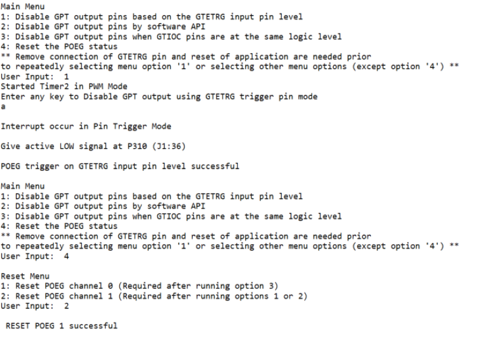
	
**POEG Output Disable On Software API Terminal Application log**

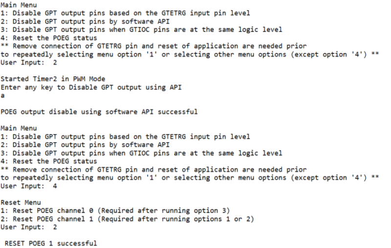
	
**POEG Output Disable On GPT Output Level Terminal Application log**

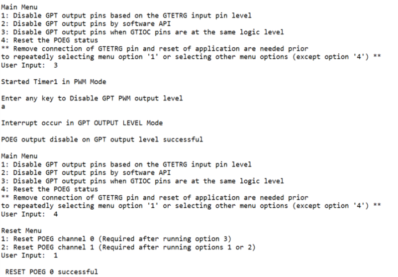
	
**POEG POEG Reset Channel 0 Terminal Application log**

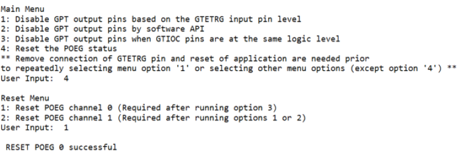

**POEG POEG Reset Channel 1 Terminal Application  log**

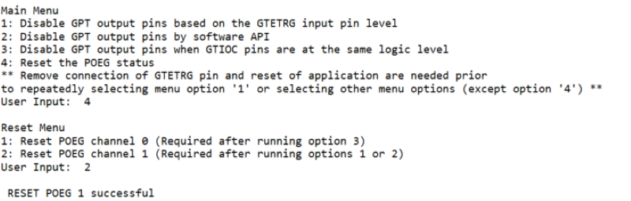

The EP operation waveform with a Logic Analyzer as shown below:

The waveform below illustrates **POEG Option 1** disabling GPT output pins based on the GTETRG input pin level, followed by a reset using **POEG Option 4**:

  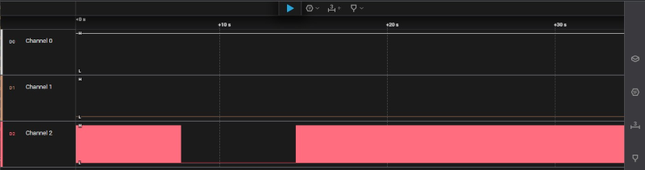
  
The waveform below illustrates **POEG Option 2** disabling GPT output pins by software API, followed by a reset using **POEG Option 4**:

  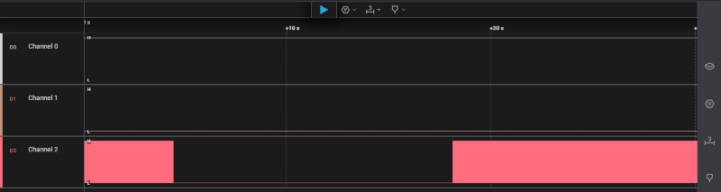

The waveform below illustrates **POEG Option 3** disabling GPT output pins when GTIOC pins are at the same logic level, followed by a reset using **POEG Option 4**:
  
  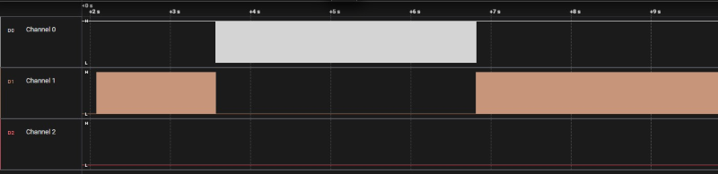

## Special Topics ##

### Debugger Setting ###

* To use E2 Lite on-board or E2 Emulator Lite, please follow the instructions below:

1. **Common step**: Click [**Run**] → [**Debug Configurations…**] to open the “**Debug Configurations**” window.  
  

2. **Select file application**  
  a. **Used for projects built with GCC**: --> Select file **.elf**.  
    
  b. **Used for projects built with CCRX**: --> Select file **.x**.  
  

3. **Setting debugger configurations**  
  a. **Used for E2 Lite on-board**.    
    
  b. **Used for external E2 Emulator Lite**.  
    

  **Note:** Connect the RX board debugger port (J9) to the host PC via E2 Emulator Lite (with USB cable and 20-20 pin cable).

### Adding lowsrc Folder

Before changing terminal application settings, you need to add the `lowsrc` folder from another Example Project:

1. **Locate the lowsrc folder:**
   
   - Navigate to Example Project `sci_uart` or `usb_pcdc_with_freertos`  (`example_projects/<board>/sci_uart/e2studio/gccrx_sci_uart_<board>_ep/src`)
   - Find the `lowsrc` folder containing low-level source files.

2. **Copy `lowsrc` folder to this Example Project:**
   
   - Copy the entire `lowsrc` folder.
   - Paste it into this your target Example Project directory: `example_projects/ek_rx74m/<EP>/e2studio/`.

3. **Add lowsrc to e2studio project:**
   
   - In e2studio, right-click on the project in Project Explorer.
   - Select **Refresh** (or press F5) to detect the new folder.

4. **Verify the folder is included:**
   
   - Expand the project tree in Project Explorer.
   - Confirm that `lowsrc` folder and its contents are visible.
   - The folder should be included in the build path with source files ready to compile.

5. **Changing the terminal Application to use the Debug Virtual Console:**
   
   - For instructions on how to switch between these options, please refer to the section [`Special Topics`](#special-topics)/[`Changing Terminal Application`](#changing-terminal-application).

6. **Re-build the project:**
   
   - In e2studio, right-click on the project and select **Build Project**.

**Note:** To use Debug Virtual Console, the `lowsrc` folder must be added to the project, as it contains the source files required for Debug Virtual Console operation.

### Changing Terminal Application ###
By default, the EP supports Serial Terminal for RX boards that support USB Serial COM   
**For use CCRX Compiler:**
* Define USE_VIRTUAL_COM=1 macro in Project Properties -> C/C++ Build -> Settings -> Tool Settings -> Compiler -> Source -> Macro definition (-define)
  
To use Debug Virtual Console, please follow the instructions below:
* Define USE_VIRTUAL_COM=0 macro in Project Properties -> C/C++ Build -> Settings -> Tool Settings -> Compiler -> Source -> Macro definition (-define)
* Define BSP_CFG_IO_LIB_ENABLE=1 macro in Project Properties -> C/C++ Build -> Settings -> Tool Settings -> Compiler -> Source -> Macro definition (-define)
  

  
**For use GCCRX Compiler:**  
* Define USE_VIRTUAL_COM=1 macro in Project Properties -> C/C++ Build -> Settings -> Tool Settings -> Compiler -> Includes -> Macro Defines (-D)
  
To use Debug Virtual Console, please follow the instructions below:
* Define USE_VIRTUAL_COM=0 macro in Project Properties -> C/C++ Build -> Settings -> Tool Settings -> Compiler -> Includes -> Macro Defines (-D)
  
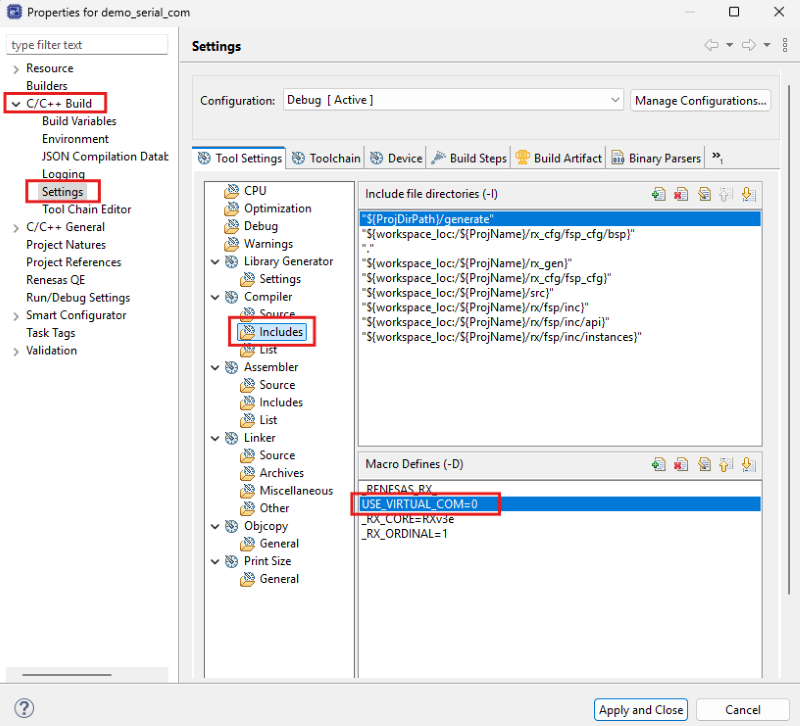
