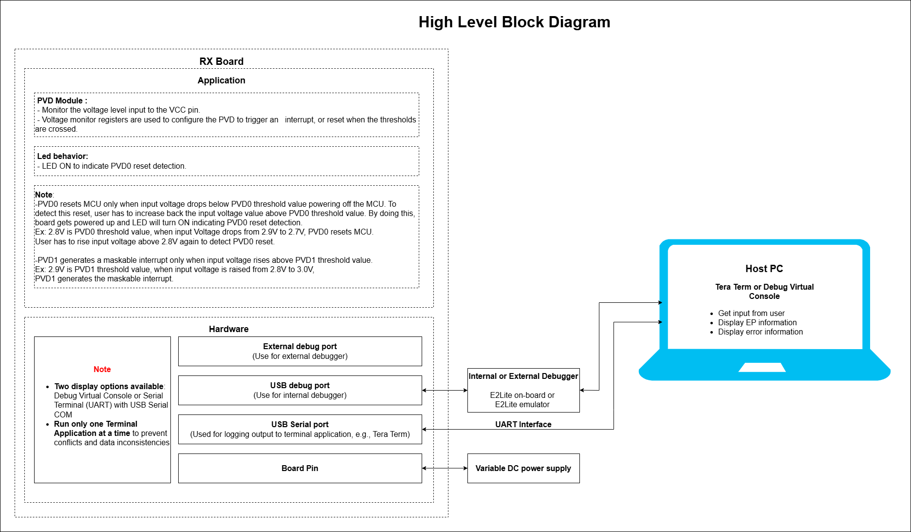
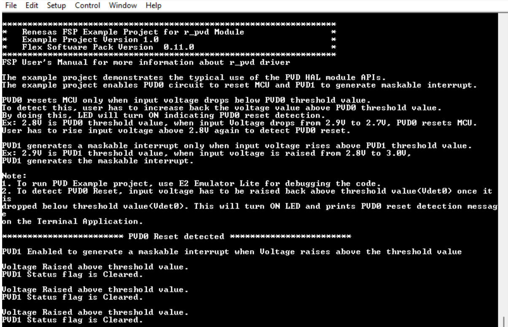
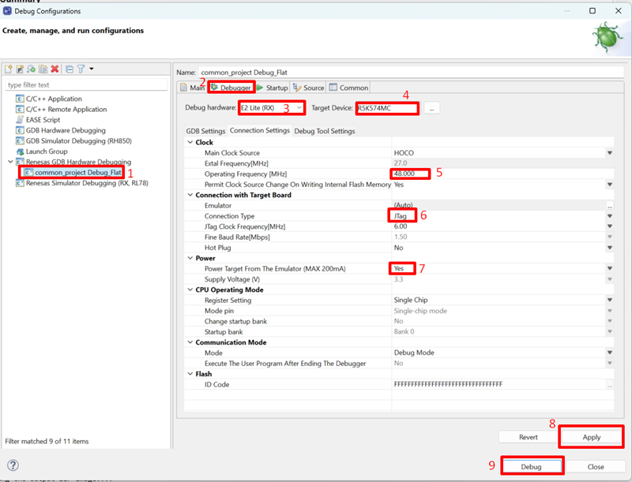

# Introduction #

The example project demonstrates the typical use of the PVD HAL module APIs. This project enables PVD0 circuit to reset MCU and PVD1 to generate maskable interrupt. PVD0 resets MCU only when input voltage drops below PVD0 threshold value, causing the MCU to power off. To detect this reset, the user has to increase the input voltage value back to above PVD0 threshold value. By doing this, board gets powered up and LED will turn ON indicating PVD0 reset detection.

Ex: 2.8V is PVD0 threshold value. When input Voltage is dropped from 2.9V to 2.7V, PVD0 resets MCU. The user has to raise input voltage above 2.8V again to detect PVD0 reset.

PVD1 generates a maskable interrupt only when input voltage is raised above PVD1 threshold value.
Ex: 2.9V is PVD1 threshold value. When input voltage is raised from 2.8V to 3.0V, PVD1 generates the maskable interrupt.

Please note that no interrupt will be generated when Voltage is already above the threshold value and increased further.
Ex: When input voltage is raised from 3.0V to 3.1V with 2.9V as threshold voltage, no interrupt is generated.

**Note**: 
- To display information, the user can select between Debug Virtual Console and the Serial Terminal (UART) with USB Serial COM. It is important to note that the user should only operate a single terminal application at a time to avoid conflicts or data inconsistencies. For instructions on how to switch between these options, please refer to the section [`Special Topics`](#special-topics)/[`Changing Terminal Application`](#changing-terminal-application).

- By default, EP information is printed to the host PC using the Serial Terminal (UART) for boards that support USB Serial COM. LED3 is turned ON to indicate the UART initialized unsuccessfully.

- RX boards that support USB Serial COM: EK-RX74M. 

- When running the EP with the PVD (Low Voltage Detection) example, the user must connect the PMOD UART instead of using USB Serial COM. This is because the USB Serial COM interface supplies power to the board, which prevents the board supply voltage from being adjusted. As a result, PVD voltage level changes cannot be tested correctly when USB Serial COM is used.

## Required Resources ##

To build and run the PVD example project, the following resources are needed.

### Software ###

* Renesas Flexible Software Package (FSP): Version 1.0.0.
* e2 studio: Version 2026-07.
* Renesas GCC Compiler for RX: Version 14.2.0.202607.
* Renesas CC-RX Compiler: Version v3.08.00.
* Terminal Console Application: Tera Term or a similar application.

### Hardware ###

* 1 x Renesas RX board.
* 1 x E2 Emulator Lite.
* 1 x Variable DC Power supply.
* 1 x USB to UART Converter (e.g., Pmod USBUART: https://digilent.com/shop/pmod-usbuart-usb-to-uart-interface/).
* 1 x Micro USB cable used to connect the Pmod USBUART to the Host PC.
* 2 x Female-to-female jumper wires. 

### Hardware Connections ###

- Connect the RX board debugger port (J9) to the host PC via E2 Emulator Lite using a USB cable and 20-pin cable.
   - **Important**: Refer to section 3b in [`Debugger Setting`](#debugger-setting) to configure the debugger correctly for using the external E2 Emulator.
   - **Critical for PVD Testing**: Set *Power Target From The Emulator (Max 200mA)* to **No**. This ensures the board receives power from the external DC power supply instead of the emulator, enabling the voltage adjustments required for PVD testing.
- Connect the Pmod USBUART to the host PC via a Micro USB cable.
- For Pmod USBUART: Jumper JP1 placement is on LCL-VCC pins (The attached system board is powered independently from the PMOD USBUART).
- Connect the Pmod USBUART to the RX board as shown below:
    - RXD P115 (J2:16)	---> TXD Pin of Pmod USBUART (J2:3)
    - TXD P114 (J2:15) 	---> RXD Pin of Pmod USBUART (J2:2)
- For EK-RX74M
  - Connect DC Power supply +ve pin ---> Any on board VCC pin.
  - Connect DC Power supply -ve pin ---> Any on board VSS(GND) pin.
  - PVD1 generates an interrupt when input Voltage raises above 3.08V.
  - PVD0 resets the MCU when input Voltage drops below 2.85V
  - Turn ON SW6.1

## Related Collateral References ##
The following documents can be referred to for enhancing your understanding of the operation of this example project:
- [FSP User Manual on GitHub (Reference link)](https://renesas.github.io/fsp/)
- [FSP Known Issues (Reference link)](https://github.com/renesas/fsp/issues)

# Project Notes #

## System Level Block Diagram ##

## FSP Modules Used ##
List all the various modules that are used in this example project. Refer to the FSP User Manual for further details on each module listed below.

| Module Name | Usage | Searchable Keyword  |
|-------------|-----------------------------------------------|-----------------------------------------------|
| PVD | This module is used to monitor the voltage level input to the VCC pin. | r_pvd |

## Module Configuration Notes ##
This section describes FSP Configurator properties which are important or different than those selected by default.

**Common Configuration Properties**

|   Module Property Path and Identifier   |   Default Value   |   Used Value   |   Reason   |
| :-------------------------------------: | :---------------: | :------------: | :--------: |
|   configuration.xml > BSP > Properties > Settings > Property > RX Common > Heap size (bytes)  |  0   | 0x1000  |  Heap size is required for standard library functions to be used. |

**Configuration Properties for PVD**

|   Module Property Path and Identifier   |   Default Value   |   Used Value   |   Reason   |
|-----------------------------------------|-------------------|----------------|------------|
| configuration.xml > Stack > g_pvd Low/Programmable Voltage Detection (r_pvd) > Properties > Settings > Property > Module g_pvd Low/Programmable Voltage Detection (r_pvd) > Detection Response | No response (Voltage monitor status will be polled) | Maskable interrupt | Select behavior when the voltage crosses the threshold voltage. |
| configuration.xml > Stack > g_pvd Low/Programmable Voltage Detection (r_pvd) > Properties > Settings > Property > Module g_pvd Low/Programmable Voltage Detection (r_pvd) > Voltage Slope | Falling voltage | Rising voltage | Select interrupt generation. |
| configuration.xml > Stack > g_pvd Low/Programmable Voltage Detection (r_pvd) > Properties > Settings > Property > Module g_pvd Low/Programmable Voltage Detection (r_pvd) > Monitor Interrupt Callback | NULL | pvd1_callback | Using function callback. |
| configuration.xml > Stack > g_pvd Low/Programmable Voltage Detection (r_pvd) > Properties > Settings > Property > Module g_pvd Low/Programmable Voltage Detection (r_pvd) > PVD Monitor Interrupt Priority | Disabled | Priority 4 | Select the PVD Monitor interrupt priority. |

**Configuration Properties for using the Serial Terminal (UART)**   
|   Configure Clock Path                  |   Default Value   |   Used Value   |   Reason   |
|-----------------------------------------|-------------------|----------------|------------|
| configuration.xml > Clocks > Clocks Configuration > SCICLK Disable | SCICLK Disable | SCICLK Src: HOCO | Enable operating clock for SCI module by HOCO clock source. |

|   Configure Interrupt Event Path        |   Default Value   |   Used Value   |   Reason   |
|-----------------------------------------|-------------------|----------------|------------|
| configuration.xml > Interrupts > Interrupts Configuration > New User Event > RSCI > RSCI12 > RSCI12 RXI (Receive data full) | empty | sci_b_uart_rxi_isr | Assign the UART receive ISR (Receive data full) to the interrupt vector table. |
| configuration.xml > Interrupts > Interrupts Configuration > New User Event > RSCI > RSCI12 > RSCI12 TXI (Transmit data empty) | empty | sci_b_uart_txi_isr | Assign the UART transfer ISR (Transfer data empty) to the interrupt vector table. |
| configuration.xml > Interrupts > Interrupts Configuration > New User Event > RSCI > RSCI12 > 105-6 GROUPAL1 RSCI12 TEI (Transmit end) | empty | sci_b_uart_tei_isr | Assign the UART transfer ISR (Transfer end) to the interrupt vector table. |
| configuration.xml > Interrupts > Interrupts Configuration > New User Event > RSCI > RSCI12 > 105-7 GROUPAL1 RSCI12 ERI (Receive error) | empty | sci_b_uart_eri_isr | Assign the UART receive ISR (Receive error) to the interrupt vector table. |

## API Usage ##

The table below lists the APIs used at the application layer by this example project.

| API Name    | Usage                                                                          |
|-------------|--------------------------------------------------------------------------------|
| R_PVD_Open | This API is used to open the PVD instance. |
| R_PVD_StatusClear | This API is used to clear the status PVD. |
| R_PVD_Close | This API is used to close GPT PVD instance. |

**For using the Serial Terminal (UART)**
| API Name    | Usage                                                                          |
|-------------|--------------------------------------------------------------------------------|
| R_SCI_B_UART_Open | This API is used to configures the UART driver based on the input configurations. |
| R_SCI_B_UART_Write | This API is used to transmit user specified number of bytes from the source buffer pointer. |
| R_SCI_B_UART_Close | This API is used to abort any in progress transfers, disables interrupts, receiver, and transmitter, close lower level transfer drivers if used and remove power. |

## Verifying Operation ##
1. Import the example project.

2. Generate, and build the example project.

3. Before running the example project, make sure hardware connections are completed.

4. Connect the RX MCU to the host PC via debugger. By default, EP will use E2lite debugger.
5. Open a terminal application (e.g., Tera Term or Debug Virtual Console) on the host PC and connect to the RX board’s USB Serial port.  
   * Note: For using the Serial Terminal application:
        * To echo back typed content in Tera Term, go to [Setup] -> [Terminal...] and check [Local echo].
        * The configuration parameters of the serial port are:
            - COM port: Provided by the USB Serial COM.
            - Baud rate: 115200 bps
            - Data length: 8 bits
            - Parity: None
            - Stop bit: 1 bit
            - Flow control: None 
            
**Note: For using PVD example**
  * Power Target from the Emulator must be NO. Because PVD using voltage from the variable power supply.

### The below images showcase the output on the Terminal Application (Tera Term) ###

## Special Topics ##

### Debugger Setting ###

* To use E2 Lite on-board or E2 Emulator Lite, please follow the instructions below:

1. **Common step**: Click [**Run**] → [**Debug Configurations…**] to open the “**Debug Configurations**” window.  
  

2. **Select file application**  
  a. **Used for projects built with GCC**: --> Select file **.elf**.  
    
  b. **Used for projects built with CCRX**: --> Select file **.x**.  
  

3. **Setting debugger configurations**  
  a. **Used for E2 Lite on-board**.    
    
  b. **Used for external E2 Emulator Lite**.  
    

  **Note:** Connect the RX board debugger port (J9) to the host PC via E2 Emulator Lite (With USB cable and 20-20 pin cable).

### Adding lowsrc Folder

Before changing terminal application settings, you need to add the `lowsrc` folder from another Example Project:

1. **Locate the lowsrc folder:**
   
   - Navigate to Example Project `sci_uart` or `usb_pcdc_with_freertos`  (`example_projects/<board>/sci_uart/e2studio/gccrx_sci_uart_<board>_ep/src`)
   - Find the `lowsrc` folder containing low-level source files.

2. **Copy `lowsrc` folder to this Example Project:**
   
   - Copy the entire `lowsrc` folder.
   - Paste it into this your target Example Project directory: `example_projects/ek_rx74m/<EP>/e2studio/`.

3. **Add lowsrc to e2studio project:**
   
   - In e2studio, right-click on the project in Project Explorer.
   - Select **Refresh** (or press F5) to detect the new folder.

4. **Verify the folder is included:**
   
   - Expand the project tree in Project Explorer.
   - Confirm that `lowsrc` folder and its contents are visible.
   - The folder should be included in the build path with source files ready to compile.

5. **Changing the terminal Application to use the Debug Virtual Console:**
   
   - For instructions on how to switch between these options, please refer to the section [`Special Topics`](#special-topics)/[`Changing Terminal Application`](#changing-terminal-application).

6. **Re-build the project:**
   
   - In e2studio, right-click on the project and select **Build Project**.

**Note:** To use Debug Virtual Console, the `lowsrc` folder must be added to the project, as it contains the source files required for Debug Virtual Console operation.

### Changing Terminal Application ###
By default, the EP supports Serial Terminal for RX boards that support USB Serial COM   
**For use CCRX Compiler:**
* Define USE_VIRTUAL_COM=1 macro in Project Properties -> C/C++ Build -> Settings -> Tool Settings -> Compiler -> Source -> Macro definition (-define)
    
To use Debug Virtual Console, please follow the instructions below:
* Define USE_VIRTUAL_COM=0 macro in Project Properties -> C/C++ Build -> Settings -> Tool Settings -> Compiler -> Source -> Macro definition (-define)
* Define BSP_CFG_IO_LIB_ENABLE=1 macro in Project Properties -> C/C++ Build -> Settings -> Tool Settings -> Compiler -> Source -> Macro definition (-define)
    
    
    
**For use GCCRX Compiler:**  
* Define USE_VIRTUAL_COM=1 macro in Project Properties -> C/C++ Build -> Settings -> Tool Settings -> Compiler -> Includes -> Macro Defines (-D)
    
To use Debug Virtual Console, please follow the instructions below:
* Define USE_VIRTUAL_COM=0 macro in Project Properties -> C/C++ Build -> Settings -> Tool Settings -> Compiler -> Includes -> Macro Defines (-D)
    
  
