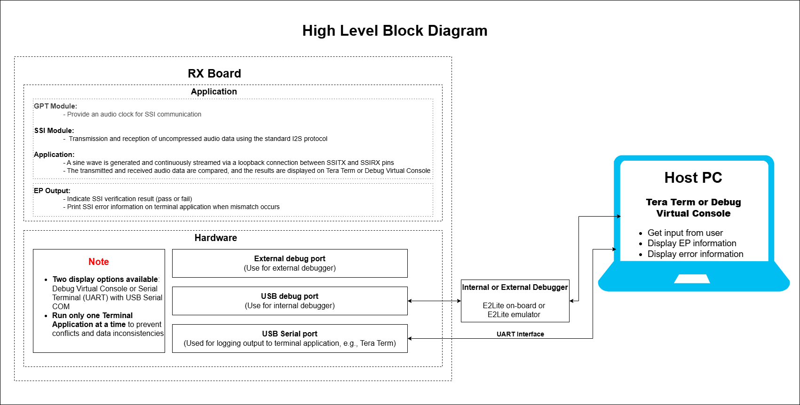
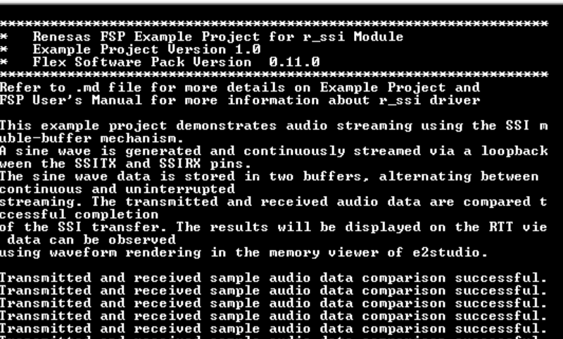
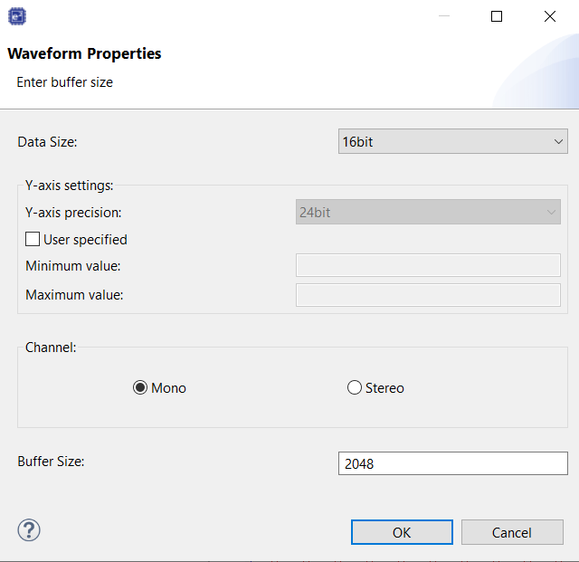
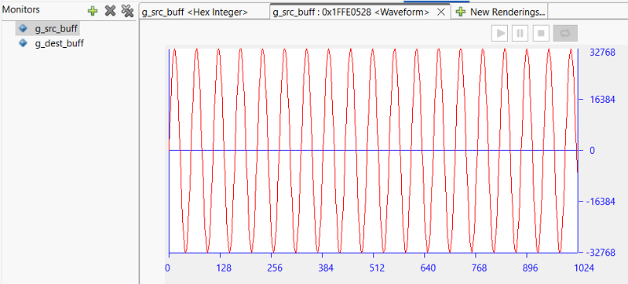
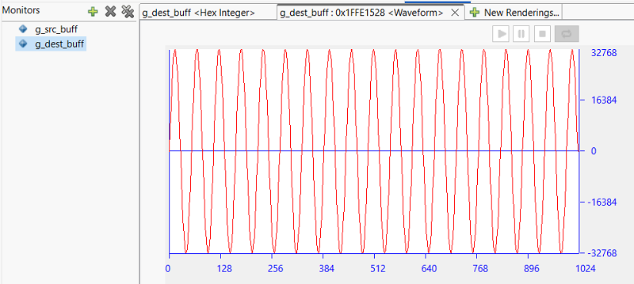
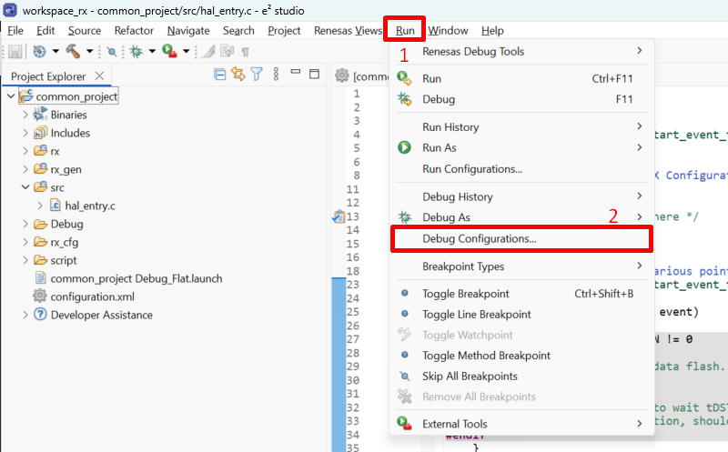

# Introduction 
This example project demonstrates audio streaming using the SSI module with a double-buffer mechanism. A sine wave is generated and continuously streamed via a loopback connection between the SSITX and SSIRX pins. The sine wave data is stored in two buffers, alternating between them to ensure continuous and uninterrupted streaming. The transmitted and received audio data are compared to verify the successful completion of the SSI transfer. The results will be displayed on the Terminal Console Application. The sample data can be observed using waveform rendering in the memory viewer of e2studio.

**Note**: 
- To display information, the user can select between Debug Virtual Console and the Serial Terminal (UART) with USB Serial COM. It is important to note that the user should only operate a single terminal application at a time to avoid conflicts or data inconsistencies. For instructions on how to switch between these options, please refer to the section [`Special Topics`](#special-topics)/[`Changing Terminal Application`](#changing-terminal-application).

- By default, EP information is printed to the host PC using the Serial Terminal (UART) for boards that support USB Serial COM. LED3 is turned ON to indicate the UART initialized unsuccessfully.

- RX boards that support USB Serial COM: EK-RX74M. 

## Required Resources
To build and run the SSI example project, the following resources are needed.

### Software 
* Renesas Flexible Software Package (FSP): Version 1.0.0.
* e2 studio: Version 2026-07.
* Renesas GCC Compiler for RX: Version 14.2.0.202607.
* Renesas CC-RX Compiler: Version v3.08.00.
* Terminal Console Application: Tera Term or a similar application.

### Hardware 
* 1 x Renesas RX board.
* 2 x Type-C USB cables for programming and debugging.
* 1 x Jumper wire to connect.

## Hardware Connections 
- Connect the RX board USB debug port (J8) to the PC via a Type-C USB cable for EP debugging (If E2 Lite on-board is used).
- Connect the RX board USB Serial port (J27) to the PC using a Type-C USB cable to verify logs through the Terminal Application.

- For EK-RX74M:
  - Connect P310 (J1:36) (SSITXD pin)	<--> P311 (J1:37) (SSIRXD pin).

## Related Collateral References 
The following documents can be referred to for enhancing your understanding of the operation of this example project:
- [FSP User Manual on GitHub (Reference link)](https://renesas.github.io/fsp/)
- [FSP Known Issues (Reference link)](https://github.com/renesas/fsp/issues)

# Project Notes 

## System Level Block Diagram

## FSP Modules Used 
List all the various modules that are used in this example project. Refer to the FSP User Manual for further details on each module listed below.

| Module Name | Usage  | Searchable Keyword (using New Stack > Search) |
|-------------|-----------------------------------------------|-----------------------------------------------|
| SCI UART | SCI UART is used for data transmission and reception. | r_sci_b_uart |
| GPT | GPT is used to control frequency and intensity of LEDs | r_gpt |
| SSI | CRC is used for transmission and reception of uncompressed audio data using the standard I2S protocol in master and slave modes. | r_ssi |

## Module Configuration Notes 
This section describes FSP Configurator properties which are important or different than those selected by default. 

**Common Configuration Properties**

|   Module Property Path and Identifier   |   Default Value   |   Used Value   |   Reason   |
| :-------------------------------------: | :---------------: | :------------: | :--------: |
|   configuration.xml > BSP > Properties > Settings > Property > RX Common > Heap size (bytes)  |  0   | 0x400  |  Heap size is required for standard library functions to be used. |
|   configuration.xml > BSP > Properties > Settings > Property > RX Common > Subclock Populated | Not Populated | Populated | To enable the subclock oscillator for RTC operation. |

**SCI UART Configuration Properties (g_uart)**
|   Module Property Path and Identifier   |   Default Value   |   Used Value   |   Reason   |
| :-------------------------------------: | :---------------: | :------------: | :--------: |
|  configuration.xml > Stacks > g_uart UART (r_sci_b_uart) > Properties > Settings > Property > Module g_uart UART (r_sci_b_uart) > General > Name | g_uart0 | g_uart | Name of the SCI UART instance. |
|  configuration.xml > Stacks > g_uart UART (r_sci_b_uart) > Properties > Settings > Property > Module g_uart UART (r_sci_b_uart) > General > Channel | 0 | 0 | Channel number 0 is used for SCI UART communication. |
|  configuration.xml > Stacks > g_uart UART (r_sci_b_uart) > Properties > Settings > Property > Module g_uart UART (r_sci_b_uart) > Interrupts > Callback | NULL | uart_cb | Assigned name for using callback function. |
|  configuration.xml > Stacks > g_uart UART (r_sci_b_uart) > Properties > Settings > Property > Module g_uart UART (r_sci_b_uart) > Interrupts > Receive Interrupt Priority | Priority 2 | Priority 12 | Select the interrupt priority. |
|  configuration.xml > Stacks > g_uart UART (r_sci_b_uart) > Properties > Settings > Property > Module g_uart UART (r_sci_b_uart) > Interrupts > Transmit Data Empty Interrupt Priority | Priority 2 | Priority 12 | Select the interrupt priority. |
|  configuration.xml > Stacks > g_uart UART (r_sci_b_uart) > Properties > Settings > Property > Module g_uart UART (r_sci_b_uart) > Interrupts > Transmit End Interrupt Priority | Priority 2 | Priority 12 | Select the interrupt priority. |
|  configuration.xml > Stacks > g_uart UART (r_sci_b_uart) > Properties > Settings > Property > Module g_uart UART (r_sci_b_uart) > Interrupts > Error Interrupt Priority | Priority 2 | Priority 12 | Select the interrupt priority. |
|  configuration.xml > Stacks > g_uart UART (r_sci_b_uart) > Properties > Settings > Property > Pins > RXD0 | None | P005 | RXD0 is assigned to P005. |
|  configuration.xml > Stacks > g_uart UART (r_sci_b_uart) > Properties > Settings > Property > Pins > TXD0 | None | P004 | TXD0 is assigned to P004. |

**GPT Configuration Properties (r_gpt)**
|   Module Property Path and Identifier   |   Default Value   |   Used Value   |   Reason   |
| :-------------------------------------: | :---------------: | :------------: | :--------: |
|  configuration.xml > Stacks > g_timer Timer, General PWM (r_gpt) > Properties > Settings > Property > g_timer Timer, General PWM (r_gpt) > common > Pin Output Support | Disabled | Enabled | Enables or disables support for outputting PWM waveforms on GTIOCx pins.  |
|  configuration.xml > Stacks > g_timer Timer, General PWM (r_gpt) > Properties > Settings > Property > g_timer Timer, General PWM (r_gpt) > Output > Custom Waveform > Output > GTIOCA Output Enabled | False | True | Enable the output of GTIOCA on a pin. |
| configuration.xml > Stacks > g_timer Timer, General PWM (r_gpt) > Properties > Settings > Property > g_timer Timer, General PWM (r_gpt) > General > Channel | 0 | 14 | Channel of GPT to get audio clock for SSI communication |
| configuration.xml > Stacks > g_timer Timer, General PWM (r_gpt) > Properties > Settings > Property > g_timer Timer, General PWM (r_gpt) > General > Period | 0x10000 | 1411200 | Period to get audio clock for SSI communication |
| configuration.xml > Stacks > g_timer Timer, General PWM (r_gpt) > Properties > Settings > Property > g_timer Timer, General PWM (r_gpt)> General > Period Unit | Raw Counts | Hertz | Unit of the period specified above |

**SSI Configuration Properties (r_ssi)**
|   Module Property Path and Identifier   |   Default Value   |   Used Value   |   Reason   |
| :-------------------------------------: | :---------------: | :------------: | :--------: |
| configuration.xml > g_i2s I2S (r_ssi) > Properties > Settings > Property > Module g_i2s I2S (r_ssi) > Operating Mode (Master/Slave)| Master Mode | Master Mode| SSI Configuration. |
| configuration.xml > g_i2s I2S (r_ssi) > Properties > Settings > Property > Module g_i2s I2S (r_ssi) > Bit Depth | 16 Bits | 16 bits| Bit Depth. |
| configuration.xml > g_i2s I2S (r_ssi) > Properties > Settings > Property > Module g_i2s I2S (r_ssi) > Word Length | 16 Bits| 16 bits | This property is used to specify Word Length. |
| configuration.xml > g_i2s I2S (r_ssi) > Properties > Settings > Property > Module g_i2s I2S (r_ssi) > WS Continue Mode | Disabled | Disabled | This property is used to enable/disable WS Continue Mode. |
| configuration.xml > g_i2s I2S (r_ssi) > Properties > Settings > Property > Module g_i2s I2S (r_ssi) > Bit Clock Source (available only in Master mode) | External AUDIO_CLK| Internal AUDIO_CLK | This property is used to set Bit Clock Source. |
| configuration.xml > g_i2s I2S (r_ssi) > Properties > Settings > Property > Module g_i2s I2S (r_ssi) >  Bit Clock Divider (available only in Master mode)  | Audio Clock / 1| Audio Clock/2 | This property is used to set Bit Clock Divider. |
| configuration.xml > g_i2s I2S (r_ssi) > Properties > Settings > Property > Module g_i2s I2S (r_ssi) > Callback | NULL | i2s_callback | Defined user callback for SSI events. |
| configuration.xml > g_i2s I2S (r_ssi) > Properties > Settings > Property > Module g_i2s I2S (r_ssi) > Transmit Interrupt Priority | Disabled | Priority 29| This property is used to set Transmit Interrupt Priority. |
| configuration.xml > g_i2s I2S (r_ssi) > Properties > Settings > Property > Module g_i2s I2S (r_ssi) > Receive Interrupt Priority  | Disabled  | Priority 29 | This property is used to set Receive Interrupt Priority. |
| configuration.xml > g_i2s I2S (r_ssi) > Properties > Settings > Property > Module g_i2s I2S (r_ssi) > Idle/Error Interrupt Priority  | Disabled  | Priority 29 | This property is used to set Idle/Error Interrupt Priority. |

**Configuration Properties for using the Serial Terminal (UART)**   
|   Configure Interrupt Event Path        |   Default Value   |   Used Value   |   Reason   |
|-----------------------------------------|-------------------|----------------|------------|
| configuration.xml > Interrupts > Interrupts Configuration > New User Event > RSCI > RSCI12 > RSCI12 RXI (Receive data full) | empty | sci_b_uart_rxi_isr | Assign the UART receive ISR (Receive data full) to the interrupt vector table. |
| configuration.xml > Interrupts > Interrupts Configuration > New User Event > RSCI > RSCI12 > RSCI12 TXI (Transmit data empty) | empty | sci_b_uart_txi_isr | Assign the UART transfer ISR (Transfer data empty) to the interrupt vector table. |
| configuration.xml > Interrupts > Interrupts Configuration > New User Event > RSCI > RSCI12 > 105-6 GROUPAL1 RSCI12 TEI (Transmit end) | empty | sci_b_uart_tei_isr | Assign the UART transfer ISR (Transfer end) to the interrupt vector table. |
| configuration.xml > Interrupts > Interrupts Configuration > New User Event > RSCI > RSCI12 > 105-7 GROUPAL1 RSCI12 ERI (Receive error) | empty | sci_b_uart_eri_isr | Assign the UART receive ISR (Receive error) to the interrupt vector table. |

## API Usage 

The table below lists the FSP provided APIs used at the application layer by this example project.

| API Name    | Usage                                                                          |
|-------------|--------------------------------------------------------------------------------|
| R_SCI_B_UART_Open | This API is used to open a SCI UART instance. |
| R_SCI_B_UART_Read | This API is used to read data from the SCI UART instance. |
| R_SCI_B_UART_Write | This API is used to write data to the SCI UART instance. |
| R_SCI_B_UART_Close | This API is used to close the SCI UART instance. |
|R_SSI_Open| This API is used to open the SSI instance. |
|R_SSI_Stop| This API is used to stop SSI. |
|R_SSI_WriteRead| This API is used to writes from source buffer and reads data into destination buffer. |
|R_SSI_Close| This API closes the SSI instance. |
|R_GPT_Open| This API is used to initialize the General PWM configured as SSI Audio Clock. |
|R_GPT_Start| This API is used to start SSI Audio Clock. |
|R_GPT_Close| This API is used to stop the SSI Audio Clock. |

## Verifying Operation

1. Import the example project.

2. Generate, and build the example project.

3. Before running the example project, make sure hardware connections are completed.

4. Connect the RX MCU to the host PC via debugger. By default, EP will use E2lite debugger.

5. Open a terminal application (e.g., Tera Term or Debug Virtual Console) on the host PC and connect to the RX board’s USB Serial port.  
   * Note: For using the Serial Terminal application:
        * To echo back typed content in Tera Term, go to [Setup] -> [Terminal...] and check [Local echo].
        * The configuration parameters of the serial port are:
            - COM port: Provided by the USB Serial COM.
            - Baud rate: 115200 bps
            - Data length: 8 bits
            - Parity: None
            - Stop bit: 1 bit
            - Flow control: None 

### Below images showcases the output log on the Terminal Application (Tera Term):

  

## Special Topics ##

### Setting up waveform rendering ###
* While debugging the project, enter the memory view and add "g_src_buff" (transmitted data) and "g_dest_buff" (received data) as variables to monitor.
* Then click on New Rendering -> Waveform -> Waveform properties
* Set the waveform properties as Data size to 16 bit, user-specified minimum and maximum values for Y-axis on signal generator, Channel to Mono, Buffer size as 2048.

   
   **Note:** User can add the buffer address of each channel in the memory to view the waveform of each channel connected.
  
The images below showcase the output of waveform rendering for SSI:

* Waveform Rendering of SSI source buffer (g_src_buff):

* Waveform Rendering of SSI destination buffer (g_dest_buff):
   * Note: 
      * The `g_dest_buff` buffer is cleared before new incoming data is stored, which may cause differences between the waveform viewed in **Memory View** and the capture image below. This is expected behavior due to the double-buffering mechanism used in streaming.
      * For accurate validation, the user should set a breakpoint at **line 142** (This code line used memcmp function to compare `g_src_buff` and `g_dest_buff`) in `...\e2studio\src\ssi_ep.c` to validate the waveform.

### Debugger Setting ###

* To use E2 Lite on-board or E2 Emulator Lite, please follow the instructions below:

1. **Common step**: Click [**Run**] → [**Debug Configurations…**] to open the “**Debug Configurations**” window.  
  

2. **Select file application**  
  a. **Used for projects built with GCC**: --> Select file **.elf**.  
    
  b. **Used for projects built with CCRX**: --> Select file **.x**.  
  

3. **Setting debugger configurations**  
  a. **Used for E2 Lite on-board**.    
    
  b. **Used for external E2 Emulator Lite**.  
    

  **Note:** Connect the RX board debugger port (J9) to the host PC via E2 Emulator Lite (with USB cable and 20-20 pin cable).

### Adding lowsrc Folder

Before changing terminal application settings, you need to add the `lowsrc` folder from another Example Project:

1. **Locate the lowsrc folder:**
   
   - Navigate to Example Project `sci_uart` or `usb_pcdc_with_freertos`  (`example_projects/<board>/sci_uart/e2studio/gccrx_sci_uart_<board>_ep/src`)
   - Find the `lowsrc` folder containing low-level source files.

2. **Copy `lowsrc` folder to this Example Project:**
   
   - Copy the entire `lowsrc` folder.
   - Paste it into this your target Example Project directory: `example_projects/ek_rx74m/<EP>/e2studio/`.

3. **Add lowsrc to e2studio project:**
   
   - In e2studio, right-click on the project in Project Explorer.
   - Select **Refresh** (or press F5) to detect the new folder.

4. **Verify the folder is included:**
   
   - Expand the project tree in Project Explorer.
   - Confirm that `lowsrc` folder and its contents are visible.
   - The folder should be included in the build path with source files ready to compile.

5. **Changing the terminal Application to use the Debug Virtual Console:**
   
   - For instructions on how to switch between these options, please refer to the section [`Special Topics`](#special-topics)/[`Changing Terminal Application`](#changing-terminal-application).

6. **Re-build the project:**
   
   - In e2studio, right-click on the project and select **Build Project**.

**Note:** To use Debug Virtual Console, the `lowsrc` folder must be added to the project, as it contains the source files required for Debug Virtual Console operation.

### Changing Terminal Application ###
  By default, the EP supports Serial Terminal for RX boards that support USB Serial COM   
**For use CCRX Compiler:**
* Define USE_VIRTUAL_COM=1 macro in Project Properties -> C/C++ Build -> Settings -> Tool Settings -> Compiler -> Source -> Macro definition (-define)
  
  To use Debug Virtual Console, please follow the instructions below:
* Define USE_VIRTUAL_COM=0 macro in Project Properties -> C/C++ Build -> Settings -> Tool Settings -> Compiler -> Source -> Macro definition (-define)
* Define BSP_CFG_IO_LIB_ENABLE=1 macro in Project Properties -> C/C++ Build -> Settings -> Tool Settings -> Compiler -> Source -> Macro definition (-define)
  
  
  
**For use GCCRX Compiler:**  
* Define USE_VIRTUAL_COM=1 macro in Project Properties -> C/C++ Build -> Settings -> Tool Settings -> Compiler -> Includes -> Macro Defines (-D)
  
To use Debug Virtual Console, please follow the instructions below:
* Define USE_VIRTUAL_COM=0 macro in Project Properties -> C/C++ Build -> Settings -> Tool Settings -> Compiler -> Includes -> Macro Defines (-D)
  
  
