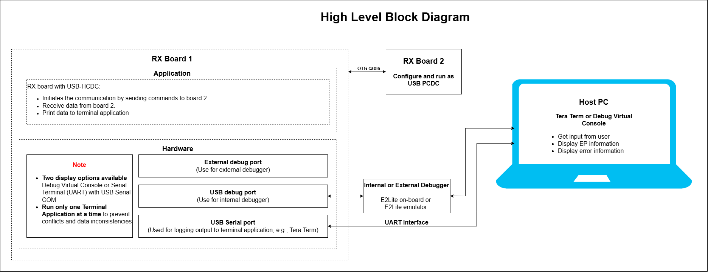
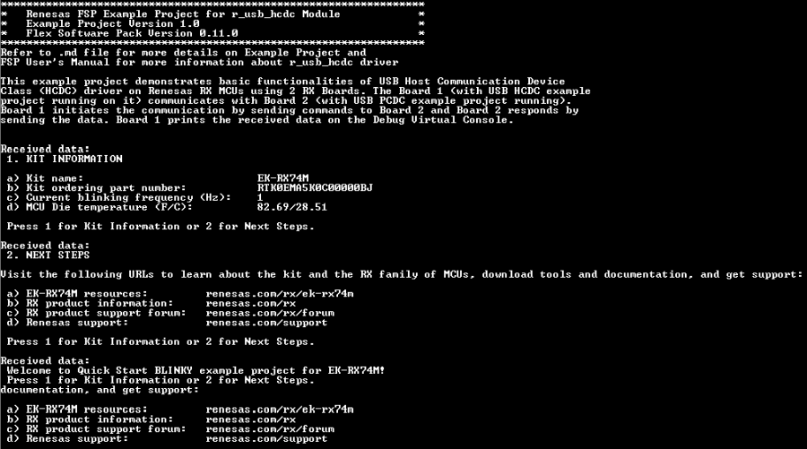

# Introduction #

This example project demonstrates the basic functionality of USB Host Communication Class (HCDC) driver on Renesas RX MCUs using 2 boards. Board 1 (with USB HCDC example project running on it) communicates with Board 2 (with USB PCDC example project running). Board 1 initiates the communication by sending commands to Board 2, and Board 2 responds by sending the data. Board 1 prints the received data on the Terminal Application.  

Note: 
* To display information, the user can select between the Debug Virtual Console and the Serial Terminal (UART) with USB Serial COM. It is important to note that the user should only operate a single Terminal Application at a time to avoid conflicts or data inconsistencies. For instructions on how to switch between these options, please refer to the section [`Special Topics`](#special-topics)/[`Changing Terminal Application`](#changing-terminal-application).

* By default, EP information is printed to the host PC using the Serial Terminal (UART) for boards that support USB Serial COM. LED3 is turned ON to indicate the UART initialized unsuccessfully.

* RX boards that support USB Serial COM: EK-RX74M.

## Required Resources ##

To build and run the USB HCDC example project, the following resources are needed.

### Software ###

* Renesas Flexible Software Package (FSP): Version 1.0.0.
* e2 studio: Version 2026-07.
* Renesas GCC Compiler for RX: Version 14.2.0.202607.
* Renesas CC-RX Compiler: Version v3.08.00.
* Terminal Console Application: Tera Term or a similar application.

### Hardware ###

* 2 x Renesas RX boards.
    - 1 x RX board runs the USB HCDC example project.
    - 1 x RX board runs the USB PCDC example project.
* 3 x Type-C USB cables.
* 1 x Type-C OTG cable.

### Hardware Connections ###

* Connect the RX board 1 USB debug port (J8) to the PC via a Type-C USB cable for EP debugging.
* Connect Board 1 (USB Host running the HCDC example) to Board 2 (USB Device running the PCDC example) using a Type-C OTG cable.
* Connect the RX board 1 USB Serial port (J27) to the PC using a Type-C USB cable to verify logs through the Terminal Application.

* For EK-RX74M:
    * **For using High-Speed Port**:
      * **Host Mode:**
        - J32: Open (No jumper).
        - J34: Jumper on pins 1-2.
        - J48: Jumper on pins 1-2.
        - SW4: SW4-Pin2, 4 OFF, SW4-Pin1, 3, 9, 10 ON.
        - Connect Type-C USB High-Speed port (J35) of the board to the Board 2 through OTG cable.
    
    * **For using Full-Speed Port**:
      * **VBUS supply enable signal:**
        - E64: Close.
        - E65: Open.
      * **Host Mode:**
        - J28: Open (No jumper).
        - J30: Jumper on pins 1-2.
        - SW4: SW4-Pin6, 8 OFF, SW4-Pin5, 7, 11, 12 ON.
        - Connect Type-C USB Full-Speed port (J31) of the board to the Board 2 through OTG cable.

***Note***
> * By default, the USB HCDC example project (i.e., Board 1) runs in Full-Speed mode.

* For Board 2 (USB Device running the PCDC example):
  - The device operates in **Bus-powered** mode, where power is supplied through the USB connection from the host board.
  - The following jumper settings are used for this mode:
    - **VBUS supply enable signal:**
      - E64: Close.
      - E65: Open.
    - **Bus-Powered Mode:**
      - J28: Jumper on pins 1-2.
      - J30: Jumper on pins 2-3.
      - SW4: SW4-Pin6, 8 ON, SW4-Pin5, 7, 11, 12 OFF.
      - Connect Type-C USB Full-Speed port (J31) or High-Speed port (J35) of the board to the Board 1 through OTG cable.

## Related Collateral References ##
The following documents can be referred to for enhancing your understanding of the operation of this example project:
- [FSP User Manual on GitHub (Reference link)](https://renesas.github.io/fsp/)
- [FSP Known Issues (Reference link)](https://github.com/renesas/fsp/issues)

# Project Notes #

## System Level Block Diagram ##

## FSP Modules Used ##
List all the various modules that are used in this example project. Refer to the FSP User Manual for further details on each module listed below.

| Module Name | Usage  | Searchable Keyword (using New Stack > Search) |
|-------------|-----------------------------------------------|-----------------------------------------------|
| USB HCDC | The USB HCDC example allows the host board to perform read/write communication with the connected USB device (PCDC). | r_usb_hcdc |
|USB Basic Driver | USB driver operates in combination with the device class drivers provided by Renesas to form a complete USB stack. | r_usb_basic |

## Module Configuration Notes ##
This section describes FSP Configurator properties which are important or different than those selected by default.

**Common Configuration Properties**

|   Module Property Path and Identifier   |   Default Value   |   Used Value   |   Reason   |
| :-------------------------------------: | :---------------: | :------------: | :--------: |
|   configuration.xml > BSP > Properties > Settings > Property > RX Common > Heap size (bytes)  |  0   | 0x1000  |  Heap size is required for standard library functions to be used. |
|   configuration.xml > Stacks > USB Thread > Properties > Settings > Property > Thread > Stack size (bytes)  |  1024   | 4096 |  Number bytes in the stack memory area. |
|   configuration.xml > Stacks > USB Thread > Properties > Settings > Property > Thread > Memory Allocation > Support Dynamic Allocation |  Disabled   | Enabled |  Enables dynamic memory allocation for the USB thread at runtime. |
|   configuration.xml > Stacks > USB Thread > Properties > Settings > Property > Thread > Memory Allocation > Total Heap Size	 |  0   | 50000 |  The total amount of RAM available in the FreeRTOS heap. |

**Configuration Properties for USB Speed as High-Speed**

|   Module Property Path and Identifier   |   Default Value   |   Used Value   |   Reason   |
| :-------------------------------------: | :---------------: | :------------: | :--------: |
|  configuration.xml > Stacks > g_basic USB (r_usb_basic) > Properties > Settings > Property > Module g_basic USB (r_usb_basic) > USB Speed | Full Speed | Hi Speed | This property is used to configure USB speed. |
|  configuration.xml > Stacks > g_basic USB (r_usb_basic) > Properties > Settings > Property > Module g_basic USB (r_usb_basic) > USB Module Number| USB_IP0 Port | USB_IP1 Port | This property is used to specify USB module number to be used as per configured USB speed. | 	
|  configuration.xml > Stacks > g_basic USB (r_usb_basic) > Properties > Settings > Property > Pins > USBHS_OVRCURA_A(DS) | None | P206 | The USBHS_OVRCURA_A(DS) pin is configured to P206 to match the RX74M board's pinout. |
|  configuration.xml > Stacks > g_basic USB (r_usb_basic) > Properties > Settings > Property > Pins > USBHS_VBUSEN | None | P205| The USBHS_VBUSEN pin is configured to P205 to match the RX74M board's pinout. |

**Configuration Properties for USB Speed as Full-Speed**

|   Module Property Path and Identifier   |   Default Value   |   Used Value   |   Reason   |
| :-------------------------------------: | :---------------: | :------------: | :--------: |
|  configuration.xml > Stacks > g_basic USB (r_usb_basic) > Properties > Settings > Property > Module g_basic USB (r_usb_basic) > USB Speed | Full Speed | Full Speed | This property is used to configure USB speed. |
|  configuration.xml > Stacks > g_basic USB (r_usb_basic) > Properties > Settings > Property > Module g_basic USB (r_usb_basic) > USB Module Number| USB_IP0 Port | USB_IP0 Port | This property is used to specify USB module number to be used as per configured USB speed. | 	
|  configuration.xml > Stacks > g_basic USB (r_usb_basic) > Properties > Settings > Property > Pins > USBFS_OVRCURA_A(DS) | None | P104 | The USBFS_OVRCURA_A(DS) pin is configured to P104 to match the RX74M board's pinout. |
|  configuration.xml > Stacks > g_basic USB (r_usb_basic) > Properties > Settings > Property > Pins > USBFS_VBUSEN | None | P304 | The USBFS_VBUSEN pin is configured to P304 to match the RX74M board's pinout. |

**Configuration Properties for using the Serial Terminal (UART)**   

|   Configure Clock Path                  |   Default Value   |   Used Value   |   Reason   |
|-----------------------------------------|-------------------|----------------|------------|
| configuration.xml > Clocks > Clocks Configuration > SCICLK Disable | SCICLK Disable | SCICLK Src: HOCO | Enable operating clock for SCI module by HOCO clock source. |

|   Configure Interrupt Event Path        |   Default Value   |   Used Value   |   Reason   |
|-----------------------------------------|-------------------|----------------|------------|
| configuration.xml > Interrupts > Interrupts Configuration > New User Event > RSCI > RSCI12 > RSCI12 RXI (Receive data full) | empty | sci_b_uart_rxi_isr | Assign the UART receive ISR (Receive data full) to the interrupt vector table. |
| configuration.xml > Interrupts > Interrupts Configuration > New User Event > RSCI > RSCI12 > RSCI12 TXI (Transmit data empty) | empty | sci_b_uart_txi_isr | Assign the UART transfer ISR (Transfer data empty) to the interrupt vector table. |
| configuration.xml > Interrupts > Interrupts Configuration > New User Event > RSCI > RSCI12 > 105-6 GROUPAL1 RSCI12 TEI (Transmit end) | empty | sci_b_uart_tei_isr | Assign the UART transfer ISR (Transfer end) to the interrupt vector table. |
| configuration.xml > Interrupts > Interrupts Configuration > New User Event > RSCI > RSCI12 > 105-7 GROUPAL1 RSCI12 ERI (Receive error) | empty | sci_b_uart_eri_isr | Assign the UART receive ISR (Receive error) to the interrupt vector table. |

## API Usage ##

The table below lists the APIs used at the application layer by this example project.

| API Name    | Usage                                                                          |
|-------------|--------------------------------------------------------------------------------|
|R_USB_Open| This API is used to open an USB instance. |
|R_USB_Read| This API is used to read data from the USB interface. |
|R_USB_Write| This API is used to write data to the USB interface. |
| R_USB_HostControlTransfer | This API is used to perform a control transfer between the USB host and the connected device. |
|R_USB_Close| This API is used to close the USB instance. |

**For using the Serial Terminal (UART)**

| API Name           | Usage    |
|--------------------|----------|
| R_SCI_B_UART_Open  | This API is used to configures the UART driver based on the input configurations. |
| R_SCI_B_UART_Write | This API is used to transmit user specified number of bytes from the source buffer pointer. |
| R_SCI_B_UART_Close | This API is used to abort any in progress transfers, disables interrupts, receiver, and transmitter, close lower level transfer drivers if used and remove power. |

## Verifying Operation ##

1. Import the example project.

2. Generate, and build the example project.

3. Before running the example project, make sure hardware connections are completed.

4. Connect the RX MCU to the host PC via debugger. By default, EP will use E2lite debugger.

5. Open a terminal application (e.g., Tera Term or Debug Virtual Console) on the host PC and connect to the RX board’s USB Serial port.  
   * Note: For using the Serial Terminal application:
        * To echo back typed content in Tera Term, go to [Setup] -> [Terminal...] and check [Local echo].
        * The configuration parameters of the serial port are:
            - COM port: Provided by the USB Serial COM.
            - Baud rate: 115200 bps
            - Data length: 8 bits
            - Parity: None
            - Stop bit: 1 bit
            - Flow control: None 

6. Users can perform the menu operations and check the corresponding results on the terminal console (USB Serial COM).

Note: The examples are separate projects and should be flashed to two different boards. 
* On EK-RX74M, EK-RX74N: After flashing Board 1, set SW6.1 on that board to ON to enable on-board debugging, press the Reset button, and then flash the second project to the Board 2.

The below image showcases the output on the Serial terminal application (Tera Term):

## Special Topics ##

### Debugger Setting ###

* To use E2 Lite on-board or E2 Emulator Lite, please follow the instructions below:

1. **Common step**: Click [**Run**] → [**Debug Configurations…**] to open the “**Debug Configurations**” window.  
  

2. **Select file application**  
  a. **Used for projects built with GCC**: --> Select file **.elf**.  
    
  b. **Used for projects built with CCRX**: --> Select file **.x**.  
  

3. **Setting debugger configurations**  
  a. **Used for E2 Lite on-board**.    
    
  b. **Used for external E2 Emulator Lite**.  
    

  **Note:** Connect the RX board debugger port (J9) to the host PC via E2 Emulator Lite (with USB cable and 20-20 pin cable).

### Adding lowsrc Folder

Before changing terminal application settings, you need to add the `lowsrc` folder from another Example Project:

1. **Locate the lowsrc folder:**
   
   - Navigate to Example Project `sci_uart` or `usb_pcdc_with_freertos`  (`example_projects/<board>/sci_uart/e2studio/gccrx_sci_uart_<board>_ep/src`)
   - Find the `lowsrc` folder containing low-level source files.

2. **Copy `lowsrc` folder to this Example Project:**
   
   - Copy the entire `lowsrc` folder.
   - Paste it into this your target Example Project directory: `example_projects/ek_rx74m/<EP>/e2studio/`.

3. **Add lowsrc to e2studio project:**
   
   - In e2studio, right-click on the project in Project Explorer.
   - Select **Refresh** (or press F5) to detect the new folder.

4. **Verify the folder is included:**
   
   - Expand the project tree in Project Explorer.
   - Confirm that `lowsrc` folder and its contents are visible.
   - The folder should be included in the build path with source files ready to compile.

5. **Changing the terminal Application to use the Debug Virtual Console:**
   
   - For instructions on how to switch between these options, please refer to the section [`Special Topics`](#special-topics)/[`Changing Terminal Application`](#changing-terminal-application).

6. **Re-build the project:**
   
   - In e2studio, right-click on the project and select **Build Project**.

**Note:** To use Debug Virtual Console, the `lowsrc` folder must be added to the project, as it contains the source files required for Debug Virtual Console operation.

### Changing Terminal Application ###
By default, the EP supports Serial Terminal for RX boards that support USB Serial COM   
**For use CCRX Compiler:**
* Define USE_VIRTUAL_COM=1 macro in Project Properties -> C/C++ Build -> Settings -> Tool Settings -> Compiler -> Source -> Macro definition (-define)

To use Debug Virtual Console, please follow the instructions below:
* Define USE_VIRTUAL_COM=0 macro in Project Properties -> C/C++ Build -> Settings -> Tool Settings -> Compiler -> Source -> Macro definition (-define)
* Define BSP_CFG_IO_LIB_ENABLE=1 macro in Project Properties -> C/C++ Build -> Settings -> Tool Settings -> Compiler -> Source -> Macro definition (-define)

**For use GCCRX Compiler:**  
* Define USE_VIRTUAL_COM=1 macro in Project Properties -> C/C++ Build -> Settings -> Tool Settings -> Compiler -> Includes -> Macro Defines (-D)

To use Debug Virtual Console, please follow the instructions below:
* Define USE_VIRTUAL_COM=0 macro in Project Properties -> C/C++ Build -> Settings -> Tool Settings -> Compiler -> Includes -> Macro Defines (-D)

