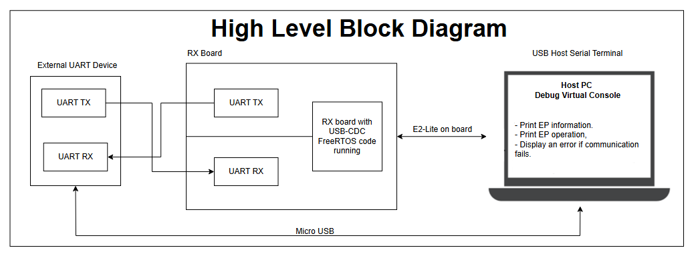
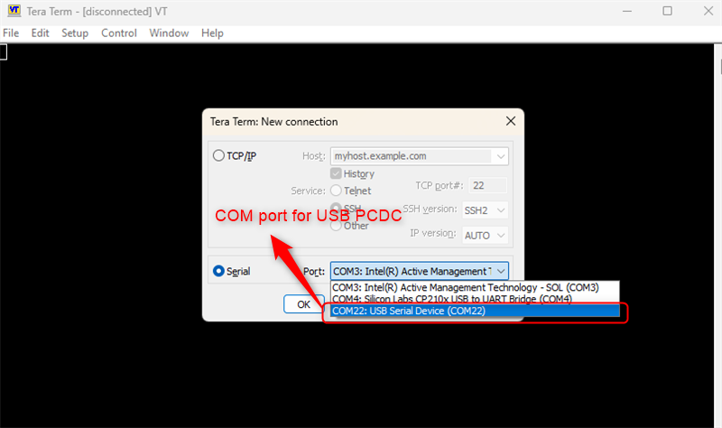
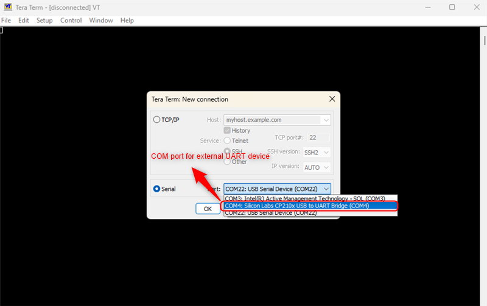
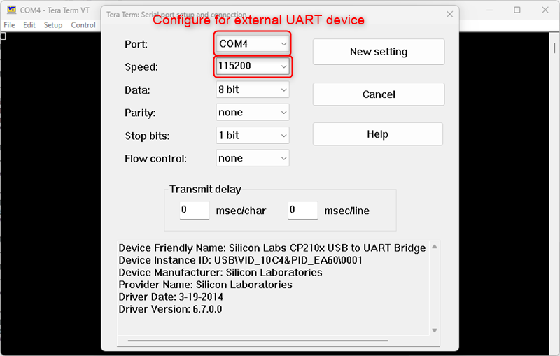
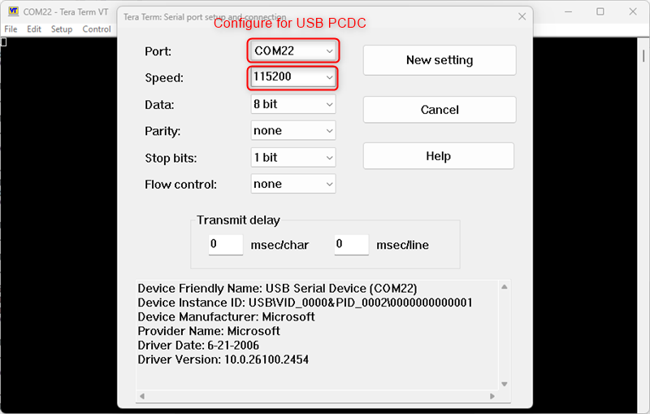
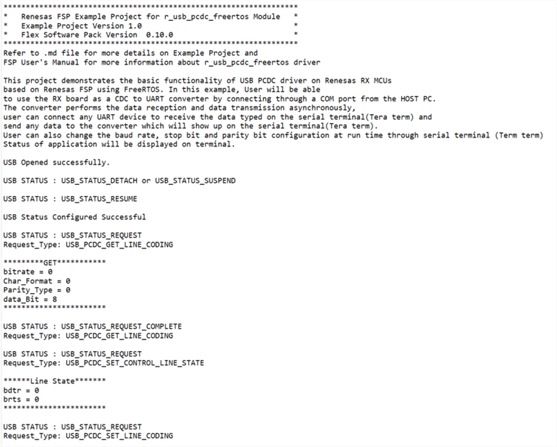
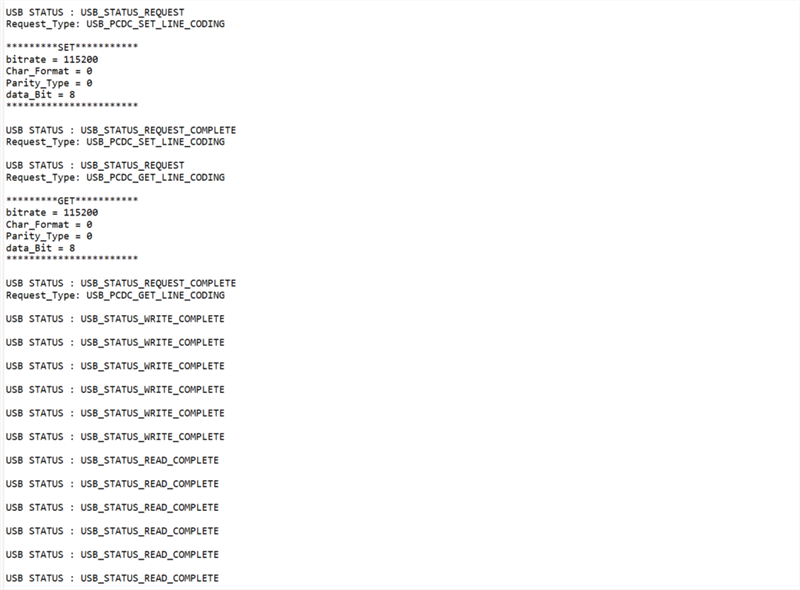
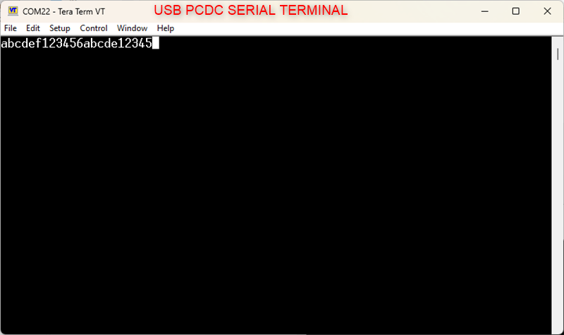
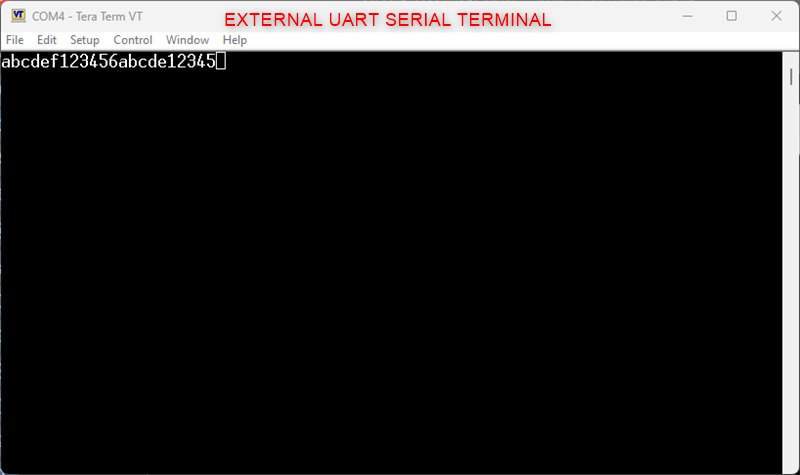

# Introduction #

This example project demonstrates the basic functionality of USB PCDC driver on Renesas RX MCUs based on Renesas FSP using FreeRTOS. In this example, the user will be able to use the RX board as a CDC to UART converter by connecting through a COM port from the host PC.
The converter performs the data reception and data transmission asynchronously. The user can connect any UART device to receive the data typed in Tera Term, and to send any data to the converter to display on Tera Term. The user can also change the baud rate, stop bit and parity bit configuration at run time through Tera Term. The status of the application will be displayed on terminal.

## Required Resources ##

To build and run the USB PCDC with FreeRTOS example project, the following resources are needed.

### Software ###

* Renesas Flexible Software Package (FSP): Version 1.0.0.
* e2 studio: Version 2026-07.
* Renesas GCC Compiler for RX: Version 14.2.0.202607.
* Renesas CC-RX Compiler: Version v3.08.00.
* Terminal Console Application: Tera Term or a similar application.

### Hardware ###

* 1 x Renesas RX board.
* 2 x Type-C USB cables.
* 1 x Pmod USBUART (e.g., Pmod USBUART: https://digilent.com/shop/pmod-usbuart-usb-to-uart-interface/) is used as example external UART device to demonstrate the functionality of the converter.
* 1 x Micro USB cable for connecting the Pmod USBUART to the host PC.
* 1 x PC with at least 3 USB ports (1 for debug, 2 for COM port).
* Some jumper wires.

### Hardware Connections ###

- Connect USB debug ports (J8) of the RX board to USB ports of the host PC via USB cable.

- UART:
  - TXD0 P004 (J2:21) to RX pin of external UART device.
  - RXD0 P005 (J2:22) to TX pin of external UART device.
  - When using flow control from Tera Term, the CTS_RST0 P007 (J2:24) should be connected to GND.
  - Connect the Pmod USBUART Board (J1) to the host PC via a micro USB cable. 

- For EK-RX74M (Full-Speed):
  - **Self-powered Mode:**
    - J28: Open (No jumper).
    - J30: Jumper on pins 2-3.
    - SW4: SW4-Pin6, 8 ON, SW4-Pin5, 7, 11, 12 OFF.
    - Connect Type-C USB Full Speed port (J31) of the board via a Type-C USB cable.

  - **VBUS supply enable signal:**
    - E64: Close.
    - E65: Open.

- For EK-RX74M (High-Speed):
  - **Self-powered Mode:**
    - J32: Open (No jumper).
    - J34: Jumper on pins 2-3.
    - SW4: SW4-Pin2, 4 ON, SW4-Pin1, 3, 9, 10 OFF.    
    - Connect Type-C USB High Speed port (J35) of the board via a Type-C USB cable.

  - **VBUS supply enable signal:**
    - J48 : Jumper on pins 1-2.
  
  ***Note:***
- Verify the USB pin configuration when switching between Full-Speed and High-Speed modes.
- The RX board can operate in different power modes (**Bus-powered**) based on jumper configuration. Refer to the "USB PCDC with FreeRTOS Function Modes" section in Special Topics for detailed Bus-powered mode configuration.

## Related Collateral References ##
The following documents can be referred to for enhancing your understanding of the operation of this example project:
- [FSP User Manual on GitHub (Reference link)](https://renesas.github.io/fsp/)
- [FSP Known Issues (Reference link)](https://github.com/renesas/fsp/issues)

# Project Notes #

## System Level Block Diagram ##

## FSP Modules Used ##
List all the various modules that are used in this example project. Refer to the FSP User Manual for further details on each module listed below.

| Module Name | Usage  | Searchable Keyword (using New Stack > Search) |
|-------------|-----------------------------------------------|-----------------------------------------------|
| USB PCDC | USB Peripheral Communications Device Class (PCDC) driver transfers data to and from USB host, responds to CDC class requests.| r_usb_pcdc |
| UART | SCI_B_UART module supports data reception and transmission, bitrate modulation, baud rate change , and flow control. | r_sci_b_uart |

## Module Configuration Notes ##
This section describes FSP Configurator properties which are important or different than those selected by default.

**Common Configuration Properties**

|   Module Property Path and Identifier   |   Default Value   |   Used Value   |   Reason   |
| :-------------------------------------: | :---------------: | :------------: | :--------: |
|   configuration.xml > BSP > Properties > Settings > Property > RX Common > Heap size (bytes)  |  0   | 0x400  |  Heap size is required for standard library functions to be used. |

**Common Module Configuration Properties**
|   Module Property Path and Identifier   |   Default Value   |   Used Value   |   Reason   |
| :-------------------------------------: | :---------------: | :------------: | :--------: |
| configuration.xml > Stacks > Threads > PCDC Thread > g_basic USB (r_usb_basic) > Properties > Settings > Property > Module g_basic USB >  USB Callback | NULL | usb_pcdc_callback | Defined user callback for sending events. |

**Configuration Properties if USB Speed as High Speed**
|   Module Property Path and Identifier   |   Default Value   |   Used Value   |   Reason   |
| :-------------------------------------: | :---------------: | :------------: | :--------: |
| configuration.xml > Stacks > Threads > Host Thread > g_basic USB (r_usb_basic) > Properties > Settings > Property > Module g_basic USB (r_usb_basic) > USB Speed | Full Speed | Hi Speed | USB Speed is configured as **Hi Speed**. |
| configuration.xml > Stacks > Threads > Host Thread > g_basic USB (r_usb_basic) > Properties > Settings > Property > Module g_basic USB (r_usb_basic) > USB Module Number | USB_IP0 Port | USB_IP1 Port | This property is used to specify USB module number to be used as per configured USB speed. |

**Configuration Properties if USB Speed as Full Speed**
|   Module Property Path and Identifier   |   Default Value   |   Used Value   |   Reason   |
| :-------------------------------------: | :---------------: | :------------: | :--------: |
| configuration.xml > Stacks > Threads > Host Thread > g_basic USB (r_usb_basic) > Properties > Settings > Property > Module g_basic USB (r_usb_basic) > USB Speed | Full Speed | Full Speed | USB Speed is configured as **Full Speed**. |
| configuration.xml > Stacks > Threads > Host Thread > g_basic USB (r_usb_basic) > Properties > Settings > Property > Module g_basic USB (r_usb_basic) > USB Module Number | USB_IP0 Port | USB_IP0 Port | This property is used to specify USB module number to be used as per configured USB speed. |

## API Usage ##

The table below lists the APIs used at the application layer by this example project.

| API Name                    | Usage                                                                                    |
|-----------------------------|------------------------------------------------------------------------------------------|
| R_USB_Open                  | This API is used to open USB instance.                                                   |
| R_USB_Read                  | This API is used to read data.                                                           |
| R_USB_PeriControlDataGet    | This API is used to receive data sent by control transfer.                               |
| R_USB_PeriControlDataSet    | This API is used to set class request.                                                   |
| R_USB_PeriControlStatusSet  | This API is used to set the USB status.                                                  |
| R_USB_Close                 | This API is used to stop USB module and terminate power.                                 |
| R_SCI_B_UART_Open           | This API is used to open UART module.                                                    |
| R_SCI_B_UART_BaudCalculate  | This API is used to calculate Baud rate register settings.                               |
| R_SCI_B_UART_Write          | This API is used to write data to UART TX pin.                                           |
| R_SCI_B_UART_Close          | This API is used to close the UART driver and any lower-level transfer drivers, if used. |

## Verifying Operation ##

1. Import the example project.
2. Generate, and build the example project.
3. Before running the example project, make sure hardware connections are completed.
4. Connect the RX MCU to the host PC via E2 Lite on-board.
By default, EP will use the on-board E2 Lite. If the user uses the E2 Emulator Lite, please refer to the section [`Special Topics`](#special-topics).
5. Users can run the example project and view the corresponding EP information on the Renesas Debug Virtual Console.

Open two serial terminals (preferably Tera Term) on the HOST PC and connect to COM port as shown below:
* One COM for USB PCDC and another COM for external UART device.

* Configure baud rate, stop bit and parity bit settings on the serial terminal (Tera Term) for external UART device:

* Configure baud rate, stop bit and parity bit settings on the serial terminal (Tera Term) for USB PCDC based on the settings of the external UART device connected to converter. **Note that only CTS/RTS flow control is tested with TeraTerm.**

* Enable "Local echo" in the serial terminal if you would like to view the data sent by the serial terminal.
* Send data using serial terminal (Tera Term) to external UART device.
* View the data received from the external UART device via the converter through the serial terminal (Tera Term).
* The status messages will be displayed on terminal as depicted below:

* The sent and received data in the serial terminals can be observed as shown below:

## Special Topics ##

### Developing Descriptor ###

A USB device provides information about itself in data structures called USB descriptors.

The host obtains descriptors from an attached device by sending various standard control requests to the default endpoint. These requests specify the type of descriptor to retrieve. In response to such requests, the device sends descriptors that include information about the device, its configurations, interfaces and the related endpoints.

* A template for PCDC descriptors can be found in rx/fsp/src/r_usb_pcdc_descriptor.c.template. Also, please be sure to use your vendor ID.

### USB PCDC Function Modes ###

**Full Speed**
**1. Bus-powered Mode**: The USB device is powered by the USB host through the USB cable. The device draws power from the USB bus. The following jumper settings are used for this mode:
  - J28: Jumper on pins 1-2.
  - J30: Jumper on pins 2-3.
  - SW4: SW4-Pin6, 8 ON, SW4-Pin5, 7, 11, 12 OFF.

**2. Self-powered Mode**: The USB device has its own power supply and does not rely on the USB host for power. The device operates independently of the USB bus power.

**High Speed**
**1. Bus-powered Mode**: The USB device is powered by the USB host through the USB cable. The device draws power from the USB bus. The following jumper settings are used for this mode:
  - J32: Jumper on pins 1-2.
  - J34: Jumper on pins 2-3.
  - SW4: SW4-Pin2, 4 ON, SW4-Pin1, 3, 9, 10 OFF.

**2. Self-powered Mode**: The USB device has its own power supply and does not rely on the USB host for power. The device operates independently of the USB bus power.

### Debugger Setting ###

* To use E2 Lite on-board or E2 Emulator Lite, please follow the instructions below:

1. **Common step**: Click [**Run**] → [**Debug Configurations…**] to open the “**Debug Configurations**” window.  
  

2. **Select file application**  
  a. **Used for projects built with GCC**: --> Select file **.elf**.  
    
  b. **Used for projects built with CCRX**: --> Select file **.x**.  
  

3. **Setting debugger configurations**  
  a. **Used for E2 Lite on-board**.    
    
  b. **Used for external E2 Emulator Lite**.  
    

  **Note:** Connect the RX board debugger port (J9) to the host PC via E2 Emulator Lite (With USB cable and 20-20 pin cable).