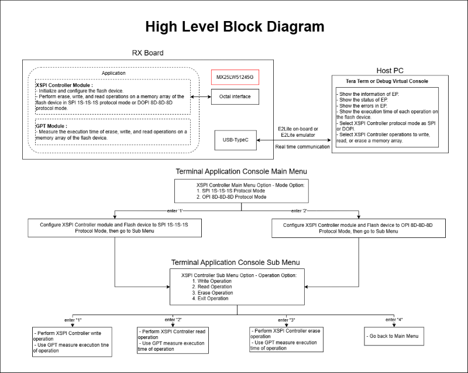
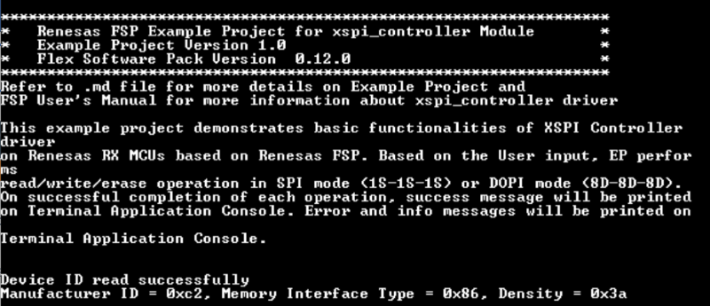
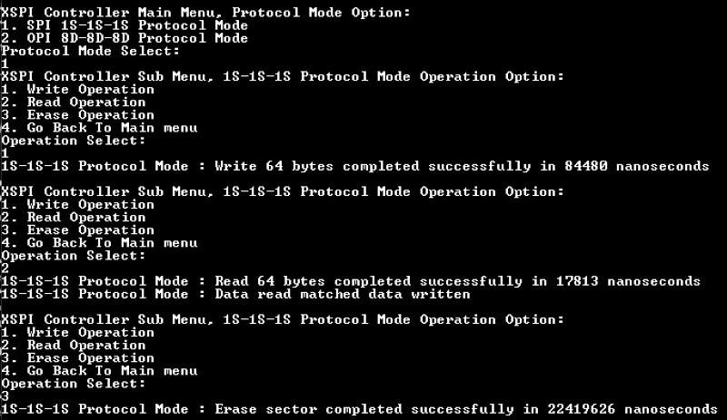
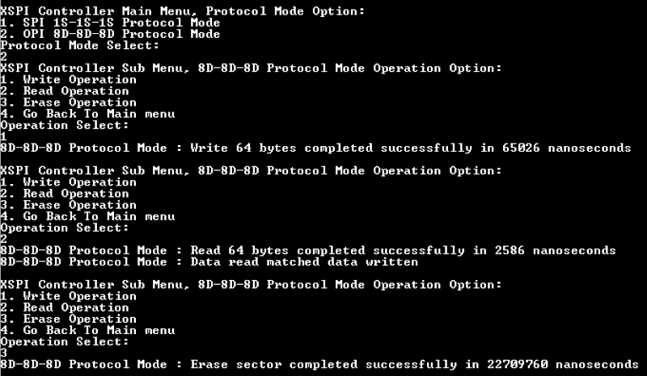
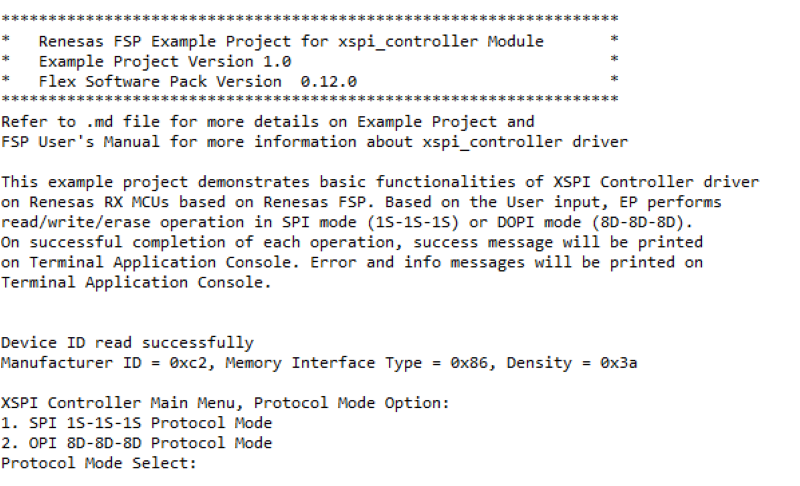
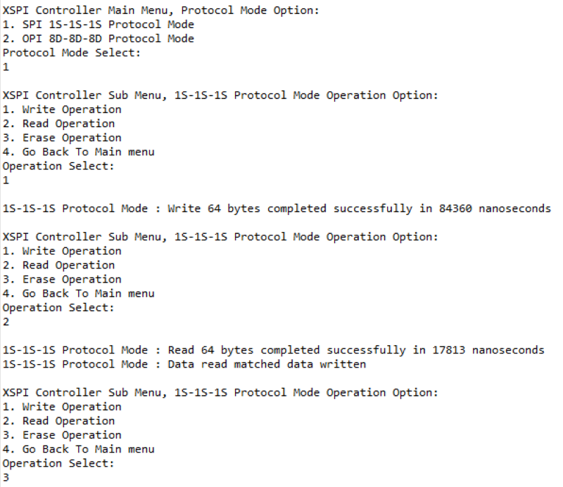
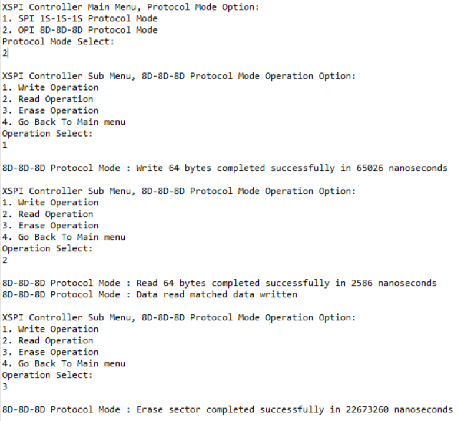

# Introduction #

This example project demonstrates basic functionalities of XSPI_CONTROLLER driver on Renesas RX MCUs based on Renesas FSP.  
In Main menu, based on Terminal Application Console, the user selects mode for xspi_controller module operations.  
1. SPI 1S-1S-1S protocol mode.
2. OPI 8D-8D-8D protocol mode.

In Sub Menu, based on Terminal Application Console, the user selects operations to perform.  
1. Write data to OSPI flash device.
2. Read back data from OSPI flash device.
3. Erase a sector of OSPI flash device.
4. Go back to main menu.

On successful completion of each operation, a success message and execution time of operation will be displayed on Terminal Application Console. Error messages and information will be printed on Terminal Application Console.

Note: 
* To display information, the user can select between the Debug Virtual Console and the Serial Terminal (UART) with USB Serial COM. It is important to note that the user should only operate a single Terminal Application at a time to avoid conflicts or data inconsistencies. For instructions on how to switch between these options, please refer to the section [`Special Topics`](#special-topics)/[`Changing Terminal Application`](#changing-terminal-application).

* By default, EP information is printed to the host PC using the Serial Terminal (UART) for boards that support USB Serial COM. LED3 is turned ON to indicate the UART initialized unsuccessfully.

* RX boards that support USB Serial COM: EK-RX74M.

## Required Resources ##

To build and run the XSPI_CONTROLLER example project, the following resources are needed.

### Software ###

* Renesas Flexible Software Package (FSP): Version 1.0.0.
* e2 studio: Version 2026-07.
* Renesas GCC Compiler for RX: Version 14.2.0.202607.
* Renesas CC-RX Compiler: Version v3.08.00.
* Terminal Console Application: Tera Term or a similar application.

### Hardware ###
Supported RX boards: EK-RX74M.

* 1 x Renesas RX board.
* 2 x Type-C USB cables for programming and debugging.

### Hardware Connections ###

* Connect the RX board USB debug port (J8) to the PC via a Type-C USB cable for EP debugging (If E2 Lite on-board is used).
* Connect the RX board USB Serial port (J27) to the PC using a Type-C USB cable to verify logs through the Terminal Application.

## Related Collateral References ##
The following documents can be referred to for enhancing your understanding of the operation of this example project:
- [FSP User Manual on GitHub (Reference link)](https://renesas.github.io/fsp/)
- [FSP Known Issues (Reference link)](https://github.com/renesas/fsp/issues)

# Project Notes #

## System Level Block Diagram ##

## FSP Modules Used ##
List all the various modules that are used in this example project. Refer to the FSP User Manual for further details on each module listed below.

| Module Name | Usage | Searchable Keyword  |
|-------------|-----------------------------------------------|-----------------------------------------------|
| XSPI_CONTROLLER | XSPI_CONTROLLER is used to configure flash device and perform write, read, or erase operations on flash device's memory array. | r_xspi_controller |
| GPT | GPT is used to measure execution time of XSPI_CONTROLLER module operations. | r_gpt |

## Module Configuration Notes ##
This section describes FSP Configurator properties which are important or different than those selected by default.

**Common Configuration Properties**

|   Module Property Path and Identifier   |   Default Value   |   Used Value   |   Reason   |
| :-------------------------------------: | :---------------: | :------------: | :--------: |
|   configuration.xml > BSP > Properties > Settings > Property > RX Common > Main stack size (bytes)  |  0x400   | 0x4000  |  Main stack size is required for standard library functions to be used. |
|   configuration.xml > BSP > Properties > Settings > Property > RX Common > Heap size (bytes)  |  0   | 0x4000  |  Heap size is required for standard library functions to be used. |

**Configuration Properties for using XSPI_CONTROLLER**

|   Module Property Path and Identifier   |   Default Value   |   Used Value   |   Reason   |
|-----------------------------------------|-------------------|----------------|------------|
| configuration.xml > Clocks > OCTASPICLK | Disable | OCTASPICLK 66.500MHz | Enable OCTASPICLK for using OSPI_b module. |
| configuration.xml > Stacks > g_xspi_controller XSPI (r_xspi_controller) > Properties > Settings > Property > Common > Autocalibration Support | Disable | Enable | Enable DS autocalibration for dual-data-rate modes. |
| configuration.xml > Stacks > g_xspi_controller XSPI (r_xspi_controller) > Properties > Settings > Property > Module g_xspi_controller XSPI (r_xspi_controller) > General > DS Auto-calibration Pattern Address | 0 | 0x30002000 | Address to the auto-calibration pattern to the target flash memory's address space. |
| configuration.xml > Stacks > g_xspi_controller XSPI (r_xspi_controller) > Properties > Settings > Property > Module g_xspi_controller XSPI (r_xspi_controller) > Command Sets > Erase Sizes > Block Erase | 262144 | 65536 | Block size of the flash device. |
| configuration.xml > Stacks > g_xspi_controller XSPI (r_xspi_controller) > Properties > Settings > Property > Module g_xspi_controller XSPI (r_xspi_controller) > Command Sets > Initial Mode > Read > Command Code | 0x13 | 0x0B | Read Command of flash device in SPI (1S-1S-1S) protocol mode. |
| configuration.xml > Stacks > g_xspi_controller XSPI (r_xspi_controller) > Properties > Settings > Property > Module g_xspi_controller XSPI (r_xspi_controller) > Command Sets > Initial Mode > Address Length | 3 bytes | 4 bytes | Address length for initial mode operations. |
| configuration.xml > Stacks > g_xspi_controller XSPI (r_xspi_controller) > Properties > Settings > Property > Module g_xspi_controller XSPI (r_xspi_controller) > Command Sets > High-speed Mode > Program > Command Code | 0x1212 | 0x12ED | Page program command of flash device in Dual data rate OPI (8D-8D-8D) protocol mode. |
| configuration.xml > Stacks > g_xspi_controller XSPI (r_xspi_controller) > Properties > Settings > Property > Module g_xspi_controller XSPI (r_xspi_controller) > Command Sets > High-speed Mode > Read > Command Code | 0xEEEE | 0xEE11 | Dual Read Command of flash device in Dual data rate OPI (8D-8D-8D) protocol mode. |
| configuration.xml > Stacks > g_xspi_controller XSPI (r_xspi_controller) > Properties > Settings > Property > Module g_xspi_controller XSPI (r_xspi_controller) > Command Sets > High-speed Mode > Read > Dummy Cycles | 20 | 10 | Dummy cycles for Read Command of flash device in Dual data rate OPI (8D-8D-8D) protocol mode. |
| configuration.xml > Stacks > g_xspi_controller XSPI (r_xspi_controller) > Properties > Settings > Property > Module g_xspi_controller XSPI (r_xspi_controller) > Command Sets > High-speed Mode > Write Enable > Command Code | 0x0606 | 0x06F9 | Write Enable Command of flash device in Dual data rate OPI (8D-8D-8D) protocol mode. |
| configuration.xml > Stacks > g_xspi_controller XSPI (r_xspi_controller) > Properties > Settings > Property > Module g_xspi_controller XSPI (r_xspi_controller) > Command Sets > High-speed Mode > Status Read > Command Code | 0x0505 | 0x05FA | Status Command of flash device in Dual data rate OPI (8D-8D-8D) protocol mode. |
| configuration.xml > Stacks > g_xspi_controller XSPI (r_xspi_controller) > Properties > Settings > Property > Module g_xspi_controller XSPI (r_xspi_controller) > Command Sets > High-speed Mode > Status Read > Dummy Cycles | 3 | 4 | Status Read Dummy Cycles of flash device in dual data rate OPI (8D-8D-8D) protocol mode. |
| configuration.xml > Stacks > g_xspi_controller XSPI (r_xspi_controller) > Properties > Settings > Property > Module g_xspi_controller XSPI (r_xspi_controller) > Command Sets > High-speed Mode > Sector Erase > Command Code | 0x2121 | 0x21DE | Sector Erase Command of flash device in Dual data rate OPI (8D-8D-8D) protocol mode. |
| configuration.xml > Stacks > g_xspi_controller XSPI (r_xspi_controller) > Properties > Settings > Property > Module g_xspi_controller XSPI (r_xspi_controller) > Command Sets > High-speed Mode > Block Erase > Command Code | 0xDCDC | 0xDC23 | Block Erase Command of flash device in Dual data rate OPI (8D-8D-8D) protocol mode. |
| configuration.xml > Stacks > g_xspi_controller XSPI (r_xspi_controller) > Properties > Settings > Property > Module g_xspi_controller XSPI (r_xspi_controller) > Command Sets > High-speed Mode > Chip Erase > Command Code | 0x6060 | 0x609F | Chip Erase Command of flash device in Dual data rate OPI (8D-8D-8D) protocol mode. |
| configuration.xml > Stacks > g_xspi_controller XSPI (r_xspi_controller) > Properties > Settings > Property > Module g_xspi_controller XSPI (r_xspi_controller) > Timing Settings > Output Assert Delay | Disabled | Enabled | Enable Output Assert Delay for flash device. |

**Configuration Properties for using GPT**

|   Module Property Path and Identifier   |   Default Value   |   Used Value   |   Reason   |
|-----------------------------------------|-------------------|----------------|------------|
| configuration.xml > Stacks > g_timer_periodic Timer, General PWM (r_gpt) > Properties > Settings > Property > Module g_timer_periodic Timer, General PWM (r_gpt) > General > Period | 0x10000 | 0x100000000 | Change period time to measure execution time of XSPI_CONTROLLER module operations. |

**Configuration Properties for using the Serial Terminal (UART)**   
|   Configure Clock Path                  |   Default Value   |   Used Value   |   Reason   |
|-----------------------------------------|-------------------|----------------|------------|
| configuration.xml > Clocks > Clocks Configuration > SCICLK Disable | SCICLK Disable | SCICLK Src: HOCO | Enable operating clock for SCI module by HOCO clock source. |

|   Configure Interrupt Event Path        |   Default Value   |   Used Value   |   Reason   |
|-----------------------------------------|-------------------|----------------|------------|
| configuration.xml > Interrupts > Interrupts Configuration > New User Event > RSCI > RSCI12 > RSCI12 RXI (Receive data full) | empty | sci_b_uart_rxi_isr | Assign the UART receive ISR (Receive data full) to the interrupt vector table. |
| configuration.xml > Interrupts > Interrupts Configuration > New User Event > RSCI > RSCI12 > RSCI12 TXI (Transmit data empty) | empty | sci_b_uart_txi_isr | Assign the UART transfer ISR (Transfer data empty) to the interrupt vector table. |
| configuration.xml > Interrupts > Interrupts Configuration > New User Event > RSCI > RSCI12 > 105-6 GROUPAL1 RSCI12 TEI (Transmit end) | empty | sci_b_uart_tei_isr | Assign the UART transfer ISR (Transfer end) to the interrupt vector table. |
| configuration.xml > Interrupts > Interrupts Configuration > New User Event > RSCI > RSCI12 > 105-7 GROUPAL1 RSCI12 ERI (Receive error) | empty | sci_b_uart_eri_isr | Assign the UART receive ISR (Receive error) to the interrupt vector table. |

## API Usage ##

The table below lists the APIs used at the application layer by this example project.

| API Name                | Usage                                                                |
|-------------------------|----------------------------------------------------------------------|
| R_XSPI_CONTROLLER_Open           | This API is used to initialize XSPI_CONTROLLER module.                        |
| R_XSPI_CONTROLLER_SpiProtocolSet | This API is used to change XSPI_CONTROLLER's protocol mode.                   |
| R_XSPI_CONTROLLER_DirectTransfer | This API is used to write, or read flash device register.            |
| R_XSPI_CONTROLLER_StatusGet      | This API is used to get the write or erase status of the flash       |
| R_XSPI_CONTROLLER_Write          | This API is used to write data to flash device memory array.         |
| R_XSPI_CONTROLLER_Erase          | This API is used to erase a Flash device's sector.                   |
| R_XSPI_CONTROLLER_Close          | This API is used to de-initialize XSPI_CONTROLLER module.                     |
| R_GPT_Open              | This API is used to initialize GPT module.                           |
| R_GPT_Reset             | This API is used to clear GPT count value.                           |
| R_GPT_Start             | This API is used to start GPT module.                                |
| R_GPT_StatusGet         | This API is used to get GPT count value.                             |
| R_GPT_InfoGet           | This API is used to get GPT clock frequency.                         |
| R_GPT_Stop              | This API is used to stop GPT module.                                 |
| R_GPT_Close             | This API is used to de-initialize GPT module.                        |
| R_BSP_OctaclkUpdate     | This API is used to update the clock source for the XSPI_CONTROLLER module.   |

**For using the Serial Terminal (UART)**

| API Name           | Usage    |
|--------------------|----------|
| R_SCI_B_UART_Open  | This API is used to configures the UART driver based on the input configurations. |
| R_SCI_B_UART_Write | This API is used to transmit user specified number of bytes from the source buffer pointer. |
| R_SCI_B_UART_Close | This API is used to abort any in progress transfers, disables interrupts, receiver, and transmitter, close lower level transfer drivers if used and remove power. |

## Verifying Operation ##

1. Import the example project.

2. Generate, and build the example project.

3. Before running the example project, make sure hardware connections are completed.

4. Connect the RX MCU to the host PC via debugger. By default, EP will use E2lite debugger.

5. Open a terminal application (e.g., Tera Term or Debug Virtual Console) on the host PC and connect to the RX board’s USB Serial port.  
   * Note: For using the Serial Terminal application:
        * To echo back typed content in Tera Term, go to [Setup] -> [Terminal...] and check [Local echo].
        * The configuration parameters of the serial port are:
            - COM port: Provided by the USB Serial COM.
            - Baud rate: 115200 bps
            - Data length: 8 bits
            - Parity: None
            - Stop bit: 1 bit
            - Flow control: None 

6. Users can perform the menu operations and check the corresponding results on the terminal console (USB Serial COM).
    * After Main Menu is displayed on Terminal Application Console, type '1' and enter to select SPI 1S-1S-1S protocol mode, or type '2' and enter to select OPI 8D-8D-8D protocol mode.
    * After Sub Menu is displayed on Terminal Application Console, type '1' and enter to perform a write operation, type '2' and enter to perform a read operation, type '3' and enter to perform an erase operation, or type '4' and enter to go back to main menu.

## The below images showcase the output on the Terminal Application (Tera Term):

**XSPI Controller EP Information**

**SPI Mode**

**DOPI Mode**

## The below images showcase the output on the Terminal Application (Debug Virtual Console):

**XSPI Controller EP Information**

**SPI Mode**

**DOPI Mode**

## Special Topics ##
 
### Debugger Setting ###

* To use E2 Lite on-board or E2 Emulator Lite, please follow the instructions below:

1. **Common step**: Click [**Run**] → [**Debug Configurations…**] to open the “**Debug Configurations**” window.  
  

2. **Select file application**  
  a. **Used for projects built with GCC**: --> Select file **.elf**.  
    
  b. **Used for projects built with CCRX**: --> Select file **.x**.  
  

3. **Setting debugger configurations**  
  a. **Used for E2 Lite on-board**.    
    
  b. **Used for external E2 Emulator Lite**.  
    

  **Note:** Connect the RX board debugger port (J9) to the host PC via E2 Emulator Lite (with USB cable and 20-20 pin cable).

### Adding lowsrc Folder

Before changing terminal application settings, you need to add the `lowsrc` folder from another Example Project:

1. **Locate the lowsrc folder:**
   
   - Navigate to Example Project `sci_uart` or `usb_pcdc_with_freertos`  (`example_projects/<board>/sci_uart/e2studio/gccrx_sci_uart_<board>_ep/src`)
   - Find the `lowsrc` folder containing low-level source files.

2. **Copy `lowsrc` folder to this Example Project:**
   
   - Copy the entire `lowsrc` folder.
   - Paste it into this your target Example Project directory: `example_projects/ek_rx74m/<EP>/e2studio/`.

3. **Add lowsrc to e2studio project:**
   
   - In e2studio, right-click on the project in Project Explorer.
   - Select **Refresh** (or press F5) to detect the new folder.

4. **Verify the folder is included:**
   
   - Expand the project tree in Project Explorer.
   - Confirm that `lowsrc` folder and its contents are visible.
   - The folder should be included in the build path with source files ready to compile.

5. **Changing the terminal Application to use the Debug Virtual Console:**
   
   - For instructions on how to switch between these options, please refer to the section [`Special Topics`](#special-topics)/[`Changing Terminal Application`](#changing-terminal-application).

6. **Re-build the project:**
   
   - In e2studio, right-click on the project and select **Build Project**.

**Note:** To use Debug Virtual Console, the `lowsrc` folder must be added to the project, as it contains the source files required for Debug Virtual Console operation.

### Changing Terminal Application ###
By default, the EP supports Serial Terminal for RX boards that support USB Serial COM   
**For use CCRX Compiler:**
* Define USE_VIRTUAL_COM=1 macro in Project Properties -> C/C++ Build -> Settings -> Tool Settings -> Compiler -> Source -> Macro definition (-define)

To use Debug Virtual Console, please follow the instructions below:
* Define USE_VIRTUAL_COM=0 macro in Project Properties -> C/C++ Build -> Settings -> Tool Settings -> Compiler -> Source -> Macro definition (-define)
* Define BSP_CFG_IO_LIB_ENABLE=1 macro in Project Properties -> C/C++ Build -> Settings -> Tool Settings -> Compiler -> Source -> Macro definition (-define)

**For use GCCRX Compiler:**  
* Define USE_VIRTUAL_COM=1 macro in Project Properties -> C/C++ Build -> Settings -> Tool Settings -> Compiler -> Includes -> Macro Defines (-D)

To use Debug Virtual Console, please follow the instructions below:
* Define USE_VIRTUAL_COM=0 macro in Project Properties -> C/C++ Build -> Settings -> Tool Settings -> Compiler -> Includes -> Macro Defines (-D)

