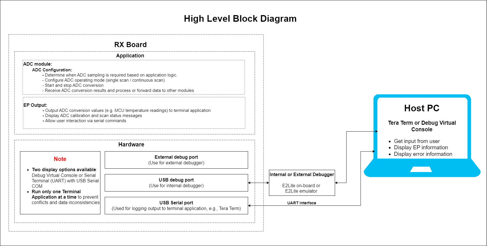
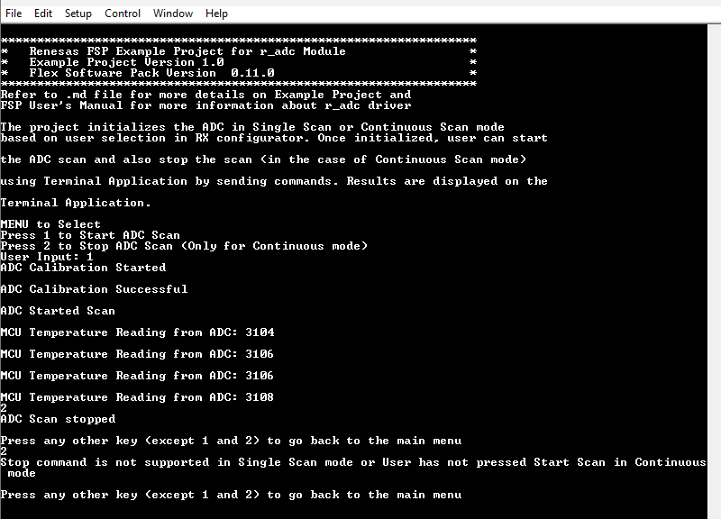
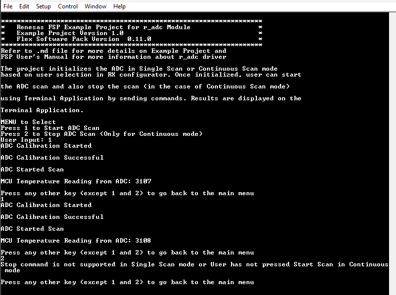

# Introduction 

The example project demonstrates the typical use of the ADC HAL module APIs. The project initializes the ADC in Single Scan or Continuous Scan mode based on user selection in RX Configurator. Once initialized, user can start the ADC scan and also stop the scan (in the case of Continuous Scan mode) using Terminal Application by sending commands. Results are displayed on the Terminal Application.

**Note**: 
- To display information, the user can select between Debug Virtual Console and the Serial Terminal (UART) with USB Serial COM. It is important to note that the user should only operate a single terminal application at a time to avoid conflicts or data inconsistencies. For instructions on how to switch between these options, please refer to the section [`Special Topics`](#special-topics)/[`Changing Terminal Application`](#changing-terminal-application).

- By default, EP information is printed to the host PC using the Serial Terminal (UART) for boards that support USB Serial COM. LED3 is turned ON to indicate the UART initialized unsuccessfully.

- RX boards that support USB Serial COM: EK-RX74M, EK-RX74N.

- EK-RX74M/EK-RX74N does not support Window Compare Mode and operates with an internal temperature sensor.

## Required Resources 
To build and run the ADC example project, the following resources are needed.

### Software 
* Renesas Flexible Software Package (FSP): Version 1.0.0.
* e2 studio: Version 2026-07.
* Renesas GCC Compiler for RX: Version 14.2.0.202607.
* Renesas CC-RX Compiler: Version v3.08.00.
* Terminal Console Application: Tera Term or a similar application.

### Hardware 

Supported RX boards: EK-RX74M, EK-RX74N.

* 1 x Renesas RX board.
* 2 x Type-C USB cables for programming and debugging.

## Hardware Connections 
- Connect the RX board USB debug port (J8) to the PC via a Type-C USB cable for EP debugging (If E2 Lite on-board is used).
- Connect the RX board USB SERIAL port (J27) to the PC using a Type-C USB cable to verify logs through the terminal console.

## Related Collateral References 
The following documents can be referred to for enhancing your understanding of the operation of this example project:
- [FSP User Manual on GitHub (Reference link)](https://renesas.github.io/fsp/)
- [FSP Known Issues (Reference link)](https://github.com/renesas/fsp/issues)

# Project Notes 

## System Level Block Diagram 
  

## FSP Modules Used 
List all the various modules that are used in this example project. Refer to the FSP User Manual for further details on each module listed below.

| Module Name | Usage  | Searchable Keyword (using New Stack > Search) |
|-------------|-----------------------------------------------|-----------------------------------------------|
| ADC | Driver for the ADC peripheral to demonstrate basic functionalities of ADC, including the Window Compare Mode on Renesas RX MCUs | r_adc_b |

## Module Configuration Notes 
This section describes FSP Configurator properties which are important or different than those selected by default. 

**Common Configuration Properties**
|   Module Property Path and Identifier   |   Default Value   |   Used Value   |   Reason   |
| :-------------------------------------: | :---------------: | :------------: | :--------: |
|   configuration.xml > BSP > Properties > Settings > Property > RX Common > Main stack size (bytes)  |  0   | 0x1000  |  Main stack size is required for standard library functions to be used. |

**ADC Configuration Properties**

|   Module Property Path and Identifier   |   Default Value   |   Used Value   |   Reason   |
| :-------------------------------------: | :---------------: | :------------: | :--------: |
| configuration.xml > Stacks > g_adc ADC (r_adc_b) > Properties > Settings > Property > Module g_adc ADC (r_adc_b) > General > Name | g_adc0 | g_adc | To use a generic name for the ADC driver instance. |
| configuration.xml > Stacks > g_adc ADC (r_adc_b) > Properties > Settings > Property > Module g_adc ADC (r_adc_b) > General > Operation > ADC 0 > Scan Mode | Single Scan | Continuous Scan | To demonstrate continuous scanning capability of the ADC. |
| configuration.xml > Stacks > g_adc ADC (r_adc_b) > Properties > Settings > Property > Module g_adc ADC (r_adc_b) > Clock Configuration > Divider | Div /3 | Div /1 | To demonstrate the maximum sampling rate capability of the ADC. |
| configuration.xml > Stacks > g_adc ADC (r_adc_b) > Properties > Settings > Property > Module g_adc ADC (r_adc_b) > Clock Configuration > Source | PCLKA | ADCCLK | To use the ADCCLK clock source for ADC operation. |
| configuration.xml > Stacks > g_adc ADC (r_adc_b) > Properties > Settings > Property > Module g_adc ADC (r_adc_b) > Interrupts > Scan End Priority > Group 0 | Priority 12 | Priority 29 | To prioritize scan end interrupts. |
| configuration.xml > Stacks > g_adc ADC (r_adc_b) > Properties > Settings > Property > Module g_adc ADC (r_adc_b) > Sample and Hold > Enable Unit > Unit 0 | Not checked | Checked | To enable the sample and hold unit for ADC operation. |
| configuration.xml > Stacks > g_adc ADC (r_adc_b) > Properties > Settings > Property > Module g_adc ADC (r_adc_b) > Virtual Channels > Virtual Channel 0 > Scan Group | None | Scan Group 0 | To assign the virtual channel to a scan group for ADC operation. |
| configuration.xml > Stacks > g_adc ADC (r_adc_b) > Properties > Settings > Property > Module g_adc ADC (r_adc_b) > Virtual Channels > Virtual Channel 0 > Channel Select | ADC Channel 0 | ADC Channel TEMPERATURE | To use the internal temperature sensor as the ADC channel for demonstration. |
| configuration.xml > Stacks > g_adc ADC (r_adc_b) > Properties > Settings > Property > Module g_adc ADC (r_adc_b) > Scan Groups > Scan Group 0 > Enable | Disable | Enable | To enable the scan group for ADC operation. 

**Configuration Properties for using the Serial Terminal (UART)**   
|   Configure Clock Path                  |   Default Value   |   Used Value   |   Reason   |
|-----------------------------------------|-------------------|----------------|------------|
| configuration.xml > Clocks > Clocks Configuration > SCICLK Disable | SCICLK Disable | SCICLK Src: HOCO | Enable operating clock for SCI module by HOCO clock source. |

|   Configure Interrupt Event Path        |   Default Value   |   Used Value   |   Reason   |
|-----------------------------------------|-------------------|----------------|------------|
| configuration.xml > Interrupts > Interrupts Configuration > New User Event > RSCI > RSCI12 > RSCI12 RXI (Receive data full) | empty | sci_b_uart_rxi_isr | Assign the UART receive ISR (Receive data full) to the interrupt vector table. |
| configuration.xml > Interrupts > Interrupts Configuration > New User Event > RSCI > RSCI12 > RSCI12 TXI (Transmit data empty) | empty | sci_b_uart_txi_isr | Assign the UART transfer ISR (Transfer data empty) to the interrupt vector table. |
| configuration.xml > Interrupts > Interrupts Configuration > New User Event > RSCI > RSCI12 > 105-6 GROUPAL1 RSCI12 TEI (Transmit end) | empty | sci_b_uart_tei_isr | Assign the UART transfer ISR (Transfer end) to the interrupt vector table. |
| configuration.xml > Interrupts > Interrupts Configuration > New User Event > RSCI > RSCI12 > 105-7 GROUPAL1 RSCI12 ERI (Receive error) | empty | sci_b_uart_eri_isr | Assign the UART receive ISR (Receive error) to the interrupt vector table. |

## API Usage 

The table below lists the FSP provided API used at the application layer by this example project.

| API Name    | Usage                                                                          |
|-------------|--------------------------------------------------------------------------------|
| R_ADC_B_Open | This API is used to Open the ADC instance. |
| R_ADC_B_ScanCfg | This API is used to configure the ADC scan parameters. |
| R_ADC_B_ScanStart | This API is used to start the ADC Scan.  |
| R_ADC_B_Read | This API is used to read the adc converted value from the specific ADC channel. |
| R_ADC_B_ScanStop | This API is used to stop the ADC scan. |
| R_ADC_B_Close | This API is used to close the ADC module. |
| R_BSP_SoftwareDelay | This API is used to delay a specified period of time. |

**For using the Serial Terminal (UART)**
| API Name    | Usage                                                                          |
|-------------|--------------------------------------------------------------------------------|
| R_SCI_B_UART_Open | This API is used to configures the UART driver based on the input configurations. |
| R_SCI_B_UART_Write | This API is used to transmit user specified number of bytes from the source buffer pointer. |
| R_SCI_B_UART_Close | This API is used to abort any in progress transfers, disables interrupts, receiver, and transmitter, close lower level transfer drivers if used and remove power. |

## Verifying Operation

1. Import the example project.

2. Generate, and build the example project.

3. Before running the example project, make sure hardware connections are completed.

4. Connect the RX MCU to the host PC via debugger. By default, EP will use E2lite debugger.
5. Open a terminal application (e.g., Tera Term or Debug Virtual Console) on the host PC and connect to the RX board’s USB Serial port. 
   * Note: For using the Serial Terminal application:
        * To echo back typed content in Tera Term, go to [Setup] -> [Terminal...] and check [Local echo].
        * The configuration parameters of the serial port are:
            - COM port: Provided by the USB Serial COM.
            - Baud rate: 115200 bps
            - Data length: 8 bits
            - Parity: None
            - Stop bit: 1 bit
            - Flow control: None

Note: By default, the example project runs in Continuous Scan mode on the boards. In order to switch the scan mode, change the 'Scan Mode' field of ADC Driver in the RX Configurator to Single Scan.

### The below image showcases the ADC output for Continuous Scan mode on the Terminal Application (Tera Term) ###

  

### The below image showcases the ADC output for Single Scan mode on Terminal Application (Tera Term) ###
  

## Special Topics ##

### Debugger Setting ###

* To use E2 Lite on-board or E2 Emulator Lite, please follow the instructions below:

1. **Common step**: Click [**Run**] → [**Debug Configurations…**] to open the “**Debug Configurations**” window.  
  

2. **Select file application**  
  a. **Used for projects built with GCC**: --> Select file **.elf**.  
    
  b. **Used for projects built with CCRX**: --> Select file **.x**.  
  

3. **Setting debugger configurations**  
  a. **Used for E2 Lite on-board**.    
    
  b. **Used for external E2 Emulator Lite**.  
    

  **Note:** Connect the RX board debugger port (J9) to the host PC via E2 Emulator Lite (with USB cable and 20-20 pin cable).

### Adding lowsrc Folder

Before changing terminal application settings, you need to add the `lowsrc` folder from another Example Project:

1. **Locate the lowsrc folder:**
   
   - Navigate to Example Project `sci_uart` or `usb_pcdc_with_freertos`  (`example_projects/<board>/sci_uart/e2studio/gccrx_sci_uart_<board>_ep/src`)
   - Find the `lowsrc` folder containing low-level source files.

2. **Copy `lowsrc` folder to this Example Project:**
   
   - Copy the entire `lowsrc` folder.
   - Paste it into this your target Example Project directory: `example_projects/ek_rx74m/<EP>/e2studio/`.

3. **Add lowsrc to e2studio project:**
   
   - In e2studio, right-click on the project in Project Explorer.
   - Select **Refresh** (or press F5) to detect the new folder.

4. **Verify the folder is included:**
   
   - Expand the project tree in Project Explorer.
   - Confirm that `lowsrc` folder and its contents are visible.
   - The folder should be included in the build path with source files ready to compile.

5. **Changing the terminal Application to use the Debug Virtual Console:**
   
   - For instructions on how to switch between these options, please refer to the section [`Special Topics`](#special-topics)/[`Changing Terminal Application`](#changing-terminal-application).

6. **Re-build the project:**
   
   - In e2studio, right-click on the project and select **Build Project**.

**Note:** To use Debug Virtual Console, the `lowsrc` folder must be added to the project, as it contains the source files required for Debug Virtual Console operation.

### Changing Terminal Application ###
By default, the EP supports Serial Terminal for RX boards that support USB Serial COM   
**For use CCRX Compiler:**
* Define USE_VIRTUAL_COM=1 macro in Project Properties -> C/C++ Build -> Settings -> Tool Settings -> Compiler -> Source -> Macro definition (-define)

To use Debug Virtual Console, please follow the instructions below:
* Define USE_VIRTUAL_COM=0 macro in Project Properties -> C/C++ Build -> Settings -> Tool Settings -> Compiler -> Source -> Macro definition (-define)
* Define BSP_CFG_IO_LIB_ENABLE=1 macro in Project Properties -> C/C++ Build -> Settings -> Tool Settings -> Compiler -> Source -> Macro definition (-define)

**For use GCCRX Compiler:**  
* Define USE_VIRTUAL_COM=1 macro in Project Properties -> C/C++ Build -> Settings -> Tool Settings -> Compiler -> Includes -> Macro Defines (-D)
  
To use Debug Virtual Console, please follow the instructions below:
* Define USE_VIRTUAL_COM=0 macro in Project Properties -> C/C++ Build -> Settings -> Tool Settings -> Compiler -> Includes -> Macro Defines (-D)

