# Introduction
This example project demonstrates the operation of ADC GPT Periodic Sampling using the ADC, DTC, GPT, and ELC peripherals on RX MCU. ADC GPT Periodic Sampling allows the user to sample analog signals at periodic intervals with a double buffer. The frequency of sampling is determined by the settings of the GPT linked to the ADC unit by the ELC. The DTC is used to transfer data from the ADC data registers to the circular buffer. Using the DTC allows the CPU to be used for other operations. When the first buffer is filled completely, the CPU executes the ADC Interrupt service routine to switch to the DTC to fill the second buffer with ADC values, and raise a flag/event to allow processing on the data available in the first buffer. 

**Note**: 
- To display information, the user can select between Debug Virtual Console and the Serial Terminal (UART) with USB Serial COM. It is important to note that the user should only operate a single terminal application at a time to avoid conflicts or data inconsistencies. For instructions on how to switch between these options, please refer to the section [`Special Topics`](#special-topics)/[`Changing Terminal Application`](#changing-terminal-application).

- By default, EP information is printed to the host PC using the Serial Terminal (UART) for boards that support USB Serial COM. LED3 is turned ON to indicate the UART initialized unsuccessfully.

- RX boards that support USB Serial COM: EK-RX74M, EK-RX74N. 

## Required Resources
To build and run the ADC GPT Periodic Sampling example project, the following resources are needed.

### Software
* Renesas Flexible Software Package (FSP): Version 1.0.0.
* e2 studio: Version 2026-07.
* Renesas GCC Compiler for RX: Version 14.2.0.202607.
* Renesas CC-RX Compiler: Version v3.08.00.
* Terminal Console Application: Tera Term or a similar application.

### Hardware
* 1 x Renesas RX board.
* 2 x Type-C USB cables for programming and debugging.
* 1 x Signal generator (e.g., https://www.keysight.com/us/en/product/DSOX1202G/oscilloscope-70-100-200-mhz-2-analog-channels-waveform-generator.html).
* 1 x Breadboard.
* Some jumper wires.

## Hardware Connections
* Connect the RX board USB debug port (J8) to the PC via a Type-C USB cable for EP debugging (If E2 Lite on-board is used).
* Connect the RX board USB Serial port (J27) to the PC using a Type-C USB cable to verify logs through the Terminal Application.

* Connect the signal generator to the breadboard as follows:
  * Connect input signal (e.g., 800Hz sinusoidal, 0-3V) to the horizontal line of the breadboard.
  * Connect GND of the signal generator to GND of the RX board.

* Connect pins mentioned below to horizontal holes of the breadboard so that all pins are shorted to receive an input signal.

* Note: All channels are connected to the same input signal for testing. The user can configure channels to other input frequencies as per requirement.

* For EK-RX74M/EK-RX74N:
  * ADC UNIT 0: AN000--P400, AN001--P401, AN002--P402, AN003--P403
  * ADC UNIT 1: AN010--P410, AN011--P411, AN012--P412, AN103--P413

## Related Collateral References
The following documents can be referred to for enhancing your understanding of the operation of this example project:
- [FSP User Manual on GitHub (Reference link)](https://renesas.github.io/fsp/)
- [FSP Known Issues (Reference link)](https://github.com/renesas/fsp/issues)

# Project Notes

## System Level Block Diagram
High level block diagram of the system is as shown below:

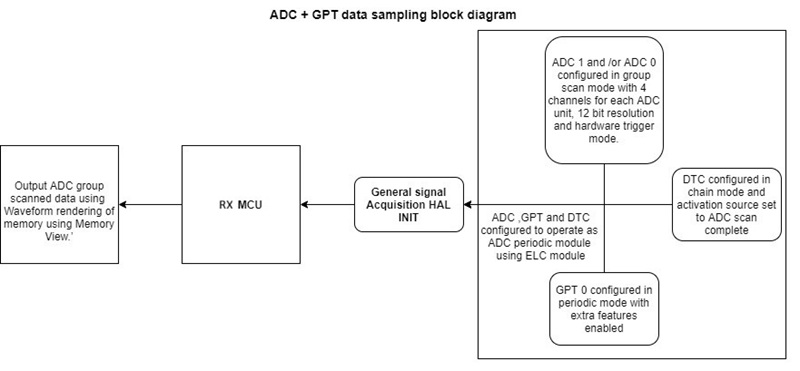

## FSP Modules Used
List all the various modules that are used in this example project. Refer to the FSP User Manual for further details on each module listed below.

| Module Name | Usage | Searchable Keyword  |
|-------------|-----------------------------------------------|-----------------------------------------------|
| ADC | ADC is used in group scan mode to scan the input sinusoidal signal connected to ADC channels | r_adc_b |
| DTC | DTC is used to transfer data from the ADC data registers to the circular buffer | r_dtc |
| GPT | GPT is used to generate ADC group scan trigger at periodic interval | r_gpt |
| ELC | ELC is used to link ADC with GPT module for Hardware triggering | r_elc |

## Module Configuration Notes
This section describes FSP Configurator properties which are important or different than those selected by default.

**Common Configuration Properties**

|   Module Property Path and Identifier   |   Default Value   |   Used Value   |   Reason   |
| :-------------------------------------: | :---------------: | :------------: | :--------: |
|   configuration.xml > BSP > Properties > Settings > Property > RX Common > Heap size (bytes)  |  0   | 0x1000  |  Heap size is required for standard library functions to be used. |

**Configuration Properties for using ADC:**
|   Module Property Path and Identifier   |   Default Value   |   Used Value   |   Reason   |
| :-------------------------------------: | :---------------: | :------------: | :--------: |
|   configuration.xml > Stacks > g_adc0 ADC Driver on r_adc_b > Properties > Settings > Property > Module g_adc0 ADC Driver on r_adc_b > Interrupts > Callback  |   NULL  |   g_adc0_callback  |   Called from the ISR when the ADC scan completes.  |

**Note:** ADC_B uses a single driver instance (g_adc0) to control both ADC Unit 0 and ADC Unit 1.
For clarity, this guideline separates the configuration by ADC unit:

  * **Configuration Properties for using ADC unit 0:**  

|   Module Property Path and Identifier   |   Default Value   |   Used Value   |   Reason   |
| :-------------------------------------: | :---------------: | :------------: | :--------: |
|   configuration.xml > Stacks > g_adc0 ADC Driver on r_adc_b > Properties > Settings > Property > Module g_adc0 ADC Driver on r_adc_b > General > Operation > ADC 0 > Scan Mode  |   Single Scan   |   Single Scan   |  Specifies the scan mode for this ADC unit. |
|   configuration.xml > Stacks > g_adc0 ADC Driver on r_adc_b > Properties > Settings > Property > Module g_adc0 ADC Driver on r_adc_b > Interrupts > Scan End Priority > Group 0 |   Priority 29   |  Priority 29  |   Sets the scan end interrupt priority for Group 0.   |
|   configuration.xml > Stacks > g_adc0 ADC Driver on r_adc_b > Properties > Settings > Property > Module g_adc0 ADC Driver on r_adc_b > Interrupts > Scan End Priority > Group 1 |   Priority 29   |  Priority 29  |   Sets the scan end interrupt priority for Group 1.   |
|   configuration.xml > Stacks > g_adc0 ADC Driver on r_adc_b > Properties > Settings > Property > Module g_adc0 ADC Driver on r_adc_b > Virtual Channels > Virtual Channel 0 > Scan Group |   None  |   Scan Group 0  |   Selects the scan group for this virtual channel.   |
|   configuration.xml > Stacks > g_adc0 ADC Driver on r_adc_b > Properties > Settings > Property > Module g_adc0 ADC Driver on r_adc_b > Virtual Channels > Virtual Channel 0 > Channel Select |   ADC Channel 0  |   ADC Channel 0  |   Selects the physical channel for this virtual channel. |
|   configuration.xml > Stacks > g_adc0 ADC Driver on r_adc_b > Properties > Settings > Property > Module g_adc0 ADC Driver on r_adc_b > Virtual Channels > Virtual Channel 1 > Scan Group |   None  |   Scan Group 0  |   Selects the scan group for this virtual channel.   |
|   configuration.xml > Stacks > g_adc0 ADC Driver on r_adc_b > Properties > Settings > Property > Module g_adc0 ADC Driver on r_adc_b > Virtual Channels > Virtual Channel 1 > Channel Select |   ADC Channel 0  |   ADC Channel 1  |   Selects the physical channel for this virtual channel. |
|   configuration.xml > Stacks > g_adc0 ADC Driver on r_adc_b > Properties > Settings > Property > Module g_adc0 ADC Driver on r_adc_b > Virtual Channels > Virtual Channel 2 > Scan Group |   None  |   Scan Group 1  |   Selects the scan group for this virtual channel.   |
|   configuration.xml > Stacks > g_adc0 ADC Driver on r_adc_b > Properties > Settings > Property > Module g_adc0 ADC Driver on r_adc_b > Virtual Channels > Virtual Channel 2 > Channel Select |   ADC Channel 0  |   ADC Channel 2  |   Selects the physical channel for this virtual channel. |
|   configuration.xml > Stacks > g_adc0 ADC Driver on r_adc_b > Properties > Settings > Property > Module g_adc0 ADC Driver on r_adc_b > Virtual Channels > Virtual Channel 3 > Scan Group |   None  |   Scan Group 1  |   Selects the scan group for this virtual channel.   |
|   configuration.xml > Stacks > g_adc0 ADC Driver on r_adc_b > Properties > Settings > Property > Module g_adc0 ADC Driver on r_adc_b > Virtual Channels > Virtual Channel 3 > Channel Select |   ADC Channel 0  |   ADC Channel 3  |   Selects the physical channel for this virtual channel. |
|   configuration.xml > Stacks > g_adc0 ADC Driver on r_adc_b > Properties > Settings > Property > Module g_adc0 ADC Driver on r_adc_b > Scan Groups > Scan Group 0 > ELC Trigger Enable > ELC Trigger Input 0 Enable |   ☐  |   ☑  |   Enables ELC trigger input 0 for Group 0 scanning.  |
|   configuration.xml > Stacks > g_adc0 ADC Driver on r_adc_b > Properties > Settings > Property > Module g_adc0 ADC Driver on r_adc_b > Scan Groups > Scan Group 0 > Enable |   Disable  |   Enable  |   Enable scan group 0.  |
|   configuration.xml > Stacks > g_adc0 ADC Driver on r_adc_b > Properties > Settings > Property > Module g_adc0 ADC Driver on r_adc_b > Scan Groups > Scan Group 0 > Converter Selection |   ADC 0  |   ADC 0  |   Selects the A/D converter used with this scan group.  |
|   configuration.xml > Stacks > g_adc0 ADC Driver on r_adc_b > Properties > Settings > Property > Module g_adc0 ADC Driver on r_adc_b > Scan Groups > Scan Group 0 > ELC Trigger Enable > ELC Trigger Input 1 Enable  |   ☐  |   ☑   |   Enables ELC trigger input 1 for Group 1 scanning.  |
|   configuration.xml > Stacks > g_adc0 ADC Driver on r_adc_b > Properties > Settings > Property > Module g_adc0 ADC Driver on r_adc_b > Scan Groups > Scan Group 1 > Enable |   Disable  |   Enable  |   Enable scan group 1.  |
|   configuration.xml > Stacks > g_adc0 ADC Driver on r_adc_b > Properties > Settings > Property > Module g_adc0 ADC Driver on r_adc_b > Scan Groups > Scan Group 1 > Converter Selection |   ADC 0  |   ADC 0  |   Selects the A/D converter used with this scan group.  |

  * **Configuration Properties for using ADC unit 1:**

|   Module Property Path and Identifier   |   Default Value   |   Used Value   |   Reason   |
| :-------------------------------------: | :---------------: | :------------: | :--------: |
|   configuration.xml > Stacks > g_adc0 ADC Driver on r_adc_b > Properties > Settings > Property > Module g_adc0 ADC Driver on r_adc_b > General > Operation > ADC 1 > Scan Mode  |   Single Scan   |   Single Scan   |  Specifies the scan mode for this ADC unit. |
|   configuration.xml > Stacks > g_adc0 ADC Driver on r_adc_b > Properties > Settings > Property > Module g_adc0 ADC Driver on r_adc_b > Interrupts > Scan End Priority > Group 4 |   Priority 29   |  Priority 29  |   Sets the scan end interrupt priority for Group 2.   |
|   configuration.xml > Stacks > g_adc0 ADC Driver on r_adc_b > Properties > Settings > Property > Module g_adc0 ADC Driver on r_adc_b > Interrupts > Scan End Priority > Group 5 |   Priority 29   |  Priority 29  |   Sets the scan end interrupt priority for Group 3.   |
|   configuration.xml > Stacks > g_adc0 ADC Driver on r_adc_b > Properties > Settings > Property > Module g_adc0 ADC Driver on r_adc_b > Virtual Channels > Virtual Channel 10 > Scan Group |   None  |   Scan Group 4  |   Selects the scan group for this virtual channel.   |
|   configuration.xml > Stacks > g_adc0 ADC Driver on r_adc_b > Properties > Settings > Property > Module g_adc0 ADC Driver on r_adc_b > Virtual Channels > Virtual Channel 10 > Channel Select |   ADC Channel 0  |   ADC Channel 10  |   Selects the physical channel for this virtual channel. |
|   configuration.xml > Stacks > g_adc0 ADC Driver on r_adc_b > Properties > Settings > Property > Module g_adc0 ADC Driver on r_adc_b > Virtual Channels > Virtual Channel 11 > Scan Group |   None  |   Scan Group 4  |   Selects the scan group for this virtual channel.   |
|   configuration.xml > Stacks > g_adc0 ADC Driver on r_adc_b > Properties > Settings > Property > Module g_adc0 ADC Driver on r_adc_b > Virtual Channels > Virtual Channel 11 > Channel Select |   ADC Channel 0  |   ADC Channel 11 |   Selects the physical channel for this virtual channel. |
|   configuration.xml > Stacks > g_adc0 ADC Driver on r_adc_b > Properties > Settings > Property > Module g_adc0 ADC Driver on r_adc_b > Virtual Channels > Virtual Channel 12 > Scan Group |   None  |   Scan Group 5  |   Selects the scan group for this virtual channel.   |
|   configuration.xml > Stacks > g_adc0 ADC Driver on r_adc_b > Properties > Settings > Property > Module g_adc0 ADC Driver on r_adc_b > Virtual Channels > Virtual Channel 12 > Channel Select |   ADC Channel 0  |   ADC Channel 12  |   Selects the physical channel for this virtual channel. |
|   configuration.xml > Stacks > g_adc0 ADC Driver on r_adc_b > Properties > Settings > Property > Module g_adc0 ADC Driver on r_adc_b > Virtual Channels > Virtual Channel 13 > Scan Group |   None  |   Scan Group 5  |   Selects the scan group for this virtual channel.   |
|   configuration.xml > Stacks > g_adc0 ADC Driver on r_adc_b > Properties > Settings > Property > Module g_adc0 ADC Driver on r_adc_b > Virtual Channels > Virtual Channel 13 > Channel Select |   ADC Channel 0  |   ADC Channel 13  |   Selects the physical channel for this virtual channel. |
|   configuration.xml > Stacks > g_adc0 ADC Driver on r_adc_b > Properties > Settings > Property > Module g_adc0 ADC Driver on r_adc_b > Scan Groups > Scan Group 4 > ELC Trigger Enable > ELC Trigger Input 0 Enable |   ☐  |   ☑  |   Enables ELC trigger input 0 for Group 4 scanning.  |
|   configuration.xml > Stacks > g_adc0 ADC Driver on r_adc_b > Properties > Settings > Property > Module g_adc0 ADC Driver on r_adc_b > Scan Groups > Scan Group 4 > Enable |   Disable  |   Enable  |   Enable scan group 4.  |
|   configuration.xml > Stacks > g_adc0 ADC Driver on r_adc_b > Properties > Settings > Property > Module g_adc0 ADC Driver on r_adc_b > Scan Groups > Scan Group 4 > Converter Selection |   ADC 0  |   ADC 1  |   Selects the A/D converter used with this scan group.  |
|   configuration.xml > Stacks > g_adc0 ADC Driver on r_adc_b > Properties > Settings > Property > Module g_adc0 ADC Driver on r_adc_b > Scan Groups > Scan Group 5 > ELC Trigger Enable > ELC Trigger Input 1 Enable  |   ☐  |   ☑   |   Enables ELC trigger input 1 for Group 5 scanning.  |
|   configuration.xml > Stacks > g_adc0 ADC Driver on r_adc_b > Properties > Settings > Property > Module g_adc0 ADC Driver on r_adc_b > Scan Groups > Scan Group 5 > Enable |   Disable  |   Enable  |   Enable scan group 5.  |
|   configuration.xml > Stacks > g_adc0 ADC Driver on r_adc_b > Properties > Settings > Property > Module g_adc0 ADC Driver on r_adc_b > Scan Groups > Scan Group 5 > Converter Selection |   ADC 0  |   ADC 1  |   Selects the A/D converter used with this scan group.  |

**Configuration Properties for using Timer, General PWM (GPT)**
|   Module Property Path and Identifier   |   Default Value   |   Used Value   |   Reason   |
| :-------------------------------------: | :---------------: | :------------: | :--------: |
|   configuration.xml > Stacks > g_timer0 Timer, General PWM (r_gpt) > Properties > Settings > Property > Module g_timer0 Timer, General PWM (r_gpt) > General > Period |   0x10000  |  21  |   Time period for free running timer.   |
|   configuration.xml > Stacks > g_timer0 Timer, General PWM (r_gpt) > Properties > Settings > Property > Module g_timer0 Timer, General PWM (r_gpt) > General > Period Unit |  Raw count  | Microseconds  | Unit of the period specified above.  |
|   configuration.xml > Stacks > g_timer0 Timer, General PWM (r_gpt) > Properties > Settings > Property > Module g_timer0 Timer, General PWM (r_gpt) > Interrupt > Overflow/Crest Interrupt Priority |  Disable | Priority 29  | Select the timer overflow interrupt priority.  |
|   configuration.xml > Stacks > g_timer0 Timer, General PWM (r_gpt) > Properties > Settings > Property > Module g_timer0 Timer, General PWM (r_gpt) > Interrupt > Capture/Compare match A Interrupt Priority |  Disable | Priority 29  | Select the timer  Capture A interrupt priority.  |

**Configuration Properties for using ADC unit 0 group A Transfer (DTC)**
|   Module Property Path and Identifier   |   Default Value   |   Used Value   |   Reason   |
| :-------------------------------------: | :---------------: | :------------: | :--------: |
|   configuration.xml > Stacks > g_transfer_adc0_group_a Transfer (r_dtc) > Properties > Settings > Property > Module g_transfer_adc0_group_a Transfer (r_dtc)  > Mode  |   Normal  |   Repeat  |  One transfer per activation, Repeat Area address reset after Number of Transfers, transfer repeats until stopped.  |
|   configuration.xml > Stacks > g_transfer_adc0_group_a Transfer (r_dtc)  > Properties > Settings > Property > Module g_transfer_adc0_group_a Transfer (r_dtc)  > Destination Address Mode  |   Fixed |   Incremented  |  Select the address mode for the destination. Destination address get incremented after each transfer.|
|   configuration.xml > Stacks > g_transfer_adc0_group_a Transfer (r_dtc)  > Properties > Settings > Property > Module g_transfer_adc0_group_a Transfer (r_dtc)  > Repeat Area (Unused in Normal Mode) |   Source  |   Destination |  Destination address resets to its initial value after completing Number of Transfers.   |
|   configuration.xml > Stacks > g_transfer_adc0_group_a Transfer (r_dtc)  > Properties > Settings > Property > Module g_transfer_adc0_group_a Transfer (r_dtc)  > Number of Transfers  |   0  |   64  |  Specify the number of transfers to be performed. |
|   configuration.xml > Stacks > g_transfer_adc0_group_a Transfer (r_dtc)  > Properties > Settings > Property > Module g_transfer_adc0_group_a Transfer (r_dtc)  > Activation Source  |   Disable  |   ID:X ADC ADI0 (Group 0 A/D scan end)  |  Select the DTC transfer start event. |

**Configuration Properties for using ADC unit 0 group B Transfer (DTC)**
|   Module Property Path and Identifier   |   Default Value   |   Used Value   |   Reason   |
| :-------------------------------------: | :---------------: | :------------: | :--------: |
|   configuration.xml > Stacks > g_transfer_adc0_group_b Transfer (r_dtc) > Properties > Settings > Property > Module g_transfer_adc0_group_b Transfer (r_dtc) > Mode  |   Normal  |   Repeat  |  One transfer per activation, Repeat Area address reset after Number of Transfers, transfer repeats until stopped.  |
|   configuration.xml > Stacks > g_transfer_adc0_group_b Transfer (r_dtc) > Properties > Settings > Property > Module g_transfer_adc0_group_b Transfer (r_dtc) > Destination Address Mode  |   Fixed |   Incremented  |  Select the address mode for the destination. Destination address get incremented after each transfer.|
|   configuration.xml > Stacks > g_transfer_adc0_group_b Transfer (r_dtc) > Properties > Settings > Property > Module g_transfer_adc0_group_b Transfer (r_dtc) > Repeat Area (Unused in Normal Mode) |   Source  |   Destination |  Destination address resets to its initial value after completing Number of Transfers.   |
|   configuration.xml > Stacks > g_transfer_adc0_group_b Transfer (r_dtc) > Properties > Settings > Property > Module g_transfer_adc0_group_b Transfer (r_dtc) > Number of Transfers  |   0  |   64  |  Specify the number of transfers to be performed. |
|   configuration.xml > Stacks > g_transfer_adc0_group_b Transfer (r_dtc) > Properties > Settings > Property > Module g_transfer_adc0_group_b Transfer (r_dtc) > Activation Source  |   Disable  |   ID:X ADC ADI1 (Group 1 A/D scan end)  |  Select the DTC transfer start event. |

**Configuration Properties for using ADC unit 1 group A Transfer (DTC)**
|   Module Property Path and Identifier   |   Default Value   |   Used Value   |   Reason   |
| :-------------------------------------: | :---------------: | :------------: | :--------: |
|   configuration.xml > Stacks > g_transfer_adc1_group_a Transfer (r_dtc)  > Properties > Settings > Property > Module g_transfer_adc1_group_a Transfer (r_dtc)  > Mode  |   Normal  |   Repeat  |  One transfer per activation, Repeat Area address reset after Number of Transfers, transfer repeats until stopped.  |
|   configuration.xml > Stacks > g_transfer_adc1_group_a Transfer (r_dtc)  > Properties > Settings > Property > Module g_transfer_adc1_group_a Transfer (r_dtc)  > Destination Address Mode  |   Fixed |   Incremented  |  Select the address mode for the destination. Destination address get incremented after each transfer.|
|   configuration.xml > Stacks > g_transfer_adc1_group_a Transfer (r_dtc)  > Properties > Settings > Property > Module g_transfer_adc1_group_a Transfer (r_dtc)  > Repeat Area (Unused in Normal Mode) |   Source  |   Destination |  Destination address resets to its initial value after completing Number of Transfers.   |
|   configuration.xml > Stacks > g_transfer_adc1_group_a Transfer (r_dtc)  > Properties > Settings > Property > Module g_transfer_adc1_group_a Transfer (r_dtc)  > Number of Transfers  |   0  |   64  |  Specify the number of transfers to be performed. |
|   configuration.xml > Stacks > g_transfer_adc1_group_a Transfer (r_dtc)  > Properties > Settings > Property > Module g_transfer_adc1_group_a Transfer (r_dtc)  > Activation Source  |   Disable  |   ID:X ADC ADI4 (Group 4 A/D scan end)  |  Select the DTC transfer start event. |

**Configuration Properties for using ADC unit 1 group B Transfer (DTC)**
|   Module Property Path and Identifier   |   Default Value   |   Used Value   |   Reason   |
| :-------------------------------------: | :---------------: | :------------: | :--------: |
|   configuration.xml > Stacks > g_transfer_adc1_group_b Transfer (r_dtc) > Properties > Settings > Property > Module g_transfer_adc1_group_b Transfer (r_dtc) > Mode  |   Normal  |   Repeat  |  One transfer per activation, Repeat Area address reset after Number of Transfers, transfer repeats until stopped.  |
|   configuration.xml > Stacks > g_transfer_adc1_group_b Transfer (r_dtc) > Properties > Settings > Property > Module g_transfer_adc1_group_b Transfer (r_dtc) > Destination Address Mode  |   Fixed |   Incremented  |  Select the address mode for the destination. Destination address get incremented after each transfer.|
|   configuration.xml > Stacks > g_transfer_adc1_group_b Transfer (r_dtc) > Properties > Settings > Property > Module g_transfer_adc1_group_b Transfer (r_dtc) > Repeat Area (Unused in Normal Mode) |   Source  |   Destination |  Destination address resets to its initial value after completing Number of Transfers.   |
|   configuration.xml > Stacks > g_transfer_adc1_group_b Transfer (r_dtc) > Properties > Settings > Property > Module g_transfer_adc1_group_b Transfer (r_dtc) > Number of Transfers  |   0  |   64  |  Specify the number of transfers to be performed. |
|   configuration.xml > Stacks > g_transfer_adc1_group_b Transfer (r_dtc) > Properties > Settings > Property > Module g_transfer_adc1_group_b Transfer (r_dtc) > Activation Source  |   Disable  |   ID:X ADC ADI5 (Group 5 A/D scan end)  |  Select the DTC transfer start event. |

**Configuration Properties for using the Serial Terminal (UART)**   
|   Configure Clock Path                  |   Default Value   |   Used Value   |   Reason   |
|-----------------------------------------|-------------------|----------------|------------|
| configuration.xml > Clocks > Clocks Configuration > SCICLK Disable | SCICLK Disable | SCICLK Src: HOCO | Enable operating clock for SCI module by HOCO clock source. |

|   Configure Interrupt Event Path        |   Default Value   |   Used Value   |   Reason   |
|-----------------------------------------|-------------------|----------------|------------|
| configuration.xml > Interrupts > Interrupts Configuration > New User Event > RSCI > RSCI12 > RSCI12 RXI (Receive data full) | empty | sci_b_uart_rxi_isr | Assign the UART receive ISR (Receive data full) to the interrupt vector table. |
| configuration.xml > Interrupts > Interrupts Configuration > New User Event > RSCI > RSCI12 > RSCI12 TXI (Transmit data empty) | empty | sci_b_uart_txi_isr | Assign the UART transfer ISR (Transfer data empty) to the interrupt vector table. |
| configuration.xml > Interrupts > Interrupts Configuration > New User Event > RSCI > RSCI12 > 105-6 GROUPAL1 RSCI12 TEI (Transmit end) | empty | sci_b_uart_tei_isr | Assign the UART transfer ISR (Transfer end) to the interrupt vector table. |
| configuration.xml > Interrupts > Interrupts Configuration > New User Event > RSCI > RSCI12 > 105-7 GROUPAL1 RSCI12 ERI (Receive error) | empty | sci_b_uart_eri_isr | Assign the UART receive ISR (Receive error) to the interrupt vector table. |

**Configuring Event Links to Trigger ADC Scans:**  
To trigger ADC conversions using GPT timer events, the user must configure **Event Links** in the FSP configurator.
* configuration.xml > Event Links > Event Links Configuration > User Events Consumed > New User Event.
* Then add the following user events:
  * User Event 1 — Trigger for Group Scan 0 and 1.
    * Peripheral Function: ADC Trigger 0.
    * Event: ID:X GPT0 CAPTURE COMPARE A (Capture/compare).

  * User Event 2 — Trigger for Group Scan 4 and 5.
    * Peripheral Function: ADC Trigger 1.
    * Event: ID:X GPT0 COUNTER OVERFLOW (Overflow interrupt).
* Expected result:
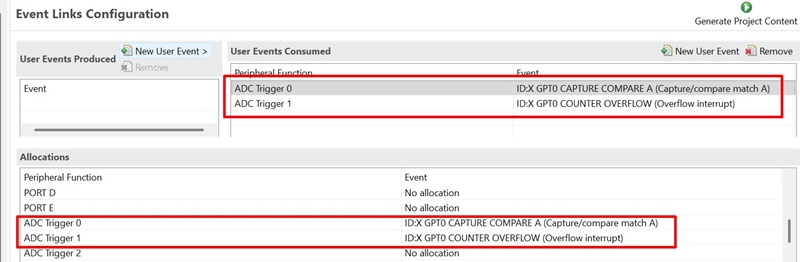 

## API Usage
The table below lists the FSP provided API used at the application layer by this example project.

| API Name                    | Usage                                                                              |
|-----------------------------|------------------------------------------------------------------------------------|
| R_ADC_B_Open                | This API is used to initialize the ADC module.                               |
| R_ADC_B_ScanStart           | This API is used to start scanning of ADC channel connected to ADC peripheral. |
| R_ADC_B_Close               | This API is used to close the opened ADC instance.                           |
| R_DTC_Open                  | This API is used to initialize the DTC module.                               |
| R_DTC_Enable                | This API is used to enable transfers on this activation source.              |
| R_DTC_Reconfigure           | This API is used to reconfigure DTC with chain mode transfer info.           |
| R_DTC_Close                 | This API is used to close the opened DTC instance.                           |
| R_GPT_Open                  | This API is used to initialize the GPT module.                               |
| R_GPT_Start                 | This API is used to start GPT timer in periodic mode.                        |
| R_GPT_Close                 | This API is used to close the opened GPT instance.                           |
| R_ELC_Open                  | This API is used to initialize the ELC module.                               |
| R_ELC_Enable                | This API is used to enable event links between peripheral modules.           |
| R_ELC_Close                 | This API is used to close the opened ELC instance.                           |

**For using the Serial Terminal (UART)**
| API Name    | Usage                                                                          |
|-------------|--------------------------------------------------------------------------------|
| R_SCI_B_UART_Open | This API is used to configures the UART driver based on the input configurations. |
| R_SCI_B_UART_Write | This API is used to transmit user specified number of bytes from the source buffer pointer. |
| R_SCI_B_UART_Close | This API is used to abort any in progress transfers, disables interrupts, receiver, and transmitter, close lower level transfer drivers if used and remove power. |

## Verifying Operation

1. Import the example project.

2. Generate, and build the example project.

3. Before running the example project, make sure hardware connections are completed.

4. Connect the RX MCU to the host PC via debugger. By default, EP will use E2lite debugger.
5. Open a terminal application (e.g., Tera Term or Debug Virtual Console) on the host PC and connect to the RX board’s USB Serial port.  
   * Note: For using the Serial Terminal application:
        * To echo back typed content in Tera Term, go to [Setup] -> [Terminal...] and check [Local echo].
        * The configuration parameters of the serial port are:
            - COM port: Provided by the USB Serial COM.
            - Baud rate: 115200 bps
            - Data length: 8 bits
            - Parity: None
            - Stop bit: 1 bit
            - Flow control: None 

6. Users can view the results in the Terminal Application and Memory Monitor tab.
### The below images showcase the output on the Terminal Application (Tera Term) 
  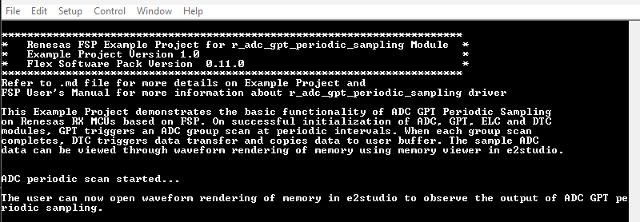

### Setting up waveform rendering
* To set waveform rendering, the user needs to first debug the code, then go to memory view and add g_buffer_adc under memory monitor.
* The user can view any of the respective channel by adding specific ADC Unit buffer under memory monitor. For example ADC Unit 0 Group A Channel 0 samples can be viewed by selecting &g_buffer_adc[0][0][0]. This way other ADC Units, groups, and channels can be selected.
* Then click on New Rendering -> Waveform -> Waveform properties.
* The configuration parameters of the Waveform properties are as follows:
  - Select Data Size: 16bit.
  - User-specified: Tick on the box.
  - Minimum values: 0.
  - Maximum values: 4095.
  - Channel: Mono.
  - Buffer size: 512.

**Note:** 12-bit ADC will have minimum and maximum value between 0-4095. As Ping-Pong buffer is used, the buffer size is 512 (i.e., 256*2) for each channel, where 2 denotes the number of buffers and 256 is the size of the buffer.

* Click Real-time Refresh on Memory monitor tab to check buffer in real-time.

  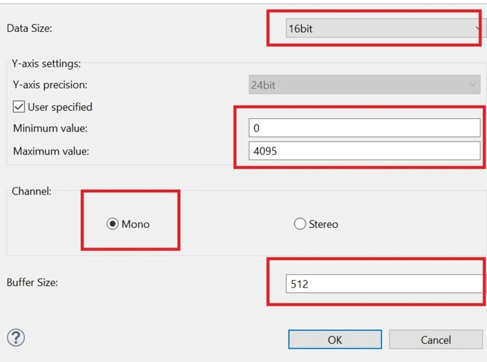

### Input for Signal generator

* The signal needs to be generated from the Signal Generator for the Input to the ADC (0-3V Sinusoidal) with a frequency set to 800Hz.

* After running the EP, open waveform rendering in memory viewer to see the output of sampled data. One can also check the buffer in real-time by adding it to the expression tab.

* Below images showcase the output on waveform rendering of ADC Unit 0 for each channel of group A (group) and B:

  * ADC Unit 0 Group A channel 0 (g_buffer_adc[0][0][0]) and channel 1 (g_buffer_adc[0][0][1]):

  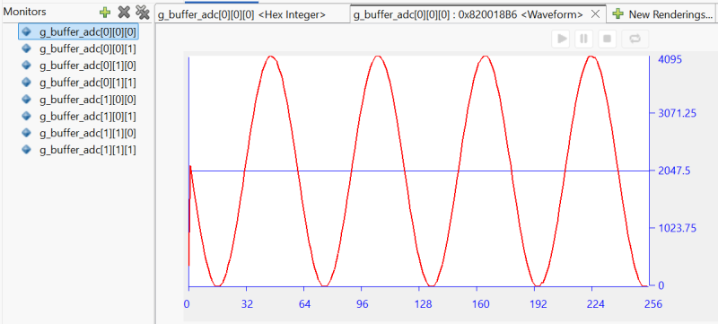 

  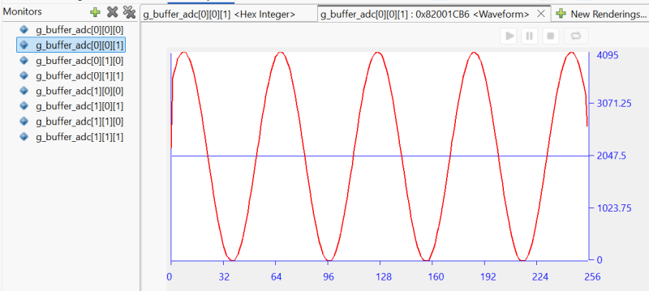

  * ADC Unit 0 Group B channel 2 (g_buffer_adc[0][1][0]) and channel 3 (g_buffer_adc[0][1][1]):

  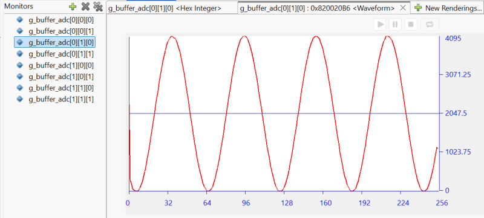 

  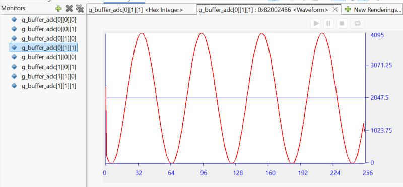

  * ADC Unit 1 Group A channel 10 (g_buffer_adc[0][0][0]) and channel 11 (g_buffer_adc[0][0][1]):

  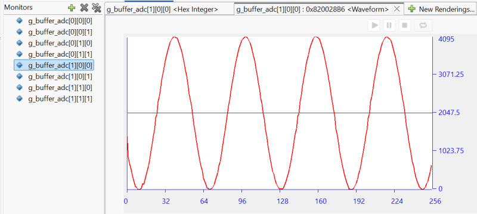 

  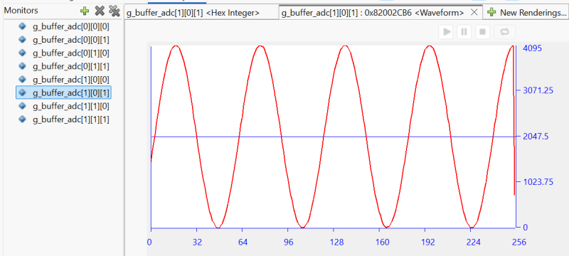

  * ADC Unit 0 Group B channel 12 (g_buffer_adc[0][1][0]) and channel 13 (g_buffer_adc[0][1][1]):

  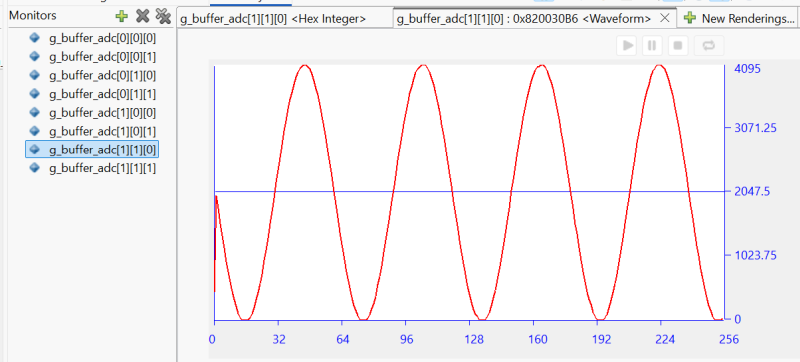 

  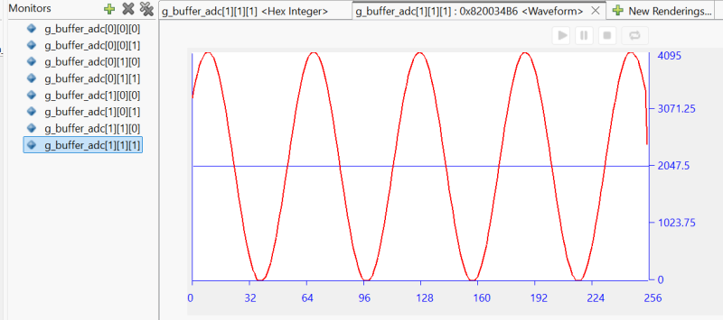

## Special Topics ##

### Debugger Setting

* To use E2 Lite on-board or E2 Emulator Lite, please follow the instructions below:

1. **Common step**: Click [**Run**] → [**Debug Configurations…**] to open the “**Debug Configurations**” window.  
  

2. **Select file application**  
  a. **Used for projects built with GCC**: --> Select file **.elf**.  
    
  b. **Used for projects built with CCRX**: --> Select file **.x**.  
  

3. **Setting debugger configurations**  
  a. **Used for E2 Lite on-board**.    
    
  b. **Used for external E2 Emulator Lite**.  
    

**Note:** Connect the RX board debugger port (J9) to the host PC via E2 Emulator Lite (With USB cable and 20-20 pin cable).

### Setting up Chain Mode in DTC ###
* The chain mode can be setup by declaring local transfer info structure containing info related to Chain Mode Transfer and configure DTC with same info.
  The table below lists the transfer info elements required for chain transfer.
  | Transfer info element   | transfer info 0               |       transfer info 1              |
  |-------------|-------------------------------------------|------------------------------------|
  |Transfer mode | Normal mode| Normal mode|
  |Source address control | Fixed | Fixed |
  |Destination address control | Incremented| Incremented|
  |Chain transfer  | Enabled | Disable|
  |Transfer block size | 2 bytes | 2 bytes|
  |Transfer source address | &R_ADDR0| &R_ADDR1|
  |Transfer destination address | g_buffer[unit0][Group scan A][channel 0][0][0]| g_buffer[unit0][Group scan A][channel 1][0][0]|
  
**Note:** Above table shows chain transfer for group A of ADC Unit 0 same way this can be updated for other ADC units and groups.
          The user can also update their info as per requirement.
* After A/D conversion is completed, the DTC is activated by an A/D Scan complete interrupt request.
  Once the DTC is activated, it reads transfer info for transfer_adc_groupA[0] which is a local buffer, and copy values of register ADDR0
  to the destination buffer location of DTC g_buffer_adc[0]. Since chain transfer is enabled, so the DTC successively reads transfer_adc_groupA[1] (i.e., channel 1 of group A).
* Once DTC operation for transfer_adc_groupA[1] starts it transfers values of registers ADDR1 to the destination buffer g_buffer_adc[1]. Since chain transfer is disabled in transfer info of A[1],
  data transfer by the DTC is completed here.
* DTC transfer completes the operation of one group, an A/D conversion interrupt is generated after DTC transfer is completed for the other ADC group 
  and the same process repeats for group B.
  
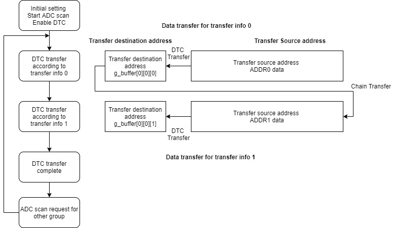

### Calculating Time period and ADC Trigger Raw count ###
* To calculate the Time period of GPT timer use 
  Time period = 1/input frequency (where input sampling frequency is 2 * signal generator input frequency).
  This calculated Time Period can be set as GPT Time period in the properties tab.
* To calculate Raw period count for ADC trigger use
   Raw period count =  (Time period in seconds * (PCLKD / (2^ Pre scaler)))
  (where prescaler value is 0 by default so 2^0 = 1)
  **Note :** PCLKD frequency will vary as per MCU variant.
* ADC Trigger value for ADC Compare match value for A and B are set to 50% and 99% duty cycle (Raw period count). So ADC Compare match value for A = (0.5 * Raw period count) and ADC Compare match value for 
  B = (0.99 * Raw period count). ADC Compare A and B Match raw count values are supported for MCUs supporting enhanced GPT timer.
  For MCUs without enhanced GPT timer support, the user only needs to set GPT Time period as ADC group are set to trigger ADC group A at 50% of the cycle and ADC group B at full cycle (GPT overflow interrupt).
  
### Ping Pong Buffer Operation ###
* The DTC is used to transfer data from the ADC data registers to the Ping-Pong buffer.
* Using the DTC allows the CPU to be used for other operations.
* When the first buffer is filled completely (i.e., desired sample size), a DTC activation source generates an interrupt to the CPU.
* The CPU executes the ADC Interrupt service routine to:
  * Switch to the DTC to fill the second buffer with ADC values
  * Allow processing on the data available in the first buffer.

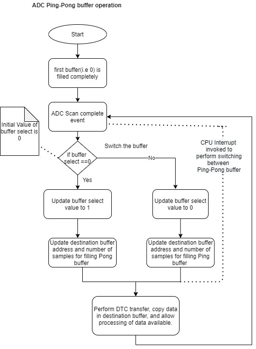

### Adding lowsrc Folder

Before changing terminal application settings, you need to add the `lowsrc` folder from another Example Project:

1. **Locate the lowsrc folder:**
   
   - Navigate to Example Project `sci_uart` or `usb_pcdc_with_freertos`  (`example_projects/<board>/sci_uart/e2studio/gccrx_sci_uart_<board>_ep/src`)
   - Find the `lowsrc` folder containing low-level source files.

2. **Copy `lowsrc` folder to this Example Project:**
   
   - Copy the entire `lowsrc` folder.
   - Paste it into this your target Example Project directory: `example_projects/ek_rx74m/<EP>/e2studio/`.

3. **Add lowsrc to e2studio project:**
   
   - In e2studio, right-click on the project in Project Explorer.
   - Select **Refresh** (or press F5) to detect the new folder.

4. **Verify the folder is included:**
   
   - Expand the project tree in Project Explorer.
   - Confirm that `lowsrc` folder and its contents are visible.
   - The folder should be included in the build path with source files ready to compile.

5. **Changing the terminal Application to use the Debug Virtual Console:**
   
   - For instructions on how to switch between these options, please refer to the section [`Special Topics`](#special-topics)/[`Changing Terminal Application`](#changing-terminal-application).

6. **Re-build the project:**
   
   - In e2studio, right-click on the project and select **Build Project**.

**Note:** To use Debug Virtual Console, the `lowsrc` folder must be added to the project, as it contains the source files required for Debug Virtual Console operation.

### Changing Terminal Application ###
By default, the EP supports Serial Terminal for RX boards that support USB Serial COM   
**For use CCRX Compiler:**
* Define USE_VIRTUAL_COM=1 macro in Project Properties -> C/C++ Build -> Settings -> Tool Settings -> Compiler -> Source -> Macro definition (-define)

To use Debug Virtual Console, please follow the instructions below:
* Define USE_VIRTUAL_COM=0 macro in Project Properties -> C/C++ Build -> Settings -> Tool Settings -> Compiler -> Source -> Macro definition (-define)
* Define BSP_CFG_IO_LIB_ENABLE=1 macro in Project Properties -> C/C++ Build -> Settings -> Tool Settings -> Compiler -> Source -> Macro definition (-define)

**For use GCCRX Compiler:**  
* Define USE_VIRTUAL_COM=1 macro in Project Properties -> C/C++ Build -> Settings -> Tool Settings -> Compiler -> Includes -> Macro Defines (-D)
  
To use Debug Virtual Console, please follow the instructions below:
* Define USE_VIRTUAL_COM=0 macro in Project Properties -> C/C++ Build -> Settings -> Tool Settings -> Compiler -> Includes -> Macro Defines (-D)

