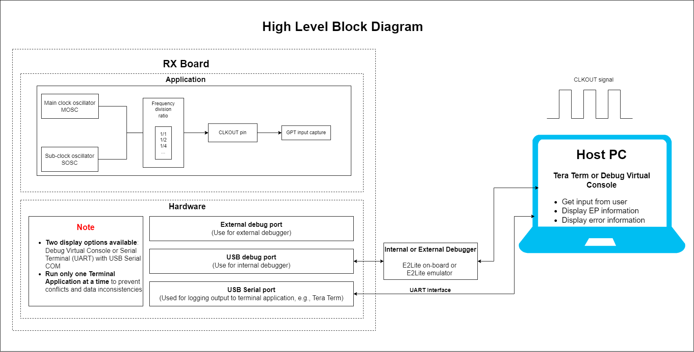
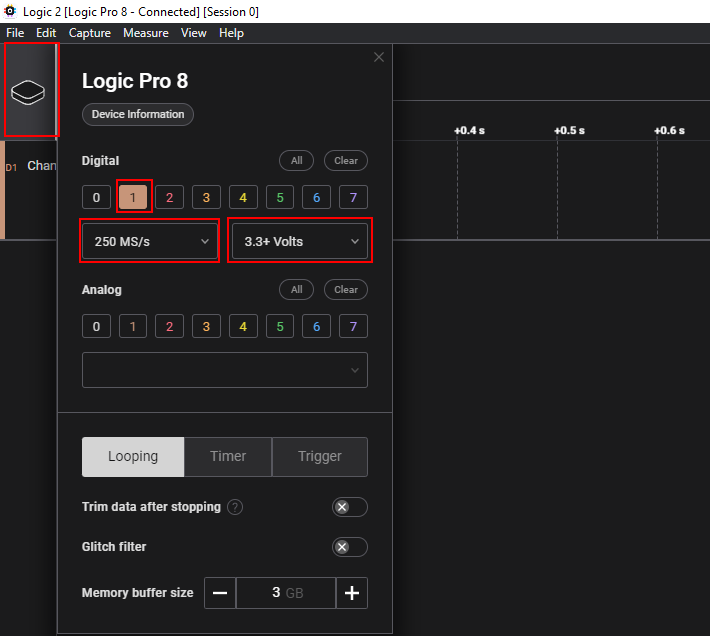
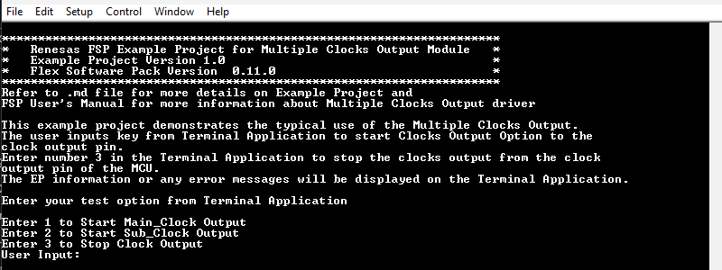
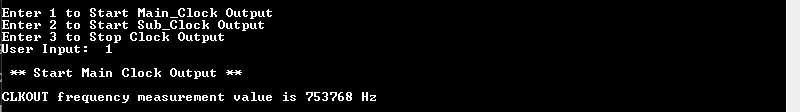
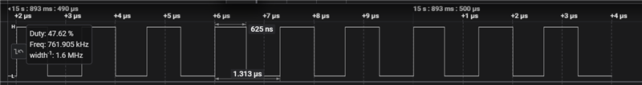
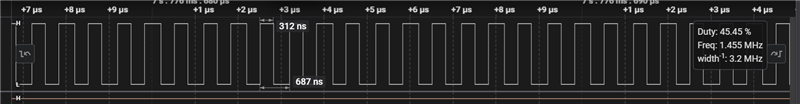
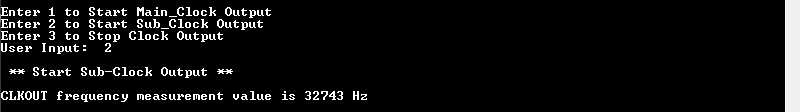
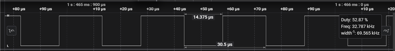
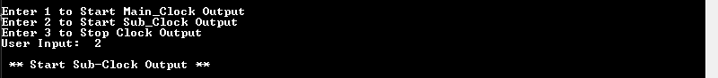
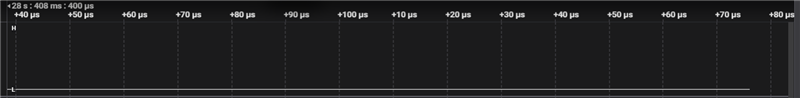

# Introduction #

This example project demonstrates the typical use of the Multiple Clocks Output. The user inputs key from Terminal Application. to start Clocks Output Option to the clock output pin. Enter number 3 in the Terminal Application. to stop the clocks output from the clock output pin of the MCU. The EP information or any error messages will be displayed on the Terminal Application. 

**Note**: 
- To display information, the user can select between Debug Virtual Console and the Serial Terminal (UART) with USB Serial COM. It is important to note that the user should only operate a single terminal application at a time to avoid conflicts or data inconsistencies. For instructions on how to switch between these options, please refer to the section [`Special Topics`](#special-topics)/[`Changing Terminal Application`](#changing-terminal-application).

- By default, EP information is printed to the host PC using the Serial Terminal (UART) for boards that support USB Serial COM. LED3 is turned ON to indicate the UART initialized unsuccessfully.

- RX boards that support USB Serial COM: EK-RX74M, EK-RX74N.

* For Verifying Operation:
	* To verify EP, the user can select between the GPT or oscilloscope.
	* By default, the EP uses GPT to capture clock output value. To use oscilloscope, please follow the instructions in "Verifying Operation" section.

## Required Resources ##

To build and run the clock output example project, the following resources are needed.

### Software ###

* Renesas Flexible Software Package (FSP): Version 1.0.0.
* e2 studio: Version 2026-07.
* Renesas GCC Compiler for RX: Version 14.2.0.202607.
* Renesas CC-RX Compiler: Version v3.08.00.
* Terminal Console Application: Tera Term or a similar application.

### Hardware ###
Supported RX boards: EK-RX74M, EK-RX74N.

* 1 x Renesas RX board.
* 2 x Type-C USB cables for programming and debugging.
* 1 x Signal analyzer to verify the CLKOUT signal (e.g., Saleae logic, Oscilloscope).
* 1 x Jumper wire with both ends female.

### Hardware Connections ###

* Connect the RX board USB debug port (J8) to the PC via a Type-C USB cable for EP debugging (If E2 Lite on-board is used).
* Connect the RX board USB Serial port (J27) to the PC using a Type-C USB cable to verify logs through the Terminal Application.

- CLKOUT Pin Configuration for RX Development Kits:
	| Development Kit | CLKOUT_PIN | Connector and Pin |
	|-----------------|------------|-------------------|
	| EK-RX74M        | P205       | J1-P20            |
  | EK-RX74N        | P205       | J1-P54            |

- For Verifying Operation:
  * Using the GPT to capture clock output value (Default):
	  * For EK-RX74M:
		  * Connect CLKOUT pin - P205 (J1-P20) to GTIOCA pin - P802 (J3-P13).

      * For EK-RX74N:
		  * Connect CLKOUT pin - P205 (J1-P54) to GTIOCA pin - P802 (J2-P33).
  
  * Using the oscilloscope to measure clock output waveform:
	  * Connect the ground clip of the oscilloscope probe to a ground point on the RX board.
	  * Connect the probe tip to the CLKOUT pin (CLKOUT_PIN) on the RX board. 

## Related Collateral References ##
The following documents can be referred to for enhancing your understanding of the operation of this example project:
- [FSP User Manual on GitHub (Reference link)](https://renesas.github.io/fsp/)
- [FSP Known Issues (Reference link)](https://github.com/renesas/fsp/issues)

# Project Notes #

## System Level Block Diagram ##

## FSP Modules Used ##
List all the various modules that are used in this example project. Refer to the FSP User Manual for further details on each module listed below.

| Module Name | Usage  | Searchable Keyword (using New Stack > Search) |
|-------------|-----------------------------------------------|-----------------------------------------------|
| GPT | GPT is used to capture clock frequency. | r_gpt |

## Module Configuration Notes ##
This section describes FSP Configurator properties which are important or different than those selected by default.

**Common Configuration Properties**

|   Module Property Path and Identifier   |   Default Value   |   Used Value   |   Reason   |
| :-------------------------------------: | :---------------: | :------------: | :--------: |
|   configuration.xml > BSP > Properties > Settings > Property > RX Common > Main stack size (bytes)  |  0x400   | 0x1000  |  Main stack size is required for standard library functions to be used. |

**GPT Configuration Properties**
|   Module Property Path and Identifier   |   Default Value   |   Used Value   |   Reason   |
| :-------------------------------------: | :---------------: | :------------: | :--------: |
|  configuration.xml > Stacks > g_input_capture Timer, General PWM (r_gpt) > Properties > Settings > Property > Module g_input_capture Timer, General PWM (r_gpt) > General > Channel | 0 | 1 | Select channel for GPT module. |
|  configuration.xml > Stacks > g_input_capture Timer, General PWM (r_gpt) > Properties > Settings > Property > Module g_input_capture Timer, General PWM (r_gpt) > General > Mode | Periodic | Periodic | Select mode for GPT module. |
|  configuration.xml > Stacks > g_input_capture Timer, General PWM (r_gpt) > Properties > Settings > Property > Module g_input_capture Timer, General PWM (r_gpt) > General > Period | 0x10000 | 0x1000000000 | Specify the timer period in units. |
|  configuration.xml > Stacks > g_input_capture Timer, General PWM (r_gpt) > Properties > Settings > Property > Module g_input_capture Timer, General PWM (r_gpt) > General > Period Unit | Raw Counts | Raw Counts | Unit of the period specified. |
|  configuration.xml > Stacks > g_input_capture Timer, General PWM (r_gpt) > Properties > Settings > Property > Module g_input_capture Timer, General PWM (r_gpt) > Input > Start Source > GTIOCA Rising Edge While GTIOCB Low| ☐ | ☑ | Select external source that will start the timer. |
|  configuration.xml > Stacks > g_input_capture Timer, General PWM (r_gpt) > Properties > Settings > Property > Module g_input_capture Timer, General PWM (r_gpt) > Input > Clear Source > GTIOCA Rising Edge While GTIOCB Low| ☐ | ☑ | Select external source that will clear the timer. |
|  configuration.xml > Stacks > g_input_capture Timer, General PWM (r_gpt) > Properties > Settings > Property > Module g_input_capture Timer, General PWM (r_gpt) > Input > Capture A Source > GTIOCA Rising Edge While GTIOCB Low| ☐ | ☑ | Select external source that will trigger a capture A event. |
| configuration.xml -> Stacks > g_input_capture Timer, General PWM (r_gpt) > Properties > Settings > Property > Module g_input_capture Timer, General PWM (r_gpt) > Interrupts > Callback | NULL | input_capture_user_callback | It is called from the interrupt service routine (ISR) each time the timer period elapses. |
| configuration.xml -> Stacks > g_input_capture Timer, General PWM (r_gpt) > Properties > Settings > Property > Module g_input_capture Timer, General PWM (r_gpt) > Interrupts > Overflow/Crest Interrupt priority | Disabled | Priority 31 (highest) | Select the interrupt priority for Overflow/Crest. |
| configuration.xml -> Stacks > g_input_capture Timer, General PWM (r_gpt) > Properties > Settings > Property > Module g_input_capture Timer, General PWM (r_gpt) > Interrupts > Capture/Compare match A Interrupt priority | Disabled | Priority 31 (highest) | Select the interrupt priority for Capture/Compare match A. |

**Configuration Properties for using the Serial Terminal (UART)**   
|   Configure Clock Path                  |   Default Value   |   Used Value   |   Reason   |
|-----------------------------------------|-------------------|----------------|------------|
| configuration.xml > Clocks > Clocks Configuration > SCICLK Disable | SCICLK Disable | SCICLK Src: HOCO | Enable operating clock for SCI module by HOCO clock source. |

|   Configure Interrupt Event Path        |   Default Value   |   Used Value   |   Reason   |
|-----------------------------------------|-------------------|----------------|------------|
| configuration.xml > Interrupts > Interrupts Configuration > New User Event > RSCI > RSCI12 > RSCI12 RXI (Receive data full) | empty | sci_b_uart_rxi_isr | Assign the UART receive ISR (Receive data full) to the interrupt vector table. |
| configuration.xml > Interrupts > Interrupts Configuration > New User Event > RSCI > RSCI12 > RSCI12 TXI (Transmit data empty) | empty | sci_b_uart_txi_isr | Assign the UART transfer ISR (Transfer data empty) to the interrupt vector table. |
| configuration.xml > Interrupts > Interrupts Configuration > New User Event > RSCI > RSCI12 > 105-6 GROUPAL1 RSCI12 TEI (Transmit end) | empty | sci_b_uart_tei_isr | Assign the UART transfer ISR (Transfer end) to the interrupt vector table. |
| configuration.xml > Interrupts > Interrupts Configuration > New User Event > RSCI > RSCI12 > 105-7 GROUPAL1 RSCI12 ERI (Receive error) | empty | sci_b_uart_eri_isr | Assign the UART receive ISR (Receive error) to the interrupt vector table. |

## API Usage ##

The table below lists the FSP provided API used at the application layer by this example project.

| API Name    | Usage                                                                          |
|-------------|--------------------------------------------------------------------------------|
|R_IOPORT_PinCfg| This API is used to configure the settings of a pin.|
|R_GPT_Open| This API is used to initialize the timer module and applies configurations.|
|R_GPT_Close| This API is used to stop counter, disable output pins, and clear internal driver data.|
|R_GPT_Enable| This API is used to enable external event triggers that start, stop, clear, or capture the counter.|
|R_GPT_Disable| This API is used to disable external event triggers that start, stop, clear, or capture the counter.|
|R_GPT_InfoGet| This API is used to get timer information and store it in provided pointer.|

**For using the Serial Terminal (UART)**
| API Name    | Usage                                                                          |
|-------------|--------------------------------------------------------------------------------|
| R_SCI_B_UART_Open | This API is used to configures the UART driver based on the input configurations. |
| R_SCI_B_UART_Write | This API is used to transmit user specified number of bytes from the source buffer pointer. |
| R_SCI_B_UART_Close | This API is used to abort any in progress transfers, disables interrupts, receiver, and transmitter, close lower level transfer drivers if used and remove power. |

## Verifying Operation ##

1. Import the example project.

2. Generate, and build the example project.

3. Before running the example project, make sure hardware connections are completed.

4. Connect the RX MCU to the host PC via debugger. By default, EP will use E2lite debugger.
5. Open a terminal application (e.g., Tera Term or Debug Virtual Console) on the host PC and connect to the RX board’s USB Serial port.  
   * Note: For using the Serial Terminal application:
        * To echo back typed content in Tera Term, go to [Setup] -> [Terminal...] and check [Local echo].
        * The configuration parameters of the serial port are:
            - COM port: Provided by the USB Serial COM.
            - Baud rate: 115200 bps
            - Data length: 8 bits
            - Parity: None
            - Stop bit: 1 bit
            - Flow control: None 
**Note:** 
Verifying Operation:
* By default, the EP uses the GPT to capture clock output value
	* Define GPT_MEASURE_CLKOUT=1 macro in Project Properties -> C/C++ Build -> Settings -> Tool Settings -> Compiler -> Includes (**For GCC-RX compiler**).
  * Define GPT_MEASURE_CLKOUT=1 macro in Project Properties -> C/C++ Build -> Settings -> Tool Settings -> Compiler -> Source (**For CC-RX compiler**).
  * The user must connect CLKOUT pin to GTIOC1A pin as "Hardware Connections" section.
  * View clock output value on the Terminal Application.

* For using the oscilloscope to measure clock output waveform
	* Define GPT_MEASURE_CLKOUT=0 macro in Project Properties -> C/C++ Build -> Settings -> Tool Settings -> Compiler -> Includes (For GCC-RX compiler).
  * Define GPT_MEASURE_CLKOUT=0 macro in Project Properties -> C/C++ Build -> Settings -> Tool Settings -> Compiler -> Source (For CC-RX compiler).
  * Connect the ground clip of the oscilloscope probe to a ground point on the RX board.
  * Connect the probe tip to the CLKOUT pin (CLKOUT_PIN) on the RX board. CLKOUT pin for each board refer "Hardware Connections" section. 
  * To accurately measure the clock output waveform, a sampling rate of 250 MS/s and a voltage level setting of 3.3+ Volts (threshold at 1.65 Volts) are recommended.
			* e.g., When using Saleae logic, The configuration on the Logic Analyzer Application are as follows:
				* Digital: Channel 1
				* Sampling rate: 250 MS/s
				* Voltage level: 3.3+ Volts  
				

### Below images showcases the output log on the Terminal Application (Tera Term):

**The EP information:**  

**Main clock output operation:**  

* Using the GPT to capture clock output value:

* Using the oscilloscope to measure clock output waveform:

**Sub clock output operation:**

* Using the GPT to capture clock output value:

* Using the oscilloscope to measure clock output waveform:

**Stop clock output:**

   

## Special Topics ##

### Clock Specifications ###
The Main clock oscillator (MOSC) has to be divided by at least 32 when measured by GPT and divided by at least 16 when measured not by GPT. 

| Board            | Main clock (XTAL) | Sub clock      | Main clock divided by 32  | Main clock divided by 16  |
-------------------|-------------------|----------------| --------------------------|---------------------------|
| EK-RX74M         | 24 MHz            | 32.768 KHz     |            750 KHz        |          1.5 MHz          |
| EK-RX74N         | 24 MHz            | 32.768 KHz     |            750 KHz        |          1.5 MHz          |

### Debugger Setting ###

* To use E2 Lite on-board or E2 Emulator Lite, please follow the instructions below:

1. **Common step**: Click [**Run**] → [**Debug Configurations…**] to open the “**Debug Configurations**” window.  
  

2. **Select file application**  
  a. **Used for projects built with GCC**: --> Select file **.elf**.  
    
  b. **Used for projects built with CCRX**: --> Select file **.x**.  
  

3. **Setting debugger configurations**  
  a. **Used for E2 Lite on-board**.    
    
  b. **Used for external E2 Emulator Lite**.  
    

  **Note:** Connect the RX board debugger port (J9) to the host PC via E2 Emulator Lite (with USB cable and 20-20 pin cable).

### Adding lowsrc Folder

Before changing terminal application settings, you need to add the `lowsrc` folder from another Example Project:

1. **Locate the lowsrc folder:**
   
   - Navigate to Example Project `sci_uart` or `usb_pcdc_with_freertos`  (`example_projects/<board>/sci_uart/e2studio/gccrx_sci_uart_<board>_ep/src`)
   - Find the `lowsrc` folder containing low-level source files.

2. **Copy `lowsrc` folder to this Example Project:**
   
   - Copy the entire `lowsrc` folder.
   - Paste it into this your target Example Project directory: `example_projects/ek_rx74m/<EP>/e2studio/`.

3. **Add lowsrc to e2studio project:**
   
   - In e2studio, right-click on the project in Project Explorer.
   - Select **Refresh** (or press F5) to detect the new folder.

4. **Verify the folder is included:**
   
   - Expand the project tree in Project Explorer.
   - Confirm that `lowsrc` folder and its contents are visible.
   - The folder should be included in the build path with source files ready to compile.

5. **Changing the terminal Application to use the Debug Virtual Console:**
   
   - For instructions on how to switch between these options, please refer to the section [`Special Topics`](#special-topics)/[`Changing Terminal Application`](#changing-terminal-application).

6. **Re-build the project:**
   
   - In e2studio, right-click on the project and select **Build Project**.

**Note:** To use Debug Virtual Console, the `lowsrc` folder must be added to the project, as it contains the source files required for Debug Virtual Console operation.

### Changing Terminal Application ###
  By default, the EP supports Serial Terminal for RX boards that support USB Serial COM   
**For use CCRX Compiler:**
* Define USE_VIRTUAL_COM=1 macro in Project Properties -> C/C++ Build -> Settings -> Tool Settings -> Compiler -> Source -> Macro definition (-define)
  
  To use Debug Virtual Console, please follow the instructions below:
* Define USE_VIRTUAL_COM=0 macro in Project Properties -> C/C++ Build -> Settings -> Tool Settings -> Compiler -> Source -> Macro definition (-define)
* Define BSP_CFG_IO_LIB_ENABLE=1 macro in Project Properties -> C/C++ Build -> Settings -> Tool Settings -> Compiler -> Source -> Macro definition (-define)
  
  
  
**For use GCCRX Compiler:**  
* Define USE_VIRTUAL_COM=1 macro in Project Properties -> C/C++ Build -> Settings -> Tool Settings -> Compiler -> Includes -> Macro Defines (-D)
  
To use Debug Virtual Console, please follow the instructions below:
* Define USE_VIRTUAL_COM=0 macro in Project Properties -> C/C++ Build -> Settings -> Tool Settings -> Compiler -> Includes -> Macro Defines (-D)
  
  
