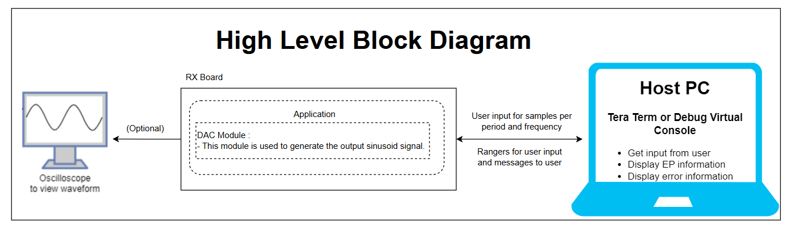
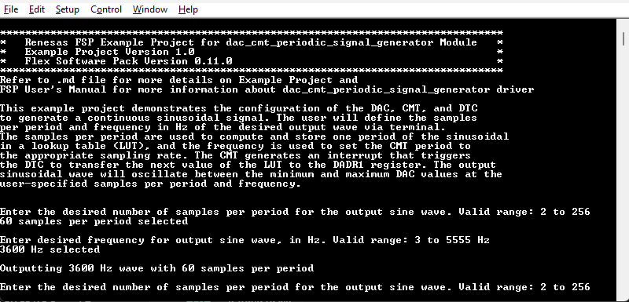
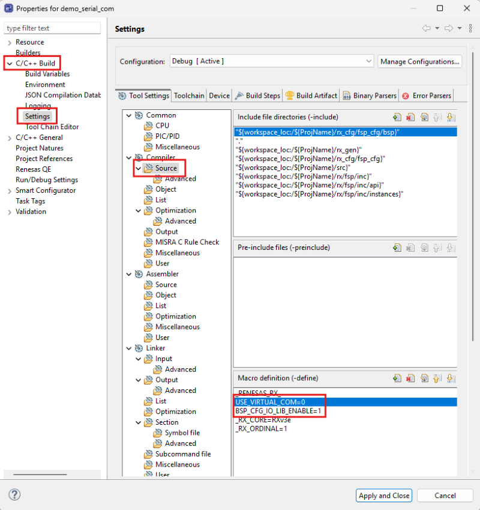

# Introduction #

The sample code accompanying this file shows the operation of the DAC, CMT, and DTC modules to generate a continuous sinusoidal signal on a RX MCU. The user is prompted to set the output signal's samples per period and frequency via terminal. The program first calculates one period of the sinusoidal signal stores it in a lookup table. Then, the samples per period and frequency are used to calculate and configure the counts per timer cycle of the CMT. After the CMT module is started, every CMT cycle triggers the DTC to transfer the next value of the lookup table to the DADR1 register and the corresponding voltage is output to the D/A output pin. The desired output sinusoidal wave will oscillate between the minimum and maximum DAC values at the user-specified samples per period and frequency.

For EK-RX74M/EK-RX74N: The board is not support AGT module. So the EP is using CMT module instead of AGT module.

**Note**: 
- To display information, the user can select between Debug Virtual Console and the Serial Terminal (UART) with USB Serial COM. It is important to note that the user should only operate a single terminal application at a time to avoid conflicts or data inconsistencies. For instructions on how to switch between these options, please refer to the section [`Special Topics`](#special-topics)/[`Changing Terminal Application`](#changing-terminal-application).

- By default, EP information is printed to the host PC using the Serial Terminal (UART) for boards that support USB Serial COM. LED3 is turned ON to indicate the UART initialized unsuccessfully.

- RX boards that support USB Serial COM: EK-RX74M, EK-RX74N. 

## Required Resources ##

To build and run the dac cmt periodic signal generator example project, the following resources are needed.

### Software ###

* Renesas Flexible Software Package (FSP): Version 1.0.0.
* e2 studio: Version 2026-07.
* Renesas GCC Compiler for RX: Version 14.2.0.202607.
* Renesas CC-RX Compiler: Version v3.08.00.
* Terminal Console Application: Tera Term or a similar application.

### Hardware ###
Supported RX boards: EK-RX74M, EK-RX74N.

* 1 x Renesas RX board.
* 2 x Type-C USB cables for programming and debugging.
* Optional hardware to view waveform: Oscilloscope and Probes.

### Hardware Connections ###

- Connect the RX board USB debug port (J8) to the PC via a Type-C USB cable for EP debugging (If E2 Lite on-board is used).
- Connect the RX board USB Serial port (J27) to the PC using a Type-C USB cable to verify logs through the Terminal Application.
- To view waveform:
  - EK-RX74M: P415 (J1:18) is DA1 output.
  - EK-RX74N: P415 (J1:21) is DA1 output.

## Related Collateral References ##
The following documents can be referred to for enhancing your understanding of the operation of this example project:
- [FSP User Manual on GitHub (Reference link)](https://renesas.github.io/fsp/)
- [FSP Known Issues (Reference link)](https://github.com/renesas/fsp/issues)

# Project Notes #

## System Level Block Diagram ##



## FSP Modules Used ##
List all the various modules that are used in this example project. Refer to the FSP User Manual for further details on each module listed below.

| Module Name | Usage | Searchable Keyword  |
|-------------|-----------------------------------------------|-----------------------------------------------|
| DAC | DAC is used to generate the output sinusoid signal. | r_dac |
| CMT | CMT is used to trigger the DTC transfer. | r_cmt | 
| DTC | DTC is used to transfer values from the look up table to the DAC data register. | r_dtc |

## Module Configuration Notes ##
This section describes FSP Configurator properties which are important or different than those selected by default.

**Common Configuration Properties**
|   Module Property Path and Identifier   |   Default Value   |   Used Value   |   Reason   |
| :-------------------------------------: | :---------------: | :------------: | :--------: |
|   configuration.xml > BSP > Properties > Settings > Property > RX Common > Heap size (bytes)  |  0   | 0x400  |  Heap size is required for standard library functions to be used. |

**Configuration Properties for dac_cmt_periodic_signal_generator**
|   Module Property Path and Identifier   |   Default Value   |   Used Value   |   Reason   |
|-----------------------------------------|-------------------|----------------|------------|
| configuration.xml > Stacks > g_timer0 Timer, Compare Match Timer (r_cmt) > Properties > Settings > Property > Module g_timer0 Timer, Compare Match Timer (r_cmt) > Interrupts > Compare Match Interrupt Priority | Disabled | Priority 30 | This configures the CMT to interrupt with priority 30. | 
| configuration.xml > Stacks > g_transfer0 Transfer (r_dtc) > Properties > Settings > Property > Module g_transfer0 Transfer (r_dtc) > Mode | Normal | Repeat | This configures the DTC transfer address to return to the start of the look up table after the number of data transfers reaches the specified repeat size. | 
| configuration.xml > Stacks > g_transfer0 Transfer (r_dtc) > Properties > Settings > Property > Module g_transfer0 Transfer (r_dtc) > Source Address Mode | Fixed | Incremented | This configures the DTC's source address to increment to the next value in the look up table after each transfer is completed. | 
configuration.xml > Stacks > g_transfer0 Transfer (r_dtc) > Properties > Settings > Property > Module g_transfer0 Transfer (r_dtc) > Activation Source | Disabled | ID:28 CMT0 CMI (Compare match) | This configures the CMT interrupt to activate the DTC transfer, triggering the transfer of a value in the look up table to the DAC data register. | 

**Configuration Properties for using the Serial Terminal (UART)**   
|   Configure Interrupt Event Path        |   Default Value   |   Used Value   |   Reason   |
|-----------------------------------------|-------------------|----------------|------------|
| configuration.xml > Interrupts > Interrupts Configuration > New User Event > RSCI > RSCI12 > RSCI12 RXI (Receive data full) | empty | sci_b_uart_rxi_isr | Assign the UART receive ISR (Receive data full) to the interrupt vector table. |
| configuration.xml > Interrupts > Interrupts Configuration > New User Event > RSCI > RSCI12 > RSCI12 TXI (Transmit data empty) | empty | sci_b_uart_txi_isr | Assign the UART transfer ISR (Transfer data empty) to the interrupt vector table. |
| configuration.xml > Interrupts > Interrupts Configuration > New User Event > RSCI > RSCI12 > 105-6 GROUPAL1 RSCI12 TEI (Transmit end) | empty | sci_b_uart_tei_isr | Assign the UART transfer ISR (Transfer end) to the interrupt vector table. |
| configuration.xml > Interrupts > Interrupts Configuration > New User Event > RSCI > RSCI12 > 105-7 GROUPAL1 RSCI12 ERI (Receive error) | empty | sci_b_uart_eri_isr | Assign the UART receive ISR (Receive error) to the interrupt vector table. |

## API Usage ##

The table below lists the APIs used at the application layer by this example project.

| API Name    | Usage                                                                          |
|-------------|--------------------------------------------------------------------------------|
| R_DAC_Open | This API initializes the DAC channel. |
| R_DAC_Start | This API starts the D/A conversion output. |
| R_CMT_Open | This API initializes the CMT module instance. |
| R_CMT_PeriodSet | This API updates the number of counts in the CMT period. |
| R_CMT_Start | This API starts the CMT timer. | 
| R_DTC_Open | This API initializes the DTC module and configures the DTC vector table.  | 
| R_DTC_Reconfigure | This API reconfigures the DTC data transfer destination, source, and length. | 
| R_FSP_SystemClockHzGet | This API gets the frequency of the clock operating the CMT counts.  | 

**For using the Serial Terminal (UART)**
| API Name    | Usage                                                                          |
|-------------|--------------------------------------------------------------------------------|
| R_SCI_B_UART_Open | This API is used to configures the UART driver based on the input configurations. |
| R_SCI_B_UART_Write | This API is used to transmit user specified number of bytes from the source buffer pointer. |
| R_SCI_B_UART_Close | This API is used to abort any in progress transfers, disables interrupts, receiver, and transmitter, close lower level transfer drivers if used and remove power. |

## Verifying Operation ##

1. Import the example project.

2. Generate, and build the example project.

3. Before running the example project, make sure hardware connections are completed.

4. Connect the RX MCU to the host PC via debugger. By default, EP will use E2lite debugger.
5. Open a terminal application (e.g., Tera Term or Debug Virtual Console) on the host PC and connect to the RX board’s USB Serial port.  
   * Note: For using the Serial Terminal application:
        * To echo back typed content in Tera Term, go to [Setup] -> [Terminal...] and check [Local echo].
        * The configuration parameters of the serial port are:
            - COM port: Provided by the USB Serial COM.
            - Baud rate: 115200 bps
            - Data length: 8 bits
            - Parity: None
            - Stop bit: 1 bit
            - Flow control: None 

**Note:** (Optional: to view waveform) Connect oscilloscope probes to the DAC output pin and GND pin.

### The below images showcase the output on the Terminal Application (Tera Term) ###



## Special Topics ##

### Generating Different Periodic Signals ### 
This program generates a continuous output signal by repeatedly iterating through one period of the sine function in a lookup table. The user can generate additional periodic signals with this program by replacing the sine function with other periodic functions in the code section for calculating the lookup table. 

**e.g. Triangle Wave:** 

To edit the program to generate a triangle wave, replace the code in the file *hal_entry.c* inside the function generate_lut() (lines 260-268) with the following code:

```c
        int duty_cycle = 50;
        int cutoff =  input_spp *duty_cycle/100;
        uint16_t b = (uint16_t)(4095 +(4095/(input_spp-cutoff))*cutoff);
        uint16_t m1 = (uint16_t)(4095/cutoff);
        uint16_t m2 = (uint16_t)(-4095/(input_spp-cutoff));

        for(int i=0; i< cutoff; ++i )
        {
            look_up_table[i] = (uint16_t)(m1*i);
        }

        for(int i=cutoff; i<input_spp; ++i)
        {
            look_up_table[i] = (uint16_t)(m2*i+b);
        }
```
### Debugger Setting ###

* To use E2 Lite on-board or E2 Emulator Lite, please follow the instructions below:

1. **Common step**: Click [**Run**] → [**Debug Configurations…**] to open the “**Debug Configurations**” window.  
  

2. **Select file application**  
  a. **Used for projects built with GCC**: --> Select file **.elf**.  
    
  b. **Used for projects built with CCRX**: --> Select file **.x**.  
  

3. **Setting debugger configurations**  
  a. **Used for E2 Lite on-board**.    
    
  b. **Used for external E2 Emulator Lite**.  
    

  **Note:** Connect the RX board debugger port (J9) to the host PC via E2 Emulator Lite (With USB cable and 20-20 pin cable).
  
### Adding lowsrc Folder

Before changing terminal application settings, you need to add the `lowsrc` folder from another Example Project:

1. **Locate the lowsrc folder:**
   
   - Navigate to Example Project `sci_uart` or `usb_pcdc_with_freertos`  (`example_projects/<board>/sci_uart/e2studio/gccrx_sci_uart_<board>_ep/src`)
   - Find the `lowsrc` folder containing low-level source files.

2. **Copy `lowsrc` folder to this Example Project:**
   
   - Copy the entire `lowsrc` folder.
   - Paste it into this your target Example Project directory: `example_projects/ek_rx74m/<EP>/e2studio/`.

3. **Add lowsrc to e2studio project:**
   
   - In e2studio, right-click on the project in Project Explorer.
   - Select **Refresh** (or press F5) to detect the new folder.

4. **Verify the folder is included:**
   
   - Expand the project tree in Project Explorer.
   - Confirm that `lowsrc` folder and its contents are visible.
   - The folder should be included in the build path with source files ready to compile.

5. **Changing the terminal Application to use the Debug Virtual Console:**
   
   - For instructions on how to switch between these options, please refer to the section [`Special Topics`](#special-topics)/[`Changing Terminal Application`](#changing-terminal-application).

6. **Re-build the project:**
   
   - In e2studio, right-click on the project and select **Build Project**.

**Note:** To use Debug Virtual Console, the `lowsrc` folder must be added to the project, as it contains the source files required for Debug Virtual Console operation.

### Changing Terminal Application ###
  By default, the EP supports Serial Terminal for RX boards that support USB Serial COM   
**For use CCRX Compiler:**
* Define USE_VIRTUAL_COM=1 macro in Project Properties -> C/C++ Build -> Settings -> Tool Settings -> Compiler -> Source -> Macro definition (-define)
  
To use Debug Virtual Console, please follow the instructions below:
* Define USE_VIRTUAL_COM=0 macro in Project Properties -> C/C++ Build -> Settings -> Tool Settings -> Compiler -> Source -> Macro definition (-define)
* Define BSP_CFG_IO_LIB_ENABLE=1 macro in Project Properties -> C/C++ Build -> Settings -> Tool Settings -> Compiler -> Source -> Macro definition (-define)
  
  
  
**For use GCCRX Compiler:**  
* Define USE_VIRTUAL_COM=1 macro in Project Properties -> C/C++ Build -> Settings -> Tool Settings -> Compiler -> Includes -> Macro Defines (-D)
  
To use Debug Virtual Console, please follow the instructions below:
* Define USE_VIRTUAL_COM=0 macro in Project Properties -> C/C++ Build -> Settings -> Tool Settings -> Compiler -> Includes -> Macro Defines (-D)
  
  
  