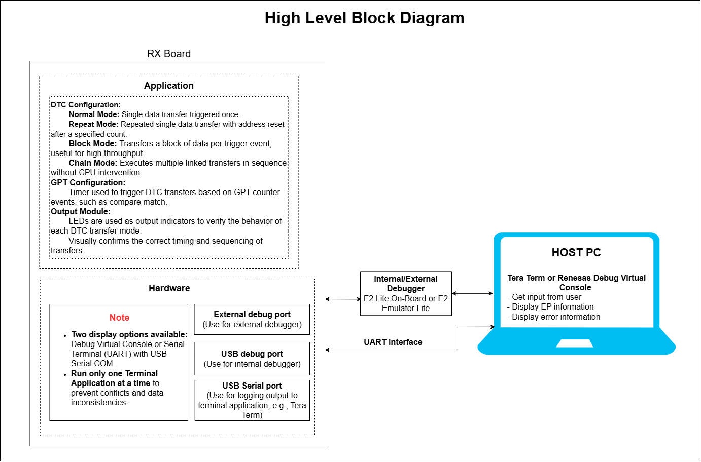
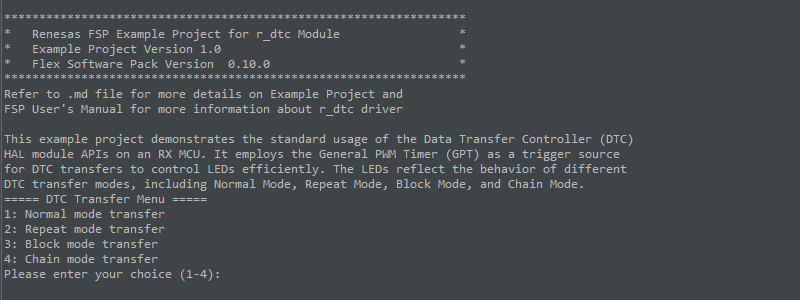
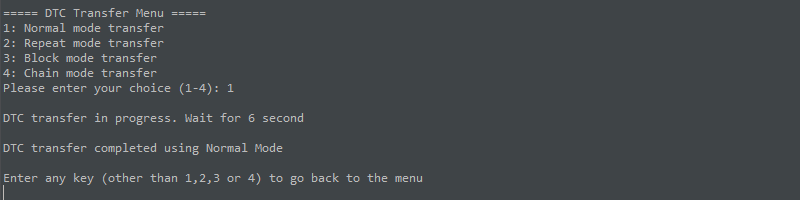
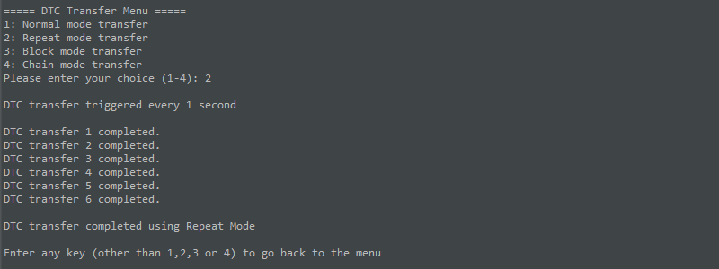
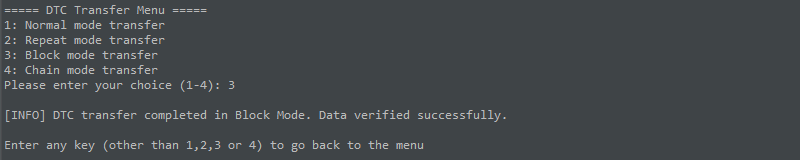
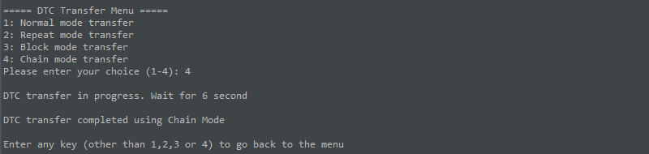

# Introduction
This example project demonstrates the standard usage of the Data Transfer Controller (DTC) HAL module APIs on an RX MCU.
It employs the General PWM Timer (GPT) as a trigger source for DTC transfers to control LEDs efficiently.
The LEDs reflect the behavior of different DTC transfer modes, including Normal Mode, Repeat Mode, Block Mode, and Chain Mode.

**Note**: 
- To display information, the user can select between Debug Virtual Console and the Serial Terminal (UART) with USB Serial COM. It is important to note that the user should only operate a single terminal application at a time to avoid conflicts or data inconsistencies. For instructions on how to switch between these options, please refer to the section [`Special Topics`](#special-topics)/[`Changing Terminal Application`](#changing-terminal-application).

- By default, EP information is printed to the host PC using the Serial Terminal (UART) for boards that support USB Serial COM. LED3 is turned ON to indicate the UART initialized unsuccessfully.

- RX boards that support USB Serial COM: EK-RX74M, EK-RX74N. 

## Required Resources
To build and run the DTC example project, the following resources are needed.

### Software 

* Renesas Flexible Software Package (FSP): Version 1.0.0.
* e2 studio: Version 2026-07.
* Renesas GCC Compiler for RX: Version 14.2.0.202607.
* Renesas CC-RX Compiler: Version v3.08.00.
* Terminal Console Application: Tera Term or a similar application.

### Hardware
Supported RX boards: EK-RX74M, EK-RX74N.

* 1 x Renesas RX board.
* 2 x Type-C USB cables for programming and debugging.

## Hardware Connections
- Connect the RX board USB debug port (J8) to the PC via a Type-C USB cable for EP debugging (If E2 Lite on-board is used).
- Connect the RX board USB Serial port (J27) to the PC using a Type-C USB cable to verify logs through the Terminal Application.

## Related Collateral References
The following documents can be referred to for enhancing your understanding of the operation of this example project:
- [FSP User Manual on GitHub](https://renesas.github.io/fsp/)
- [FSP Known Issues](https://github.com/renesas/fsp/issues)

# Project Notes

## System Level Block Diagram
 High level block diagram
  

## FSP Modules Used
List of important modules that are used in this example project. Refer to the FSP User Manual for further details on each module listed below.

| Module Name | Usage | Searchable Keyword  |
|-------------|-----------------------------------------------|-----------------------------------------------|
| DTC |The Data Transfer Controller (DTC) can be used to transfer data between memory locations, offload data movement tasks from the CPU, reduce interrupt load, and improve overall system efficiency. | r_dtc|
| GPT | The GPT module can be used to generate triggers for DTC transfers based on timer events | r_gpt|

## Module Configuration Notes
This section describes FSP Configurator properties which are important or different than those selected by default. 

**Configuration Properties for using DTC (g_transfer_normal)**

|   Module Property Path and Identifier   |   Default Value   |   Used Value   |   Reason   |
|-----------------------------------------|-------------------|----------------|------------|
| configuration.xml > Stacks > g_transfer_data Transfer (r_dtc) ID:A GPT0 COUNTER OVERFLOW (Overflow interrupt) > Properties > Settings > Property > Module g_transfer_data Transfer (r_dtc) ID:A GPT0 COUNTER OVERFLOW (Overflow interrupt) > Mode	| Normal | Normal | Select the transfer mode. |
| configuration.xml > Stacks > g_transfer_data Transfer (r_dtc) ID:A GPT0 COUNTER OVERFLOW (Overflow interrupt) > Properties > Settings > Property > Module g_transfer_data Transfer (r_dtc) ID:A GPT0 COUNTER OVERFLOW (Overflow interrupt) > Transfer size | 2 Bytes | 4 Bytes | Select the transfer size. |
| configuration.xml > Stacks > g_transfer_data Transfer (r_dtc) ID:A GPT0 COUNTER OVERFLOW (Overflow interrupt) > Properties > Settings > Property > Module g_transfer_data Transfer (r_dtc) ID:A GPT0 COUNTER OVERFLOW (Overflow interrupt) > Destination Address Mode | Fixed | Fixed | Select the address mode for the destination. |
| configuration.xml > Stacks > g_transfer_data Transfer (r_dtc) ID:A GPT0 COUNTER OVERFLOW (Overflow interrupt) > Properties > Settings > Property > Module g_transfer_data Transfer (r_dtc) ID:A GPT0 COUNTER OVERFLOW (Overflow interrupt) > Source Address Mode | Fixed | Incremented | Select the address mode for the source. |
| configuration.xml > Stacks > g_transfer_data Transfer (r_dtc) ID:A GPT0 COUNTER OVERFLOW (Overflow interrupt) > Properties > Settings > Property > Module g_transfer_data Transfer (r_dtc) ID:A GPT0 COUNTER OVERFLOW (Overflow interrupt) > Interrupt Frequency | After all transfers have completed | After all transfers have completed | Select to have interrupt after each transfer or after last transfer.|
| configuration.xml > Stacks > g_transfer_data Transfer (r_dtc) ID:A GPT0 COUNTER OVERFLOW (Overflow interrupt) > Properties > Settings > Property > Module g_transfer_data Transfer (r_dtc) ID:A GPT0 COUNTER OVERFLOW (Overflow interrupt) > Number of Transfer | 0 | 60 | Specify the number of transfer. |
| configuration.xml > Stacks > g_transfer_data Transfer (r_dtc) ID:A GPT0 COUNTER OVERFLOW (Overflow interrupt) > Properties > Settings > Property > Module g_transfer_data Transfer (r_dtc) ID:A GPT0 COUNTER OVERFLOW (Overflow interrupt) > Activation Source	| Disabled | ID:A GPT0 COUNTER OVERFLOW (Overflow interrupt) | Select the DTC transfer start event.|

**Configuration Properties for using DTC (g_transfer_repeat)**

|   Module Property Path and Identifier   |   Default Value   |   Used Value   |   Reason   |
|-----------------------------------------|-------------------|----------------|------------|
| configuration.xml > Stacks > g_transfer_data Transfer (r_dtc) ID:A GPT0 COUNTER OVERFLOW (Overflow interrupt) > Properties > Settings > Property > Module g_transfer_data Transfer (r_dtc) ID:A GPT0 COUNTER OVERFLOW (Overflow interrupt) > Mode	| Normal | Repeat | Select the transfer mode. |
| configuration.xml > Stacks > g_transfer_data Transfer (r_dtc) ID:A GPT0 COUNTER OVERFLOW (Overflow interrupt) > Properties > Settings > Property > Module g_transfer_data Transfer (r_dtc) ID:A GPT0 COUNTER OVERFLOW (Overflow interrupt) > Transfer size | 2 Bytes | 4 Bytes | Select the transfer size. |
| configuration.xml > Stacks > g_transfer_data Transfer (r_dtc) ID:A GPT0 COUNTER OVERFLOW (Overflow interrupt) > Properties > Settings > Property > Module g_transfer_data Transfer (r_dtc) ID:A GPT0 COUNTER OVERFLOW (Overflow interrupt) > Destination Address Mode | Fixed | Fixed | Select the address mode for the destination. |
| configuration.xml > Stacks > g_transfer_data Transfer (r_dtc) ID:A GPT0 COUNTER OVERFLOW (Overflow interrupt) > Properties > Settings > Property > Module g_transfer_data Transfer (r_dtc) ID:A GPT0 COUNTER OVERFLOW (Overflow interrupt) > Source Address Mode | Fixed | Incremented | Select the address mode for the source. 
| configuration.xml > Stacks > g_transfer_data Transfer (r_dtc) ID:A GPT0 COUNTER OVERFLOW (Overflow interrupt) > Properties > Settings > Property > Module g_transfer_data Transfer (r_dtc) ID:A GPT0 COUNTER OVERFLOW (Overflow interrupt) > Interrupt Frequency | After all transfers have completed | After each transfer | Select to have interrupt after each transfer or after last transfer.
| configuration.xml > Stacks > g_transfer_data Transfer (r_dtc) ID:A GPT0 COUNTER OVERFLOW (Overflow interrupt) > Properties > Settings > Property > Module g_transfer_data Transfer (r_dtc) ID:A GPT0 COUNTER OVERFLOW (Overflow interrupt) > Number of Transfer | 0 | 60 | Specify the number of transfer. 
| configuration.xml > Stacks > g_transfer_data Transfer (r_dtc) ID:A GPT0 COUNTER OVERFLOW (Overflow interrupt) > Properties > Settings > Property > Module g_transfer_data Transfer (r_dtc) ID:A GPT0 COUNTER OVERFLOW (Overflow interrupt) > Activation Source	| Disabled | ID:A GPT0 COUNTER OVERFLOW (Overflow interrupt) | Select the DTC transfer start event.

**Configuration Properties for using DTC (g_transfer_block)**

|   Module Property Path and Identifier   |   Default Value   |   Used Value   |   Reason   |
|-----------------------------------------|-------------------|----------------|------------|
| configuration.xml > Stacks > g_transfer_data Transfer (r_dtc) ID:A GPT0 COUNTER OVERFLOW (Overflow interrupt) > Properties > Settings > Property > Module g_transfer_data Transfer (r_dtc) ID:A GPT0 COUNTER OVERFLOW (Overflow interrupt) > Mode	| Normal | Block | Select the transfer mode. |
| configuration.xml > Stacks > g_transfer_data Transfer (r_dtc) ID:A GPT0 COUNTER OVERFLOW (Overflow interrupt) > Properties > Settings > Property > Module g_transfer_data Transfer (r_dtc) ID:A GPT0 COUNTER OVERFLOW (Overflow interrupt) > Transfer size | 2 Bytes | 4 Bytes | Select the transfer size. |
| configuration.xml > Stacks > g_transfer_data Transfer (r_dtc) ID:A GPT0 COUNTER OVERFLOW (Overflow interrupt)> Properties > Settings > Property > Module g_transfer_data Transfer (r_dtc) ID:A GPT0 COUNTER OVERFLOW (Overflow interrupt) > Destination Address Mode | Fixed | Incremented | Select the address mode for the destination. |
| configuration.xml > Stacks > g_transfer_data Transfer (r_dtc) ID:A GPT0 COUNTER OVERFLOW (Overflow interrupt) > Properties > Settings > Property > Module g_transfer_data Transfer (r_dtc) ID:A GPT0 COUNTER OVERFLOW (Overflow interrupt) > Source Address Mode | Fixed | Incremented | Select the address mode for the source. |
| configuration.xml > Stacks > g_transfer_data Transfer (r_dtc) ID:A GPT0 COUNTER OVERFLOW (Overflow interrupt) > Properties > Settings > Property > Module g_transfer_data Transfer (r_dtc) ID:A GPT0 COUNTER OVERFLOW (Overflow interrupt) > Interrupt Frequency | After all transfers have completed | After each transfer | Select to have interrupt after each transfer or after last transfer.|
| configuration.xml > Stacks > g_transfer_data Transfer (r_dtc) ID:A GPT0 COUNTER OVERFLOW (Overflow interrupt) > Properties > Settings > Property > Module g_transfer_data Transfer (r_dtc) ID:A GPT0 COUNTER OVERFLOW (Overflow interrupt) > Number of Transfer | 0 | 60 | Specify the number of transfer. |
| configuration.xml > Stacks > g_transfer_data Transfer (r_dtc) ID:A GPT0 COUNTER OVERFLOW (Overflow interrupt) > Properties > Settings > Property > Module g_transfer_data Transfer (r_dtc) ID:A GPT0 COUNTER OVERFLOW (Overflow interrupt) > Number of Blocks (Valid only in Block Mode) | 0 | 15 | Specify the number of blocks to transfer in Block mode.|
| configuration.xml > Stacks > g_transfer_data Transfer (r_dtc) ID:A GPT0 COUNTER OVERFLOW (Overflow interrupt) > Properties > Settings > Property > Module g_transfer_data Transfer (r_dtc) ID:A GPT0 COUNTER OVERFLOW (Overflow interrupt) > Activation Source	| Disabled | ID:A GPT0 COUNTER OVERFLOW (Overflow interrupt) | Select the DTC transfer start event.

**Configuration Properties for using GPT (g_timer)**

|   Module Property Path and Identifier   |   Default Value   |   Used Value   |   Reason   |
|-----------------------------------------|-------------------|----------------|------------|
| configuration.xml > Stacks > g_timer Timer, General PWM (r_gpt) > Properties > Settings > Property > Module g_timer Timer, General PWM (r_gpt) > General > Mode	| Periodic | One-Shot | Select mode. |
| configuration.xml > Stacks > g_timer Timer, General PWM (r_gpt) > Properties > Settings > Property > Module g_timer Timer, General PWM (r_gpt) > General > Period	| 0x10000 | 100 | Select Period. |
| configuration.xml > Stacks > g_timer Timer, General PWM (r_gpt) > Properties > Settings > Property > Module g_timer Timer, General PWM (r_gpt) > General > Period Unit	| Raw Counts | Milliseconds | Period is defined as a raw count instead of a time unit such as milliseconds or seconds. |
| configuration.xml > Stacks > g_timer Timer, General PWM (r_gpt) > Properties > Settings > Property > Module g_timer Timer, General PWM (r_gpt) > Interrupts > Callback	| NULL | g_timer_callback | A user callback function can be specified here. If this callback function is specified, it will be called from the interrupt service routine (ISR) each time the corresponding interrupt occurs. | 
| configuration.xml > Stacks > g_timer Timer, General PWM (r_gpt) > Properties > Settings > Property > Module g_timer Timer, General PWM (r_gpt) > Interrupts > Overflow/Crest Interrupt Priority | Disable | Priority 20 | Select the overflow interrupt priority. This is the crest interrupt for triangle-wave PWM. | 

**Configuration Properties for using the Serial Terminal (UART)**   
|   Configure Clock Path                  |   Default Value   |   Used Value   |   Reason   |
|-----------------------------------------|-------------------|----------------|------------|
| configuration.xml > Clocks > Clocks Configuration > SCICLK Disable | SCICLK Disable | SCICLK Src: HOCO | Enable operating clock for SCI module by HOCO clock source. |

|   Configure Interrupt Event Path        |   Default Value   |   Used Value   |   Reason   |
|-----------------------------------------|-------------------|----------------|------------|
| configuration.xml > Interrupts > Interrupts Configuration > New User Event > RSCI > RSCI12 > RSCI12 RXI (Receive data full) | empty | sci_b_uart_rxi_isr | Assign the UART receive ISR (Receive data full) to the interrupt vector table. |
| configuration.xml > Interrupts > Interrupts Configuration > New User Event > RSCI > RSCI12 > RSCI12 TXI (Transmit data empty) | empty | sci_b_uart_txi_isr | Assign the UART transfer ISR (Transfer data empty) to the interrupt vector table. |
| configuration.xml > Interrupts > Interrupts Configuration > New User Event > RSCI > RSCI12 > 105-6 GROUPAL1 RSCI12 TEI (Transmit end) | empty | sci_b_uart_tei_isr | Assign the UART transfer ISR (Transfer end) to the interrupt vector table. |
| configuration.xml > Interrupts > Interrupts Configuration > New User Event > RSCI > RSCI12 > 105-7 GROUPAL1 RSCI12 ERI (Receive error) | empty | sci_b_uart_eri_isr | Assign the UART receive ISR (Receive error) to the interrupt vector table. |

The table below lists the FSP provided API used at the application layer by this example project.

| API Name    | Usage                                                                          |
|-------------|--------------------------------------------------------------------------------|
| R_DTC_Open | This API is used to initialize the DTC module |
| R_DTC_Enable |	This API is used to enable DTC transfers on the specified activation source| 
| R_DTC_Close	| This API is used to de-initialize the DTC module |
| R_GPT_Open | This API is used to initialize the GPT module|
| R_GPT_PeriodSet | This API is used to set the period value provided |
| R_GPT_Start  | This API is used to start GPT module|
| R_GPT_Close | This API is used to de-initialize the GPT module|

## Verifying operation
1. Import the example project.

2. Generate, and build the example project.

3. Before running the example project, make sure hardware connections are completed.

4. Connect the RX MCU to the host PC via debugger. By default, EP will use E2lite debugger.

5. Open a terminal application (e.g., Tera Term or Debug Virtual Console) on the host PC and connect to the RX board’s USB Serial port.  
   * Note: For using the Serial Terminal application:
        * To echo back typed content in Tera Term, go to [Setup] -> [Terminal...] and check [Local echo].
        * The configuration parameters of the serial port are:
            - COM port: Provided by the USB Serial COM.
            - Baud rate: 115200 bps
            - Data length: 8 bits
            - Parity: None
            - Stop bit: 1 bit
            - Flow control: None 

The following images showcase the output on the Terminal Application:
    
   
   
   Below is the output when running with the Normal mode option.

   

   Below is the output when running with the Repeat mode option.

   

   Below is the output when running with the Block mode option.

   

   Below is the output when running with the Chain mode option.

   

## Special Topics ##
User is expected to enter data of size not exceeding above 15 bytes.
        
Operation is not guaranteed for any user input value other than integer (i.e. float, char, special char) through Terminal.

## LED Behavior
This demonstration verifies the correct operation of the application by observing the behavior of the onboard LEDs under different options.
| Option | Mode Transfer | LED Behavior                                                      |
| ------ | --------------|--------------------------------------------------------- |
| 1 | Normal Mode | **LED1** blinks for 6 seconds, then turns OFF.                           |
| 2 | Repeat Mode | **LED1** toggles ON/OFF continuously in a 1-second cycle.                |
| 3 | Block Mode  | This mode does not use any LED.                                          |
| 4 | Chain Mode  | **LED1** and **LED2** blink simultaneously for 6 seconds, then turns OFF. |

### Debugger Setting

* To use E2 Lite on-board or E2 Emulator Lite, please follow the instructions below:

1. **Common step**: Click [**Run**] → [**Debug Configurations…**] to open the “**Debug Configurations**” window.  
  

2. **Select file application**  
  a. **Used for projects built with GCC**: --> Select file **.elf**.  
    
  b. **Used for projects built with CCRX**: --> Select file **.x**.  
  

3. **Setting debugger configurations**  
  a. **Used for E2 Lite on-board**.  
    
  b. **Used for external E2 Emulator Lite**.  
    

  **Note:** Connect the RX board debugger port (J9) to the host PC via E2 Emulator Lite (with USB cable and 20-20 pin cable).

### Adding lowsrc Folder

Before changing terminal application settings, you need to add the `lowsrc` folder from another Example Project:

1. **Locate the lowsrc folder:**
   
   - Navigate to Example Project `sci_uart` or `usb_pcdc_with_freertos`  (`example_projects/<board>/sci_uart/e2studio/gccrx_sci_uart_<board>_ep/src`)
   - Find the `lowsrc` folder containing low-level source files.

2. **Copy `lowsrc` folder to this Example Project:**
   
   - Copy the entire `lowsrc` folder.
   - Paste it into this your target Example Project directory: `example_projects/ek_rx74m/<EP>/e2studio/`.

3. **Add lowsrc to e2studio project:**
   
   - In e2studio, right-click on the project in Project Explorer.
   - Select **Refresh** (or press F5) to detect the new folder.

4. **Verify the folder is included:**
   
   - Expand the project tree in Project Explorer.
   - Confirm that `lowsrc` folder and its contents are visible.
   - The folder should be included in the build path with source files ready to compile.

5. **Changing the terminal Application to use the Debug Virtual Console:**
   
   - For instructions on how to switch between these options, please refer to the section [`Special Topics`](#special-topics)/[`Changing Terminal Application`](#changing-terminal-application).

6. **Re-build the project:**
   
   - In e2studio, right-click on the project and select **Build Project**.

**Note:** To use Debug Virtual Console, the `lowsrc` folder must be added to the project, as it contains the source files required for Debug Virtual Console operation.

### Changing Terminal Application ###
By default, the EP supports Serial Terminal for RX boards that support USB Serial COM   
**For use CCRX Compiler:**
* Define USE_VIRTUAL_COM=1 macro in Project Properties -> C/C++ Build -> Settings -> Tool Settings -> Compiler -> Source -> Macro definition (-define)

To use Debug Virtual Console, please follow the instructions below:
* Define USE_VIRTUAL_COM=0 macro in Project Properties -> C/C++ Build -> Settings -> Tool Settings -> Compiler -> Source -> Macro definition (-define)
* Define BSP_CFG_IO_LIB_ENABLE=1 macro in Project Properties -> C/C++ Build -> Settings -> Tool Settings -> Compiler -> Source -> Macro definition (-define)

**For use GCCRX Compiler:**  
* Define USE_VIRTUAL_COM=1 macro in Project Properties -> C/C++ Build -> Settings -> Tool Settings -> Compiler -> Includes -> Macro Defines (-D)

To use Debug Virtual Console, please follow the instructions below:
* Define USE_VIRTUAL_COM=0 macro in Project Properties -> C/C++ Build -> Settings -> Tool Settings -> Compiler -> Includes -> Macro Defines (-D)

