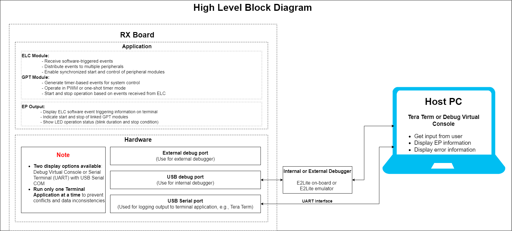
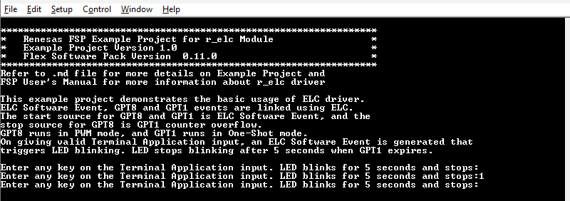

# Introduction
This example project demonstrates the basic usage of ELC driver. ELC Software Event, GPT8 and GPT1 events are linked using ELC. The start source for GPT8 and GPT1 is ELC Software Event, and the stop source for GPT8 is GPT1 counter overflow. GPT8 runs in PWM mode, and GPT1 runs in One-Shot mode. On giving valid Terminal Application input, an ELC Software Event is generated that triggers LED blinking. LED stops blinking after 5 seconds when GPT1 expires.

**Note**: 
- To display information, the user can select between Debug Virtual Console and the Serial Terminal (UART) with USB Serial COM. It is important to note that the user should only operate a single terminal application at a time to avoid conflicts or data inconsistencies. For instructions on how to switch between these options, please refer to the section [`Special Topics`](#special-topics)/[`Changing Terminal Application`](#changing-terminal-application).

- By default, EP information is printed to the host PC using the Serial Terminal (UART) for boards that support USB Serial COM. LED3 is turned ON to indicate the UART initialized unsuccessfully.

- RX boards that support USB Serial COM: EK-RX74M, EK-RX74N.  

## Required Resources
To build and run the ELC example project, the following resources are needed.

### Software
* Renesas Flexible Software Package (FSP): Version 1.0.0.
* e2 studio: Version 2026-07.
* Renesas GCC Compiler for RX: Version 14.2.0.202607.
* Renesas CC-RX Compiler: Version v3.08.00.
* Terminal Console Application: Tera Term or a similar application.

### Hardware
* 1 x Renesas RX board.
* 2 x Type-C USB cables for programming and debugging.

## Hardware Connections
- Connect the RX board USB debug port (J8) to the PC via a Type-C USB cable for EP debugging (If E2 Lite on-board is used).
- Connect the RX board USB Serial port (J27) to the PC using a Type-C USB cable to verify logs through the Terminal Application.

## Related Collateral References 
The following documents can be referred to for enhancing your understanding of the operation of this example project:
- [FSP User Manual on GitHub (Reference link)](https://renesas.github.io/fsp/)
- [FSP Known Issues (Reference link)](https://github.com/renesas/fsp/issues)

# Project Notes 

## System Level Block Diagram 
High level block diagram of the system is as shown below:
  

## FSP Modules Used 
List all the various modules that are used in this example project. Refer to the FSP User Manual for further details on each module listed below.

| Module Name | Usage | Searchable Keyword  |
|-------------|-----------------------------------------------|-----------------------------------------------|
|ELC | The event link controller (ELC) uses the event requests generated by various peripheral modules as source signals to connect (link) them to different modules, allowing direct cooperation between the modules without central processing unit (CPU) intervention. | r_elc|
|GPT | The GPT module can be used to count events, measure external input signals, generate a periodic interrupt, or output a periodic or PWM signal to a GTIOC pin. | r_gpt|

## Module Configuration Notes 
This section describes FSP Configurator properties which are important or different than those selected by default. 

**Common Configuration Properties**

|   Module Property Path and Identifier   |   Default Value   |   Used Value   |   Reason   |
| :-------------------------------------: | :---------------: | :------------: | :--------: |
|   configuration.xml > BSP > Properties > Settings > Property > RX Common > Heap size (bytes)  |  0   | 0x400  |  Heap size is required for standard library functions to be used. |

**Configuration Properties for using ELC (g_elc)**

|   Module Property Path and Identifier   |   Default Value   |   Used Value   |   Reason   |
|-----------------------------------------|-------------------|----------------|------------|
| configuration.xml > Stack > g_elc Timer Driver on r_cmtw > Properties > Settings > Property > Module g_elc Timer Driver on r_cmtw > General > Name | g_elc | g_elc | Module name. |

**Configuration Properties for using GPT (g_timer_pwm)**
|   Module Property Path and Identifier   |   Default Value   |   Used Value   |   Reason   |
|-----------------------------------------|-------------------|----------------|------------|
| configuration.xml > Stack > g_timer_pwm Timer Driver on r_gpt > Properties > Settings > Property > Common > Pin Output Support | Disabled | Enabled | Enables or disables support for outputting PWM waveforms on GTIOCx pins. The "Enabled with Extra Features" option enables support for Triangle wave modes and also enables the features located in the "Extra Features" section of each module instance. |
| configuration.xml > Stack > g_timer_pwm Timer Driver on r_gpt > Properties > Settings > Property > Module g_timer_pwm Timer Driver on r_gpt > General > Name | g_timer0 | g_timer_pwm | Module name. |
| configuration.xml > Stack > g_timer_pwm Timer Driver on r_gpt > Properties > Settings > Property > Module g_timer_pwm Timer Driver on r_gpt > General > Channel | 0 | 8 | Specify the hardware channel. |
| configuration.xml > Stack > g_timer_pwm Timer Driver on r_gpt > Properties > Settings > Property > Module g_timer_pwm Timer Driver on r_gpt > General > Mode | Periodic | Saw-wave PWM | This property is used to select the Mode selection. |
| configuration.xml > Stack > g_timer_pwm Timer Driver on r_gpt > Properties > Settings > Property > Module g_timer_pwm Timer Driver on r_gpt > General > Period | 0x10000 | 500 | This property is used to select the timer period. |
| configuration.xml > Stack > g_timer_pwm Timer Driver on r_gpt > Properties > Settings > Property > Module g_timer_pwm Timer Driver on r_gpt > General > Period Unit | Raw Counts | Milliseconds | Unit of the period specified above. |
| configuration.xml > Stack > g_timer_pwm Timer Driver on r_gpt > Properties > Settings > Property > Module g_timer_pwm Timer Driver on r_gpt > Output > GTIOCB Output Enabled | False | True | Enable the output of GTIOCB on a pin. |
| configuration.xml > Stack > g_timer_gpt_output_generate Timer Driver on r_gpt > Properties > Settings > Property > Module g_timer_gpt_output_generate Timer Driver on r_gpt > Input > Start Source > ELC SOFTWARE EVENT 0 (Software event 0) | ☐ | ☑ | Select external source that will start the timer. |
| configuration.xml > Stack > g_timer_gpt_output_generate Timer Driver on r_gpt > Properties > Settings > Property > Module g_timer_gpt_output_generate Timer Driver on r_gpt > Input > Stop Source > ID:x GPT1 COUNTER OVERFLOW (Overflow interrupt) | ☐ | ☑ | Select external source that will stop the timer. |
| configuration.xml > Stack > g_timer_pwm Timer Driver on r_gpt > Properties > Settings > Property > Module g_timer_pwm Timer Driver on r_gpt > Pins > GTIOC1B | None | PF05 | Select pin output. |

**Configuration Properties for using GPT (g_timer_oneshot)**
|   Module Property Path and Identifier   |   Default Value   |   Used Value   |   Reason   |
|-----------------------------------------|-------------------|----------------|------------|
| configuration.xml > Stack > g_timer_oneshot Timer Driver on r_gpt > Properties > Settings > Property > Common > Pin Output Support | Disabled | Enabled | Enables or disables support for outputting PWM waveforms on GTIOCx pins. The "Enabled with Extra Features" option enables support for Triangle wave modes and also enables the features located in the "Extra Features" section of each module instance. |
| configuration.xml > Stack > g_timer_oneshot Timer Driver on r_gpt > Properties > Settings > Property > Module g_timer_oneshot Timer Driver on r_gpt > General > Name | g_timer0 | g_timer_oneshot | Module name. |
| configuration.xml > Stack > g_timer_oneshot Timer Driver on r_gpt > Properties > Settings > Property > Module g_timer_oneshot Timer Driver on r_gpt > General > Channel | 0 | 1 | Specify the hardware channel. |
| configuration.xml > Stack > g_timer_oneshot Timer Driver on r_gpt > Properties > Settings > Property > Module g_timer_oneshot Timer Driver on r_gpt > General > Mode | Periodic | One-shot | This property is used to select the Mode selection. |
| configuration.xml > Stack > g_timer_oneshot Timer Driver on r_gpt > Properties > Settings > Property > Module g_timer_oneshot Timer Driver on r_gpt > General > Period | 0x10000 | 5 | 	This property is used to select the timer period. |
| configuration.xml > Stack > g_timer_oneshot Timer Driver on r_gpt > Properties > Settings > Property > Module g_timer_oneshot Timer Driver on r_gpt > General > Period Unit | Raw Counts | Seconds | Unit of the period specified above. |
| configuration.xml > Stack > g_timer_gpt_output_generate Timer Driver on r_gpt > Properties > Settings > Property > Module g_timer_gpt_output_generate Timer Driver on r_gpt > Input > Start Source > ELC SOFTWARE EVENT 0 (Software event 0) | ☐ | ☑ | Select external source that will start the timer. |
| configuration.xml > Stack > g_timer_gpt_output_generate Timer Driver on r_gpt > Properties > Settings > Property > Module g_timer_gpt_output_generate Timer Driver on r_gpt > Input > Stop Source > ID:x GPT1 COUNTER OVERFLOW (Overflow interrupt) | ☐ | ☑ | Select external source that will stop the timer. |

**Configuration Properties for using the Serial Terminal (UART)**   
|   Configure Interrupt Event Path        |   Default Value   |   Used Value   |   Reason   |
|-----------------------------------------|-------------------|----------------|------------|
| configuration.xml > Interrupts > Interrupts Configuration > New User Event > RSCI > RSCI12 > RSCI12 RXI (Receive data full) | empty | sci_b_uart_rxi_isr | Assign the UART receive ISR (Receive data full) to the interrupt vector table. |
| configuration.xml > Interrupts > Interrupts Configuration > New User Event > RSCI > RSCI12 > RSCI12 TXI (Transmit data empty) | empty | sci_b_uart_txi_isr | Assign the UART transfer ISR (Transfer data empty) to the interrupt vector table. |
| configuration.xml > Interrupts > Interrupts Configuration > New User Event > RSCI > RSCI12 > 105-6 GROUPAL1 RSCI12 TEI (Transmit end) | empty | sci_b_uart_tei_isr | Assign the UART transfer ISR (Transfer end) to the interrupt vector table. |
| configuration.xml > Interrupts > Interrupts Configuration > New User Event > RSCI > RSCI12 > 105-7 GROUPAL1 RSCI12 ERI (Receive error) | empty | sci_b_uart_eri_isr | Assign the UART receive ISR (Receive error) to the interrupt vector table. |

## API Usage
The table below lists the FSP provided API used at the application layer by this example project.

| API Name    | Usage                                                                          |
|-------------|--------------------------------------------------------------------------------|
| R_ELC_Open | This API is used to initialize the ELC module.|
| R_ELC_Enable| This API is used to enable event links between peripheral modules.|
| R_ELC_SoftwareEventGenerate | This API is used to generate a software event to trigger linked peripherals. |
| R_ELC_Close| This API is used to de-initialize the ELC module.|
| R_GPT_Open| This API is used to initialize the GPT module.|
| R_GPT_Enable| This API is used to enable external event triggers for GPT timer.|
| R_GPT_Close| This API is used to de-initialize the GPT module.|

**For using the Serial Terminal (UART)**
| API Name    | Usage                                                                          |
|-------------|--------------------------------------------------------------------------------|
| R_SCI_B_UART_Open | This API is used to configures the UART driver based on the input configurations. |
| R_SCI_B_UART_Write | This API is used to transmit user specified number of bytes from the source buffer pointer. |
| R_SCI_B_UART_Close | This API is used to abort any in progress transfers, disables interrupts, receiver, and transmitter, close lower level transfer drivers if used and remove power. |

## Verifying operation
1. Import the example project.

2. Generate, and build the example project.

3. Before running the example project, make sure hardware connections are completed.

4. Connect the RX MCU to the host PC via debugger. By default, EP will use E2lite debugger.
5. Open a terminal application (e.g., Tera Term or Debug Virtual Console) on the host PC and connect to the RX board’s USB Serial port.  
   * Note: For using the Serial Terminal application:
        * To echo back typed content in Tera Term, go to [Setup] -> [Terminal...] and check [Local echo].
        * The configuration parameters of the serial port are:
            - COM port: Provided by the USB Serial COM.
            - Baud rate: 115200 bps
            - Data length: 8 bits
            - Parity: None
            - Stop bit: 1 bit
            - Flow control: None 

### The below images showcase the output on the Terminal Application (Tera Term) ###

     

## Special Topics ##

* To use E2 Lite on-board or E2 Emulator Lite, please follow the instructions below:  

   1. **Common step**: Click [**Run**] → [**Debug Configurations…**] -> to open the “**Debug Configurations**” window.  
   

   2. **Select file application**  
      a. **Used for projects built with GCC**: --> Select file *.elf  
     

      b. **Used for projects built with CCRX**: --> Select file *.x  
   

   3. **Setting debugger configurations**  
      a. **Used for E2 Lite on-board**.  
     

      b. **Used for external E2 Lite emulator**.  
     

**Note:** Connect the RX board debugger port (J9) to the host PC via E2 Emulator Lite (With USB cable and 20-20 pin cable). 

### Adding lowsrc Folder

Before changing terminal application settings, you need to add the `lowsrc` folder from another Example Project:

1. **Locate the lowsrc folder:**
   
   - Navigate to Example Project `sci_uart` or `usb_pcdc_with_freertos`  (`example_projects/<board>/sci_uart/e2studio/gccrx_sci_uart_<board>_ep/src`)
   - Find the `lowsrc` folder containing low-level source files.

2. **Copy `lowsrc` folder to this Example Project:**
   
   - Copy the entire `lowsrc` folder.
   - Paste it into this your target Example Project directory: `example_projects/ek_rx74m/<EP>/e2studio/`.

3. **Add lowsrc to e2studio project:**
   
   - In e2studio, right-click on the project in Project Explorer.
   - Select **Refresh** (or press F5) to detect the new folder.

4. **Verify the folder is included:**
   
   - Expand the project tree in Project Explorer.
   - Confirm that `lowsrc` folder and its contents are visible.
   - The folder should be included in the build path with source files ready to compile.

5. **Changing the terminal Application to use the Debug Virtual Console:**
   
   - For instructions on how to switch between these options, please refer to the section [`Special Topics`](#special-topics)/[`Changing Terminal Application`](#changing-terminal-application).

6. **Re-build the project:**
   
   - In e2studio, right-click on the project and select **Build Project**.

**Note:** To use Debug Virtual Console, the `lowsrc` folder must be added to the project, as it contains the source files required for Debug Virtual Console operation.

### Changing Terminal Application ###
By default, the EP supports Serial Terminal for RX boards that support USB Serial COM   
**For use CCRX Compiler:**
* Define USE_VIRTUAL_COM=1 macro in Project Properties -> C/C++ Build -> Settings -> Tool Settings -> Compiler -> Source -> Macro definition (-define)

To use Debug Virtual Console, please follow the instructions below:
* Define USE_VIRTUAL_COM=0 macro in Project Properties -> C/C++ Build -> Settings -> Tool Settings -> Compiler -> Source -> Macro definition (-define)
* Define BSP_CFG_IO_LIB_ENABLE=1 macro in Project Properties -> C/C++ Build -> Settings -> Tool Settings -> Compiler -> Source -> Macro definition (-define)

**For use GCCRX Compiler:**  
* Define USE_VIRTUAL_COM=1 macro in Project Properties -> C/C++ Build -> Settings -> Tool Settings -> Compiler -> Includes -> Macro Defines (-D)

To use Debug Virtual Console, please follow the instructions below:
* Define USE_VIRTUAL_COM=0 macro in Project Properties -> C/C++ Build -> Settings -> Tool Settings -> Compiler -> Includes -> Macro Defines (-D)

