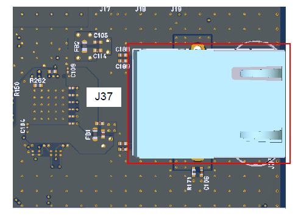
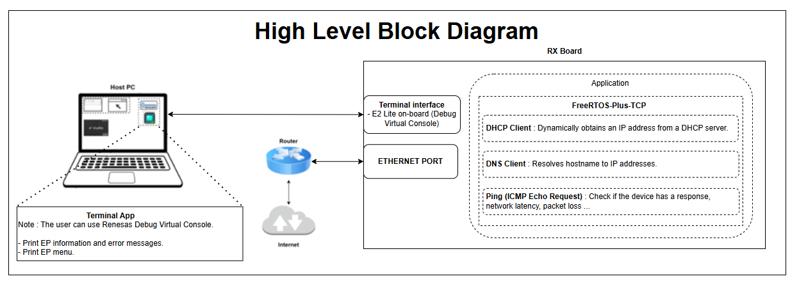
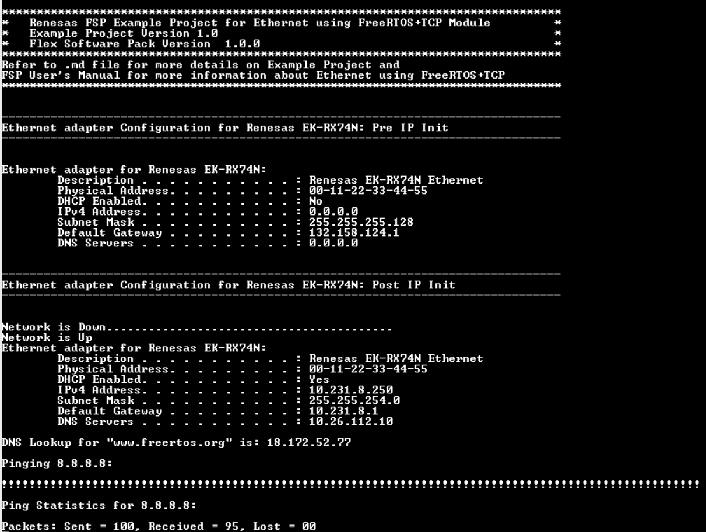

# Introduction #

The example project demonstrates the use of the FreeRTOS + TCP Module with Ethernet. The example project demonstrate the usage of FreeRTOS DHCP Client, DNS Client and ICMP code. This example project has 2 modes for the user.
* DHCP Mode, where the IP credentials are obtained from the DHCP Server on the Network.
* Static IP Address mode, where in the Static IP address can be configured for the Ethernet based on the Availability of free address in the LAN.

**Note**: 
- To display information, the user can select between Debug Virtual Console and the Serial Terminal (UART) with USB Serial COM. It is important to note that the user should only operate a single terminal application at a time to avoid conflicts or data inconsistencies. For instructions on how to switch between these options, please refer to the section [`Special Topics`](#special-topics)/[`Changing Terminal Application`](#changing-terminal-application).

- By default, EP information is printed to the host PC using the Serial Terminal (UART) for boards that support USB Serial COM. LED3 is turned ON to indicate the UART initialized unsuccessfully.

- RX boards that support USB Serial COM: EK-RX74M, EK-RX74N. 

## Required Resources ##

To build and run the Ethernet example project, the following resources are needed.

### Software ###

* Renesas Flexible Software Package (FSP): Version 1.0.0.
* e2 studio: Version 2026-07.
* Renesas GCC Compiler for RX: Version 14.2.0.202607.
* Renesas CC-RX Compiler: Version v3.08.00.
* Terminal Console Application: Tera Term or a similar application.

### Hardware ###
Supported RX boards: EK-RX74M, EK-RX74N.

* 1 x Renesas RX board.
* 2 x Type-C USB cables for programming and debugging.
* 1 x LAN cable.
* 1 x Ethernet switch.

### Hardware Connections ###

- Connect the RX board USB debug port (J8) to the PC via a Type-C USB cable for EP debugging (If E2 Lite on-board is used).
- Connect LAN cable on RX board at ethernet port (J37) and other end connect to ethernet switch/router that connect to the Internet.
- Connect the RX board USB Serial port (J27) to the PC using a Type-C USB cable to verify logs through the Terminal Application.

## Related Collateral References ##
The following documents can be referred to for enhancing your understanding of the operation of this example project:
- [FSP User Manual on GitHub (Reference link)](https://renesas.github.io/fsp/)
- [FSP Known Issues (Reference link)](https://github.com/renesas/fsp/issues)

# Project Notes #

## System Level Block Diagram ##

## FSP Modules Used ##
List all the various modules that are used in this example project. Refer to the FSP User Manual for further details on each module listed below.

| Module Name | Usage | Searchable Keyword  |
|-------------|-----------------------------------------------|-----------------------------------------------|
| FreeRTOS+TCP | This stack implements a lightweight TCP/IP stack for enabling network communication. | FreeRTOS+TCP |
| FreeRTOS+TCP Wrapper to r_ether | This module provides the network interface required to use FreeRTOS Plus TCP with the Ethernet (r_rmac) driver. | rm_freertos_plus_tcp |
| Ethernet  | This module performs Ethernet frame transmission and reception using an Ethernet controller. | r_rmac |
| CMT | This module is used for system tick in FreeRTOS. | r_cmt |

## Module Configuration Notes ##
This section describes FSP Configurator properties which are important or different than those selected by default.

**Common Configuration Properties**

|   Module Property Path and Identifier   |   Default Value   |   Used Value   |   Reason   |
| :-------------------------------------: | :---------------: | :------------: | :--------: |
|   configuration.xml > BSP > Properties > Settings > Property > RX Common > Main Stack size (bytes)  |  0x400   | 0x1000  |  Main Stack size is required for standard library functions to be used. |
|   configuration.xml > BSP > Properties > Settings > Property > RX Common > Heap size (bytes)  |  0   | 0x2000  |  Heap size is required for standard library functions to be used. |

**Configuration Properties for Net thread**
|   Module Property Path and Identifier   |   Default Value   |   Used Value   |   Reason   |
|-----------------------------------------|-------------------|----------------|------------|
| configuration.xml > Stacks > Net Thread > Properties > Settings > Property > Common > General > Tick Rate Hz | 1000 | 100 | The frequency of the RTOS tick interrupt. |
| configuration.xml > Stacks > Net Thread > Properties > Settings > Property > Common > General > Max Priorities | 7 | 5 | The number of priorities available to the application task. |
| configuration.xml > Stacks > Net Thread > Properties > Settings > Property > Common > General > Max Task Name Len | 12 | 16 | The maximum permissible length of the descriptive name given to the task. |
| configuration.xml > Stacks > Net Thread > Properties > Settings > Property > Common > General > Idle Should Yield | Enabled | Disabled | Control the behavior of task at the idle priority. |
| configuration.xml > Stacks > Net Thread > Properties > Settings > Property > Common > General > Use Queue Sets | Enabled | Disabled | Disabled to omit queue set functionality. |
| configuration.xml > Stacks > Net Thread > Properties > Settings > Property > Common > General > Num Thread Local Storage Pointers | 3 | 5 | Sets the number of indexes in each task's thread local storage array. |
| configuration.xml > Stacks > Net Thread > Properties > Settings > Property > Common > General > Library Max Syscall Interrupt Priority | Priority 1 | Priority 30 | The interrupt priority used by the kernel itself for the tick interrupt and the pended interrupt. |
| configuration.xml > Stacks > Net Thread > Properties > Settings > Property > Common > Timers > Timer Task Priority | 6 | 3 | Sets the priority of the software timer service. |
| configuration.xml > Stacks > Net Thread > Properties > Settings > Property > Common > Timers > Timer Queue Length | 5 | 10 | Sets the length of the software timer command queue. |
| configuration.xml > Stacks > Net Thread > Properties > Settings > Property > Common > Timers > Timer Task Stack Depth | configMINIMAL_STACK_SIZE * 6 | 128 | Sets the stack depth allocated to the software timer service. |
| configuration.xml > Stacks > Net Thread > Properties > Settings > Property > Thread > Stack size (bytes) | 1024 | 4096 | Stack size is required for handling function and local variables usage. |
| configuration.xml > Stacks > Net Thread > Properties > Settings > Property > Thread > Priority | 1 | 2 | Select the priority which the created task will execute. |
| configuration.xml > Stacks > Net Thread > Properties > Settings > Property > Thread > Memory Allocation > Support Dynamic Allocation | Disabled | Enabled | Enable support for dynamic allocation. |
| configuration.xml > Stacks > Net Thread > Properties > Settings > Property > Thread > Memory Allocation > Support Static Allocation | Disabled | Enabled | Enable support for static allocation. |
| configuration.xml > Stacks > Net Thread > Properties > Settings > Property > Thread > Memory Allocation > Total Heap Size | 0 | 0x8000 | Total amount RAM available in FreeRTOS heap. |

**Configuration Properties for using Ethernet**

|   Module Property Path and Identifier   |   Default Value   |   Used Value   |   Reason   |
|-----------------------------------------|-------------------|----------------|------------|
| configuration.xml > Clocks > ESWCLK | Disable | ESWCLK 250MHz | Enable ESWCLK for using ESWM module. |
| configuration.xml > Clocks > ESWPHYCLK | Disable | ESWPHYCLK 500MHz | Enable ESWPHYCLK for using ESWM PHY module. |
| configuration.xml > Clocks > ETHPHYCLK | Disable | ETHPHYCLK 25MHz | Enable ETHPHYCLK for using ethernet module. |
| configuration.xml > Stacks > FreeRTOS+TCP > Properties > Settings > Property > Common > Receive Block Time | 10000 | 2000 | Amount of time FreeRTOS_recv() will block for. |
| configuration.xml > Stacks > FreeRTOS+TCP > Properties > Settings > Property > Common > Send Block Time | 10000 | 2000 | Amount of time FreeRTOS_send() will block for. |
| configuration.xml > Stacks > FreeRTOS+TCP > Properties > Settings > Property > Common > DNS Request Attempts | 2 | 5 | Increased DNS Request Attempts. |
| configuration.xml > Stacks > FreeRTOS+TCP > Properties > Settings > Property > Common > IP stack task priority | configMAX_PRIORITIES - 2 | configMAX_PRIORITIES - 1 | Set the priority of the task that executes the IP stack. |
| configuration.xml > Stacks > FreeRTOS+TCP > Properties > Settings > Property > Common > Stack size in words (not bytes) | configMINIMAL_STACK_SIZE * 5 | configMINIMAL_STACK_SIZE * 10 | The size of the stack allocated to the FreeRTOS+TCP stack. |
| configuration.xml > Stacks > FreeRTOS+TCP > Properties > Settings > Property > Common > Network Events call vApplicationIPNetworkEventHook | Enable | Disable | Not call vApplicationIPNetworkEventHook when the network connects or disconnects. |
| configuration.xml > Stacks > FreeRTOS+TCP > Properties > Settings > Property > Common > DHCP Send Discover After Auto IP | Disable | Enable | Enable DHCP Send Discover After Auto IP. |
| configuration.xml > Stacks > FreeRTOS+TCP > Properties > Settings > Property > Common > DHCP callback function | Disable | Enable | Provide an implementation of the DHCP callback function. |
| configuration.xml > Stacks > FreeRTOS+TCP > Properties > Settings > Property > Common > Total number of available network buffers | 10 | 16 | Define the total number of network buffer that are available to the IP stack. |
| configuration.xml > Stacks > FreeRTOS+TCP > Properties > Settings > Property > Common > FreeRTOS+SendPingRequest() is available | Disable | Enable | FreeRTOS+SendPingRequest() API function is available. |
| configuration.xml > Stacks > FreeRTOS+TCP > g_layer3_switch0 Switch (r_layer3_switch) > Properties > Settings > Property > Module g_layer3_switch0 Switch (r_layer3_switch) > Interrupt > Interrupt priority | Priority 2 | Priority 4 | Select the layer3_switch interrupt priority. |
| configuration.xml > Stacks > FreeRTOS+TCP > g_rmac_phy0 Ethernet (r_rmac_phy) > Properties > Settings > Property > Common > VSC8541 Target | Disabled | Enabled | Select to use VSC8541 PHY-LSI. |
| configuration.xml > Stacks > FreeRTOS+TCP > g_rmac_phy0 Ethernet (r_rmac_phy) > Properties > Settings > Property > Module g_rmac_phy0 Ethernet (r_rmac_phy) > Select MII Type | RGMII | RGMII | Select to use RGMII mode. |
| configuration.xml > Stacks > FreeRTOS+TCP > g_rmac_phy0 Ethernet (r_rmac_phy) > Properties > Settings > Property > Module g_rmac_phy0 Ethernet (r_rmac_phy) > MDIO hold timing adjustment | 0 | 7 | Specify the clock cycle for hold timing. |
| configuration.xml > Stacks > FreeRTOS+TCP > g_rmac_phy_lsi0 Ethernet PHY-LSI > Properties > Settings > Property > Common > VSC8541 Target | Disabled | Enabled | Select to use VSC8541 PHY-LSI. |
| configuration.xml > Stacks > FreeRTOS+TCP > g_rmac_phy_lsi0 Ethernet PHY-LSI > Properties > Settings > Property > Module g_rmac_phy_lsi0 Ethernet PHY-LSI >  PHY-LSI type | Kit Component | VSC8541 | Select the PHY-LSI target. |

**Configuration Properties for using CMT**

|   Module Property Path and Identifier   |   Default Value   |   Used Value   |   Reason   |
|-----------------------------------------|-------------------|----------------|------------|
| configuration.xml > Stacks > g_timer Timer Driver on r_cmt > Properties > Settings > Property > Module g_timer Timer Driver on r_cmt > General > Period | 0x10000 | 1 | Change period time to use for FreeRTOS system tick. |
| configuration.xml > Stacks > g_timer Timer Driver on r_cmt > Properties > Settings > Property > Module g_timer Timer Driver on r_cmt > General > Period Unit | Raw Counts | Milliseconds | Change period unit to use for FreeRTOS system tick. |

## API Usage ##

The table below lists the APIs used at the application layer by this example project.

| API Name    | Usage                                                                          |
|-------------|--------------------------------------------------------------------------------|
| FreeRTOS_IPInit | This API is used to initialize the FreeRTOS+TCP network stack. |
| FreeRTOS_gethostbyname | This API is used to resolve a domain name into an IP address. |
| FreeRTOS_IsNetworkUp | This API is used to check the current status of the network connection. |
| FreeRTOS_inet_addr | This API is used to convert the IP address from "w.x.y.z" (dotted decimal) format to the 32-bit format. |
| FreeRTOS_SendPingRequest | This API is used to send an ICMP ping request to a remote host. |
| FreeRTOS_inet_ntoa | This API is used to convert the IP address to a string. |
| R_RMAC_LinkProcess | This API is used to check the status of the Ethernet link. |

## Verifying Operation ##
1. Import the example project.
2. Generate, and build the example project.
3. Before running the example project, make sure hardware connections are completed.
4. Connect the RX MCU to the host PC via E2 Lite on-board.
By default, EP will use the on-board E2 Lite.
5. Open a terminal application (e.g., Tera Term or Debug Virtual Console) on the host PC and connect to the RX board’s USB Serial port.  
   * Note: For using the Serial Terminal application:
        * To echo back typed content in Tera Term, go to [Setup] -> [Terminal...] and check [Local echo].
        * The configuration parameters of the serial port are:
            - COM port: Provided by the USB Serial COM.
            - Baud rate: 115200 bps
            - Data length: 8 bits
            - Parity: None
            - Stop bit: 1 bit
            - Flow control: None 

**NOTE:** 
- This project uses DHCP as the default network configuration. To support this, the reset values (zero) are assigned to the static IP address, gateway, subnet mask, and DNS server fields. These settings are used during IP initialization, allowing the DHCP client to request and apply the leased IP configuration from the DHCP server.
- After a successful link-up, the IP configuration that obtained from DHCP server will be displayed to the console.
- A DNS request is made for 'www.freertos.org', and the resolved IP address is printed on the console.
- A Ping request is sent to ‘8.8.8.8’ and the result is displayed. Successful response should be as follows: “Packets: Sent  = 100, Received = 100 (97 - 100), Lost = 00”

### The below image showcases the output on the Terminal Application (Tera Term) ###

## Special Topics ##

- User use RGMII mode, you must connect with switch support 1 Gbps.

### Debugger Setting ###

* To use E2 Lite on-board or E2 Emulator Lite, please follow the instructions below:

1. **Common step**: Click [**Run**] → [**Debug Configurations…**] to open the “**Debug Configurations**” window.  
  

2. **Select file application**  
  a. **Used for projects built with GCC**: --> Select file **.elf**.  
    
  b. **Used for projects built with CCRX**: --> Select file **.x**.  
  

3. **Setting debugger configurations**  
  a. **Used for E2 Lite on-board**.    
    
  b. **Used for external E2 Emulator Lite**.  
    

  **Note:** Connect the RX board debugger port (J9) to the host PC via E2 Emulator Lite (With USB cable and 20-20 pin cable).

### Adding lowsrc Folder

Before changing terminal application settings, you need to add the `lowsrc` folder from another Example Project:

1. **Locate the lowsrc folder:**
   
   - Navigate to Example Project `sci_uart` or `usb_pcdc_with_freertos`  (`example_projects/<board>/sci_uart/e2studio/gccrx_sci_uart_<board>_ep/src`)
   - Find the `lowsrc` folder containing low-level source files.

2. **Copy `lowsrc` folder to this Example Project:**
   
   - Copy the entire `lowsrc` folder.
   - Paste it into this your target Example Project directory: `example_projects/ek_rx74m/<EP>/e2studio/`.

3. **Add lowsrc to e2studio project:**
   
   - In e2studio, right-click on the project in Project Explorer.
   - Select **Refresh** (or press F5) to detect the new folder.

4. **Verify the folder is included:**
   
   - Expand the project tree in Project Explorer.
   - Confirm that `lowsrc` folder and its contents are visible.
   - The folder should be included in the build path with source files ready to compile.

5. **Changing the terminal Application to use the Debug Virtual Console:**
   
   - For instructions on how to switch between these options, please refer to the section [`Special Topics`](#special-topics)/[`Changing Terminal Application`](#changing-terminal-application).

6. **Re-build the project:**
   
   - In e2studio, right-click on the project and select **Build Project**.

**Note:** To use Debug Virtual Console, the `lowsrc` folder must be added to the project, as it contains the source files required for Debug Virtual Console operation.

### Changing Terminal Application ###
By default, the EP supports Serial Terminal for RX boards that support USB Serial COM   
**For use CCRX Compiler:**
* Define USE_VIRTUAL_COM=1 macro in Project Properties -> C/C++ Build -> Settings -> Tool Settings -> Compiler -> Source -> Macro definition (-define)

To use Debug Virtual Console, please follow the instructions below:
* Define USE_VIRTUAL_COM=0 macro in Project Properties -> C/C++ Build -> Settings -> Tool Settings -> Compiler -> Source -> Macro definition (-define)
* Define BSP_CFG_IO_LIB_ENABLE=1 macro in Project Properties -> C/C++ Build -> Settings -> Tool Settings -> Compiler -> Source -> Macro definition (-define)

**For use GCCRX Compiler:**  
* Define USE_VIRTUAL_COM=1 macro in Project Properties -> C/C++ Build -> Settings -> Tool Settings -> Compiler -> Includes -> Macro Defines (-D)
  
To use Debug Virtual Console, please follow the instructions below:
* Define USE_VIRTUAL_COM=0 macro in Project Properties -> C/C++ Build -> Settings -> Tool Settings -> Compiler -> Includes -> Macro Defines (-D)
