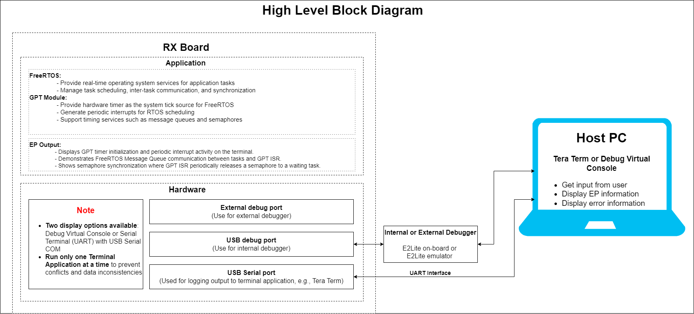
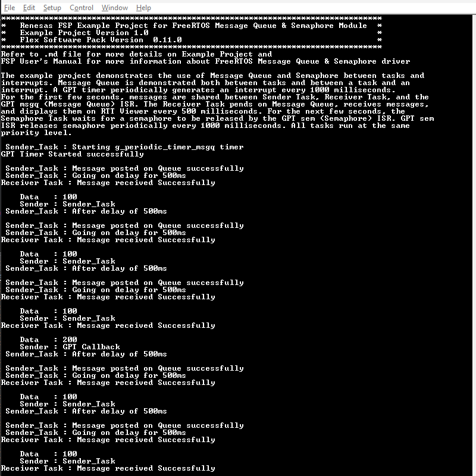
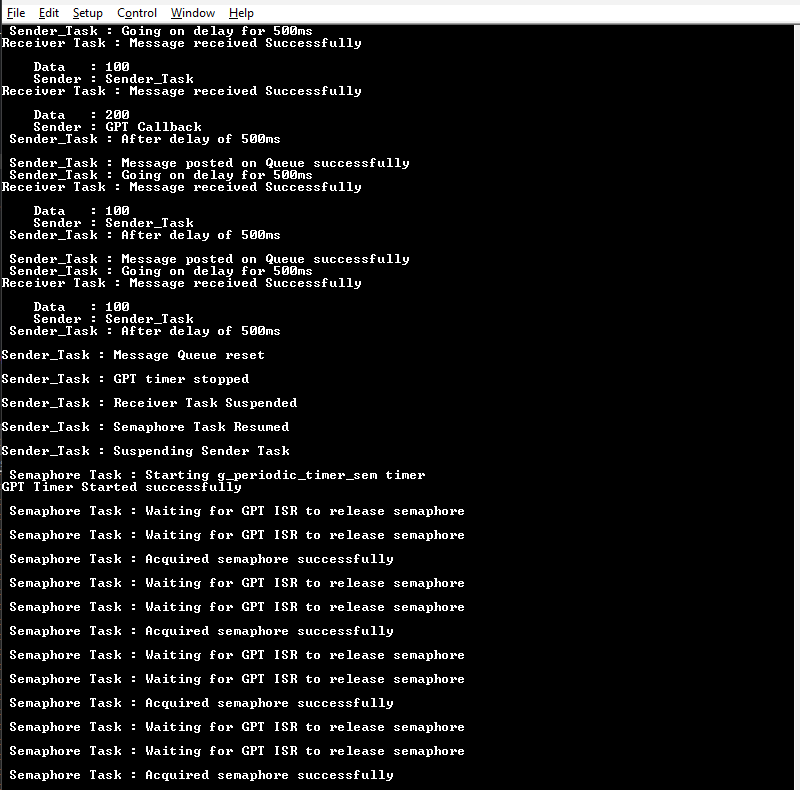
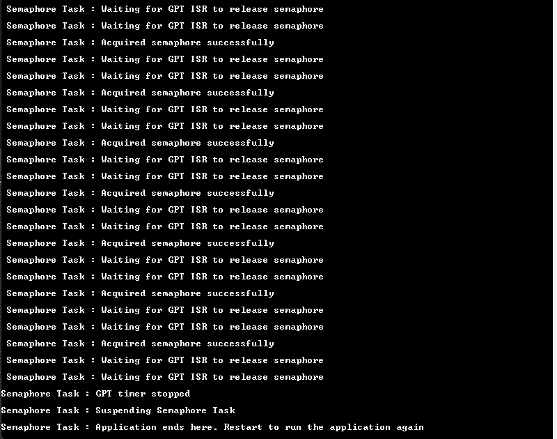
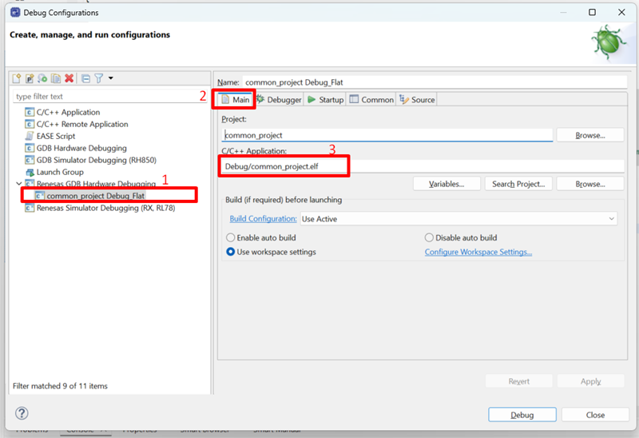

# Introduction #
The example project demonstrates the use of Message Queue and Semaphore between tasks and interrupts. Message Queue is demonstrated both between tasks and between a task and an interrupt. A GPT timer periodically generates an interrupt every 1000 milliseconds. For the first few seconds, messages are shared between Sender Task, Receiver Task, and the GPT msgq (Message Queue) ISR. The Receiver Task pends on Message Queue, receives messages, and displays them on Terminal Application every 500 milliseconds. For the next few seconds, the Semaphore Task waits for a semaphore to be released by the GPT sem (Semaphore) ISR. GPT sem ISR releases semaphore periodically every 1000 milliseconds. All tasks run at the same priority level.

**Note**: 
- To display information, the user can select between Debug Virtual Console and the Serial Terminal (UART) with USB Serial COM. It is important to note that the user should only operate a single serminal application at a time to avoid conflicts or data inconsistencies. For instructions on how to switch between these options, please refer to the section [`Special Topics`](#special-topics)/[`Changing Terminal Application`](#changing-terminal-application).

- By default, EP information is printed to the host PC using the Serial Terminal (UART) for boards that support USB Serial COM. LED3 is turned ON to indicate the UART initialized unsuccessfully.

- RX boards that support USB Serial COM: EK-RX74M, EK-RX74N. 

## Required Resources ##  
To build and run the FreeRTOS example project, the following resources are needed.

### Software ###

* Renesas Flexible Software Package (FSP): Version 1.0.0.
* e2 studio: Version 2026-07.
* Renesas GCC Compiler for RX: Version 14.2.0.202607.
* Renesas CC-RX Compiler: Version v3.08.00.
* Terminal Console Application: Tera Term or a similar application.

### Hardware ###
Supported RX boards: EK-RX74M, EK-RX74N.

* 1 x Renesas RX board.
* 2 x Type-C USB cables for programming and debugging.

### Hardware Connections ### 

- Connect the RX board USB debug port (J8) to the PC via a Type-C USB cable for EP debugging (If E2 Lite on-board is used).
- Connect the RX board USB Serial port (J27) to the PC using a Type-C USB cable to verify logs through the Terminal Application.

## Related Collateral References ##

The following documents can be referred to for enhancing your understanding of the operation of this example project:
- [FSP User Manual on GitHub (Reference link)](https://renesas.github.io/fsp/)
- [FSP Known Issues (Reference link)](https://github.com/renesas/fsp/issues)

# Project Notes # 

## System Level Block Diagram ## 
  

## FSP Modules Used ##

List of important modules that are used in this example project. Refer to the FSP User Manual for further details on each module listed below.

| Module Name | Usage | Searchable Keyword  |
|-------------|-----------------------------------------------|-----------------------------------------------|
| FreeRTOS | Module supports FreeRTOS | rm_freertos_port |
| GPT | System tick source for FreeRTOS, periodic time. | r_gpt |

## Module Configuration Notes ##
This section describes FSP Configurator properties which are important or different than those selected by default. 

**Common Configuration Properties**

|   Module Property Path and Identifier   |   Default Value   |   Used Value   |   Reason   |
| :-------------------------------------: | :---------------: | :------------: | :--------: |
|   configuration.xml > BSP > Properties > Settings > Property > RX Common > Heap size (bytes)  |  0   | 0x800  |  Heap size is required for standard library functions to be used. |

**Configuration Properties for using freertos (g_timer_driver)**

|   Module Property Path and Identifier   |   Default Value   |   Used Value   |   Reason   |
|-----------------------------------------|-------------------|----------------|------------|
| configuration.xml > Stacks > g_timer_driver Timer Driver General PWM r_gpt > Properties > Settings > Property > Module g_timer_driver Timer Driver General PWM r_gpt > General > Name | g_timer0 | g_timer_driver | Assigned GPT module name. |
| configuration.xml > Stacks > g_timer_driver Timer Driver General PWM r_gpt > Properties > Settings > Property > Module g_timer_driver Timer Driver General PWM r_gpt > General > Channel | 0 | 0 | Specify the hardware channel. |
| configuration.xml > Stacks > g_timer_driver Timer Driver General PWM r_gpt > Properties > Settings > Property > Module g_timer_driver Timer Driver General PWM r_gpt > General > Mode | Periodic | Periodic | Specified the periodic. |
| configuration.xml > Stacks > g_timer_driver Timer Driver General PWM r_gpt > Properties > Settings > Property > Module g_timer_driver Timer Driver General PWM r_gpt > General > Period | 0x1000 | 1 | Specified the timer period based on the selected unit. |
| configuration.xml > Stacks > g_timer_driver Timer Driver General PWM r_gpt > Properties > Settings > Property > Module g_timer_driver Timer Driver General PWM r_gpt > General > Period Unit | Raw Counts | Milliseconds | Unit of the period specified. |
| configuration.xml > Stacks > g_timer_driver Timer Driver General PWM r_gpt > Properties > Settings > Property > Module g_timer_driver Timer Driver General PWM r_gpt > Interrupts > Callback | rm_freertos_port_systick_callback | rm_freertos_port_systick_callback | Assigned name for using callback function. |
| configuration.xml > Stacks > g_timer_driver Timer Driver General PWM r_gpt > Properties > Settings > Property > Module g_timer_driver Timer Driver General PWM r_gpt > Interrupts > Overflow/Crest Interrupt Priority | Disabled | Priority 29 | Select the interrupt priority. |

**Configuration Properties for using freertos (g_periodic_timer_msgq)**

|   Module Property Path and Identifier   |   Default Value   |   Used Value   |   Reason   |
|-----------------------------------------|-------------------|----------------|------------|
| configuration.xml > Stacks > g_periodic_timer_msgq Timer Driver General PWM r_gpt > Properties > Settings > Property > Module g_periodic_timer_msgq Timer Driver General PWM r_gpt > General > Name | g_timer0 | g_periodic_timer_msgq | Assigned GPT module name. |
| configuration.xml > Stacks > g_periodic_timer_msgq Timer Driver General PWM r_gpt > Properties > Settings > Property > Module g_periodic_timer_msgq Timer Driver General PWM r_gpt > General > Channel | 0 | 1 | Specify the hardware channel. |
| configuration.xml > Stacks > g_periodic_timer_msgq Timer Driver General PWM r_gpt > Properties > Settings > Property > Module g_periodic_timer_msgq Timer Driver General PWM r_gpt > General > Mode | Periodic | Periodic | Mode selection. |
| configuration.xml > Stacks > g_periodic_timer_msgq Timer Driver General PWM r_gpt > Properties > Settings > Property > Module g_periodic_timer_msgq Timer Driver General PWM r_gpt > General > Period | 0x1000 | 1 | Specified the timer period based on the selected unit. |
| configuration.xml > Stacks > g_periodic_timer_msgq Timer Driver General PWM r_gpt > Properties > Settings > Property > Module g_periodic_timer_msgq Timer Driver General PWM r_gpt > General > Period Unit | Raw Counts | Seconds | Unit of the period specified. |
| configuration.xml > Stacks > g_periodic_timer_msgq Timer Driver General PWM r_gpt > Properties > Settings > Property > Module g_periodic_timer_msgq Timer Driver General PWM r_gpt > Interrupts > Callback | NULL | periodic_timer_msgq_cb | Assigned name for using callback function. |
| configuration.xml > Stacks > g_periodic_timer_msgq Timer Driver General PWM r_gpt > Properties > Settings > Property > Module g_periodic_timer_msgq Timer Driver General PWM r_gpt > Interrupts > Overflow/Crest Interrupt Priority | Disabled | Priority 29 | Select the interrupt priority. |

**Configuration Properties for using freertos (g_periodic_timer_sem)**

|   Module Property Path and Identifier   |   Default Value   |   Used Value   |   Reason   |
|-----------------------------------------|-------------------|----------------|------------|
| configuration.xml > Stacks > g_periodic_timer_sem Timer Driver General PWM r_gpt > Properties > Settings > Property > Module g_periodic_timer_sem Timer Driver General PWM r_gpt > General > Name | g_timer0 | g_periodic_timer_sem | Assigned GPT module name. |
| configuration.xml > Stacks > g_periodic_timer_sem Timer Driver General PWM r_gpt > Properties > Settings > Property > Module g_periodic_timer_sem Timer Driver General PWM r_gpt > General > Channel | 0 | 1 | Specify the hardware channel. |
| configuration.xml > Stacks > g_periodic_timer_sem Timer Driver General PWM r_gpt > Properties > Settings > Property > Module g_periodic_timer_sem Timer Driver General PWM r_gpt > General > Mode | Periodic | Periodic | Mode selection. |
| configuration.xml > Stacks > g_periodic_timer_sem Timer Driver General PWM r_gpt > Properties > Settings > Property > Module g_periodic_timer_sem Timer Driver General PWM r_gpt > General > Period | 0x1000 | 1 | Specified the timer period based on the selected unit. |
| configuration.xml > Stacks > g_periodic_timer_sem Timer Driver General PWM r_gpt > Properties > Settings > Property > Module g_periodic_timer_sem Timer Driver General PWM r_gpt > General > Period Unit | Raw Counts | Seconds | Unit of the period specified. |
| configuration.xml > Stacks > g_periodic_timer_sem Timer Driver General PWM r_gpt > Properties > Settings > Property > Module g_periodic_timer_sem Timer Driver General PWM r_gpt > Interrupts > Callback | NULL | periodic_timer_semphr_cb | Assigned name for using callback function. |
| configuration.xml > Stacks > g_periodic_timer_sem Timer Driver General PWM r_gpt > Properties > Settings > Property > Module g_periodic_timer_sem Timer Driver General PWM r_gpt > Interrupts > Overflow/Crest Interrupt Priority | Disabled | Priority 29 | Select the interrupt priority. |

**Configuration Properties for using the Serial Terminal (UART)**   
|   Configure Interrupt Event Path        |   Default Value   |   Used Value   |   Reason   |
|-----------------------------------------|-------------------|----------------|------------|
| configuration.xml > Interrupts > Interrupts Configuration > New User Event > RSCI > RSCI12 > RSCI12 RXI (Receive data full) | empty | sci_b_uart_rxi_isr | Assign the UART receive ISR (Receive data full) to the interrupt vector table. |
| configuration.xml > Interrupts > Interrupts Configuration > New User Event > RSCI > RSCI12 > RSCI12 TXI (Transmit data empty) | empty | sci_b_uart_txi_isr | Assign the UART transfer ISR (Transfer data empty) to the interrupt vector table. |
| configuration.xml > Interrupts > Interrupts Configuration > New User Event > RSCI > RSCI12 > 105-6 GROUPAL1 RSCI12 TEI (Transmit end) | empty | sci_b_uart_tei_isr | Assign the UART transfer ISR (Transfer end) to the interrupt vector table. |
| configuration.xml > Interrupts > Interrupts Configuration > New User Event > RSCI > RSCI12 > 105-7 GROUPAL1 RSCI12 ERI (Receive error) | empty | sci_b_uart_eri_isr | Assign the UART receive ISR (Receive error) to the interrupt vector table. |

## API Usage ##

The table below lists the FreeRTOS API used at the application layer by this example project.

| API Name    | Usage                                                                          |
|-------------|--------------------------------------------------------------------------------|
| R_GPT_Open | This API is used to initialize the GPT module. |
| R_GPT_Start |This API is used to start GPT module. |
| R_GPT_Close |This API is used to de-initialize the GPT module. |

**For using the Serial Terminal (UART)**
| API Name    | Usage                                                                          |
|-------------|--------------------------------------------------------------------------------|
| R_SCI_B_UART_Open | This API is used to configures the UART driver based on the input configurations. |
| R_SCI_B_UART_Write | This API is used to transmit user specified number of bytes from the source buffer pointer. |
| R_SCI_B_UART_Close | This API is used to abort any in progress transfers, disables interrupts, receiver, and transmitter, close lower level transfer drivers if used and remove power. |

## Verifying operation ##
1. Import the example project.

2. Generate, and build the example project.

3. Before running the example project, make sure hardware connections are completed.

4. Connect the RX MCU to the host PC via debugger. By default, EP will use E2lite debugger.
5. Open a terminal application (e.g., Tera Term or Debug Virtual Console) on the host PC and connect to the RX board’s USB Serial port.  
   * Note: For using the Serial Terminal application:
        * To echo back typed content in Tera Term, go to [Setup] -> [Terminal...] and check [Local echo].
        * The configuration parameters of the serial port are:
            - COM port: Provided by the USB Serial COM.
            - Baud rate: 115200 bps
            - Data length: 8 bits
            - Parity: None
            - Stop bit: 1 bit
            - Flow control: None 

### The below images showcase the output on the Terminal Application (Tera Term) ### 

## Special Topics ##

### Debugger Setting ###

* To use E2 Lite on-board or E2 Emulator Lite, please follow the instructions below:

1. **Common step**: Click [**Run**] → [**Debug Configurations…**] to open the “**Debug Configurations**” window.  
  

2. **Select file application**  
  a. **Used for projects built with GCC**: --> Select file **.elf**.  
    
  b. **Used for projects built with CCRX**: --> Select file **.x**.  
  

3. **Setting debugger configurations**  
  a. **Used for E2 Lite on-board**.    
    
  b. **Used for external E2 Emulator Lite**.  
    

  **Note:** Connect the RX board debugger port (J9) to the host PC via E2 Emulator Lite (with USB cable and 20-20 pin cable).

### Adding lowsrc Folder

Before changing terminal application settings, you need to add the `lowsrc` folder from another Example Project:

1. **Locate the lowsrc folder:**
   
   - Navigate to Example Project `sci_uart` or `usb_pcdc_with_freertos`  (`example_projects/<board>/sci_uart/e2studio/gccrx_sci_uart_<board>_ep/src`)
   - Find the `lowsrc` folder containing low-level source files.

2. **Copy `lowsrc` folder to this Example Project:**
   
   - Copy the entire `lowsrc` folder.
   - Paste it into this your target Example Project directory: `example_projects/ek_rx74m/<EP>/e2studio/`.

3. **Add lowsrc to e2studio project:**
   
   - In e2studio, right-click on the project in Project Explorer.
   - Select **Refresh** (or press F5) to detect the new folder.

4. **Verify the folder is included:**
   
   - Expand the project tree in Project Explorer.
   - Confirm that `lowsrc` folder and its contents are visible.
   - The folder should be included in the build path with source files ready to compile.

5. **Changing the terminal Application to use the Debug Virtual Console:**
   
   - For instructions on how to switch between these options, please refer to the section [`Special Topics`](#special-topics)/[`Changing Terminal Application`](#changing-terminal-application).

6. **Re-build the project:**
   
   - In e2studio, right-click on the project and select **Build Project**.

**Note:** To use Debug Virtual Console, the `lowsrc` folder must be added to the project, as it contains the source files required for Debug Virtual Console operation.

### Changing Terminal Application ###
By default, the EP supports Serial Terminal for RX boards that support USB Serial COM   
**For use CCRX Compiler:**
* Define USE_VIRTUAL_COM=1 macro in Project Properties -> C/C++ Build -> Settings -> Tool Settings -> Compiler -> Source -> Macro definition (-define)

To use Debug Virtual Console, please follow the instructions below:
* Define USE_VIRTUAL_COM=0 macro in Project Properties -> C/C++ Build -> Settings -> Tool Settings -> Compiler -> Source -> Macro definition (-define)
* Define BSP_CFG_IO_LIB_ENABLE=1 macro in Project Properties -> C/C++ Build -> Settings -> Tool Settings -> Compiler -> Source -> Macro definition (-define)

**For use GCCRX Compiler:**  
* Define USE_VIRTUAL_COM=1 macro in Project Properties -> C/C++ Build -> Settings -> Tool Settings -> Compiler -> Includes -> Macro Defines (-D)
  
To use Debug Virtual Console, please follow the instructions below:
* Define USE_VIRTUAL_COM=0 macro in Project Properties -> C/C++ Build -> Settings -> Tool Settings -> Compiler -> Includes -> Macro Defines (-D)

