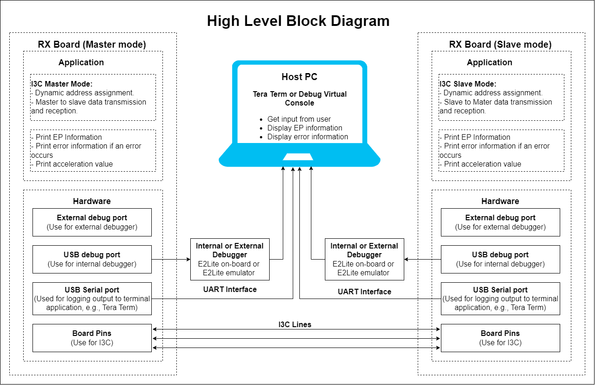
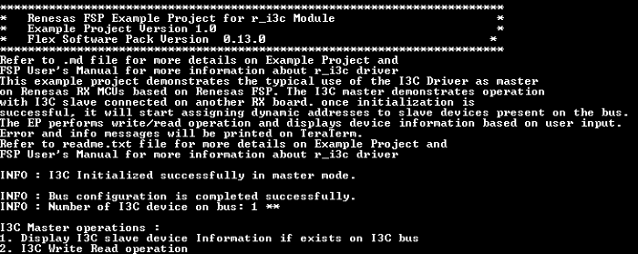
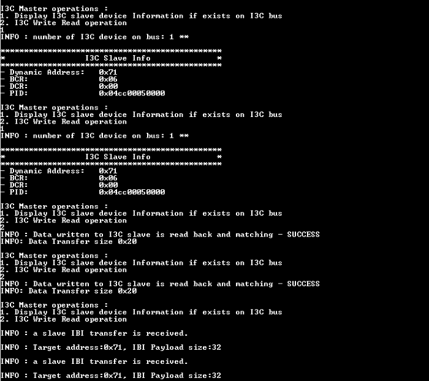
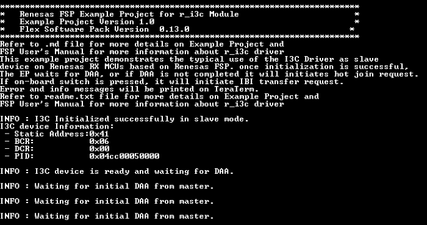
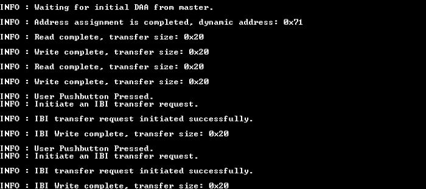

# Introduction #

**Note :** MD file is common for both i3c_master and i3c_slave EP.
The sample code accompanying this file shows the operation of the I3C Driver on RX MCUs based on Renesas FSP.  
The I3C master demonstrates operations associated with an I3C slave running on another RX board. Once initialization is successful,
I3C Master device assigns slave address to I3C slave device through DAA (dynamic address assignment) using I3C common command code (CCC).  
Once Dynamic Address Assignment is completed, the Master EP performs write/read operations, and displays slave device information based on user input. 
If the on-board switch is pressed on the slave side, it will initiate an IBI transfer request.

**Note**: 
- To display information, the user can select between Debug Virtual Console and the Serial Terminal (UART) with USB Serial COM. It is important to note that the user should only operate a single terminal application at a time to avoid conflicts or data inconsistencies. For instructions on how to switch between these options, please refer to the section [`Special Topics`](#special-topics)/[`Changing Terminal Application`](#changing-terminal-application).

- By default, EP information is printed to the host PC using the Serial Terminal (UART) for boards that support USB Serial COM. LED3 is turned ON to indicate the UART initialized unsuccessfully.

- RX boards that support USB Serial COM: EK-RX74M, EK-RX74N.  

## Required Resources ## 
To build and run the I3C example project, the following resources are needed.

### Software ###

* Renesas Flexible Software Package (FSP): Version 1.0.0.
* e2 studio: Version 2026-07.
* Renesas GCC Compiler for RX: Version 14.2.0.202607.
* Renesas CC-RX Compiler: Version v3.08.00.
* Terminal Console Application: Tera Term or a similar application.

### Hardware ###

* 2 x Renesas RX boards.
* 3 x Type-C USB cables for programming and debugging.
* 3 x Jumper wires (female to female) to link 2 RX boards (Master and slave).

### Hardware Connections ###

- Connect the RX boards (both master and slave board) USB debug port (J8) to the PC via a Type-C USB cable for EP debugging (If E2 Lite on-board is used).
- Connect the RX boards (both master and slave board) USB Serial port (J27) to the PC using a Type-C USB cable to verify logs through the Terminal Application.
- Three jumper wires are required to establish loop back connection along I3C lines across the board with pins as mentioned below:
   * EK-RX74N:
      Jumper configuration: **J14-Pin2-3, J15-Pin2-3, J16-Pin2-3**
      |      Master board |<===>| Slave board      | 
      |               ---:|:---:|:---              |
      | SCL0: P102 (J2:30) |<--->| SCL0: P102 (J2:30)|
      | SDA0: P103 (J2:29) |<--->| SDA0: P103 (J2:29)|
      | GND Pin (J2:40)   |<--->| GND Pin (J2:40)  |

## Related Collateral References ##
The following documents can be referred to for enhancing your understanding of 
the operation of this example project:
- [FSP User Manual on GitHub](https://renesas.github.io/fsp/)
- [FSP Known Issues](https://github.com/renesas/fsp/issues)

# Project Notes #

## System Level Block Diagram ##
 High level block diagram

## FSP Modules Used ##
List of important modules that are used in this example project. Refer to the FSP User Manual for further details on each module listed below.

| Module Name | Usage | Searchable Keyword  |
|-------------|-------|---------------------|
| I3C | Driver for the I3C peripheral to demonstrate Master and Slave mode on RX MCUs | i3c |
| CMT | Driver for the CMT peripheral is used for demonstrating timeout condition. | cmt |
| ICU | The external_irq interface is for configuring interrupts to fire when a trigger condition is detected on an external IRQ pin | icu |

## Module Configuration Notes ##
This section describes FSP Configurator properties which are important or different than those selected by default. 

**Common Configuration Properties**

|   Module Property Path and Identifier   |   Default Value   |   Used Value   |   Reason   |
| :-------------------------------------: | :---------------: | :------------: | :--------: |
|   configuration.xml > BSP > Properties > Settings > Property > RX Common > Heap size (bytes)  |  0   | 0x800  |  Heap size is required for standard library functions to be used. |

**I3C Master Configuration properties**

|   Module Property Path and Identifier   |   Default Value   |   Used Value   |   Reason   |
| :-------------------------------------: | :---------------: | :------------: | :--------: |
| configuration.xml -> HAL/Common -> Properties > Settings > Property > Common > Slave Support | Enable | Disable | As only master mode is required, disable slave support to decrease code size. |
| configuration.xml -> HAL/Common -> Properties > Settings > Property > Module I3C > Master Mode > Notify Rejected Mastership Requests | Disable | Enable | Generate a callback when an IBI Mastership Request is rejected. |
| configuration.xml -> HAL/Common -> Properties > Settings > Property > Module I3C > Master Mode > Notify Rejected Interrupt Requests | Disable | Enable | Generate a callback when an IBI Interrupt Request is rejected. |  
| configuration.xml -> HAL/Common -> Properties > Settings > Property > Module I3C > Interrupts > Interrupts Priority | Priority 2 | Priority 29 | Set the interrupt priority to higher level. |  
| configuration.xml -> HAL/Common -> Properties > Settings > Property > Module I3C > Interrupts > Error and Event Interrupts Priority | Priority 2 | Priority 29 | Set the error and event interrupt priority to higher level. | 

**I3C Slave Configuration properties**

|   Module Property Path and Identifier   |   Default Value   |   Used Value   |   Reason   |
| :-------------------------------------: | :---------------: | :------------: | :--------: |
| configuration.xml -> HAL/Common -> Properties > Settings > Property > Common > Master Support |Enable | Disable |If only slave mode is required, disable master support to decrease code size. |
| configuration.xml -> HAL/Common -> Properties > Settings > Property > Module I3C > Slave Mode > Command Response Info > ENEC/DISEC > In-Band Interrupts |Disable | Enable |Enable the In-Band Interrupts capability, so that the slave should issue IBI requests. |
| configuration.xml -> HAL/Common -> Properties > Settings > Property > Module I3C > Slave Mode > Command Response Info > SETMWL/GETMWL > Max Write Length |65535 | 64 |Set the Device Max Write Length. In this EP, the write buffer is 64-byte. |
| configuration.xml -> HAL/Common -> Properties > Settings > Property > Module I3C > Slave Mode > Command Response Info > SETMRL/GETMRL > Max Read Length |65535 | 64 |Set the Device Max Read Length. In this EP, the read buffer is 64-byte. |
| configuration.xml -> HAL/Common -> Properties > Settings > Property > Module I3C > Slave Mode > Command Response Info > SETMRL/GETMRL > Max IBI Payload Length |0 | 32 |Set the Device Max IBI Payload Length. In this EP, the IBI read buffer is 32-byte. |
| configuration.xml -> HAL/Common -> Properties > Settings > Property > Module I3C > Interrupts > Interrupts Priority | Priority 2 | Priority 29 | Set the interrupt priority to higher level. |  
| configuration.xml -> HAL/Common -> Properties > Settings > Property > Module I3C > Interrupts > Error and Event Interrupts Priority | Priority 2 | Priority 29 | Set the error and event interrupt priority to higher level. | 

The table below lists the FSP provided API used at the application layer by this example project.

| API Name    | Usage                                                                          |
|-------------|--------------------------------------------------------------------------------|
| R_I3C_Open | This API is used to Open the I3C instance. |
| R_I3C_DeviceCfgSet | This API is used to set the configuration for this device  |
| R_I3C_MasterDeviceTableSet | This API configures an entry in the master device table. |
| R_I3C_Enable | This API is used to Enable the I3C device.  |
| R_I3C_IbiRead | This API is used to set the read buffer for storing received IBI data. Used in only master mode.  |
| R_I3C_DynamicAddressAssignmentStart | This API is used to start the Dynamic Address Assignment Process. |
| R_I3C_Write | This API is used to set the write buffer for the transfer. In master mode, start the transfer. |
| R_I3C_Read | This API is used set the read buffer for the transfer. In master mode, start the transfer. |
| R_I3C_SlaveStatusSet | This API is used to set the status returned to the master in response to a GETSTATUS command. |
| R_I3C_IbIWrite | This API is used to initiate an IBI write operation. Used in only Slave mode. |
| R_I3C_Close | This API is used to close the I3C instance |
| R_CMT_Open | This API is used to initialize the CMT module instance. |
| R_CMT_Stop | This API is used to stop the timer. |
| R_CMT_Reset | This API is used to reset the counter value. |
| R_CMT_Start | This API is used to Start timer. |
| R_CMT_Close | This API is used to close the CMT module instance. |
| R_ICU_ExternalIrqOpen | This API is used to prepare an external IRQ pin for operation. |
| R_ICU_ExternalIrqEnable | This API is used to enable external interrupt for specified channel at NVIC. |
| R_ICU_ExternalIrqClose | This API is used to close the external interrupt channel. |
| R_IOPORT_PinRead | This API is used to read the current status of GPIO Pin. |
| R_IOPORT_PinWrite | This API is used to write the value on GPIO Pin. |

**For using the Serial Terminal (UART)**
| API Name    | Usage                                                                          |
|-------------|--------------------------------------------------------------------------------|
| R_SCI_B_UART_Open | This API is used to configures the UART driver based on the input configurations. |
| R_SCI_B_UART_Write | This API is used to transmit user specified number of bytes from the source buffer pointer. |
| R_SCI_B_UART_Close | This API is used to abort any in progress transfers, disables interrupts, receiver, and transmitter, close lower level transfer drivers if used and remove power. |

## Verifying operation ##

1. Import the example project.

2. Generate, and build the example project.

3. Before running the example project, make sure hardware connections are completed.

4. Connect the RX MCU to the host PC via debugger. By default, EP will use E2lite debugger.
5. Open a terminal application (e.g., Tera Term or Debug Virtual Console) on the host PC and connect to the RX board’s USB Serial port.  
   * Note: For using the Serial Terminal application:
        * To echo back typed content in Tera Term, go to [Setup] -> [Terminal...] and check [Local echo].
        * The configuration parameters of the serial port are:
            - COM port: Provided by the USB Serial COM.
            - Baud rate: 115200 bps
            - Data length: 8 bits
            - Parity: None
            - Stop bit: 1 bit
            - Flow control: None 

Note: The examples are separate projects and should be flashed to two different boards. Hot-plug operation is not supported; start the I3C slave board before starting the I3C master board.
* On EK-RX74M, EK-RX74N: After flashing Board 1, set SW6.1 on that board to ON to enable on-board debugging, press the Reset button, and then flash the second project to the Board 2.

### The below images showcase the output on the Terminal Application (Tera Term) ###

   Below images showcases the I3C Master output

     
   

   Below images showcases the I3C Slave output:

     
      

## LED Status ##
Below are the observations of the LED operation on slave board:
* When Dynamic Address Assignment completes, the onboard Blue LED status will be toggled.
* When write transfer completes, the onboard Green LED status will be toggled.
* When read transfer completes, the onboard Red LED status will be toggled.
* When IBI write transfer completes, the onboard Green LED status will be toggled.

## Special Topics ##
For the functioning of IIC Master on EK-RX74M board, no external pull-up resistors of value 3.9 kΩ or 4.7 kΩ are required to be connected on the I2C (SDA/SCL) lines.

### Debugger Setting ###

* To use E2 Lite on-board or E2 Emulator Lite, please follow the instructions below:

1. **Common step**: Click [**Run**] → [**Debug Configurations…**] to open the “**Debug Configurations**” window.  
  

2. **Select file application**  
  a. **Used for projects built with GCC**: --> Select file **.elf**.  
    
  b. **Used for projects built with CCRX**: --> Select file **.x**.  
  

3. **Setting debugger configurations**  
  a. **Used for E2 Lite on-board**.    
    
  b. **Used for external E2 Emulator Lite**.  
    

  **Note:** Connect the RX board debugger port (J9) to the host PC via E2 Emulator Lite (with USB cable and 20-20 pin cable).

### Adding lowsrc Folder

Before changing terminal application settings, you need to add the `lowsrc` folder from another Example Project:

1. **Locate the lowsrc folder:**
   
   - Navigate to Example Project `sci_uart` or `usb_pcdc_with_freertos`  (`example_projects/<board>/sci_uart/e2studio/gccrx_sci_uart_<board>_ep/src`)
   - Find the `lowsrc` folder containing low-level source files.

2. **Copy `lowsrc` folder to this Example Project:**
   
   - Copy the entire `lowsrc` folder.
   - Paste it into this your target Example Project directory: `example_projects/ek_rx74m/<EP>/e2studio/`.

3. **Add lowsrc to e2studio project:**
   
   - In e2studio, right-click on the project in Project Explorer.
   - Select **Refresh** (or press F5) to detect the new folder.

4. **Verify the folder is included:**
   
   - Expand the project tree in Project Explorer.
   - Confirm that `lowsrc` folder and its contents are visible.
   - The folder should be included in the build path with source files ready to compile.

5. **Changing the terminal Application to use the Debug Virtual Console:**
   
   - For instructions on how to switch between these options, please refer to the section [`Special Topics`](#special-topics)/[`Changing Terminal Application`](#changing-terminal-application).

6. **Re-build the project:**
   
   - In e2studio, right-click on the project and select **Build Project**.

**Note:** To use Debug Virtual Console, the `lowsrc` folder must be added to the project, as it contains the source files required for Debug Virtual Console operation.

### Changing Terminal Application ###
By default, the EP supports Serial Terminal for RX boards that support USB Serial COM   
**For use CCRX Compiler:**
* Define USE_VIRTUAL_COM=1 macro in Project Properties -> C/C++ Build -> Settings -> Tool Settings -> Compiler -> Source -> Macro definition (-define)
  
To use Debug Virtual Console, please follow the instructions below:
* Define USE_VIRTUAL_COM=0 macro in Project Properties -> C/C++ Build -> Settings -> Tool Settings -> Compiler -> Source -> Macro definition (-define)
* Define BSP_CFG_IO_LIB_ENABLE=1 macro in Project Properties -> C/C++ Build -> Settings -> Tool Settings -> Compiler -> Source -> Macro definition (-define)
  

  
**For use GCCRX Compiler:**  
* Define USE_VIRTUAL_COM=1 macro in Project Properties -> C/C++ Build -> Settings -> Tool Settings -> Compiler -> Includes -> Macro Defines (-D)
  
To use Debug Virtual Console, please follow the instructions below:
* Define USE_VIRTUAL_COM=0 macro in Project Properties -> C/C++ Build -> Settings -> Tool Settings -> Compiler -> Includes -> Macro Defines (-D)
  

  