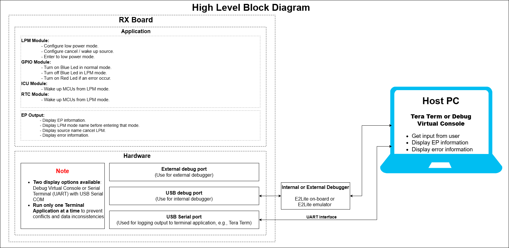
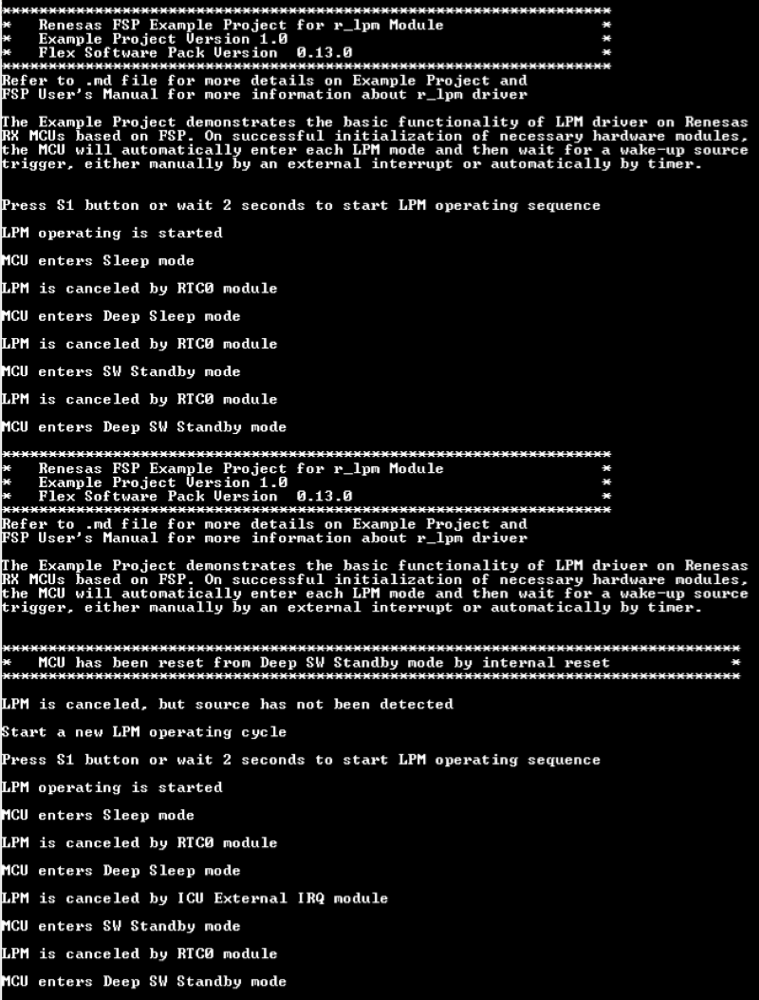

# Introduction #
The Example Project demonstrates the basic functionality of LPM driver on Renesas RX MCUs based on FSP. On successful initialization of necessary hardware modules, the MCU will automatically enter each LPM mode and then wait for a wake-up source trigger, either manually by an external interrupt or automatically by timer.

**Note**: 
- To display information, the user can select between Debug Virtual Console and the Serial Terminal (UART) with USB Serial COM. It is important to note that the user should only operate a single serminal application at a time to avoid conflicts or data inconsistencies. For instructions on how to switch between these options, please refer to the section [`Special Topics`](#special-topics)/[`Changing Terminal Application`](#changing-terminal-application).

- By default, EP information is printed to the host PC using the Serial Terminal (UART) for boards that support USB Serial COM. LED3 is turned ON to indicate the UART initialized unsuccessfully.

- RX boards that support USB Serial COM: EK-RX74M, EK-RX74N. 

## Required Resources ##  
To build and run the LPM example project, the following resources are needed.

### Software ###
Supported RX boards: EK-RX74M, EK-RX74N.

* Renesas Flexible Software Package (FSP): Version 1.0.0.
* e2 studio: Version 2026-07.
* Renesas GCC Compiler for RX: Version 14.2.0.202607.
* Renesas CC-RX Compiler: Version v3.08.00.
* Terminal Console Application: Tera Term or a similar application.

### Hardware ###

* 1 x Renesas RX board.
* 2 x Type-C USB cables for programming and debugging.

### Hardware Connections ### 

- Connect the RX board USB debug port (J8) to the PC via a Type-C USB cable for EP debugging (If E2 Lite on-board is used).
- Connect the RX board USB Serial port (J27) to the PC using a Type-C USB cable to verify logs through the Terminal Application.

## Related Collateral References ##

The following documents can be referred to for enhancing your understanding of the operation of this example project:
- [FSP User Manual on GitHub (Reference link)](https://renesas.github.io/fsp/)
- [FSP Known Issues (Reference link)](https://github.com/renesas/fsp/issues)

# Project Notes # 

## System Level Block Diagram ## 
  

## FSP Modules Used ##

List of important modules that are used in this example project. Refer to the FSP User Manual for further details on each module listed below.

| Module Name | Usage | Searchable Keyword  |
|-------------|-----------------------------------------------|-----------------------------------------------|
| LPM | LPM is used to configure power cancellation, mode selection and return the MCU to low power mode to reduce power consumption | r_lpm |
| RTC | RTC is used to automatically cancel LPM modes  | r_rtc |
| External IRQ | External IRQ is used to manually cancel the LPM modes | r_icu |

## Module Configuration Notes ##
This section describes FSP Configurator properties which are important or different than those selected by default. 

**Common Configuration Properties**

|   Module Property Path and Identifier   |   Default Value   |   Used Value   |   Reason   |
| :-------------------------------------: | :---------------: | :------------: | :--------: |
|   configuration.xml > BSP > Properties > Settings > Property > RX Common > Heap size (bytes)  |  0   | 0x400  |  Heap size is required for standard library functions to be used. |

**Configuration Properties for Sleep mode LPM instance**

|   Module Property Path and Identifier   |   Default Value   |   Used Value   |   Reason   |
|-----------------------------------------|-------------------|----------------|------------|
| configuration.xml > g_lpm_sleep Low Power Modes (r_lpm) > Settings > Property > Module g_lpm_sleep Low Power Modes (r_lpm) > General > Low Power Mode | Sleep mode | Sleep mode | Select sleep mode for this LPM instance. |

**Configuration Properties for Deep Sleep mode LPM instance**

|   Module Property Path and Identifier   |   Default Value   |   Used Value   |   Reason   |
|-----------------------------------------|-------------------|----------------|------------|
| configuration.xml > g_lpm_deep_sleep Low Power Modes (r_lpm) > Settings > Property > Module g_lpm_deep_sleep Low Power Modes (r_lpm) > General > Low Power Mode | Sleep mode | Deep Sleep mode | Select deep sleep mode for this LPM instance. |
| configuration.xml > g_lpm_deep_sw_standby Low Power Modes (r_lpm) > Settings > Property > Module g_lpm_deep_sw_standby Low Power Modes (r_lpm) > Oscillator LDO (Not available on every MCU) > PLL1 LDO State in standby mode | PLL1 LDO is disabled in standby mode | PLL1 LDO is retained in standby mode | Select this option to enable fast wake‑up from Deep SW Standby mode. |
| configuration.xml > g_lpm_deep_sw_standby Low Power Modes (r_lpm) > Settings > Property > Module g_lpm_deep_sw_standby Low Power Modes (r_lpm) > Oscillator LDO (Not available on every MCU) > PLL2 LDO State in standby mode | PLL2 LDO is disabled in standby mode | PLL2 LDO is retained in standby mode | Select this option to enable fast wake‑up from Deep SW Standby mode. |
| configuration.xml > g_lpm_deep_sw_standby Low Power Modes (r_lpm) > Settings > Property > Module g_lpm_deep_sw_standby Low Power Modes (r_lpm) > Oscillator LDO (Not available on every MCU) > HOCO LDO State in standby mode | HOCO LDO is disabled in standby mode | HOCO LDO is retained in standby mode | Select this option to enable fast wake‑up from Deep SW Standby mode. |
| configuration.xml > g_lpm_deep_sleep Low Power Modes (r_lpm) > Settings > Property > Module g_lpm_deep_sleep Low Power Modes (r_lpm) > RAM Retention Control (Not available on every MCU) > TCM retention in Deep Sleep and Standby modes | Supply power to TCM | Supply power to TCM  | Retained TCM in deep sleep mode. |

**Configuration Properties for SW Standby mode LPM instance**

|   Module Property Path and Identifier   |   Default Value   |   Used Value   |   Reason   |
|-----------------------------------------|-------------------|----------------|------------|
| configuration.xml > g_lpm_sw_standby Low Power Modes (r_lpm) > Settings > Property > Module g_lpm_sw_standby Low Power Modes (r_lpm) > General > Low Power Mode | Sleep mode | Software Standby mode | Select Software Standby mode for this LPM instance. |
| configuration.xml > g_lpm_sw_standby Low Power Modes (r_lpm) > Settings > Property > Module g_lpm_sw_standby Low Power Modes (r_lpm) > General > Output port state in standby and deep standby | No change | No change | Retained state of the output pins after entering SW Standby mode. |
| configuration.xml > g_lpm_sw_standby Low Power Modes (r_lpm) > Settings > Property > Module g_lpm_sw_standby Low Power Modes (r_lpm) > RAM Retention Control (Not available on every MCU) > RAM retention in Standby mode > Supply power to RAM Region 0 [0x82000000, 0x8201FFFF] | ☐ | ☑  | Retained this memory region in SW Standby mode. |
| configuration.xml > g_lpm_sw_standby Low Power Modes (r_lpm) > Settings > Property > Module g_lpm_sw_standby Low Power Modes (r_lpm) > RAM Retention Control (Not available on every MCU) > RAM retention in Standby mode > Supply power to RAM Region 1 [0x82000000, 0x8203FFFF] | ☐ | ☑  | Retained this memory region in SW Standby mode. |
| configuration.xml > g_lpm_sw_standby Low Power Modes (r_lpm) > Settings > Property > Module g_lpm_sw_standby Low Power Modes (r_lpm) > RAM Retention Control (Not available on every MCU) > RAM retention in Standby mode > Supply power to RAM Region 2 [0x82000000, 0x82015FFFF] | ☐ | ☑  | Retained this memory region in SW Standby mode. |
| configuration.xml > g_lpm_sw_standby Low Power Modes (r_lpm) > Settings > Property > Module g_lpm_sw_standby Low Power Modes (r_lpm) > RAM Retention Control (Not available on every MCU) > RAM retention in Standby mode > Supply power to RAM Region 3 [0x82000000, 0x8207FFFF] | ☐ | ☑  | Retained this memory region in SW Standby mode. |
| configuration.xml > g_lpm_sw_standby Low Power Modes (r_lpm) > Settings > Property > Module g_lpm_sw_standby Low Power Modes (r_lpm) > RAM Retention Control (Not available on every MCU) > RAM retention in Standby mode > Supply power to RAM Region 4 [0x82000000, 0x8209FFFF] | ☐ | ☑  | Retained this memory region in SW Standby mode. |
| configuration.xml > g_lpm_sw_standby Low Power Modes (r_lpm) > Settings > Property > Module g_lpm_sw_standby Low Power Modes (r_lpm) > RAM Retention Control (Not available on every MCU) > RAM retention in Standby mode > Supply power to RAM Region 5 [0x82000000, 0x820BFFFF] | ☐ | ☑  | Retained this memory region in SW Standby mode. |
| configuration.xml > g_lpm_sw_standby Low Power Modes (r_lpm) > Settings > Property > Module g_lpm_sw_standby Low Power Modes (r_lpm) > RAM Retention Control (Not available on every MCU) > RAM retention in Standby mode > Supply power to RAM Region 6 [0x82000000, 0x820DFFFF] | ☐ | ☑  | Retained this memory region in SW Standby mode. |
| configuration.xml > g_lpm_sw_standby Low Power Modes (r_lpm) > Settings > Property > Module g_lpm_sw_standby Low Power Modes (r_lpm) > RAM Retention Control (Not available on every MCU) > RAM retention in Standby mode > Supply power to RAM Region 7 [0x82000000, 0x820FFFFF] | ☐ | ☑  | Retained this memory region in SW Standby mode. |
| configuration.xml > g_lpm_sw_standby Low Power Modes (r_lpm) > Settings > Property > Module g_lpm_sw_standby Low Power Modes (r_lpm) > RAM Retention Control (Not available on every MCU) > RAM retention in Standby mode > Supply power to RAM Region 8 [0x82000000, 0x8211FFFF] | ☐ | ☑  | Retained this memory region in SW Standby mode. |
| configuration.xml > g_lpm_sw_standby Low Power Modes (r_lpm) > Settings > Property > Module g_lpm_sw_standby Low Power Modes (r_lpm) > RAM Retention Control (Not available on every MCU) > RAM retention in Standby mode > Supply power to RAM Region 9 [0x82000000, 0x8213FFFF] | ☐ | ☑  | Retained this memory region in SW Standby mode. |
| configuration.xml > g_lpm_sw_standby Low Power Modes (r_lpm) > Settings > Property > Module g_lpm_sw_standby Low Power Modes (r_lpm) > RAM Retention Control (Not available on every MCU) > RAM retention in Standby mode > Supply power to RAM Region 10 [0x82000000, 0x8215FFFF] | ☐ | ☑  | Retained this memory region in SW Standby mode. |
| configuration.xml > g_lpm_sw_standby Low Power Modes (r_lpm) > Settings > Property > Module g_lpm_sw_standby Low Power Modes (r_lpm) > RAM Retention Control (Not available on every MCU) > RAM retention in Standby mode > Supply power to RAM Region 11 [0x82000000, 0x8217FFFF] | ☐ | ☑  | Retained this memory region in SW Standby mode. |
| configuration.xml > g_lpm_deep_sw_standby Low Power Modes (r_lpm) > Settings > Property > Module g_lpm_deep_sw_standby Low Power Modes (r_lpm) > Oscillator LDO (Not available on every MCU) > PLL1 LDO State in standby mode | PLL1 LDO is disabled in standby mode | PLL1 LDO is retained in standby mode | Select this option to enable fast wake‑up from Deep SW Standby mode. |
| configuration.xml > g_lpm_deep_sw_standby Low Power Modes (r_lpm) > Settings > Property > Module g_lpm_deep_sw_standby Low Power Modes (r_lpm) > Oscillator LDO (Not available on every MCU) > PLL2 LDO State in standby mode | PLL2 LDO is disabled in standby mode | PLL2 LDO is retained in standby mode | Select this option to enable fast wake‑up from Deep SW Standby mode. |
| configuration.xml > g_lpm_deep_sw_standby Low Power Modes (r_lpm) > Settings > Property > Module g_lpm_deep_sw_standby Low Power Modes (r_lpm) > Oscillator LDO (Not available on every MCU) > HOCO LDO State in standby mode | HOCO LDO is disabled in standby mode | HOCO LDO is retained in standby mode | Select this option to enable fast wake‑up from Deep SW Standby mode. |
| configuration.xml > g_lpm_sw_standby Low Power Modes (r_lpm) > Settings > Property > Module g_lpm_sw_standby Low Power Modes (r_lpm) > RAM Retention Control (Not available on every MCU) > TCM retention in Deep Sleep and Standby modes | Supply power to TCM | Supply power to TCM  | Retained TCM in SW Standby mode. |

**Configuration Properties for Deep SW Standby mode LPM instance**

|   Module Property Path and Identifier   |   Default Value   |   Used Value   |   Reason   |
|-----------------------------------------|-------------------|----------------|------------|
| configuration.xml > g_lpm_deep_sw_standby Low Power Modes (r_lpm) > Settings > Property > Module g_lpm_deep_sw_standby Low Power Modes (r_lpm) > General > Low Power Mode | Sleep mode | Deep Software Standby mode | Select Deep Standby mode for this LPM instance. |
| configuration.xml > g_lpm_deep_sw_standby Low Power Modes (r_lpm) > Settings > Property > Module g_lpm_deep_sw_standby Low Power Modes (r_lpm) > General > Output port state in standby and deep standby | No change | No change | Retained state of the output pins in Deep SW Standby mode. |
| configuration.xml > g_lpm_deep_sw_standby Low Power Modes (r_lpm) > Settings > Property > Module g_lpm_deep_sw_standby Low Power Modes (r_lpm) > Deep Standby Options > Cancel Sources > IRQ30 | ☐ | ☑ | Select IRQ30 interrupt as source to cancel Deep SW Standby mode. |
| configuration.xml > g_lpm_deep_sw_standby Low Power Modes (r_lpm) > Settings > Property > Module g_lpm_deep_sw_standby Low Power Modes (r_lpm) > Deep Standby Options > Cancel Sources > RTC Interval | ☐ | ☑ | Select RTC interval Underflow Interrupt as the source to cancel Deep SW Standby mode. |
| configuration.xml > g_lpm_deep_sw_standby Low Power Modes (r_lpm) > Settings > Property > Module g_lpm_deep_sw_standby Low Power Modes (r_lpm) > Oscillator LDO (Not available on every MCU) > PLL1 LDO State in standby mode | PLL1 LDO is disabled in standby mode | PLL1 LDO is retained in standby mode | Select this option to enable fast wake‑up from Deep SW Standby mode. |
| configuration.xml > g_lpm_deep_sw_standby Low Power Modes (r_lpm) > Settings > Property > Module g_lpm_deep_sw_standby Low Power Modes (r_lpm) > Oscillator LDO (Not available on every MCU) > PLL2 LDO State in standby mode | PLL2 LDO is disabled in standby mode | PLL2 LDO is retained in standby mode | Select this option to enable fast wake‑up from Deep SW Standby mode. |
| configuration.xml > g_lpm_deep_sw_standby Low Power Modes (r_lpm) > Settings > Property > Module g_lpm_deep_sw_standby Low Power Modes (r_lpm) > Oscillator LDO (Not available on every MCU) > HOCO LDO State in standby mode | HOCO LDO is disabled in standby mode | HOCO LDO is retained in standby mode | Select this option to enable fast wake‑up from Deep SW Standby mode. |

**Configuration Properties for using External IRQ**
|   Module Property Path and Identifier   |   Default Value   |   Used Value   |   Reason   |
|-----------------------------------------|-------------------|----------------|------------|
| configuration.xml > g_external_irq External IRQ (r_icu) > Settings > Property > Module g_external_irq External IRQ (r_icu) > Channel | 0 | 30 | Use External IRQ channel 30 to cancel LPM modes. |
| configuration.xml > g_external_irq External IRQ (r_icu) > Settings > Property > Module g_external_irq External IRQ (r_icu) > Trigger | Rising | Falling | Detect button press using falling edge. |
| configuration.xml > g_external_irq External IRQ (r_icu) > Settings > Property > Module g_external_irq External IRQ (r_icu) > Digital Filtering | Disabled | Disabled | Do not use digital filtering in LPM modes. |
| configuration.xml > g_external_irq External IRQ (r_icu) > Settings > Property > Module g_external_irq External IRQ (r_icu) > Callback | NULL | external_irq_cancel_lpm_callback | It is called from the interrupt service routine (ISR) upon a falling edge is detected on the IRQ pin. |
| configuration.xml > g_external_irq External IRQ (r_icu) > Settings > Property > Module g_external_irq External IRQ (r_icu) > Pin Interrupt Priority | Priority 12 | Priority 12 | Select the External IRQ interrupt priority. |

**Configuration Properties for using RTC**
|   Module Property Path and Identifier   |   Default Value   |   Used Value   |   Reason   |
|-----------------------------------------|-------------------|----------------|------------|
|  configuration.xml > Stacks > g_timer_cancel_lpm Realtime Clock (r_rtc) > Properties > Settings > Property > Module g_timer_cancel_lpm Realtime Clock (r_rtc) > Clock Source | LOCO | LOCO | Select the RTC Clock Source. |
|  configuration.xml > Stacks > g_timer_cancel_lpm Realtime Clock (r_rtc) > Properties > Settings > Property > Module g_timer_cancel_lpm Realtime Clock (r_rtc) > Automatic Adjustment Period | 10 Seconds | 10 Seconds | Select the Error Adjustment Period for Automatic Adjustment. |
|  configuration.xml > Stacks > g_timer_cancel_lpm Realtime Clock (r_rtc) > Properties > Settings > Property > Module g_timer_cancel_lpm Realtime Clock (r_rtc) > Callback | NULL | timer_cancel_lpm_callback | Assigned name for using callback function. |
|  configuration.xml > Stacks > g_timer_cancel_lpm Realtime Clock (r_rtc) > Properties > Settings > Property > Module g_timer_cancel_lpm Realtime Clock (r_rtc) > Alarm Interrupt Priority | Disabled | Priority 12 | Select the alarm interrupt priority. |
|  configuration.xml > Stacks > g_timer_cancel_lpm Realtime Clock (r_rtc) > Properties > Settings > Property > Module g_timer_cancel_lpm Realtime Clock (r_rtc) > Period Interrupt Priority | Disabled | Priority 12 | Select the period interrupt priority. |
|  configuration.xml > Stacks > g_timer_cancel_lpm Realtime Clock (r_rtc) > Properties > Settings > Property > Module g_timer_cancel_lpm Realtime Clock (r_rtc) > Carry Interrupt Priority | Priority 2 | Priority 12 | Select the carry interrupt priority. |

**Configuration Properties for using the Serial Terminal (UART)**   
|   Configure Interrupt Event Path        |   Default Value   |   Used Value   |   Reason   |
|-----------------------------------------|-------------------|----------------|------------|
| configuration.xml > Interrupts > Interrupts Configuration > New User Event > RSCI > RSCI12 > RSCI12 RXI (Receive data full) | empty | sci_b_uart_rxi_isr | Assign the UART receive ISR (Receive data full) to the interrupt vector table. |
| configuration.xml > Interrupts > Interrupts Configuration > New User Event > RSCI > RSCI12 > RSCI12 TXI (Transmit data empty) | empty | sci_b_uart_txi_isr | Assign the UART transfer ISR (Transfer data empty) to the interrupt vector table. |
| configuration.xml > Interrupts > Interrupts Configuration > New User Event > RSCI > RSCI12 > 105-6 GROUPAL1 RSCI12 TEI (Transmit end) | empty | sci_b_uart_tei_isr | Assign the UART transfer ISR (Transfer end) to the interrupt vector table. |
| configuration.xml > Interrupts > Interrupts Configuration > New User Event > RSCI > RSCI12 > 105-7 GROUPAL1 RSCI12 ERI (Receive error) | empty | sci_b_uart_eri_isr | Assign the UART receive ISR (Receive error) to the interrupt vector table. |

## API Usage ##

The table below lists the LPM API used at the application layer by this example project.

| API Name    | Usage                                                                          |
|-------------|--------------------------------------------------------------------------------|
| R_LPM_Open | This API is used to initialize the LPM module. |
| R_LPM_LowPowerModeEnter | This API is used to enter low power mode. |
| R_LPM_Close | This API is used to de-initialize the LPM module. |
| R_ICU_ExternalIrqOpen | This API is used to initialize an IRQ input pin for use with the external interrupt interface. |
| R_ICU_ExternalIrqEnable | This API is used to enable external interrupts for a specified channel. |
| R_ICU_ExternalIrqDisable | This API is used to disable external interrupts for a specified channel. |
| R_ICU_ExternalIrqClose | This API is used to de-initialize the external interrupt channel. |
| R_RTC_Open | This API is used to open an RTC instance. |
| R_RTC_CalendarTimeSet | This API is used to set the time provided by user. |
| R_RTC_PeriodicIrqRateSet | This API is used to enable periodic interrupt rate. |
| R_RTC_Close | This API is used to close an RTC instance. |

**For using the Serial Terminal (UART)**
| API Name    | Usage                                                                          |
|-------------|--------------------------------------------------------------------------------|
| R_SCI_B_UART_Open | This API is used to configures the UART driver based on the input configurations. |
| R_SCI_B_UART_Write | This API is used to transmit user specified number of bytes from the source buffer pointer. |
| R_SCI_B_UART_Close | This API is used to abort any in progress transfers, disables interrupts, receiver, and transmitter, close lower level transfer drivers if used and remove power. |

## Verifying operation ##
1. Import the example project.

2. Generate, and build the example project.

3. Before running the example project, make sure hardware connections are completed.

4. Connect the RX MCU to the host PC via debugger. By default, EP will use E2lite debugger.
5. Open a terminal application (e.g., Tera Term or Debug Virtual Console) on the host PC and connect to the RX board’s USB Serial port.  
   * Note: For using the Serial Terminal application:
        * To echo back typed content in Tera Term, go to [Setup] -> [Terminal...] and check [Local echo].
        * The configuration parameters of the serial port are:
            - COM port: Provided by the USB Serial COM.
            - Baud rate: 115200 bps
            - Data length: 8 bits
            - Parity: None
            - Stop bit: 1 bit
            - Flow control: None 

### The below images showcase the output on the Terminal Application (Tera Term) ### 

## Special Topics ##

### Debugger Setting ###

* To use E2 Lite on-board or E2 Emulator Lite, please follow the instructions below:

1. **Common step**: Click [**Run**] → [**Debug Configurations…**] to open the “**Debug Configurations**” window.  
  

2. **Select file application**  
  a. **Used for projects built with GCC**: --> Select file **.elf**.  
    
  b. **Used for projects built with CCRX**: --> Select file **.x**.  
  

3. **Setting debugger configurations**  
  a. **Used for E2 Lite on-board**.    
    
  b. **Used for external E2 Emulator Lite**.  
    

  **Note:** Connect the RX board debugger port (J9) to the host PC via E2 Emulator Lite (with USB cable and 20-20 pin cable).

### Adding lowsrc Folder

Before changing terminal application settings, you need to add the `lowsrc` folder from another Example Project:

1. **Locate the lowsrc folder:**
   
   - Navigate to Example Project `sci_uart` or `usb_pcdc_with_freertos`  (`example_projects/<board>/sci_uart/e2studio/gccrx_sci_uart_<board>_ep/src`)
   - Find the `lowsrc` folder containing low-level source files.

2. **Copy `lowsrc` folder to this Example Project:**
   
   - Copy the entire `lowsrc` folder.
   - Paste it into this your target Example Project directory: `example_projects/ek_rx74m/<EP>/e2studio/`.

3. **Add lowsrc to e2studio project:**
   
   - In e2studio, right-click on the project in Project Explorer.
   - Select **Refresh** (or press F5) to detect the new folder.

4. **Verify the folder is included:**
   
   - Expand the project tree in Project Explorer.
   - Confirm that `lowsrc` folder and its contents are visible.
   - The folder should be included in the build path with source files ready to compile.

5. **Changing the terminal Application to use the Debug Virtual Console:**
   
   - For instructions on how to switch between these options, please refer to the section [`Special Topics`](#special-topics)/[`Changing Terminal Application`](#changing-terminal-application).

6. **Re-build the project:**
   
   - In e2studio, right-click on the project and select **Build Project**.

**Note:** To use Debug Virtual Console, the `lowsrc` folder must be added to the project, as it contains the source files required for Debug Virtual Console operation.

### Changing Terminal Application ###
By default, the EP supports Serial Terminal for RX boards that support USB Serial COM   
**For use CCRX Compiler:**
* Define USE_VIRTUAL_COM=1 macro in Project Properties -> C/C++ Build -> Settings -> Tool Settings -> Compiler -> Source -> Macro definition (-define)

To use Debug Virtual Console, please follow the instructions below:
* Define USE_VIRTUAL_COM=0 macro in Project Properties -> C/C++ Build -> Settings -> Tool Settings -> Compiler -> Source -> Macro definition (-define)
* Define BSP_CFG_IO_LIB_ENABLE=1 macro in Project Properties -> C/C++ Build -> Settings -> Tool Settings -> Compiler -> Source -> Macro definition (-define)

**For use GCCRX Compiler:**  
* Define USE_VIRTUAL_COM=1 macro in Project Properties -> C/C++ Build -> Settings -> Tool Settings -> Compiler -> Includes -> Macro Defines (-D)
  
To use Debug Virtual Console, please follow the instructions below:
* Define USE_VIRTUAL_COM=0 macro in Project Properties -> C/C++ Build -> Settings -> Tool Settings -> Compiler -> Includes -> Macro Defines (-D)

