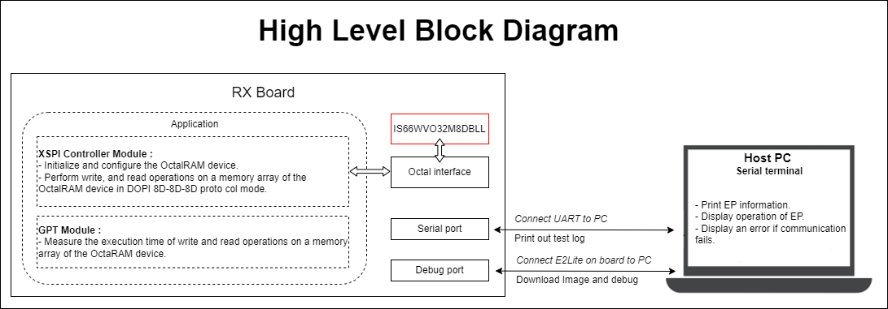
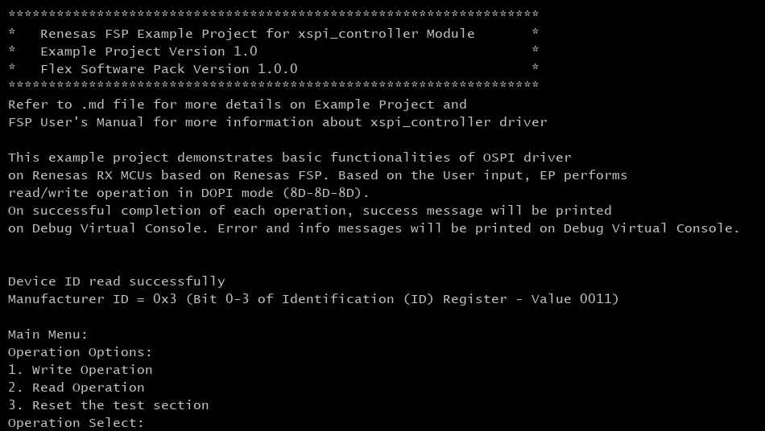
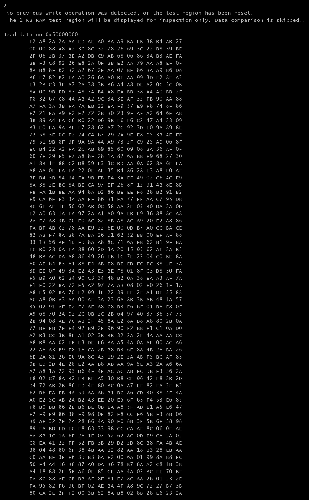
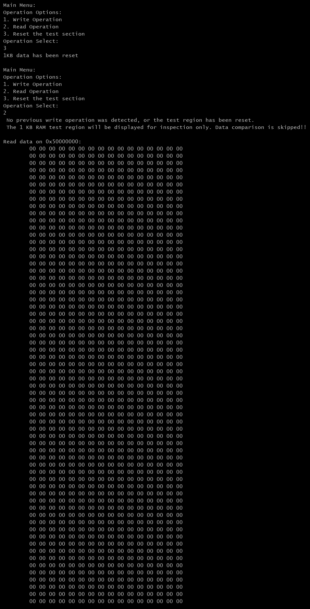
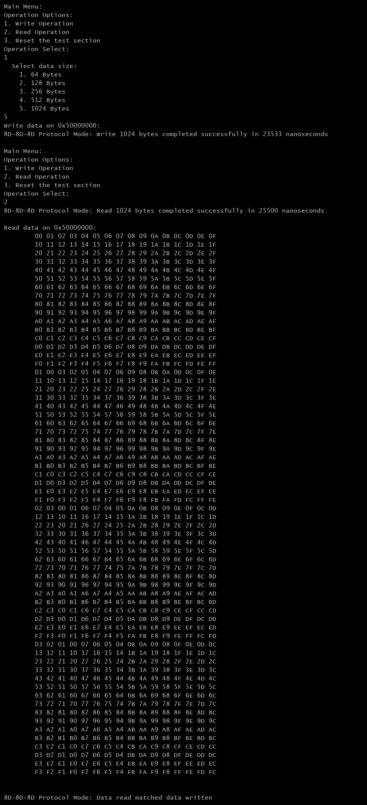

# Introduction #

This example project demonstrates basic functionalities of XSPI_Controler driver on Renesas RX MCUs based on Renesas FSP.  
In Main menu, based on Debug Virtual Console, the user selects mode for XSPI_Controler module operations.  
1. Write data to OctalRAM device (64KB, 128KB, 256KB, 512KB, 1024KB).
2. Read back data from OctalRAM device.
3. Reset the test section.

On successful completion of each operation, a success message and execution time of operation will be displayed on Debug Virtual Console. Error messages and information will be printed on Debug Virtual Console.

## Required Resources ##

To build and run the OctaRAM example project, the following resources are needed.

### Software ###

* Renesas Flexible Software Package (FSP): Version 1.0.0.
* e2 studio: Version 2026-07.
* Renesas GCC Compiler for RX: Version 14.2.0.202607.
* Renesas CC-RX Compiler: Version v3.08.00.

### Hardware ###
Supported RX boards: EK-RX74M, EK-RX74N.

* 1 x Renesas RX board.
* 2 x Type-C USB cable for programming and debugging.

### Hardware Connections ###

- Connect the RX board USB debug port (J8) to the PC via a Type-C USB cable for EP debugging (If E2 Lite on-board is used).

## Related Collateral References ##
The following documents can be referred to for enhancing your understanding of the operation of this example project:
- [FSP User Manual on GitHub (Reference link)](https://renesas.github.io/fsp/)
- [FSP Known Issues (Reference link)](https://github.com/renesas/fsp/issues)

# Project Notes #

## System Level Block Diagram ##

## FSP Modules Used ##
List all the various modules that are used in this example project. Refer to the FSP User Manual for further details on each module listed below.

| Module Name | Usage | Searchable Keyword  |
|-------------|-----------------------------------------------|-----------------------------------------------|
| XSPI_CONTROLLER | XSPI_CONTROLLER is used to configure OctalRAM device and perform write, read operations on OctalRAM device's memory array. | r_xspi_controller |
| GPT | GPT is used to measure execution time of XSPI_CONTROLLER module operations. | r_gpt |

## Module Configuration Notes ##
This section describes FSP Configurator properties which are important or different than those selected by default.

**Common Configuration Properties** configuration.xml > `BSP > Properties > Settings > Property`

|   Module Property Path and Identifier   |   Default Value   |   Used Value   |   Reason   |
| --------------------------------------- | ----------------- | -------------- | ---------- |
|   RX Common > Main Stack size (bytes)   |  0   | 0x400  |  Main Stack size is required for standard library functions to be used. |
|   RX Common > Heap size (bytes)         |  0   | 0x800  |  Heap size is required for standard library functions to be used. |

 

**Configuration Properties for Clocks** `configuration.xml > Clocks`

| Clock      | Default Value| Source Clock |      Divider     | Description                         |
|------------|--------------|--------------|------------------|-------------------------------------|
| OCTASPICLK | Disabled     | PLL2P        | OCTASPICLK Div/1 | Enable OCTASPICLK for using XSPI_Controller module. |

 

**Configuration Properties for using XSPI_CONTROLLER** `configuration.xml > Stack > HAL/Common > XSPI (r_xspi_controller) > Properties > Settings > Property`

| Module Property Path and Identifier | Default Value | Used Value | Reason |
|-------------------------------------|---------------|------------|---------|
| Module g_octa_ram XSPI (r_xspi_controller) > Command Sets > Initial Mode > Read > Command Code | 0xEE | 0xA0 | Read command required by the target OctalRAM device. |
| Module g_octa_ram XSPI (r_xspi_controller) > Command Sets > Initial Mode > Read > Dummy Cycles | 20 | 5 | Read latency requirement of the OctalRAM device. |
| Module g_octa_ram XSPI (r_xspi_controller) > Command Sets > Initial Mode > Program > Command Code | 0x12 | 0x20 | Program command required by the target OctalRAM device. |
| Module g_octa_ram XSPI (r_xspi_controller) > Command Sets > Initial Mode > Program > Dummy Cycles | 0 | 5 | Write latency requirement of the OctalRAM device. |
| Module g_octa_ram XSPI (r_xspi_controller) > Command Sets > Initial Mode > Write Enable > Command Code | 0x06 | 0x00 | Write Enable command is not required by the target OctalRAM device. |
| Module g_octa_ram XSPI (r_xspi_controller) > Command Sets > Initial Mode > Status Read > Command Code | 0x05 | 0x00 | Status Read command is not used by the target OctalRAM device. |
| Module g_octa_ram XSPI (r_xspi_controller) > Command Sets > Initial Mode > Chip Erase > Protocol Mode | SPI (1S-1S-1S) | Dual data rate OPI (8D-8D-8D) | OctalRAM operates in DDR OPI mode. |
| Module g_octa_ram XSPI (r_xspi_controller) > Command Sets > Initial Mode > Chip Erase > Frame Format | Standard | xSPI Profile 1.0 | Frame format required by the OctalRAM device. |
| Module g_octa_ram XSPI (r_xspi_controller) > Command Sets > Initial Mode > Chip Erase > Address Mode | Normal | Array Address Mode | Address mapping mode required by the OctalRAM device. |
| Module g_octa_ram XSPI (r_xspi_controller) > Command Sets > Initial Mode > Chip Erase > Latency Mode | Fixed | Variable | Variable latency mode required by the OctalRAM device. |
| Module g_octa_ram XSPI (r_xspi_controller) > Command Sets > Initial Mode > Chip Erase > Address Length | 3 bytes | 4 bytes | 4-byte addressing required by the OctalRAM device. |
| Module g_octa_ram XSPI (r_xspi_controller) > Command Sets > High-speed Mode > Read > Command Code | 0xEEEE | 0xA0 | Read command required by the target OctalRAM device. |
| Module g_octa_ram XSPI (r_xspi_controller) > Command Sets > High-speed Mode > Read > Dummy Cycles | 20 | 5 | Read latency requirement of the OctalRAM device. |
| Module g_octa_ram XSPI (r_xspi_controller) > Command Sets > High-speed Mode > Program > Command Code | 0x1212 | 0x20 | Program command required by the target OctalRAM device. |
| Module g_octa_ram XSPI (r_xspi_controller) > Command Sets > High-speed Mode > Program > Dummy Cycles | 0 | 5 | Write latency requirement of the OctalRAM device. |
| Module g_octa_ram XSPI (r_xspi_controller) > Command Sets > High-speed Mode > Write Enable > Command Code | 0x0606 | 0x00 | Write Enable command is not required by the target OctalRAM device. |
| Module g_octa_ram XSPI (r_xspi_controller) > Command Sets > High-speed Mode > Status Read > Command Code | 0x0505 | 0x00 | Status Read command is not used by the target OctalRAM device. |
| Module g_octa_ram XSPI (r_xspi_controller) > Command Sets > High-speed Mode > Status Read > Dummy Cycles | 3 | 0 | No dummy cycles are required since Status Read is unused. |
| Module g_octa_ram XSPI (r_xspi_controller) > Command Sets > High-speed Mode > Chip Erase > Address Mode | Normal | Array Address Mode | Address mapping mode required by the OctalRAM device. |
| Module g_octa_ram XSPI (r_xspi_controller) > Command Sets > High-speed Mode > Chip Erase > Latency Mode | Fixed | Variable | Variable latency mode required by the OctalRAM device. |
| Module g_octa_ram XSPI (r_xspi_controller) > Command Sets > High-speed Mode > Chip Erase > Status Register Address Length | 4 bytes | No address | Status register address is not used. |
| Module g_octa_ram XSPI (r_xspi_controller) > Command Sets > High-speed Mode > Chip Erase > Status Register Address | 0x00 | 0x00000400 | Configuration defined by the device register map. |
| Module g_octa_ram XSPI (r_xspi_controller) > Command Sets > High-speed Mode > Chip Erase > Command Code | 0x6060 | 0x01 | Command value configured for the target OctalRAM device. |
| Module g_octa_ram XSPI (r_xspi_controller) > Timing Settings > DS Latching Delay | Auto-calibrate | 15 cells | Manual DQS timing adjustment used instead of auto-calibration. |
| Module g_octa_ram XSPI (r_xspi_controller) > Timing Settings > Output Assert Delay | Disable | Enable | Improves timing margin for high-speed operation. |

 

**Configuration Properties for using GPT**

| Module Property Path and Identifier | Default Value | Used Value | Reason |
|-------------------------------------|---------------|------------|---------|
| General > Name | g_timer${_instance} | g_timer | Use a fixed instance name to simplify application code. |
| General > Period | 0x10000 | 0x100000000 | Configure GPT as a 32-bit free-running timer for long-duration timing measurements. |

 

## API Usage ##

The table below lists the APIs used at the application layer by this example project.

| API Name    | Usage                                                                          |
|-------------|--------------------------------------------------------------------------------|
| R_XSPI_CONTROLLER_Open | This API is used to initialize the XSPI Controller module. |
| R_XSPI_CONTROLLER_SpiProtocolSet | This API is used to switch the XSPI Controller to 8D-8D-8D protocol mode. |
| R_XSPI_CONTROLLER_DirectTransfer | This API is used to read from and write to OctalRAM configuration and identification registers. |
| R_GPT_Open | This API is used to initialize the GPT module. |
| R_GPT_Reset | This API is used to reset the GPT counter value before measurement. |
| R_GPT_Start | This API is used to start timing measurement. |
| R_GPT_StatusGet | This API is used to get the current GPT status and counter value. |
| R_GPT_InfoGet | This API is used to get GPT clock information for time calculation. |
| R_GPT_Stop | This API is used to stop the GPT timer after measurement. |

 

## Verifying Operation ##
1. Import the example project.
2. Generate, and build the example project.
3. Before running the example project, make sure hardware connections are completed.
4. Connect the RX MCU to the host PC via E2 Lite on-board.
By default, EP will use the on-board E2 Lite.
5. Open a terminal application (e.g., Tera Term or Debug Virtual Console) on the host PC and connect to the RX board’s USB Serial port.  
   * Note: For using the Serial Terminal application:
        * To echo back typed content in Tera Term, go to [Setup] -> [Terminal...] and check [Local echo].
        * The configuration parameters of the serial port are:
            - COM port: Provided by the USB Serial COM.
            - Baud rate: 115200 bps
            - Data length: 8 bits
            - Parity: None
            - Stop bit: 1 bit
            - Flow control: None 

### The below images showcase the output on the Terminal Application (Tera Term) ### 
  * The terminal displays the EP information:\
  

  * The terminal displays read operation before write operation:\
  

  * The terminal displays reset and read operation:\
  

  * The terminal displays write and read operations for data sizes up to 1 KB.  
    During a read operation, only the data size written in the previous write operation is read back.  
    The same behavior applies to all supported data sizes, including 64 Bytes, 128 Bytes, 256 Bytes, and 512 Bytes:\
    

## Special Topics ##

### Debugger Setting ###

* To use E2 Lite on-board or E2 Emulator Lite, please follow the instructions below:

1. **Common step**: Click [**Run**] → [**Debug Configurations…**] to open the “**Debug Configurations**” window.  
  

2. **Select file application**  
  a. **Used for projects built with GCC**: --> Select file **.elf**.  
    
  b. **Used for projects built with CCRX**: --> Select file **.x**.  
  

3. **Setting debugger configurations**  
  a. **Used for E2 Lite on-board**.    
    
  b. **Used for external E2 Emulator Lite**.  
    

  **Note:** Connect the RX board debugger port (J9) to the host PC via E2 Emulator Lite (With USB cable and 20-20 pin cable).

### Adding lowsrc Folder

Before changing terminal application settings, you need to add the `lowsrc` folder from another Example Project:

1. **Locate the lowsrc folder:**
   
   - Navigate to Example Project `sci_uart` or `usb_pcdc_with_freertos`  (`example_projects/<board>/sci_uart/e2studio/gccrx_sci_uart_<board>_ep/src`)
   - Find the `lowsrc` folder containing low-level source files.

2. **Copy `lowsrc` folder to this Example Project:**
   
   - Copy the entire `lowsrc` folder.
   - Paste it into this your target Example Project directory: `example_projects/ek_rx74n/<EP>/e2studio/`.

3. **Add lowsrc to e2studio project:**
   
   - In e2studio, right-click on the project in Project Explorer.
   - Select **Refresh** (or press F5) to detect the new folder.

4. **Verify the folder is included:**
   
   - Expand the project tree in Project Explorer.
   - Confirm that `lowsrc` folder and its contents are visible.
   - The folder should be included in the build path with source files ready to compile.

5. **Changing the terminal Application to use the Debug Virtual Console:**
   
   - For instructions on how to switch between these options, please refer to the section [`Special Topics`](#special-topics)/[`Changing Terminal Application`](#changing-terminal-application).

6. **Re-build the project:**
   
   - In e2studio, right-click on the project and select **Build Project**.

**Note:** To use Debug Virtual Console, the `lowsrc` folder must be added to the project, as it contains the source files required for Debug Virtual Console operation.

### Changing Terminal Application ###
By default, the EP supports Serial Terminal for RX boards that support USB Serial COM   
**For use CCRX Compiler:**
* Define USE_VIRTUAL_COM=1 macro in Project Properties -> C/C++ Build -> Settings -> Tool Settings -> Compiler -> Source -> Macro definition (-define)

To use Debug Virtual Console, please follow the instructions below:
* Define USE_VIRTUAL_COM=0 macro in Project Properties -> C/C++ Build -> Settings -> Tool Settings -> Compiler -> Source -> Macro definition (-define)
* Define BSP_CFG_IO_LIB_ENABLE=1 macro in Project Properties -> C/C++ Build -> Settings -> Tool Settings -> Compiler -> Source -> Macro definition (-define)

**For use GCCRX Compiler:**  
* Define USE_VIRTUAL_COM=1 macro in Project Properties -> C/C++ Build -> Settings -> Tool Settings -> Compiler -> Includes -> Macro Defines (-D)
  
To use Debug Virtual Console, please follow the instructions below:
* Define USE_VIRTUAL_COM=0 macro in Project Properties -> C/C++ Build -> Settings -> Tool Settings -> Compiler -> Includes -> Macro Defines (-D)

