# Introduction

This example project demonstrates the fundamental functionality of the PCIF (Phase Counting Interface) module on Renesas MCUs by utilizing two operating modes: Phase Counting Mode and Incremental Mode. The project showcases how the PCIF peripheral can both generate and process ABZ encoder signals, providing a complete evaluation environment for encoder-based applications. The two use cases can be selected independently through a terminal-based user interface and are executed on a single MCU without requiring a physical encoder device.

For Phase Counting Mode, the PCIF module operates as an encoder signal generator. The MCU generates ABZ encoder signals to simulate encoder movement and position changes. Through the terminal interface, users can configure a target position value, define edge count parameters, monitor encoder status information, and stop encoder count generation. This use case demonstrates encoder signal generation, position counter control, and validation of encoder-related applications without external hardware.

For Incremental Mode, the PCIF module operates as an encoder signal receiver and decoder. The MCU receives and processes ABZ encoder signals, tracks encoder position information, and generates output waveforms according to a configurable encoder resolution ratio. Users can configure the resolution ratio, monitor encoder status information, and reset the PCIF module through the terminal interface. This use case demonstrates encoder signal decoding, position tracking, waveform generation, and encoder data processing using PCIF hardware.

The project provides a terminal-based user interface that displays EP information, use case descriptions, menu options, encoder status information, and execution results throughout the application flow. Users can interact with the example through the Debug Virtual Console or a serial terminal connected to the onboard UART interface, allowing convenient configuration and monitoring of PCIF operations during execution.

In addition, the example demonstrates how a single PCIF peripheral can be used for both encoder signal generation and encoder signal processing, enabling comprehensive evaluation of encoder-related functionality. By combining Phase Counting Mode and Incremental Mode within the same application, the project provides a practical environment for validating encoder algorithms, testing position-tracking behavior, and evaluating system integration scenarios commonly found in motion-control and industrial applications.

**Note**:

- To display information, the user can select between Debug Virtual Console and the Serial Terminal (UART) with USB Serial COM. It is important to note that the user should only operate a single terminal application at a time to avoid conflicts or data inconsistencies. For instructions on how to switch between these options, please refer to the section [`Special Topics`](#special-topics)/[`Changing Terminal Application`](#changing-terminal-application).
- By default, EP information is printed to the host PC using the Serial Terminal (UART) for boards that support USB Serial COM. LED3 is turned ON to indicate the UART initialized unsuccessfully.
- RX boards that support USB Serial COM: EK-RX74M, EK-RX74N.

## Required Resources

To build and run the PCIF example project, the following resources are needed.

### Software

* Renesas Flexible Software Package (FSP): Version 1.0.0.
* e2 studio: Version 2026-07.
* Renesas GCC Compiler for RX: Version 14.2.0.202607.
* Renesas CC-RX Compiler: Version v3.08.00.
* Terminal Console Application: Tera Term or a similar application.

### Hardware

* 1 x Renesas RX board.
* 2 x Type-C USB cable for programming and debugging.
* Optional hardware to view waveform: Oscilloscope and Probes.
* 1 x MB057GA140 Encoder (Motor).

### Hardware Connections

- Connect the RX board USB debug port (J8) to the PC via a Type-C USB cable for EP debugging (If E2 Lite on-board is used).
- Connect the RX board USB Serial port (J27) to the PC using a Type-C USB cable to verify logs through the Terminal Application.

#### Phase Counting Mode (PCIF Channel 0 - Output Only)

Connect the oscilloscope probes to the PCIF0 output pins to observe the output waveform.

* **EK-RX74N**
  * PCOUTA0  P002 (J1:44)  ----> Oscilloscope CH1 (A-phase output)
  * PCOUTB0  P003 (J1:41)  ----> Oscilloscope CH2 (B-phase output)
  * PCOUTZ0  P001 (J1:43)  ----> Oscilloscope CH3 (Z-phase output)
  * GND pin  ----> Oscilloscope GND

#### Incremental Mode (PCIF Channel 1 - Input and Output)

Connect the MB057GA140 encoder to the PCIF1 input pins.

* **EK-RX74N**
  * PCINA1   P208 (J1:18)   ----> A-phase (MB057GA140 Encoder)
  * PCINB1   P209 (J1:35)   ----> B-phase (MB057GA140 Encoder)
  * PCINZ1   P210 (J1:34)   ----> Z-phase (MB057GA140 Encoder)
  * VCC pin  ----> VCC (MB057GA140 Encoder)
  * GND pin  ----> GND (MB057GA140 Encoder)

Connect the oscilloscope probes to the PCIF1 output pins to observe the output waveform.

* **EK-RX74N**
  * PCOUTA1  P004 (J1:42)  ----> Oscilloscope CH4 (A-phase output)
  * PCOUTB1  P005 (J2:39)  ----> Oscilloscope CH5 (B-phase output)
  * PCOUTZ1  P006 (J2:40)  ----> Oscilloscope CH3 (Z-phase output)
  * GND pin ----> Oscilloscope GND

---

## Related Collateral References

The following documents can be referred to for enhancing your understanding of the operation of this example project:

- [FSP User Manual on GitHub (Reference link)](https://renesas.github.io/fsp/)
- [FSP Known Issues (Reference link)](https://github.com/renesas/fsp/issues)

# Project Notes

## System Level Block Diagram

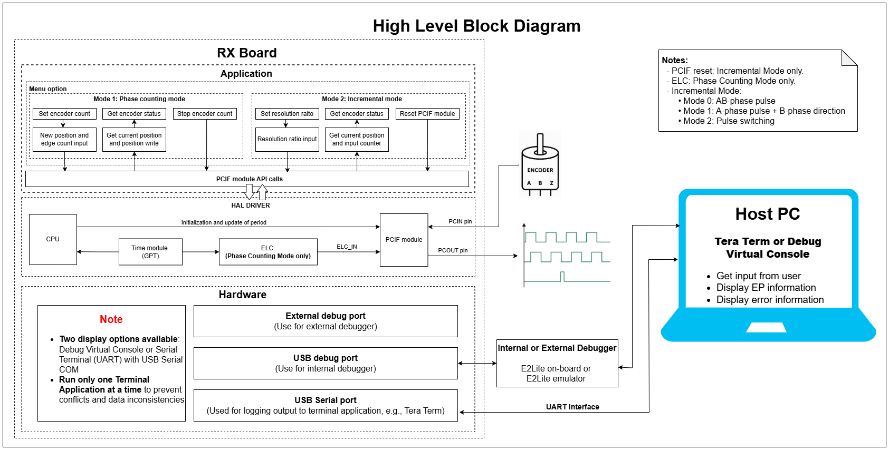

## FSP Modules Used

List all the various modules that are used in this example project. Refer to the FSP User Manual for further details on each module listed below.

| Module Name | Usage                                                                     | Searchable Keyword |
| ----------- | ------------------------------------------------------------------------- | ------------------ |
| PCIF module | This stack implements APIs to driver for the PCIF peripheral.             | r_pcif             |
| ELC module  | This stack support enables hardware event linkage to the PCIF peripheral. | r_elc              |

 

## Module Configuration Notes

This section describes FSP Configurator properties which are important or different than those selected by default.

**Configuration Properties for BSP** `configuration.xml > BSP > Properties > Settings > Property`

| Module Property Path and Identifier | Default Value | Used Value | Reason                                                                 |
| ----------------------------------- | ------------- | ---------- | ---------------------------------------------------------------------- |
| RX Common > Main Stack size (bytes) | 0x400         | 0x1000     | Main Stack size is required for standard library functions to be used. |
| RX Common > Heap size (bytes)       | 0             | 0x400      | Heap size is required for standard library functions to be used.       |

 

**Configuration Properties for PCIF Mode** `configuration.xml > Stack > HAL/Common > g_pcif_phase_counting_mode Phase-Counting Interface (r_pcif) > Properties > Settings > Property`

| Module Property Path and Identifier                                         | Default Value            | Used Value                                      | Reason                                                           |
| --------------------------------------------------------------------------- | ------------------------ | ----------------------------------------------- | ---------------------------------------------------------------- |
| Common > Timer Support                                                      | Disabled                 | Enabled                                         | If select whether to use Timer module in the build.              |
| General > Polarity > A-phase                                                | Positive                 | Positive                                        | Select the polarity for A phase.                                 |
| General > Polarity > B-phase                                                | Positive                 | Positive                                        | Select the polarity for B phase.                                 |
| General > Polarity > Z-phase                                                | Positive                 | Positive                                        | Select the polarity for Z phase.                                 |
| General > Name                                                              | g_pcif0                  | g_pcif_phase_counting_mode                      | Specify the module name.                                         |
| General > Channel                                                           | 0                        | 0                                               | Specify the PCIF channel.                                        |
| General > Clock Source                                                      | Synchronous Clock (PCLK) | Asynchronous Clock (GPTCLK)                     | Select the clock source for the PCIF module.                     |
| General > Mode                                                              | Phase Counting Mode      | Phase Counting Mode                             | Select the operating mode for the PCIF module.                   |
| General > Maximum Position                                                  | 0x10000                  | 0x10000                                         | Specify the maximum value of the position counter.               |
| Phase Counting Mode > ELC Support > Carrier Period Event Trigger Source     | Disabled                 | ID:X GPT0 COUNTER OVERFLOW (interrupt overflow) | Select external source that triggers the carrier period.         |
| Phase Counting Mode > Initialize Edge Data > Start Position                 | 0                        | 0                                               | Specify the start counter position.                              |
| Phase Counting Mode > Initialize Edge Data > Edge Count Data                | 0                        | 0                                               | Set the initial edge counter value.                              |
| Phase Counting Mode > Error Detect > Error Carrier Period Detection         | Disable                  | Enable                                          | Select carrier period error detection.                           |
| Phase Counting Mode > Error Detect > Error Edge Unprocessed Detection       | Disable                  | Enable                                          | Select edge unprocessed error detection.                         |
| Phase Counting Mode > Error Detect > Error Edge Counting Overflow Detection | Disable                  | Enable                                          | Select edge counting overflow error detection.                   |
| Phase Counting Mode > Error Detect > Error Old Edge Detection               | Disable                  | Enable                                          | Select old edge error detection.                                 |
| Phase Counting Mode > Carrier Period                                        | 500                      | 500                                             | Specify the carrier period in microseconds.                      |
| Phase Counting Mode > Carrier Period Event Difference Threshold             | 0x100                    | 0x100                                           | Specify the allowable difference range of carrier period events. |
| Phase Counting Mode > Carrier Period Adjustment Mode                        | Register Based Mode      | Event Based Mode                                | Select the carrier period adjustment mode.                       |
| Phase Counting Mode > Z Phase Width                                         | Z-phase Width Disable    | Z-phase Width 1                                 | Select Z-phase width configuration.                              |
| Phase Counting Mode > Z Phase Sync                                          | Z-phase Sync A Phase     | Z-phase Sync A Phase                            | Select Z-phase synchronize configuration.                        |
| Phase Counting Mode > Edge Counter Clear                                    | Disable                  | Enable                                          | Select automatic clear edge counter configuration.               |
| Phase Counting Mode > Callback                                              | NULL                     | pcif_phase_counting_callback                    | Specify the user callback function.                              |

 

**Configuration Properties for PCIF Mode** `configuration.xml > Stack > HAL/Common > g_pcif_incremental_mode Phase-Counting Interface (r_pcif) > Properties > Settings > Property`

| Module Property Path and Identifier                                | Default Value            | Used Value               | Reason                                                 |
| ------------------------------------------------------------------ | ------------------------ | ------------------------ | ------------------------------------------------------ |
| Common > Timer Support                                             | Disabled                 | Enabled                  | If select whether to use Timer module in the build.    |
| General > Polarity > A-phase                                       | Positive                 | Positive                 | Select the polarity for A phase.                       |
| General > Polarity > B-phase                                       | Positive                 | Positive                 | Select the polarity for B phase.                       |
| General > Polarity > Z-phase                                       | Positive                 | Positive                 | Select the polarity for Z phase.                       |
| General > Name                                                     | g_pcif0                  | g_pcif_incremental_mode  | Specify the module name.                               |
| General > Channel                                                  | 0                        | 1                        | Specify the PCIF channel.                              |
| General > Clock Source                                             | Synchronous Clock (PCLK) | Asynchronous Clock (GPTCLK) | Select the clock source for the PCIF module.           |
| General > Mode                                                     | Phase Counting Mode      | Incremental Mode         | Select the operating mode for the PCIF module.         |
| General > Maximum Position                                         | 0x10000                  | 0x10000                  | Specify the maximum value of the position counter.     |
| Incremental Mode > Z Phase Generate Sources > Counter-based        | Unchecked                | Unchecked                | Select Z phase generation from Counter-based.          |
| Incremental Mode > Z Phase Generate Sources > Z-Phase Input        | Unchecked                | Unchecked                | Select Z phase generation from Z-phase input.          |
| Incremental Mode > Z Phase Generate Sources > Crest Event Trigger  | Unchecked                | Checked                  | Select Z phase generation from Crest event trigger.    |
| Incremental Mode > Z Phase Generate Sources > Trough Event Trigger | Unchecked                | Checked                  | Select Z phase generation from Trough event trigger.   |
| Incremental Mode > Z Phase Generate Sources > Software Trigger     | Unchecked                | Checked                  | Select Z phase generation from software trigger.       |
| Incremental Mode > Clear Counter Sources > Z-Phase Input           | Unchecked                | Unchecked                | Select Counter clear from Z-phase input.               |
| Incremental Mode > Clear Counter Sources > Crest Event Trigger     | Unchecked                | Unchecked                | Select Counter clear from crest event trigger.         |
| Incremental Mode > Clear Counter Sources > Trough Event Trigger    | Unchecked                | Unchecked                | Select Counter clear from trough event trigger.        |
| Incremental Mode > Clear Counter Sources > Software Trigger        | Unchecked                | Checked                  | Select Counter clear from software trigger.            |
| Incremental Mode > ELC Support > Crest Event Trigger Src           | Disabled                 | Disabled                 | Select external source that triggers the crest event.  |
| Incremental Mode > ELC Support > Trough Event Trigger Src          | Disabled                 | Disabled                 | Select external source that triggers the trough event. |
| Incremental Mode > Downscale Resolution Ratio                      | 1                        | 16                       | Specify the downscale resolution ratio.                |
| Incremental Mode > AB-Phase Input Mode                             | Mode 0 (AB phase pulse)  | Mode 0 (AB phase pulse)  | Select incremental AB phase input mode.                |
| Incremental Mode > AB-Phase Output Mode                            | Same as input            | Same as input            | Select incremental AB phase output mode.               |
| Incremental Mode > Z-Phase Output Mode                             | Immediate output         | Immediate output         | Select incremental Z phase output mode.                |
| Incremental Mode > Z-Phase Output Minimum Cycle                    | 1                        | 1                        | Specify the minimum output cycle.                      |

 

## API Usage

The table below lists the APIs used at the application layer by this example project.

| API Name                     | Usage                                                                                    |
| ---------------------------- | ---------------------------------------------------------------------------------------- |
| R_PCIF_Open                  | This API is used to initialize the PCIF module.                                          |
| R_PCIF_Start                 | This API is used to start PCIF operation.                                                |
| R_PCIF_Stop                  | This API is used to stop PCIF operation.                                                 |
| R_PCIF_SetCounter            | This API is used to set counter data in phase counting mode.                             |
| R_PCIF_StatusGet             | This API is used to return the current PCIF status.                                      |
| R_PCIF_SoftwareEventGenerate | This API is used to generates a software event to reset the PCIF.                        |
| R_PCIF_Close                 | This API is used to close PCIF module and the lower level timer drivers if they are used |
| R_ELC_Open                   | This API is used to initialize the ELC linkage for the PCIF module.                      |
| R_ELC_Enable                 | This API is used to enable ELC operation for the PCIF module.                            |
| R_ELC_Close                  | This API is used to close ELC operation for the PCIF module.                             |

 

## Verifying Operation

1. Import the example project.
2. Generate, and build the example project.
3. Before running the example project, make sure hardware connections are completed.
4. Connect the RX MCU to the host PC via E2 Lite on-board.
   By default, EP will use the on-board E2 Lite.
5. Open a terminal application (e.g., Tera Term or Debug Virtual Console) on the host PC and connect to the RX board’s USB Serial port.
   * Note: For using the Serial Terminal application:
     * To echo back typed content in Tera Term, go to [Setup] -> [Terminal...] and check [Local echo].
     * The configuration parameters of the serial port are:
       - COM port: Provided by the USB Serial COM.
       - Baud rate: 115200 bps
       - Data length: 8 bits
       - Parity: None
       - Stop bit: 1 bit
       - Flow control: None

### The below images showcase the output on the Terminal Application (Tera Term)

* **The terminal displays the EP information:** 

  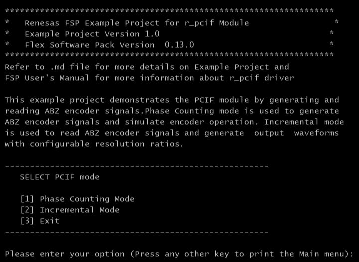
* **The terminal displays phase-counting operation:**

  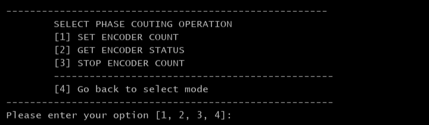
* **The terminal displays the encoder count setting in phase-counting mode:**

  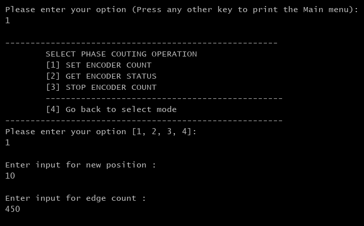
* **The terminal displays the pcif status in phase-counting mode:**

  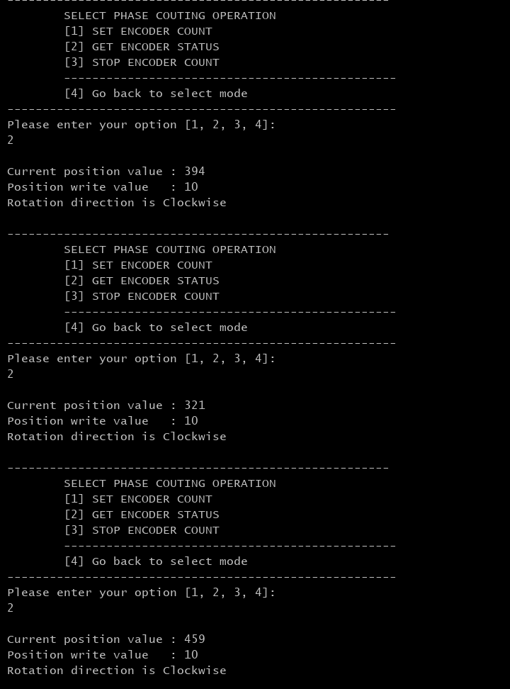
* **Using the oscilloscope to measure PCIF waveform**

  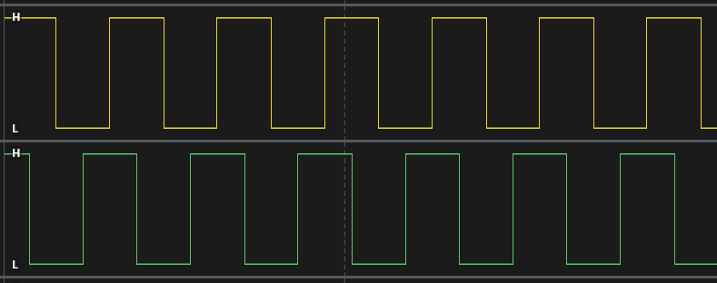
* **The terminal displays the encoder count stopping in phase-counting mode:**

  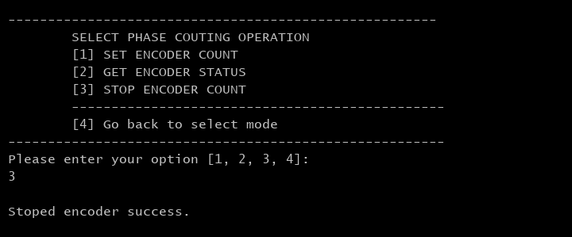
* **The terminal displays incremental mode operation:**

  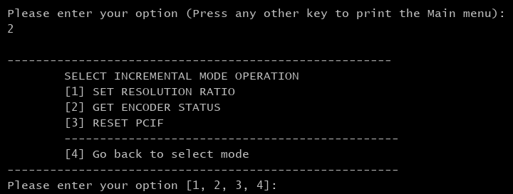
* **The terminal displays the resolution ratio setting in incremental mode:**

  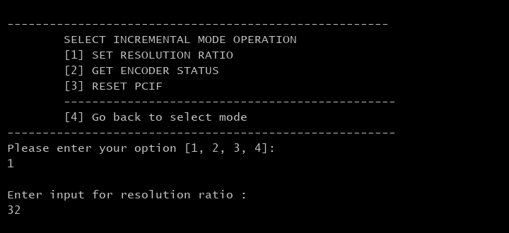
* **The terminal displays the pcif status in incremental mode:**

  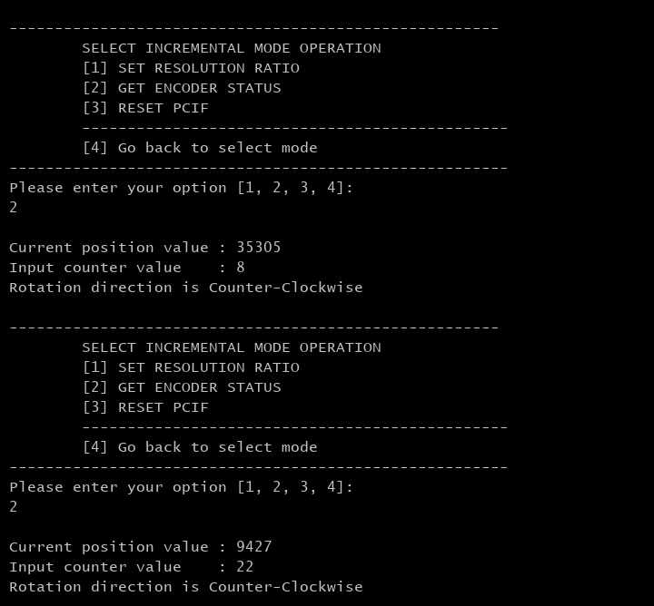
* **Using the oscilloscope to measure PCIF waveform**

  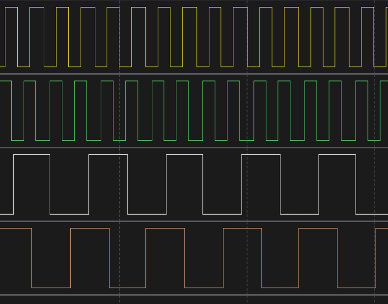
* **The terminal displays the pcif reseting in incremental mode:**

  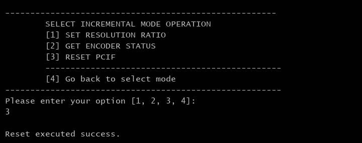
* **Exit the demo:**

  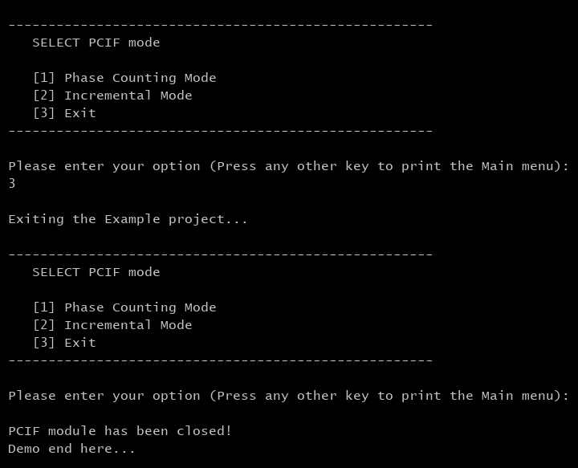

## Special Topics

### Debugger Setting

* To use E2 Lite on-board or E2 Emulator Lite, please follow the instructions below:

1. **Common step**: Click [**Run**] → [**Debug Configurations…**] to open the “**Debug Configurations**” window.  
  

2. **Select file application**  
  a. **Used for projects built with GCC**: --> Select file **.elf**.  
    
  b. **Used for projects built with CCRX**: --> Select file **.x**.  
  

3. **Setting debugger configurations**  
  a. **Used for E2 Lite on-board**.    
  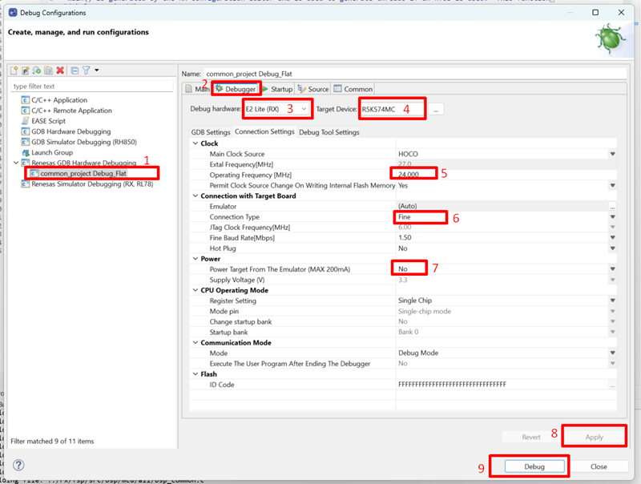  
  b. **Used for external E2 Emulator Lite**.  
    

**Note:** Connect the RX board debugger port (J9) to the host PC via E2 Emulator Lite (With USB cable and 20-20 pin cable).

### Adding lowsrc Folder

Before changing terminal application settings, you need to add the `lowsrc` folder from another Example Project:

1. **Locate the lowsrc folder:**
   
   - Navigate to Example Project `sci_uart`  (`example_projects/<board>/sci_uart/e2studio/gccrx_sci_uart_<board>_ep/src`)
   - Find the `lowsrc` folder containing low-level source files
2. **Copy `lowsrc` folder to this Example Project:**
   
   - Copy the entire `lowsrc` folder
   - Paste it into this Example project directory: `example_projects/ek_rx74m/<EP>/e2studio/`
3. **Add lowsrc to e2studio project:**
   
   - In e2studio, right-click on the project in Project Explorer
   - Select **Refresh** (or press F5) to detect the new folder
4. **Verify the folder is included:**
   
   - Expand the project tree in Project Explorer
   - Confirm that `lowsrc` folder and its contents are visible
   - The folder should be included in the build path with source files ready to compile

**Note:** To use Debug Virtual Console, the `lowsrc` folder must be added to the project, as it contains the source files required for Debug Virtual Console operation.

### Changing Terminal Application

By default, the EP supports Serial Terminal for RX boards that support USB Serial COM.

**For use CCRX Compiler:**

* Define USE_VIRTUAL_COM=1 macro in Project Properties -> C/C++ Build -> Settings -> Tool Settings -> Compiler -> Source -> Macro definition (-define)

To use Debug Virtual Console, please follow the instructions below:

* Define USE_VIRTUAL_COM=0 macro in Project Properties -> C/C++ Build -> Settings -> Tool Settings -> Compiler -> Source -> Macro definition (-define)
* Define BSP_CFG_IO_LIB_ENABLE=1 macro in Project Properties -> C/C++ Build -> Settings -> Tool Settings -> Compiler -> Source -> Macro definition (-define)

**For use GCCRX Compiler:**

* Define USE_VIRTUAL_COM=1 macro in Project Properties -> C/C++ Build -> Settings -> Tool Settings -> Compiler -> Includes -> Macro Defines (-D)

To use Debug Virtual Console, please follow the instructions below:

* Define USE_VIRTUAL_COM=0 macro in Project Properties -> C/C++ Build -> Settings -> Tool Settings -> Compiler -> Includes -> Macro Defines (-D)
  

