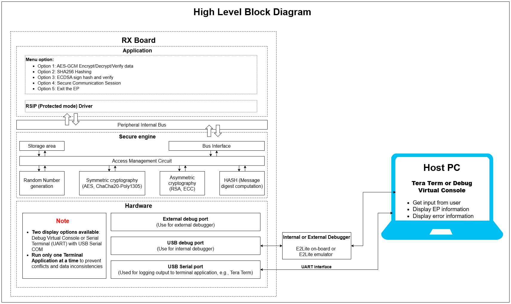
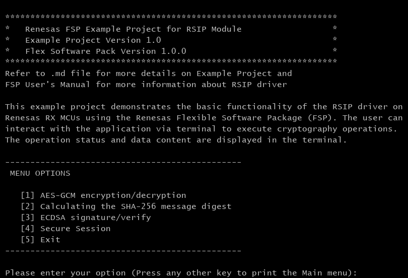
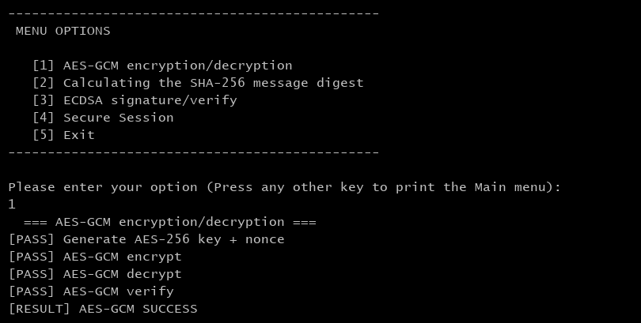
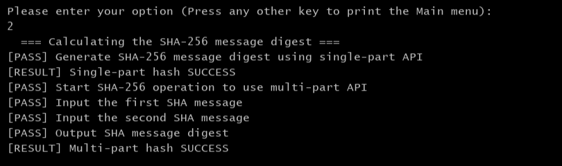
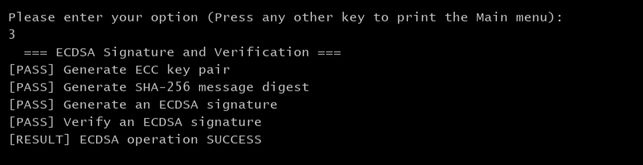
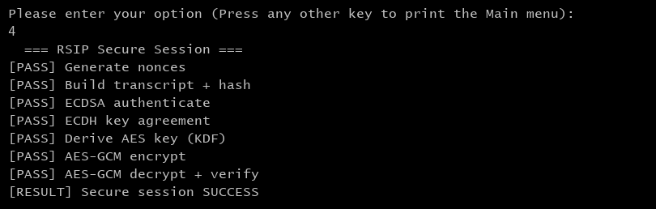
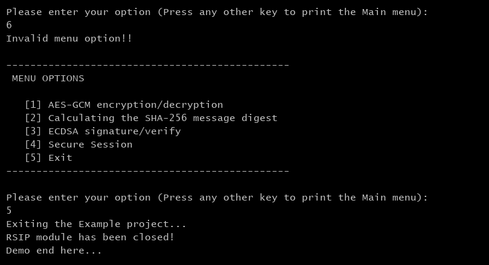

# Introduction #

The project demonstrates the basic functionality of RSIP (Renesas Secure IP) Protected Mode on Renesas RX MCUs using the RSIP Protected API. All cryptographic operations are executed through the RSIP hardware engine, ensuring that sensitive key material remains in wrapped format and is never exposed in plaintext. The example showcases four distinct use cases executed sequentially on a single MCU, simulating secure cryptographic operations and communication workflows.

For AES-GCM (Authenticated Encryption with Associated Data), the MCU generates a wrapped AES-256 key and nonce using RSIP, then encrypts plaintext to produce ciphertext and an authentication tag. The same key and nonce are used to decrypt the data and verify the tag, demonstrating both confidentiality and integrity.

For SHA-256 Hash Calculation, the MCU computes message digests using both single-part (one-shot) and multi-part (streaming) APIs. The resulting hashes are compared with a reference value to verify correctness and demonstrate consistency between both approaches.

For ECDSA (Digital Signature Algorithm), the MCU generates an ECC key pair, hashes a message using SHA-256, and signs the hash with the private key. The corresponding public key is used to verify the signature, ensuring message authenticity and integrity.

For RSIP Secure Session Establishment, the MCU simulates a secure handshake by generating nonces, building a transcript, authenticating it using ECDSA, and deriving a shared secret using ECDH. A session key is then derived using a HMAC-based KDF and used with AES-GCM to securely encrypt and decrypt application data, demonstrating secure key exchange and communication.

The project leverages RSIP’s built-in Hardware Unique Key (HUK) as the root of trust for secure key protection. All user keys are handled in wrapped format, where the HUK is used internally by RSIP to securely wrap and protect key material. As a result, raw keys are never exposed or stored in plaintext in either RAM or MRAM.

In addition, the example demonstrates RSIP’s key management mechanism, where user keys can be securely stored and reused in wrapped form. Keys wrapped with the HUK are device-specific and can only be used within the same RSIP instance. Even if a wrapped key is leaked, it cannot be unwrapped or exploited on a different MCU, ensuring strong protection against key extraction and device cloning.

**Note**: 
- To display information, the user can select between Debug Virtual Console and the Serial Terminal (UART) with USB Serial COM. It is important to note that the user should only operate a single terminal application at a time to avoid conflicts or data inconsistencies. For instructions on how to switch between these options, please refer to the section [`Special Topics`](#special-topics)/[`Changing Terminal Application`](#changing-terminal-application).

- By default, EP information is printed to the host PC using the Serial Terminal (UART) for boards that support USB Serial COM. LED3 is turned ON to indicate the UART initialized unsuccessfully.

- RX boards that support USB Serial COM: EK-RX74M, EK-RX74N. 

## Required Resources ##

To build and run the Ethernet example project, the following resources are needed.

### Software ###

* Renesas Flexible Software Package (FSP): Version 1.0.0.
* e2 studio: Version 2026-07.
* Renesas GCC Compiler for RX: Version 14.2.0.202607.
* Renesas CC-RX Compiler: Version v3.08.00.
* Terminal Console Application: Tera Term or a similar application.

### Hardware ###
Supported RX boards: EK-RX74M, EK-RX74N.

* 1 x Renesas RX board.
* 2 x Type-C USB cable for programming and debugging.

### Hardware Connections ###

- Connect the RX board USB debug port (J8) to the PC via a Type-C USB cable for EP debugging (If E2 Lite on-board is used).
- Connect the RX board USB Serial port (J27) to the PC using a Type-C USB cable to verify logs through the Terminal Application.

## Related Collateral References ##
The following documents can be referred to for enhancing your understanding of the operation of this example project:
- [FSP User Manual on GitHub (Reference link)](https://renesas.github.io/fsp/)
- [FSP Known Issues (Reference link)](https://github.com/renesas/fsp/issues)

# Project Notes #

## System Level Block Diagram ##

## FSP Modules Used ##
List all the various modules that are used in this example project. Refer to the FSP User Manual for further details on each module listed below.

| Module Name | Usage | Searchable Keyword  |
|-------------|-------|---------------------|
| RSIP Protected Mode| This stack implements APIs to securely perform cryptographic operations within hardware without exposing key material to software. | RSIP |

 

## Module Configuration Notes ##
This section describes FSP Configurator properties which are important or different than those selected by default.

**Configuration Properties for BSP** `configuration.xml > BSP > Properties > Settings > Property`

|   Module Property Path and Identifier   |   Default Value   |   Used Value   |   Reason   |
| --------------------------------------- | ----------------- | -------------- | ---------- |
|   RX Common > Main Stack size (bytes)  |  0x400   | 0x400  |  Main Stack size is required for standard library functions to be used. |
|   RX Common > Heap size (bytes)  |  0   | 0x400  |  Heap size is required for standard library functions to be used. |

 

**Configuration Properties for RSIP Protected Mode** `configuration.xml > Stack > HAL/Common > g_rsip RSIP Protected Mode (r_rsip_protected) > Properties > Settings > Property`  
  **Note**: The algorithms listed below are required for this EP, while the remaining algorithms can be disabled to optimize code size.

|   Module Property Path and Identifier   |   Default Value   |   Used Value   |   Reason   |
|-----------------------------------------|-------------------|----------------|------------|
|  Common > Selection of algorithms to enable > AES-256 | Enable | Enable | Enable support for AES-256 algorithm. |
|  Common > Selection of algorithms to enable > AES-GCM | Enable | Enable | Enable support for AES-GCM algorithm. |
|  Common > Selection of algorithms to enable > ECC SECP256R1 | Enable | Enable | Enable support for ECC SECP256R1 algorithm. |
|  Common > Selection of algorithms to enable > SHA-256 | Enable | Enable | Enable support for SHA-256 algorithm. |
|  Common > Selection of algorithms to enable > HMAC-SHA256 | Enable | Enable | Enable support for HMAC-SHA256 algorithm. |
|  Common > Selection of algorithms to enable > SHA-512 | Enable | Enable | Enable support for SHA-512 algorithm. |

 

## API Usage ##

The table below lists the APIs used at the application layer by this example project.

| API Name    | Usage                                                                          |
|-------------|--------------------------------------------------------------------------------|
| R_RSIP_Open | This API enables use of Renesas Secure IP functionality. |
| R_RSIP_Close | This API disables use of Renesas Secure IP functionality |
| R_RSIP_KeyGenerate | This API generates a wrapped symmetric key from a random number. |
| R_RSIP_KeyPairGenerate | This API generates a wrapped asymmetric key pair from a random number. |
| R_RSIP_RandomNumberGenerate | This API generates a 128-bit random number.|
| R_RSIP_AES_AEAD_Init | This API starts AES AEAD function. |
| R_RSIP_AES_AEAD_AADUpdate | This API inputs Additional Authentication Data. |
| R_RSIP_AES_AEAD_Update | This API encrypts plaintext or decrypts ciphertext.|
| R_RSIP_AES_AEAD_Finish | This API finalizes an AES AEAD encryption. |
| R_RSIP_AES_AEAD_Verify | This API finalizes an AES AEAD decryption. |
| R_RSIP_SHA_Compute | This API generates SHA message digest. |
| R_RSIP_SHA_Init | This API starts SHA operation. |
| R_RSIP_SHA_Update | This API inputs SHA message. |
| R_RSIP_SHA_Finish | This API outputs SHA message digest. |
| R_RSIP_ECDSA_Sign | This API generates an ECDSA signature. |
| R_RSIP_ECDSA_Verify | This API verifies an ECDSA signature. |
| R_RSIP_ECDH_KeyAgree | This API computes ECDH secret with wrapped private key and wrapped public key. |
| R_RSIP_KDF_HMAC_Init | This API prepares a HMAC generation. |
| R_RSIP_KDF_HMAC_ECDHSecretKeyImport | This API converts wrapped ECDH secret to wrapped HMAC key for KDF. |
| R_RSIP_KDF_DerivedKeyImport | This API outputs a wrapped key from KDF output. |
| R_RSIP_KDF_HMAC_Update | This API input message into KDF. |
| R_RSIP_KDF_HMAC_SignFinish | This API finalizes a HMAC generation. |

 

## Verifying Operation ##
1. Import the example project.
2. Generate, and build the example project.
3. Before running the example project, make sure hardware connections are completed.
4. Connect the RX MCU to the host PC via E2 Lite on-board.
By default, EP will use the on-board E2 Lite.
5. Open a terminal application (e.g., Tera Term or Debug Virtual Console) on the host PC and connect to the RX board’s USB Serial port.  
   * Note: For using the Serial Terminal application:
        * To echo back typed content in Tera Term, go to [Setup] -> [Terminal...] and check [Local echo].
        * The configuration parameters of the serial port are:
            - COM port: Provided by the USB Serial COM.
            - Baud rate: 115200 bps
            - Data length: 8 bits
            - Parity: None
            - Stop bit: 1 bit
            - Flow control: None 

### The below images showcase the output on the Terminal Application (Tera Term) ### 
  * The terminal displays the EP information:

    

  * The terminal displays the AES-GCM operation:

    

  * The terminal displays the SHA-256 operation:

    

  * The terminal displays the ECDSA operation:

    

  * The terminal displays the Secure session operation:

    

  * Exit the demo:
  
    

## Special Topics ##

### Debugger Setting ###

* To use E2 Lite on-board or E2 Emulator Lite, please follow the instructions below:

1. **Common step**: Click [**Run**] → [**Debug Configurations…**] to open the “**Debug Configurations**” window.  
  

2. **Select file application**  
  a. **Used for projects built with GCC**: --> Select file **.elf**.  
    
  b. **Used for projects built with CCRX**: --> Select file **.x**.  
  

3. **Setting debugger configurations**  
  a. **Used for E2 Lite on-board**.    
    
  b. **Used for external E2 Emulator Lite**.  
    

  **Note:** Connect the RX board debugger port (J9) to the host PC via E2 Emulator Lite (With USB cable and 20-20 pin cable).

### Adding lowsrc Folder

Before changing terminal application settings, you need to add the `lowsrc` folder from another Example Project:

1. **Locate the lowsrc folder:**
   
   - Navigate to Example Project `sci_uart` or `usb_pcdc_with_freertos`  (`example_projects/<board>/sci_uart/e2studio/gccrx_sci_uart_<board>_ep/src`)
   - Find the `lowsrc` folder containing low-level source files.

2. **Copy `lowsrc` folder to this Example Project:**
   
   - Copy the entire `lowsrc` folder.
   - Paste it into this your target Example Project directory: `example_projects/ek_rx74n/<EP>/e2studio/`.

3. **Add lowsrc to e2studio project:**
   
   - In e2studio, right-click on the project in Project Explorer.
   - Select **Refresh** (or press F5) to detect the new folder.

4. **Verify the folder is included:**
   
   - Expand the project tree in Project Explorer.
   - Confirm that `lowsrc` folder and its contents are visible.
   - The folder should be included in the build path with source files ready to compile.

5. **Changing the terminal Application to use the Debug Virtual Console:**
   
   - For instructions on how to switch between these options, please refer to the section [`Special Topics`](#special-topics)/[`Changing Terminal Application`](#changing-terminal-application).

6. **Re-build the project:**
   
   - In e2studio, right-click on the project and select **Build Project**.

**Note:** To use Debug Virtual Console, the `lowsrc` folder must be added to the project, as it contains the source files required for Debug Virtual Console operation.

### Changing Terminal Application ###
By default, the EP supports Serial Terminal for RX boards that support USB Serial COM   
**For use CCRX Compiler:**
* Define USE_VIRTUAL_COM=1 macro in Project Properties -> C/C++ Build -> Settings -> Tool Settings -> Compiler -> Source -> Macro definition (-define)

To use Debug Virtual Console, please follow the instructions below:
* Define USE_VIRTUAL_COM=0 macro in Project Properties -> C/C++ Build -> Settings -> Tool Settings -> Compiler -> Source -> Macro definition (-define)
* Define BSP_CFG_IO_LIB_ENABLE=1 macro in Project Properties -> C/C++ Build -> Settings -> Tool Settings -> Compiler -> Source -> Macro definition (-define)

**For use GCCRX Compiler:**  
* Define USE_VIRTUAL_COM=1 macro in Project Properties -> C/C++ Build -> Settings -> Tool Settings -> Compiler -> Includes -> Macro Defines (-D)
  
To use Debug Virtual Console, please follow the instructions below:
* Define USE_VIRTUAL_COM=0 macro in Project Properties -> C/C++ Build -> Settings -> Tool Settings -> Compiler -> Includes -> Macro Defines (-D)
