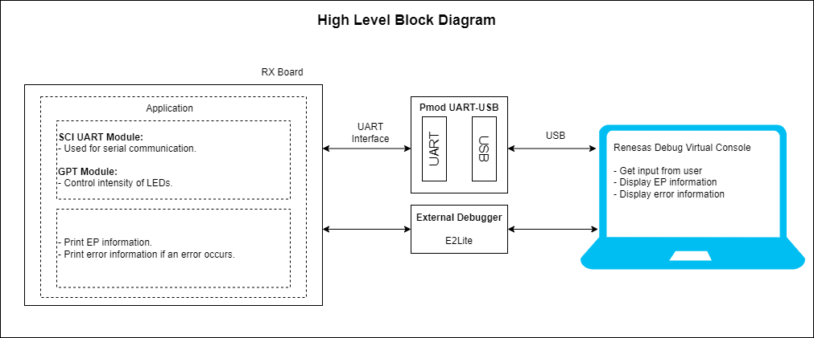
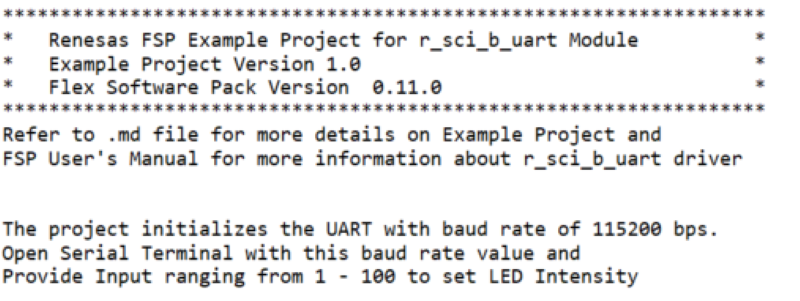
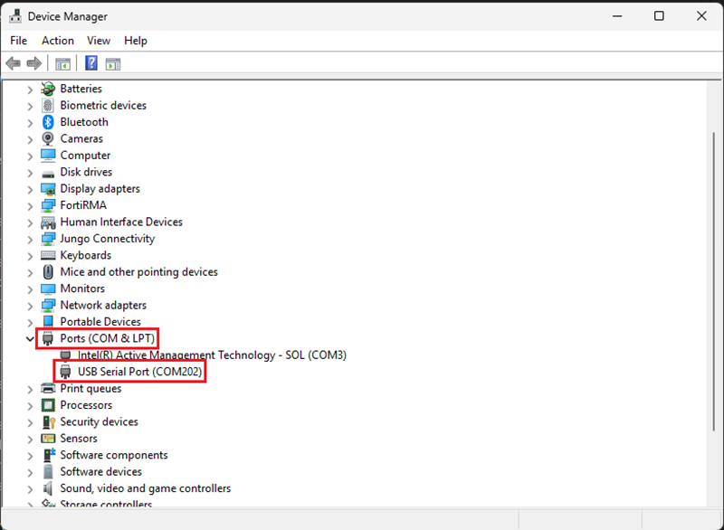
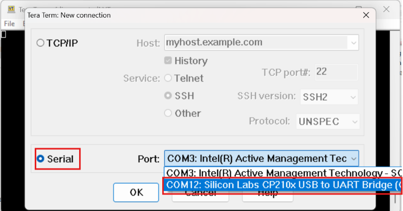
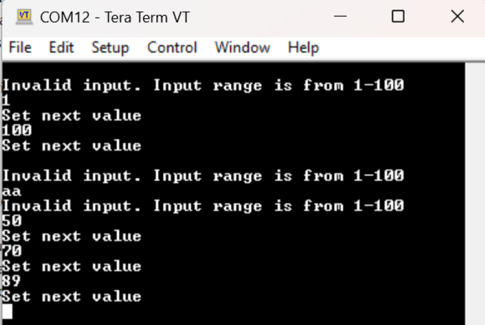
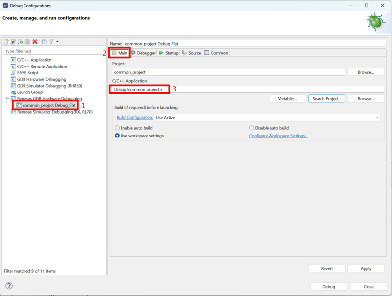

# Introduction

The example project demonstrates the typical use of the UART HAL module APIs. The project initializes the UART with a baud rate of 115200 bps and GPT in PWM mode. Using a terminal program (like Tera Term), the user can provide a value and press the enter key to set the intensity of the on-board LED. The range of input values is displayed on the Debug Virtual Console. Any failure will also be displayed using the Debug Virtual Console. To see the user input values on the serial terminal, enable the local echo option.

## Required Resources

To build and run the SCI UART example project, the following resources are needed.

### Software

* Renesas Flexible Software Package (FSP): Version 1.0.0.
* e2 studio: Version 2026-07.
* Renesas GCC Compiler for RX: Version 14.2.0.202607.
* Renesas CC-RX Compiler: Version v3.08.00.
* Terminal Console Application: Tera Term or a similar application.

### Hardware

Supported RX boards: EK-RX74M, EK-RX74N.

* 1 x Renesas RX board.
* 1 x Type-C USB cable.
* 1 x USB to UART Converter (e.g., Pmod USBUART: https://digilent.com/shop/pmod-usbuart-usb-to-uart-interface/).
* 1 x Micro USB cable used to connect the Pmod USBUART to the Host PC.
* 3 x Female-to-female jumper wires.

### Hardware Connections

- Connect the RX board USB debug port (J8) to the PC via a Type-C USB cable for EP debugging.
- Connect the Pmod USBUART to the host PC via a Micro USB cable.
- For Pmod USBUART: Jumper JP1 placement is on LCL-VCC pins (The attached system board is powered independently from the PMOD USBUART).
- Connect the Pmod USBUART to the RX board as shown below:
  
  For EK-RX74M:
  
  ```
  RXD MISO P005 (J2:22)	---> TXD Pin of Pmod USBUART (J2:3)
  
  TXD MOSI P004 (J2:21) 	---> RXD Pin of Pmod USBUART (J2:2)
  
  Common GND
  ```
  
  For EK-RX74N:
  
  ```
  RXD MISO P005 (J1:39)	---> TXD Pin of Pmod USBUART (J2:3)
  
  TXD MOSI P004 (J1:42) 	---> RXD Pin of Pmod USBUART (J2:2)
  
  Common GND
  ```

## Related Collateral References

The following documents can be referred to for enhancing your understanding of the operation of this example project:

- [FSP User Manual on GitHub (Reference link)](https://renesas.github.io/fsp/)
- [FSP Known Issues (Reference link)](https://github.com/renesas/fsp/issues)

# Project Notes

## System Level Block Diagram



## FSP Modules Used

List all the various modules that are used in this example project. Refer to the FSP User Manual for further details on each module listed below.

| Module Name | Usage  | Searchable Keyword (using New Stack > Search) |
|-------------|-----------------------------------------------|-----------------------------------------------|
| SCI UART | SCI UART is used for serial communication. | r_sci_b_uart |
| GPT | GPT is used to control the intensity of LEDs. | r_gpt |

## Module Configuration Notes

This section describes FSP Configurator properties which are important or different than those selected by default.

**Common Configuration Properties**

|   Module Property Path and Identifier   |   Default Value   |   Used Value   |   Reason   |
| :-------------------------------------: | :---------------: | :------------: | :--------: |
|   configuration.xml > BSP > Properties > Settings > Property > RX Common > Heap size (bytes)  |  0   | 0x400  |  Heap size is required for standard library functions to be used. |

**UART Configuration Properties (g_uart)**

|   Module Property Path and Identifier   |   Default Value   |   Used Value   |   Reason   |
| :-------------------------------------: | :---------------: | :------------: | :--------: |
|  configuration.xml > Stacks > g_uart UART (r_sci_b_uart) > Properties > Settings > Property > Module g_uart  UART (r_sci_b_uart) > General > Name | g_uart0 | g_uart | Specifies the name of the UART module. |
|  configuration.xml > Stacks > g_uart UART (r_sci_b_uart) > Properties > Settings > Property > Module g_uart  UART (r_sci_b_uart) > Baud > Baud Rate Modulation | Disabled | Enabled | Enables baud rate modulation for UART communication. |
|  configuration.xml > Stacks > g_uart UART (r_sci_b_uart) > Properties > Settings > Property > Module g_uart  UART (r_sci_b_uart) > Interrupts > Callback | NULL | user_uart_callback | Specifies the callback function to be called on UART events. |
|  configuration.xml > Stacks > g_uart UART (r_sci_b_uart) > Properties > Settings > Property > Module g_uart  UART (r_sci_b_uart) > Interrupts > Receive Interrupt Priority | Priority 2 | Priority 12 | Sets the priority for the receive interrupt. |
|  configuration.xml > Stacks > g_uart UART (r_sci_b_uart) > Properties > Settings > Property > Module g_uart  UART (r_sci_b_uart) > Interrupts > Transmit Data Empty Interrupt Priority | Priority 2 | Priority 12 | Sets the priority for the transmit data empty interrupt. |
|  configuration.xml > Stacks > g_uart UART (r_sci_b_uart) > Properties > Settings > Property > Module g_uart  UART (r_sci_b_uart) > Interrupts > Transmit End Interrupt Priority | Priority 2 | Priority 12 | Sets the priority for the transmit end interrupt. |
|  configuration.xml > Stacks > g_uart UART (r_sci_b_uart) > Properties > Settings > Property > Module g_uart  UART (r_sci_b_uart) > Interrupts > Error Interrupt Priority | Priority 2 | Priority 12 | Sets the priority for the error interrupt. |
|  configuration.xml > Stacks > g_uart UART (r_sci_b_uart) > Properties > Settings > Property > Pins > RXD0 | None | P005 | Specifies the pin used for receiving data. |
|  configuration.xml > Stacks > g_uart UART (r_sci_b_uart) > Properties > Settings > Property > Pins > TXD0 | None | P004 | Specifies the pin used for transmitting data. |

**GPT Configuration Properties (g_timer)**

|   Module Property Path and Identifier   |   Default Value   |   Used Value   |   Reason   |
| :-------------------------------------: | :---------------: | :------------: | :--------: |
|  configuration.xml > Stacks > g_timer Timer, General PWM (r_gpt) > Properties > Settings > Property > Common > Pin Output Support | Disabled | Enabled | Enables outputting PWM waveforms on GTIOCx pins. |
| configuration.xml > Stacks > g_timer Timer, General PWM (r_gpt) > Properties > Settings > Property > Module g_timer Timer, General PWM (r_gpt) > General > Name | g_timer0 | g_timer | Specifies the name of the GPT module. |
|  configuration.xml > Stacks > g_timer Timer, General PWM (r_gpt) > Properties > Settings > Property > Module g_timer Timer, General PWM (r_gpt) > General > Period | 0x10000 | 0x1000 | Specifies the timer period in units. |
|  configuration.xml > Stacks > g_timer Timer, General PWM (r_gpt) > Properties > Settings > Property > Module g_timer Timer, General PWM (r_gpt) > General > Mode | Periodic | Saw-wave PWM | Selects mode for GPT module. |
|  configuration.xml > Stacks > g_timer Timer, General PWM (r_gpt) > Properties > Settings > Property > Module g_timer Timer, General PWM (r_gpt) > General > Period Unit | Raw Counts | Raw Counts | Unit of the period specified. |
|  configuration.xml > Stacks > g_timer Timer, General PWM (r_gpt) > Properties > Settings > Property > Module g_timer Timer, General PWM (r_gpt) > Output > GTIOCB Output Enabled | False | True | Enables GTIOCB output for PWM. |
|  configuration.xml > Stacks > g_timer Timer, General PWM (r_gpt) > Properties > Settings > Property > Pins > GTIOC8B | None | PF05 | Specifies the pin for using the GPT module. |

## API Usage

The table below lists the APIs used at the application layer by this example project.

| API Name    | Usage                                                                          |
|-------------|--------------------------------------------------------------------------------|
| R_SCI_B_UART_Open | This API is used to open an UART instance. |                           |
| R_SCI_B_UART_Write | This API is used to write data to the UART instance. |
| R_SCI_B_UART_Close | This API is used to close the UART instance. |
| R_GPT_Open | This API is used to open a GPT instance. |
| R_GPT_Start | This API is used to start the GPT timer. |
| R_GPT_InfoGet | This API is used to get the current period setting. |
| R_GPT_DutyCycleSet | This API is used to set the duty cycle on the requested pin. |
| R_GPT_Close | This API is used to close the GPT instance. |

## Verifying Operation

Import, build and debug the EP (see section Starting Development of FSP User Manual). After running the EP, open any serial terminal (preferably Tera Term) to provide user input and view the echoed data.

The image below shows the SCI UART output on Debug Virtual Console:



**Note:**

For Serial terminal application:

1) Select the COM port in Tera Term:
   
   - On the host PC, open the Device Manager > Expand Ports (COM & LPT) > Locate USB Serial Device (COMxx) and note down the COM port number for reference in the next steps.
   
   

- Open the serial port of the device using Tera Term and press "OK".
  
  

2) To echo back what was typed in Tera Term, the user needs to enable it through [Setup] -> [Terminal...] -> Check [Local echo].
3) The configuration parameters for the serial terminal should be set as follows:
   
   - Baud rate: 115200 bps
   - Data length: 8-bits
   - Parity: none
   - Stop bit: 1-bit
   - Flow control: none

> **Note:** Press **Enter** in Tera Term after connecting to display this log.

```
The sample output on **Serial Terminal**: 


```

## Special Topics

### Debugger Setting

* To use E2 Lite on-board or E2 Emulator Lite, please follow the instructions below:

1. **Common step**: Click [**Run**] → [**Debug Configurations…**] to open the “**Debug Configurations**” window.
   
2. **Select file application**
   a. **Used for projects built with GCC**: --> Select file **.elf**.
   
   b. **Used for projects built with CCRX**: --> Select file **.x**.
   
3. **Setting debugger configurations**
   a. **Used for E2 Lite on-board**.
   
   b. **Used for external E2 Emulator Lite**.
   

**Note:** Connect the RX board debugger port (J9) to the host PC via E2 Emulator Lite (with USB cable and 20-20 pin cable).

