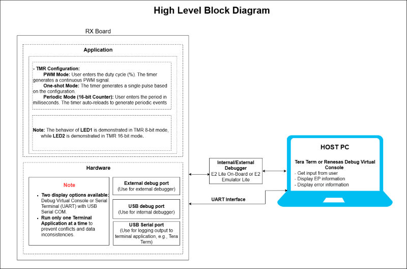
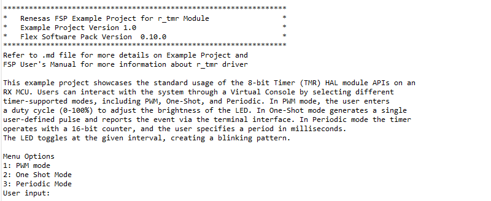
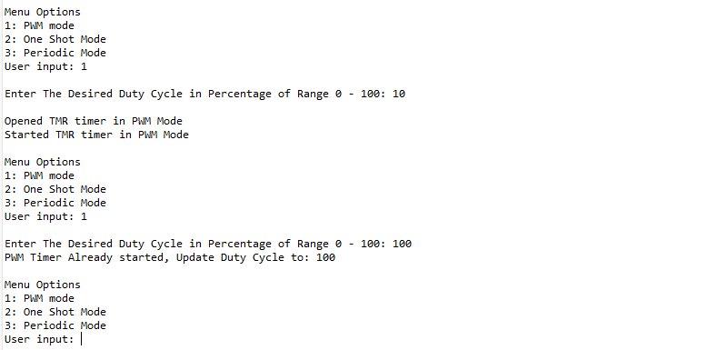
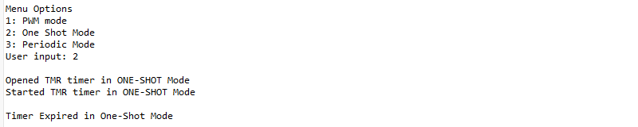
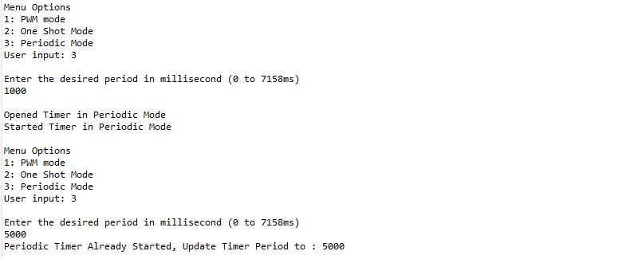

# Introduction

This example project showcases the standard usage of the 8-bit Timer (TMR) HAL module APIs on an RX MCU. Users can interact with the system through a Virtual Console by selecting different timer-supported modes, including PWM, One-Shot, and Periodic.  
In PWM mode, the user enters a duty cycle (0–100%) to adjust the brightness of the LED.     
In One-Shot mode, the timer generates a single pulse based on the configured settings, and the event is logged in the terminal.     
In Periodic mode, the timer operates with a 16-bit counter, and the user specifies a period in milliseconds. The LED toggles at the given interval, creating a blinking pattern.

**Note**: 
- To display information, the user can select between Debug Virtual Console and the Serial Terminal (UART) with USB Serial COM. It is important to note that the user should only operate a single terminal application at a time to avoid conflicts or data inconsistencies. For instructions on how to switch between these options, please refer to the section [`Special Topics`](#special-topics)/[`Changing Terminal Application`](#changing-terminal-application).

- By default, EP information is printed to the host PC using the Serial Terminal (UART) for boards that support USB Serial COM. LED3 is turned ON to indicate the UART initialized unsuccessfully.

- RX boards that support USB Serial COM: EK-RX74M, EK-RX74N. 

## Required Resources
To build and run the TMR example project, the following resources are needed.

### Software

* Renesas Flexible Software Package (FSP): Version 1.0.0.
* e2 studio: Version 2026-07.
* Renesas GCC Compiler for RX: Version 14.2.0.202607.
* Renesas CC-RX Compiler: Version v3.08.00.
* Terminal Console Application: Tera Term or a similar application.

### Hardware
Supported RX boards: EK-RX74M, EK-RX74N.

* 1 x Renesas RX board.
* 2 x Type-C USB cables for programming and debugging.
* 2 x Jumper wires used to connect.

### Hardware Connection

* Connect the RX board USB debug port (J8) to the PC via a Type-C USB cable for EP debugging (If E2 Lite on-board is used).

* Connect the RX board USB SERIAL port (J27) to the PC using a Type-C USB cable to verify logs through the terminal console.

For EK-RX74M:
  * Connect P202 (J14:3) to P807 (J3:18).
  * Connect P103 (J2:6) to PF05 (J2:36).

**Note**: Pin P202 requires jumper E50 to be closed on the board. 

For EK-RX74N:
  * Connect P202 (J2:4) to P807 (J2:15).
  * Connect P103 (J2:29) to PF05 (J1:51).  

## Related Collateral References
The following documents can be referred to for enhancing your understanding of the operation of this example project:
- [FSP User Manual on GitHub (Reference link)](https://renesas.github.io/fsp/)
- [FSP Known Issues (Reference link)](https://github.com/renesas/fsp/issues)

# Project Notes
## System Level Block Diagram 

## FSP Modules Used
List all the various modules that are used in this example project. Refer to the FSP User Manual for further details on each module listed below.

| Module Name | Usage  | Searchable Keyword (using New Stack > Search) |
| :---------: | :---------------: | :------------: |
| TMR | This module is used as a Timer to generate periodic events, delays, or PWM signals for controlling peripherals (e.g., LED). | r_tmr |

## Module Configuration Notes
This section describes FSP Configurator properties that are important or different from those selected by default. 

**Common Configuration Properties**

|   Module Property Path and Identifier   |   Default Value   |   Used Value   |   Reason   |
| :-------------------------------------: | :---------------: | :------------: | :--------: |
|   configuration.xml > BSP > Properties > Settings > Property > RX Common > Heap size (bytes) |  0  | 0x400 | Change heap size to accommodate functions usage in the EP and avoid any runtime errors. |

**Common Configuration Properties (g_pwm_timer)**

|   Module Property Path and Identifier   |   Default Value   |   Used Value   |   Reason   |
| :-------------------------------------: | :---------------: | :------------: | :--------: |
|   configuration.xml > Stacks > Properties > g_pwm_timer Timer, 8-bit timer (r_tmr) > Settings > Property > common > Pin Output Support	 | Disabled | Enabled | Waveform output to pin is included only if enabled in the build.  |
|   configuration.xml > Stacks > Properties > g_pwm_timer Timer, 8-bit timer (r_tmr) > Settings > Property > Module g_pwm_timer Timer, 8-bit timer (r_tmr) > General > Channel | 0 | 3 | Select hardware channel. |
|   configuration.xml > Stacks > Properties > g_pwm_timer Timer, 8-bit timer (r_tmr) > Settings > Property > Module g_pwm_timer Timer, 8-bit timer (r_tmr) > General > Counter Size | 8-bit Counter | 8-bit Counter | Counter size register bit width (8-bit or 16-bit). |
|   configuration.xml > Stacks > Properties > g_pwm_timer Timer, 8-bit timer (r_tmr) > Settings > Property > Module g_pwm_timer Timer, 8-bit timer (r_tmr) > General > Mode | Periodic | PWM | Mode selection.  |
|   configuration.xml > Stacks > Properties > g_pwm_timer Timer, 8-bit timer (r_tmr) > Settings > Property > Module g_pwm_timer Timer, 8-bit timer (r_tmr) > General > Period | 0x100 | 0xff | Specify the timer period based on the selected unit. |
|   configuration.xml > Stacks > Properties > g_pwm_timer Timer, 8-bit timer (r_tmr) > Settings > Property > Module g_pwm_timer Timer, 8-bit timer (r_tmr) > General > Period Unit | Raw Counts | Raw Counts | Unit of the period specified above. |

**Common Configuration Properties (g_one_shot_timer)**

|   Module Property Path and Identifier   |   Default Value   |   Used Value   |   Reason   |
| :-------------------------------------: | :---------------: | :------------: | :--------: |
|   configuration.xml > Stacks > Properties > g_one_shot_timer Timer, 8-bit timer (r_tmr) > Settings > Property > Module g_one_shot_timer Timer, 8-bit timer (r_tmr) > General > Channel | 0 | 3 | Select hardware channel. |
|   configuration.xml > Stacks > Properties > g_one_shot_timer Timer, 8-bit timer (r_tmr) > Settings > Property > Module g_one_shot_timer Timer, 8-bit timer (r_tmr) > General > Counter Size | 8-bit Counter | 8-bit Counter | Counter size register bit width (8-bit or 16-bit). |
|   configuration.xml > Stacks > Properties > g_one_shot_timer Timer, 8-bit timer (r_tmr) > Settings > Property > Module g_one_shot_timer Timer, 8-bit timer (r_tmr) > General > Mode | Periodic | One-Shot | Mode selection.  |
|   configuration.xml > Stacks > Properties > g_one_shot_timer Timer, 8-bit timer (r_tmr) > Settings > Property > Module g_one_shot_timer Timer, 8-bit timer (r_tmr) > General > Period | 0x100 | 0xff | Specify the timer period based on the selected unit. |
|   configuration.xml > Stacks > Properties > g_one_shot_timer Timer, 8-bit timer (r_tmr) > Settings > Property > Module g_one_shot_timer Timer, 8-bit timer (r_tmr) > General > Period Unit | Raw Counts | Raw Counts | Unit of the period specified above. |
|   configuration.xml > Stacks > Properties > g_one_shot_timer Timer, 8-bit timer (r_tmr) > Settings > Property > Module g_one_shot_timer Timer, 8-bit timer (r_tmr) > Interrupts > Callback | NULL | one_shot_callback | Assigned name for using callback function. |
|   configuration.xml > Stacks > Properties > g_one_shot_timer Timer, 8-bit timer (r_tmr) > Settings > Property > Module g_one_shot_timer Timer, 8-bit timer (r_tmr) > Interrupts > Overflow Interrupt Priority	| Disabled | Priority 15  | Select the overflow interrupt priority. |

**Common Configuration Properties (g_periodic_timer)**

|   Module Property Path and Identifier   |   Default Value   |   Used Value   |   Reason   |
| :-------------------------------------: | :---------------: | :------------: | :--------: |
|   configuration.xml > Stacks > Properties > g_periodic_timer Timer, 8-bit timer (r_tmr) > Settings > Property > Module g_periodic_timer Timer, 8-bit timer (r_tmr) > General > Channel | 0 | 0 | Select hardware channel. |
|   configuration.xml > Stacks > Properties > g_periodic_timer Timer, 8-bit timer (r_tmr) > Settings > Property > Module g_periodic_timer Timer, 8-bit timer (r_tmr) > General > Counter Size | 8-bit Counter | 16-bit Counter | Counter size register bit width (8-bit or 16-bit). |
|   configuration.xml > Stacks > Properties > g_periodic_timer Timer, 8-bit timer (r_tmr) > Settings > Property > Module g_periodic_timer Timer, 8-bit timer (r_tmr) > General > Mode | Periodic | Periodic | Mode selection.  |
|   configuration.xml > Stacks > Properties > g_periodic_timer Timer, 8-bit timer (r_tmr) > Settings > Property > Module g_periodic_timer Timer, 8-bit timer (r_tmr) > General > Period | 0x100 | 0x100000000 | Specify the timer period based on the selected unit. |
|   configuration.xml > Stacks > Properties > g_periodic_timer Timer, 8-bit timer (r_tmr) > Settings > Property > Module g_periodic_timer Timer, 8-bit timer (r_tmr) > General > Period Unit | Raw Counts | Raw Counts | Unit of the period specified above. |

## API Usage

The table below lists the FSP provided API used at the application layer by this example project.

| API Name    | Usage                                                                          |
|-------------|--------------------------------------------------------------------------------|
| R_TMR_Open | This API is used to initialize the TMR module. |
| R_TMR_Start | This API is used to start TMR module. |
| R_TMR_Close  | This API is used to de-initialize the TMR module. |
| R_TMR_PeriodSet | This API is used to set period value provided. |
| R_TMR_InfoGet | This API is used to get timer information and store it in provided pointer p_info. |
| R_TMR_DutyCycleSet | This API is used to set the duty cycle for the timer output. |

## Verifying operation

1. Import the example project.

2. Generate, and build the example project.

3. Before running the example project, make sure hardware connections are completed.

4. Connect the RX MCU to the host PC via debugger. By default, EP will use E2lite debugger.
5. Open a terminal application (e.g., Tera Term or Debug Virtual Console) on the host PC and connect to the RX board’s USB Serial port.  
   * Note: For using the Serial Terminal application:
        * To echo back typed content in Tera Term, go to [Setup] -> [Terminal...] and check [Local echo].
        * The configuration parameters of the serial port are:
            - COM port: Provided by the USB Serial COM.
            - Baud rate: 115200 bps
            - Data length: 8 bits
            - Parity: None
            - Stop bit: 1 bit
            - Flow control: None 

### Below images showcases the output log on the Terminal Application (Tera Term):

  * Note: Timer period range in millisecond as per EP configuration: 
  EK-RX74M/EK-RX74N -- (1 to 7158) ms

  

PWM Mode

  

Oneshot Mode

  

Periodic Mode

  

## Special Topics ##

### Debugger Setting ###

* To use E2 Lite on-board or E2 Emulator Lite, please follow the instructions below:

1. **Common step**: Click [**Run**] → [**Debug Configurations…**] to open the “**Debug Configurations**” window.  
  

2. **Select file application**  
  a. **Used for projects built with GCC**: --> Select file **.elf**.  
    
  b. **Used for projects built with CCRX**: --> Select file **.x**.  
  

3. **Setting debugger configurations**  
  a. **Used for E2 Lite on-board**.    
    
  b. **Used for external E2 Emulator Lite**.  
    

  **Note:** Connect the RX board debugger port (J9) to the host PC via E2 Emulator Lite (with USB cable and 20-20 pin cable).

  ### Adding lowsrc Folder

Before changing terminal application settings, you need to add the `lowsrc` folder from another Example Project:

1. **Locate the lowsrc folder:**
   
   - Navigate to Example Project `sci_uart` or `usb_pcdc_with_freertos`  (`example_projects/<board>/sci_uart/e2studio/gccrx_sci_uart_<board>_ep/src`)
   - Find the `lowsrc` folder containing low-level source files.

2. **Copy `lowsrc` folder to this Example Project:**
   
   - Copy the entire `lowsrc` folder.
   - Paste it into this your target Example Project directory: `example_projects/ek_rx74m/<EP>/e2studio/`.

3. **Add lowsrc to e2studio project:**
   
   - In e2studio, right-click on the project in Project Explorer.
   - Select **Refresh** (or press F5) to detect the new folder.

4. **Verify the folder is included:**
   
   - Expand the project tree in Project Explorer.
   - Confirm that `lowsrc` folder and its contents are visible.
   - The folder should be included in the build path with source files ready to compile.

5. **Changing the terminal Application to use the Debug Virtual Console:**
   
   - For instructions on how to switch between these options, please refer to the section [`Special Topics`](#special-topics)/[`Changing Terminal Application`](#changing-terminal-application).

6. **Re-build the project:**
   
   - In e2studio, right-click on the project and select **Build Project**.

**Note:** To use Debug Virtual Console, the `lowsrc` folder must be added to the project, as it contains the source files required for Debug Virtual Console operation.

### Changing Terminal Application ###
  By default, the EP supports Serial Terminal for RX boards that support USB Serial COM   
  **For use CCRX Compiler:**
  * Define USE_VIRTUAL_COM=1 macro in Project Properties -> C/C++ Build -> Settings -> Tool Settings -> Compiler -> Source -> Macro definition (-define)
  
  To use Debug Virtual Console, please follow the instructions below:
  * Define USE_VIRTUAL_COM=0 macro in Project Properties -> C/C++ Build -> Settings -> Tool Settings -> Compiler -> Source -> Macro definition (-define)
  * Define BSP_CFG_IO_LIB_ENABLE=1 macro in Project Properties -> C/C++ Build -> Settings -> Tool Settings -> Compiler -> Source -> Macro definition (-define)
  
  
  
  **For use GCCRX Compiler:**  
  * Define USE_VIRTUAL_COM=1 macro in Project Properties -> C/C++ Build -> Settings -> Tool Settings -> Compiler -> Includes -> Macro definition (-define)
  
  To use Debug Virtual Console, please follow the instructions below:
  * Define USE_VIRTUAL_COM=0 macro in Project Properties -> C/C++ Build -> Settings -> Tool Settings -> Compiler -> Includes -> Macro definition (-define)
  
  
  