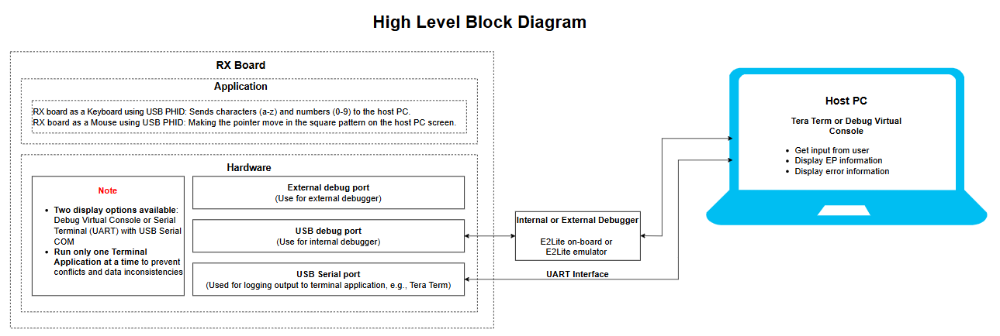
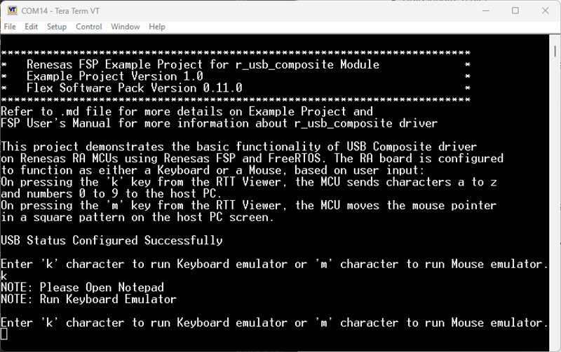
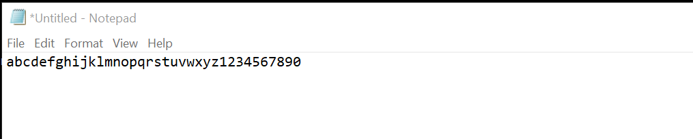
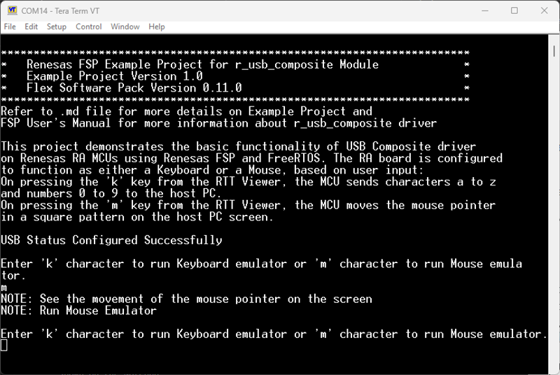
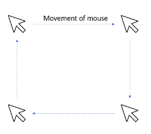

## Introduction
This project demonstrates the basic functionality of a USB PHID + PHID composite device on Renesas RX MCUs using the Renesas FSP. The RX board can function as either a keyboard or a mouse. Pressing "k" in the terminal makes the MCU act as a keyboard and send lowercase characters a–z and numbers 0–9 to the host PC. Pressing "m" makes the MCU act as a mouse and send mouse coordinates to the host PC to move the pointer in a square pattern on the host screen.

Note:
- Select either the Debug Virtual Console or the Serial Terminal (UART) with USB Serial COM to display information. Use only one terminal application at a time to avoid conflicts or data inconsistencies. For switching instructions, see [`Special Topics`](#special-topics)/[`Changing Terminal Application`](#changing-terminal-application).
- By default, EP information is printed to the host PC via the Serial Terminal (UART) on boards that support USB Serial COM. LED3 is turned ON to indicate that the UART failed to initialize.
- RX boards that support USB Serial COM: EK-RX74M, EK-RX74N.

## Required Resources

To build and run the USB PHID + PHID composite device example project, the following resources are required.

### Software

* Renesas Flexible Software Package (FSP): Version 1.0.0.
* e2 studio: Version 2026-07.
* Renesas GCC Compiler for RX: Version 14.2.0.202607.
* Renesas CC-RX Compiler: Version v3.08.00.
* Terminal Console Application: Tera Term or a similar application.

### Hardware

* 1 x Renesas RX board.
* 3 x Type-C USB cables for programming and debugging.
* 1 × Host PC with at least 3 USB ports (1 for debug, 1 for USB FS port, and 1 for USB Serial port).

### Hardware Connections

* Connect the RX board USB debug port (J8) to the PC via a Type-C USB cable for EP debugging (If E2 Lite on-board is used).
* Connect the RX board USB Serial port (J27) to the PC using a Type-C USB cable to verify logs through the Terminal Application.

For EK-RX74M/EK-RX74N board:

- Using the Full-Speed port:
  - Peripheral mode:
    - J29: Jumper on pins 2-3
    - J30: Jumper on pins 2-3.
    - SW4: SW4-Pin1, 3 OFF, SW4-Pin2, 4 ON.
  - Connect the Type-C USB Full-Speed port (J31) of the board to the PC with a Type-C USB cable.

## Related References

Refer to the following documents for more information about this example project:

- [FSP User Manual on GitHub](https://renesas.github.io/fsp/)
- [FSP Known Issues](https://github.com/renesas/fsp/issues)

## System-Level Block Diagram

High-level block diagram

## FSP Modules Used

This lists the modules used in this example project. Refer to the FSP User Manual for details on each module.

| Module Name | Usage | Searchable Keyword  |
|-------------|-----------------------------------------------|-----------------------------------------------|
| USB Composite | USB composite device works as a USB Peripheral by combining two peripheral device classes and r_usb_basic module. | r_usb_composite |
| USB PHID | The r_usb_phid module combines with the r_usb_basic module to provide a USB Peripheral Human Interface Device Class (PHID) driver. | r_usb_phid |
| USB basic | The r_usb_basic module operates in combination with the device class drivers provided by Renesas to form a complete USB stack. | r_usb_basic |

## Module Configuration Notes

This section describes FSP Configurator properties that are important or differ from the defaults.

**Common Configuration Properties**

|   Module Property Path and Identifier   |   Default Value   |   Used Value   |   Reason   |
| :-------------------------------------: | :---------------: | :------------: | :--------: |
|   configuration.xml > BSP > Properties > Settings > Property > RX Common > Heap size (bytes)  |  0   | 0x1000  |  A heap size is required for standard library functions. |

**USB Composite PHID PHID Configuration Properties**

|   Module Property Path and Identifier   |   Default Value   |   Used Value   |   Reason   |
| :-------------------------------------: | :---------------: | :------------: | :--------: |
| configuration.xml > Stacks > Threads > Phid Thread > Properties > Settings > Property > Common > General > Max Priorities | 5 | 15 | Matches the maximum interrupt priority in USB Basic. |
| configuration.xml > Stacks > Threads > Phid Thread > Properties > Settings > Property > Thread > Memory Allocation > Support Dynamic Allocation | Disabled | Enabled | RTOS objects can be created using RAM automatically allocated from the FreeRTOS heap. |
| configuration.xml > Stacks > Threads > Phid Thread > Properties > Settings > Property > Thread > Memory Allocation > Total Heap Size | 0 | 10000 | Changed because dynamic allocation is enabled and the application uses part of the FreeRTOS heap. |
| configuration.xml > Stacks > Threads > Phid Thread > Properties > Settings > Property > Thread > Stack size (bytes) | 1024 | 2048 | Increased to handle worst-case function call nesting and local variable usage. |
| configuration.xml > Stacks > Threads > Phid Thread > Properties > Settings > Property > Thread > Priority | 1 | 5 | Increased to set the thread priority. |
|  configuration.xml > Stacks > g_basic0 USB (r_usb_basic) > Properties > Settings > Property > Pins > USBFS_OVRCURA_A(DS) | None | P104 | The USBFS_OVRCURA_A(DS) pin is configured to P104 to match the RX74M board's pinout. |
|  configuration.xml > Stacks > g_basic0 USB (r_usb_basic) > Properties > Settings > Property > Pins > USBFS_VBUSEN | None | P304 | The USBFS_VBUSEN pin is configured to P304 to match the RX74M board's pinout. |
|  configuration.xml > Stacks > g_basic0 USB (r_usb_basic) > Properties > Settings > Property > Pins > USBFS_VBUS_A(DS) | None | P101 | The USBFS_VBUS_A(DS) pin is configured to P101 to match the RX74M board's pinout. |

**Configuration Properties for Using the Serial Terminal (UART)**

|   Configure Clock Path                  |   Default Value   |   Used Value   |   Reason   |
|-----------------------------------------|-------------------|----------------|------------|
| configuration.xml > Clocks > Clocks Configuration > SCICLK Disable | SCICLK Disable | SCICLK Src: HOCO | Enable the SCI module clock using the HOCO source. |

|   Configure Interrupt Event Path        |   Default Value   |   Used Value   |   Reason   |
|-----------------------------------------|-------------------|----------------|------------|
| configuration.xml > Interrupts > Interrupts Configuration > New User Event > RSCI > RSCI12 > RSCI12 RXI (Receive data full) | empty | sci_b_uart_rxi_isr | Assign the UART receive ISR (Receive data full) to the interrupt vector table. |
| configuration.xml > Interrupts > Interrupts Configuration > New User Event > RSCI > RSCI12 > RSCI12 TXI (Transmit data empty) | empty | sci_b_uart_txi_isr | Assign the UART transfer ISR (Transfer data empty) to the interrupt vector table. |
| configuration.xml > Interrupts > Interrupts Configuration > New User Event > RSCI > RSCI12 > 105-6 GROUPAL1 RSCI12 TEI (Transmit end) | empty | sci_b_uart_tei_isr | Assign the UART transfer ISR (Transfer end) to the interrupt vector table. |
| configuration.xml > Interrupts > Interrupts Configuration > New User Event > RSCI > RSCI12 > 105-7 GROUPAL1 RSCI12 ERI (Receive error) | empty | sci_b_uart_eri_isr | Assign the UART receive ISR (Receive error) to the interrupt vector table. |

## API Usage

The table below lists the FSP-provided APIs used by this example project at the application layer.

| API Name    | Usage                                                                          |
|-------------|--------------------------------------------------------------------------------|
| R_USB_Open | Opens the USB basic driver. |
| R_USB_PeriControlDataGet | Receives data from the host for USB_STATUS_REQUEST or USB_SET_REPORT events. |
| R_USB_PeriControlDataSet | Performs USB transfer to the keyboard or mouse for USB_GET_REPORT_DESCRIPTOR or USB_GET_HID_DESCRIPTOR events. |
| R_USB_PeriControlStatusSet | Sets the response to a setup packet. |
| R_USB_Write | Writes data to the host for USB_STATUS_REQUEST_COMPLETE or USB_STATUS_WRITE_COMPLETE events. |
| R_USB_Close | Closes the USB basic driver. |

**Using the Serial Terminal (UART)**

| API Name           | Usage                                                                          |
|--------------------|--------------------------------------------------------------------------------|
| R_SCI_B_UART_Open  | Configures the UART driver based on the input settings. |
| R_SCI_B_UART_Write | Transmits a specified number of bytes from the source buffer. |
| R_SCI_B_UART_Close | Aborts any in-progress transfers, disables interrupts, receiver, and transmitter, closes lower-level transfer drivers if used, and removes power. |

## Verifying Operation

1. Import the example project.

2. Generate and build the example project.

3. Before running the example, ensure the hardware connections are complete.

4. Connect the RX MCU to the host PC via the debugger. By default, EP uses the E2 Lite debugger.

5. Open a terminal application (for example, Tera Term or the Debug Virtual Console) on the host PC and connect to the RX board’s USB Serial port.

   Note: To use the Serial Terminal application:

   - To echo typed content in Tera Term, go to [Setup] → [Terminal...] and enable [Local echo].
   - Serial-port configuration:
     - COM port: Provided by the USB Serial COM
     - Baud rate: 115200
     - Data length: 8 bits
     - Parity: None
     - Stop bit: 1
     - Flow control: None

6. Use the menu operations and verify the corresponding results in the terminal console (USB Serial COM).

The images below show the output in the serial terminal application (Tera Term):

- Keyboard:

  In the terminal, choose `k`.

  

  Open Notepad on the PC; lowercase characters a–z and numbers 0–9 will appear in Notepad.

  

- Mouse:

  In the terminal, choose `m`.

  

  The mouse pointer will move on the host PC screen, as shown below.

  

## Special Topics ##

- This example does not support High Speed because the USB Composite PHID PHID class does not support it.

### Debugger Settings

To use E2 Lite on-board or E2 Emulator Lite, follow the instructions below:

1. Common step: Click [Run] → [Debug Configurations…] to open the Debug Configurations window.

   

2. Select the application file:

   a. For projects built with GCC: select the `.elf` file.

   

   b. For projects built with CCRX: select the `.x` file.

   

3. Set the debugger configuration:

   a. For E2 Lite on-board:

   

   b. For external E2 Emulator Lite:

   

Note: Connect the RX board debugger port (J9) to the host PC via E2 Emulator Lite (use the USB cable and the 20-pin cable).

### Adding lowsrc Folder

Before changing terminal application settings, you need to add the `lowsrc` folder from another Example Project:

1. **Locate the lowsrc folder:**
   
   - Navigate to Example Project `sci_uart` or `usb_pcdc_with_freertos`  (`example_projects/<board>/sci_uart/e2studio/gccrx_sci_uart_<board>_ep/src`)
   - Find the `lowsrc` folder containing low-level source files.

2. **Copy `lowsrc` folder to this Example Project:**
   
   - Copy the entire `lowsrc` folder.
   - Paste it into this your target Example Project directory: `example_projects/ek_rx74m/<EP>/e2studio/`.

3. **Add lowsrc to e2studio project:**
   
   - In e2studio, right-click on the project in Project Explorer.
   - Select **Refresh** (or press F5) to detect the new folder.

4. **Verify the folder is included:**
   
   - Expand the project tree in Project Explorer.
   - Confirm that `lowsrc` folder and its contents are visible.
   - The folder should be included in the build path with source files ready to compile.

5. **Changing the terminal Application to use the Debug Virtual Console:**
   
   - For instructions on how to switch between these options, please refer to the section [`Special Topics`](#special-topics)/[`Changing Terminal Application`](#changing-terminal-application).

6. **Re-build the project:**
   
   - In e2studio, right-click on the project and select **Build Project**.

**Note:** To use Debug Virtual Console, the `lowsrc` folder must be added to the project, as it contains the source files required for Debug Virtual Console operation.

### Changing Terminal Application ###

By default, the EP uses the Serial Terminal on RX boards that support USB Serial COM.

For the CCRX compiler:

- Define `USE_VIRTUAL_COM=1` in Project Properties → C/C++ Build → Settings → Tool Settings → Compiler → Source → Macro definition (-define) to use the serial terminal.

To use the Debug Virtual Console:

- Define `USE_VIRTUAL_COM=0` in Project Properties → C/C++ Build → Settings → Tool Settings → Compiler → Source → Macro definition (-define)
- Define `BSP_CFG_IO_LIB_ENABLE=1` in Project Properties → C/C++ Build → Settings → Tool Settings → Compiler → Source → Macro definition (-define)

For the GCCRX compiler:

- Define `USE_VIRTUAL_COM=1` in Project Properties → C/C++ Build → Settings → Tool Settings → Compiler → Includes → Macro Defines (-D) to use the serial terminal.

To use the Debug Virtual Console:

- Define `USE_VIRTUAL_COM=0` in Project Properties → C/C++ Build → Settings → Tool Settings → Compiler → Includes → Macro Defines (-D)

