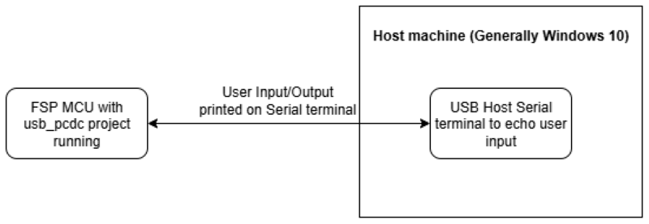
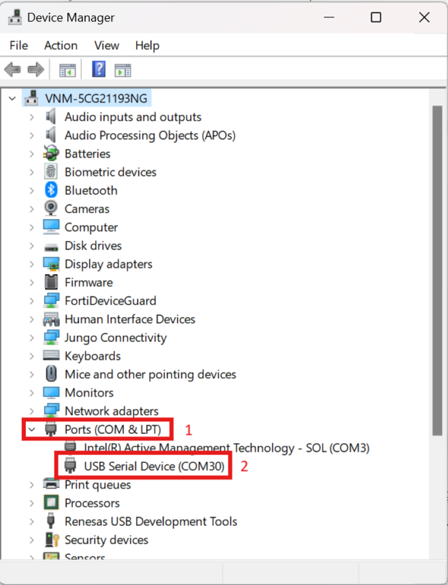
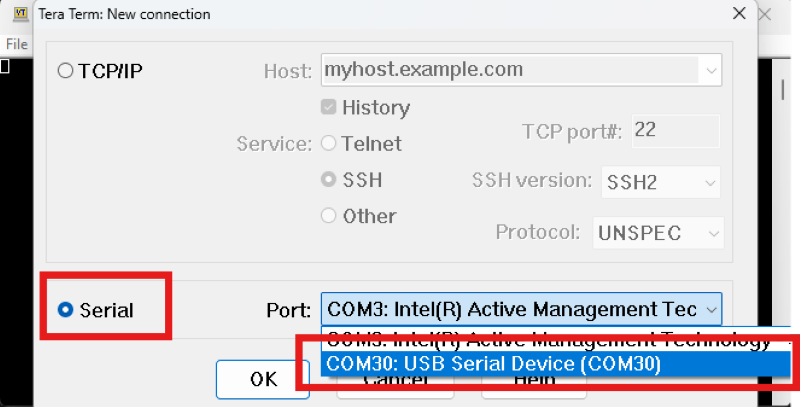
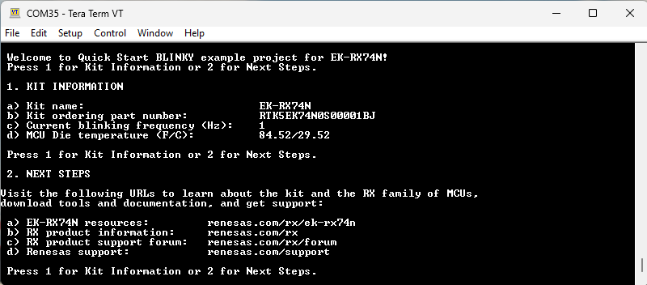

# Introduction #

This example project demonstrates the functionality of the USB PCDC (USB Peripheral Communications Device Class) module on Renesas RX MCUs using RX boards. In this project, the RX board operates as a USB PCDC device that communicates with a host PC. Once connected, the user can interact with the board through a serial terminal. The user can select option 1 to display kit information or option 2 to display information about the RX board. If an error occurs, the red LED on the RX board will turn ON.

## Required Resources ##

To build and run the USB PCDC example project, the following resources are needed.

### Software ###

* Renesas Flexible Software Package (FSP): Version 1.0.0.
* e2 studio: Version 2026-07.
* Renesas GCC Compiler for RX: Version 14.2.0.202607.
* Renesas CC-RX Compiler: Version v3.08.00.
* Terminal Console Application: Tera Term or a similar application.

### Hardware ###

Supported RX boards: EK-RX74M, EK-RX74N

* 1 x Renesas RX board.
* 2 x Type-C USB cables.
* 1 x PC with at least 2 USB ports (1 for debug and 1 for communication).

### Hardware Connections ###

- Connect the RX board USB debug port (J8) to the PC via a Type-C USB cable for EP debugging.
- Connect the RX board USB FS port (J31) to the PC via a Type-C USB cable.
- Configure SW6 as follows to use OB Debugger: SW6-Pin1 OFF, SW6-Pin2 OFF. 

- **VBUS supply enable signal:**
  
  For EK-RX74M, EK-RX74N:
    - E64: Close
    - E65: Open

- **Bus-powered Mode:**
  - J28: Jumper on pins 1-2.
  - J29: Jumper on pins 1-2.
  - J30: Jumper on pins 2-3.
  - SW4: SW4-Pin1 OFF, SW4-Pin2 ON, SW4-Pin3 OFF, SW4-Pin4 ON.

  **Note:** The RX board can operate in different power modes (such as Self-powered) depending on the jumper configuration. By default, the example project runs in Bus-powered mode. Refer to the "USB PCDC Function Modes" section in [`Special Topics`](#special-topics) for detailed Self-powered mode configuration.
  
## Related Collateral References ##
The following documents can be referred to for enhancing your understanding of the operation of this example project:
- [FSP User Manual on GitHub (Reference link)](https://renesas.github.io/fsp/)
- [FSP Known Issues (Reference link)](https://github.com/renesas/fsp/issues)

# Project Notes #

## System Level Block Diagram ##

## FSP Modules Used ##
List all the various modules that are used in this example project. Refer to the FSP User Manual for further details on each module listed below.

| Module Name | Usage  | Searchable Keyword (using New Stack > Search) |
|-------------|-----------------------------------------------|-----------------------------------------------|
| USB PCDC | USB PCDC is used to communicate with the host machine to perform write/read operations from user input and echo the same on the serial terminal. | r_usb_pcdc |
| ADC | ADC is used to read adc value from temperature sensor. | r_adc_b |
| GPT | GPT is used to control frequency and intensity of LEDs. | r_gpt |
| ICU | ICU is used to detect when a user presses a button and trigger an interrupt to change frequency and intensity of LEDs. | r_icu |

## Module Configuration Notes ##
This section describes FSP Configurator properties which are important or different than those selected by default.

**Common Configuration Properties**

|   Module Property Path and Identifier   |   Default Value   |   Used Value   |   Reason   |
| :-------------------------------------: | :---------------: | :------------: | :--------: |
|   configuration.xml > BSP > Properties > Settings > Property > RX Common > Heap size (bytes)  |  0   | 0x1000  |  Heap size is required for standard library functions to be used. |

**USB PCDC Configuration Properties (g_basic0)**

|   Module Property Path and Identifier   |   Default Value   |   Used Value   |   Reason   |
| :-------------------------------------: | :---------------: | :------------: | :--------: |
|  configuration.xml > Stacks > g_basic0 USB (r_usb_basic) > Properties > Settings > Property > Common > PLL Frequency | 24MHz | 24MHz | The PLL frequency is set to 24MHz to match the clock settings of the RX74M board. |
|  configuration.xml > Stacks > g_basic0 USB (r_usb_basic) > Properties > Settings > Property > Module g_basic0 USB (r_usb_basic) > USBFS Interrupt Priority | Priority 3 | Priority 12 | The USBFS interrupt priority is set to 12 to ensure that USB events are handled promptly. |
|  configuration.xml > Stacks > g_basic0 USB (r_usb_basic) > Properties > Settings > Property > Module g_basic0 USB (r_usb_basic) > USBFS Resume Priority | Not Supported | Priority 11 | The USBFS resume priority is set to 11 to ensure that the USB device can resume operation quickly after a suspend event. |
|  configuration.xml > Stacks > g_basic0 USB (r_usb_basic) > Properties > Settings > Property > Pins > USBFS_OVRCURA_A(DS) | None | P104 | The USBFS_OVRCURA_A(DS) pin is configured to P104 to match the RX74M board's pinout. |
|  configuration.xml > Stacks > g_basic0 USB (r_usb_basic) > Properties > Settings > Property > Pins > USBFS_VBUSEN | None | P304 | The USBFS_VBUSEN pin is configured to P304 to match the RX74M board's pinout. |
|  configuration.xml > Stacks > g_basic0 USB (r_usb_basic) > Properties > Settings > Property > Pins > USBFS_VBUS_A(DS) | None | P101 | The USBFS_VBUS_A(DS) pin is configured to P101 to match the RX74M board's pinout. |

**ADC Configuration Properties (g_adc)**

|   Module Property Path and Identifier   |   Default Value   |   Used Value   |   Reason   |
| :-------------------------------------: | :---------------: | :------------: | :--------: |
| configuration.xml > Stacks > g_adc ADC Driver on r_adc_b > Properties > Settings > Property > Module g_adc ADC Driver on r_adc_b > General > Name | g_adc0 | g_adc | To use a generic name for the ADC driver instance. |
| configuration.xml > Stacks > g_adc ADC Driver on r_adc_b > Properties > Settings > Property > Module g_adc ADC Driver on r_adc_b > General > Operation > ADC 0 > Scan Mode | Single Scan | Continuous Scan | To demonstrate continuous scanning capability of the ADC. |
| configuration.xml > Stacks > g_adc ADC Driver on r_adc_b > Properties > Settings > Property > Module g_adc ADC Driver on r_adc_b > Clock Configuration > Divider | Div /3 | Div /1 | To demonstrate the maximum sampling rate capability of the ADC. |
| configuration.xml > Stacks > g_adc ADC Driver on r_adc_b > Properties > Settings > Property > Module g_adc ADC Driver on r_adc_b > Clock Configuration > Source | PCLKA | ADCCLK | To use the ADCCLK clock source for ADC operation. |
| configuration.xml > Stacks > g_adc ADC Driver on r_adc_b > Properties > Settings > Property > Module g_adc ADC Driver on r_adc_b > Sample and Hold > Enable Unit > Unit 0 | Not checked | Checked | To enable the sample and hold unit for ADC operation. |
| configuration.xml > Stacks > g_adc ADC Driver on r_adc_b > Properties > Settings > Property > Module g_adc ADC Driver on r_adc_b > Virtual Channels > Virtual Channel 0 > Scan Group | None | Scan Group 0 | To assign the virtual channel to a scan group for ADC operation. |
| configuration.xml > Stacks > g_adc ADC Driver on r_adc_b > Properties > Settings > Property > Module g_adc ADC Driver on r_adc_b > Virtual Channels > Virtual Channel 0 > Channel Select | ADC Channel 0 | ADC Channel TEMPERATURE | To use the internal temperature sensor as the ADC channel for demonstration. |
| configuration.xml > Stacks > g_adc ADC Driver on r_adc_b > Properties > Settings > Property > Module g_adc ADC Driver on r_adc_b > Scan Groups > Scan Group 0 > Enable | Disable | Enable | To enable the scan group for ADC operation. |

**ICU Configuration Properties (g_external_irq17)**

|   Module Property Path and Identifier   |   Default Value   |   Used Value   |   Reason   |
| :-------------------------------------: | :---------------: | :------------: | :--------: |
|  configuration.xml > Stacks > g_external_irq17 External IRQ (r_icu) > Properties > Settings > Property > Module g_external_irq17 External IRQ (r_icu) > Channel | 0 | 17 | Select the channel use for EP. |
|  configuration.xml > Stacks > g_external_irq17 External IRQ (r_icu) > Properties > Settings > Property > Module g_external_irq17 External IRQ (r_icu) > Trigger | Rising | Falling | To detect both rising and falling edges of the button press. |
|  configuration.xml > Stacks > g_external_irq17 External IRQ (r_icu) > Properties > Settings > Property > Module g_external_irq17 External IRQ (r_icu) > Digital Filtering | Disabled | Enabled | The digital noise should be used. |
|  configuration.xml > Stacks > g_external_irq17 External IRQ (r_icu) > Properties > Settings > Property > Module g_external_irq17 External IRQ (r_icu) > Callback | NULL | button_irq17_callback | Assigned name for using callback function. |
|  configuration.xml > Stacks > g_external_irq17 External IRQ (r_icu) > Properties > Settings > Property > Module g_external_irq17 External IRQ (r_icu) > Pin Interrupt Priority | Priority 2 | Priority 28 | Select the PIN interrupt priority. |
|  configuration.xml > Stacks > g_external_irq17 External IRQ (r_icu) > Properties > Settings > Property > Pins > IRQ17 | None | P109 | Select pin use for ICU. |

**ICU Configuration Properties (g_external_irq30)**

|   Module Property Path and Identifier   |   Default Value   |   Used Value   |   Reason   |
| :-------------------------------------: | :---------------: | :------------: | :--------: |
|  configuration.xml > Stacks > g_external_irq30 External IRQ (r_icu) > Properties > Settings > Property > Module g_external_irq30 External IRQ (r_icu) > Channel | 0 | 30 | Select the channel use for EP. |
|  configuration.xml > Stacks > g_external_irq30 External IRQ (r_icu) > Properties > Settings > Property > Module g_external_irq30 External IRQ (r_icu) > Trigger | Rising | Falling | To detect both rising and falling edges of the button press. |
|  configuration.xml > Stacks > g_external_irq30 External IRQ (r_icu) > Properties > Settings > Property > Module g_external_irq30 External IRQ (r_icu) > Callback | NULL | button_irq30_callback | Assigned name for using callback function. |
|  configuration.xml > Stacks > g_external_irq30 External IRQ (r_icu) > Properties > Settings > Property > Module g_external_irq30 External IRQ (r_icu) > Pin Interrupt Priority | Priority 2 | Priority 28 | Select the PIN interrupt priority. |
|  configuration.xml > Stacks > g_external_irq30 External IRQ (r_icu) > Properties > Settings > Property > Pins > IRQ30 | None | P414 | Select pin use for ICU. |

**GPT Configuration Properties (g_gpt_blue)**
|   Module Property Path and Identifier   |   Default Value   |   Used Value   |   Reason   |
| :-------------------------------------: | :---------------: | :------------: | :--------: |
|  configuration.xml > Stacks > g_gpt_blue Timer, General PWM (r_gpt) > Properties > Settings > Property > Common > Pin Output Support | Disabled | Enabled | Enables for outputting PWM waveforms on GTIOCx pins. |
|  configuration.xml > Stacks > g_gpt_blue Timer, General PWM (r_gpt) > Properties > Settings > Property > Module g_gpt_blue Timer, General PWM (r_gpt) > General > Channel | 0 | 8 | Select the channel use for EP. |
|  configuration.xml > Stacks > g_gpt_blue Timer, General PWM (r_gpt) > Properties > Settings > Property > Module g_gpt_blue Timer, General PWM (r_gpt) > General > Mode | Periodic | Saw-wave PWM | Select mode for GPT module. |
|  configuration.xml > Stacks > g_gpt_blue Timer, General PWM (r_gpt) > Properties > Settings > Property > Module g_gpt_blue Timer, General PWM (r_gpt) > General > Period Unit | Raw Counts | Raw Counts | Unit of the period specified. |
|  configuration.xml > Stacks > g_gpt_blue Timer, General PWM (r_gpt) > Properties > Settings > Property > Pins > GTIOC8B | None | PF05 | Specified pin for using GPT module. |

**GPT Configuration Properties (g_gpt_green)**
|   Module Property Path and Identifier   |   Default Value   |   Used Value   |   Reason   |
| :-------------------------------------: | :---------------: | :------------: | :--------: |
|  configuration.xml > Stacks > g_gpt_green Timer, General PWM (r_gpt) > Properties > Settings > Property > Common > Pin Output Support | Disabled | Enabled | Enables for outputting PWM waveforms on GTIOCx pins. |
|  configuration.xml > Stacks > g_gpt_green Timer, General PWM (r_gpt) > Properties > Settings > Property > Module g_gpt_green Timer, General PWM (r_gpt) > General > Channel | 0 | 14 | Select the channel use for EP. |
|  configuration.xml > Stacks > g_gpt_green Timer, General PWM (r_gpt) > Properties > Settings > Property > Module g_gpt_green Timer, General PWM (r_gpt) > General > Mode | Periodic | Saw-wave PWM | Select mode for GPT module. |
|  configuration.xml > Stacks > g_gpt_green Timer, General PWM (r_gpt) > Properties > Settings > Property > Module g_gpt_green Timer, General PWM (r_gpt) > General > Period Unit | Raw Counts | Raw Counts | Unit of the period specified. |
|  configuration.xml > Stacks > g_gpt_green Timer, General PWM (r_gpt) > Properties > Settings > Property > Pins > GTIOC14B | None | P807 | Specified pin for using GPT module. |

**GPT Configuration Properties (g_gpt_red)**
|   Module Property Path and Identifier   |   Default Value   |   Used Value   |   Reason   |
| :-------------------------------------: | :---------------: | :------------: | :--------: |
|  configuration.xml > Stacks > g_gpt_red Timer, General PWM (r_gpt) > Properties > Settings > Property > Common > Pin Output Support | Disabled | Enabled | Enables for outputting PWM waveforms on GTIOCx pins. |
|  configuration.xml > Stacks > g_gpt_red Timer, General PWM (r_gpt) > Properties > Settings > Property > Module g_gpt_red Timer, General PWM (r_gpt) > General > Channel | 0 | 6 | Select the channel use for EP. |
|  configuration.xml > Stacks > g_gpt_red Timer, General PWM (r_gpt) > Properties > Settings > Property > Module g_gpt_red Timer, General PWM (r_gpt) > General > Mode | Periodic | Saw-wave PWM | Select mode for GPT module. |
|  configuration.xml > Stacks > g_gpt_red Timer, General PWM (r_gpt) > Properties > Settings > Property > Module g_gpt_red Timer, General PWM (r_gpt) > General > Period Unit | Raw Counts | Raw Counts | Unit of the period specified. |
|  configuration.xml > Stacks > g_gpt_red Timer, General PWM (r_gpt) > Properties > Settings > Property > Pins > GTIOC6A | None | P604 | Specified pin for using GPT module. |

**GPT Configuration Properties (g_blinker)**
|   Module Property Path and Identifier   |   Default Value   |   Used Value   |   Reason   |
| :-------------------------------------: | :---------------: | :------------: | :--------: |
|  configuration.xml > Stacks > g_blinker Timer, General PWM (r_gpt) > Properties > Settings > Property > Common > Pin Output Support | Disabled | Enabled | Enables for outputting PWM waveforms on GTIOCx pins. |
|  configuration.xml > Stacks > g_blinker Timer, General PWM (r_gpt) > Properties > Settings > Property > Module g_blinker Timer, General PWM (r_gpt) > General > Channel | 0 | 3 | Select the channel use for EP. |
|  configuration.xml > Stacks > g_blinker Timer, General PWM (r_gpt) > Properties > Settings > Property > Module g_blinker Timer, General PWM (r_gpt) > General > Mode | Periodic | Periodic | Select mode for GPT module. |
|  configuration.xml > Stacks > g_blinker Timer, General PWM (r_gpt) > Properties > Settings > Property > Module g_blinker Timer, General PWM (r_gpt) > General > Period | 0x10000 | 120000000 | Specify the timer period in units. |
|  configuration.xml > Stacks > g_blinker Timer, General PWM (r_gpt) > Properties > Settings > Property > Module g_blinker Timer, General PWM (r_gpt) > General > Period Unit | Raw Counts | Raw Counts | Unit of the period specified. |

## API Usage ##

The table below lists the APIs used at the application layer by this example project.

| API Name    | Usage                                                                          |
|-------------|--------------------------------------------------------------------------------|
|R_USB_Open| This API is used to open an USB instance. |
|R_USB_Read| This API is used to read data from the USB interface. |
|R_USB_Write| This API is used to write data to the USB interface. |
|R_USB_EventGet| This API is used to get USB events from the driver. |
|R_USB_PeriControlDataGet| This API is used to receive data sent by control transfer. |
|R_USB_PeriControlDataSet| This API is used to set a class request. |
|R_USB_PeriControlStatusSet| This API is used to set the USB status response. |
|R_USB_Close| This API is used to close the USB instance. |
|R_GPT_PeriodSet| This API is used to set the timer period for GPT. |
|R_GPT_DutyCycleSet| This API is used to set the duty cycle for GPT. |
|R_GPT_StatusGet| This API is used to get the status of GPT. |
|R_GPT_Start| This API is used to start the GPT timer. |
|R_GPT_Stop| This API is used to stop the GPT timer. |
|R_GPT_Open| This API is used to open a GPT instance. |
|R_GPT_PeriodSet| This API is used to set the timer period for GPT. |
|R_GPT_Close| This API is used to close the GPT instance. |
|R_ICU_ExternalIrqOpen| This API is used to configure external interrupts for ICU. |
|R_ICU_ExternalIrqEnable| This API is used to enable external interrupts for ICU. |
|R_ADC_B_Open| This API is used to open an ADC instance. |
|R_ADC_B_ScanCfg| This API is used to configure the scan settings for ADC. |
|R_ADC_B_ScanStart| This API is used to start the ADC scan. |
|R_ADC_B_Calibrate| This API is used to calibrate the ADC. |
|R_ADC_B_StatusGet| This API is used to get the status of the ADC. |

## Verifying Operation ##

Import, build and debug the EP (see section Starting Development of FSP User Manual). After running the EP, open any serial terminal (preferably Tera Term) to provide user input and view the echoed data.

**Note:** 

For Serial terminal application:
1) On power up or RESET, the three user LEDs (blue LED1, green LED2, and red LED3) start blinking at 1 Hz frequency and at 90% intensity.

	  Note:  The debug LED (LED5) will blink or light up orange; this can be ignored for now. 

2) Press the first user button (S1) on the board to change the blinking frequency of the user LEDs.

    With every press of the first user button (S1), the frequency will switch from 1 Hz to 5 Hz to 10 Hz and cycle back. 
	  
3) Press the second user button (S2) on the board to change the intensity of the user LEDs. 

    With every press of the user button (S2), the intensity will switch from 90% to 50% to 10% and cycle back. 

4) Select the COM port in Tera Term:
    - On the host PC, open the Device Manager > Expand Ports (COM & LPT) > Locate USB Serial Device (COMxx) and note down the COM port number for reference in the next steps.

    

  - Open the serial port of the device using Tera Term and press "OK".

    

5) To echo back what was typed in Tera Term, the user needs to enable it through [Setup] -> [Terminal...] -> Check [Local echo]. 

6) The configuration parameters for the serial terminal should be set as follows:
  
    - Baud rate: 9600 bps
  
    - Data length: 8-bits
  
    - Parity: none
 
    - Stop bit: 1-bit
  
    - Flow control: none

    The sample output on **Serial Terminal**: 

    

## Special Topics ##

### Developing Descriptor ###

A USB device provides information about itself in data structures called USB descriptors.

The host obtains descriptors from an attached device by sending various standard control requests to the default endpoint. These requests specify the type of descriptor to retrieve. In response to such requests, the device sends descriptors that include information about the device, its configurations, interfaces and the related endpoints.

* A template for PCDC descriptors can be found in rx/fsp/src/r_usb_pcdc/r_usb_pcdc_descriptor.c.template. Also, please be sure to use your vendor ID.

### USB PCDC Function Modes ###

**1. Bus-powered Mode**: The USB device is powered by the USB host through the USB cable. The device draws power from the USB bus. 

**2. Self-powered Mode**: The USB device has its own power supply and does not rely on the USB host for power. The device operates independently of the USB bus power. The following jumper settings are used for this mode:
  - J28: Open (No jumper).
  - J29: Jumper on pins 2-3.
  - J30: Jumper on pins 2-3.
  - SW4: SW4-Pin1 OFF, SW4-Pin2 ON, SW4-Pin3 OFF, SW4-Pin4 ON.

### Debugger Setting ###

* To use E2 Lite on-board or E2 Emulator Lite, please follow the instructions below:

1. **Common step**: Click [**Run**] → [**Debug Configurations…**] to open the “**Debug Configurations**” window.  
  

2. **Select file application**  
  a. **Used for projects built with GCC**: --> Select file **.elf**.  
    
  b. **Used for projects built with CCRX**: --> Select file **.x**.  
  

3. **Setting debugger configurations**  
  a. **Used for E2 Lite on-board**.    
    
  b. **Used for external E2 Emulator Lite**.  
    

  **Note:** Connect the RX board debugger port (J9) to the host PC via E2 Emulator Lite (With USB cable and 20-20 pin cable).